# EAP-001 — EAP COGME — fases N1..N12 (espelho rastreável)

Status: draft (espelho de linha de base; não substitui a fonte primária)

## 1. Fonte única e precedência

FONTE PRIMÁRIA VENCEDORA: `docs/planos/plano-granular/plano-integral-tap-1-2-3-4-5.md`
(plano-integral). A EAP é apresentada na **Tabela 2** (plano-integral:32-49), organizada em
nível 0 (raiz), **doze fases de nível 1** e **trinta e sete pacotes de trabalho de nível 2**,
agrupados em três macro-fases temporais (plano-integral:30). A linha de base é canônica no
TAP §4 (plano-integral:49,360): "Total: 12 fases de nível 1 + 37 pacotes de nível 2"
(plano-integral:49). Em conflito, vale a hierarquia do Art. 2 (constitution.md Art. 2) —
planos > specs — e a nota de canonicidade da própria fonte: divergências de contagem são
resolvidas pela prevalência do TAP, sem solicitação de mudança (plano-integral:360).

Este artefato é **espelho rastreável** (EAP-001, KB-INDEX.md:52): transcreve e ancora em
`arquivo:linha`, não autoriza nada por si. A referência compacta na irmã `tap.md` (tap.md:123-129,
231,242) remete a transcrição integral para este arquivo (tap.md:129).

## 2. Contexto e origem

- Origem: task TA-0064 via HF-0620 (agent-nexus-prime-ultimate → agent-sdd-specialist,
  action: spec, 2026-11-03, `.ai/handoffs/HF-0620-ai-specs-eap-md.md:17`), fechando o item
  **A.3** da LISTA (docs/analise/LISTA-SPECS-PENDENTES-2026-11-02.md:27).
- Estado prévio: `eap.md` registrado como 0 B no MANIFEST §3 (MANIFEST.md:102) e §5.1
  (MANIFEST.md:172). Verificação de disco em 2026-11-03: o arquivo estava **ausente** no
  diretório `.ai/specs/` (não apenas 0 B). Precedente idêntico na irmã `tap.md`
  (tap.md:250: "ausente no disco; MANIFEST:101 registrou 0 B").
- Pinned: sem rename, custódia fixa em `.ai/specs/eap.md` (MANIFEST.md:102,172).
- Separação ontológica: o TAP autoriza, não integra a EAP nem é objeto de PDCA — Premissa P9
  (plano-integral:116; plano-integral:10). A EAP e seus pacotes INTEGRAM os ciclos PDCA:
  doze ciclos, um por fase (plano-integral:371,581-602).
- DoR da classe `diagrama` (kb-taxonomy.md:57: "existir a fonte (svg ou mermaid)"): as
  Figuras 1 e 2 da EAP no plano-integral são placeholders SVG sem arquivo-fonte no disco
  (plano-integral:53,60; KB-INDEX.md:83,109). Este arquivo fornece **mermaid textual
  derivado da Tabela 2** (§7) como fonte válida ao DoR; os SVGs permanecem pendência da
  custódia architect (KB-INDEX.md:109) — não é escopo desta emissão.

## 3. Resolução de conflitos — divergências registradas (não resolvidas aqui)

| # | Tema | Textos em conflito | Fonte vencedora | Registro |
|---|---|---|---|---|
| D1 | Contagem de fases | Envelope HF-0620 e LISTA A.3 declaram "N1..N11" (HF-0620:3,17; LISTA:27) × fonte primária declara 12 fases N1..N12 (plano-integral:30,49,62,337,583) | plano-integral (fonte primária, precedência §1) | **12 fases N1..N12** adotadas neste espelho; a divergência N11 vs N12 fica registrada, não resolvida na LISTA/HF (fora da custódia) |
| D2 | Contagem histórica do Glossário | "13 fases e 48 pacotes" em versão anterior do Glossário × linha de base 12/37 | plano-integral:360 (prevalência do TAP; correção no próximo Glossário) | Estado atual coerente: glossário v3.2.0 registra "EAP 12/37" (KB-INDEX.md:59) |
| D3 | Figuras EAP sem fonte | Figuras 1 e 2 são placeholders SVG (plano-integral:53,60) × DoR da classe diagrama exige fonte svg/mermaid (kb-taxonomy.md:57) | kb-taxonomy.md:57 | Este arquivo fornece mermaid textual (§7); SVGs físicos permanecem `UNKNOWN - verify` sob custódia architect (KB-INDEX.md:109) |
| D4 | Estado prévio do arquivo | MANIFEST:102 registra 0 B × disco em 2026-11-03 mostra arquivo ausente | verificação direta do filesystem | Registrado o estado real; precedente: tap.md:250 |

## 4. Cadastro de fases (Tabela 2 do plano-integral)

Transcrição estrutural de plano-integral:36-47 (fase → pacotes → macro-fase), com contagem
de pacotes conferida contra os totais de plano-integral:30,49,62 (20+12+5 = 37).

| Fase | Título | Pacotes (n) | Macro-Fase | Marco ancorado na fonte | Spec irmã da rodada |
|---|---|---|---|---|---|
| N1 | Iniciação e Planejamento | 5 (N1.1–N1.5) | MF1 | M1 (plano-integral:589; :95) | — |
| N2 | Levantamento de Requisitos | 3 (N2.1–N2.3) | MF1 | M2 (plano-integral:306,590) | spec-006 (N2.2) |
| N3 | Modelagem e Prototipação | 3 (N3.1–N3.3) | MF1 | M2 (plano-integral:591,96) | — |
| N4 | Configuração de Ambiente | 4 (N4.1–N4.4) | MF1 | M2 (plano-integral:592,96) | — |
| N5 | Desenvolvimento do Sistema | 5 (N5.1–N5.5) | MF2 | M3 (plano-integral:97) | spec-008 (N5.3) |
| N6 | Garantia da Qualidade | 3 (N6.1–N6.3) | MF2 | M3 (plano-integral:594,97) | spec-009 (N6.2), spec-010 (N6.3) |
| N7 | DevOps e CI/CD | 1 (N7.1) | MF2 | M3 via MF2 (plano-integral:93-97; encerramento MF2 "pipeline CI verde" :272; M2 já exige CI verde :96) | spec-011 (N7.1) |
| N8 | Comunicação | 2 (N8.1–N8.2) | MF1 | Não atribuído individualmente na fonte (MF1 é coberta por M1 :95 e M2 :96) | — |
| N9 | Base de Conhecimento | 3 (N9.1–N9.3) | MF1 | M2 (plano-integral:597 — "ADRs emitidas antes de M2") | spec-012 (N9.3) |
| N10 | Gestão de Mudanças | 3 (N10.1–N10.3) | MF2 | Não atribuído individualmente na fonte (MF2 é coberta por M3 :97; monitoramento contínuo :598) | — |
| N11 | Documentação do Projeto | 2 (N11.1–N11.2) | MF3 | M4 (plano-integral:599,98) | spec-013 (N11.1, N11.2) |
| N12 | Encerramento | 3 (N12.1–N12.3) | MF3 | M4 (plano-integral:600,98) | — |

Totais conferidos: 12 fases; 5+3+3+4+5+3+1+2+3+3+2+3 = **37 pacotes**; MF1 = 6 fases/20
pacotes, MF2 = 4 fases/12 pacotes, MF3 = 2 fases/5 pacotes (plano-integral:62).

Nota de método: a fonte não declara "objetivo" discursivo por fase — a Tabela 2 fornece
título, pacotes e macro-fase (plano-integral:36-47); a âncora por fase disponível é o ciclo
PDCA correspondente (Tabela 18, plano-integral:589-600). Onde a fonte não ancora, declara-se
`UNKNOWN - verify` (P-08).

## 5. Detalhamento por fase (transcrição com rastreabilidade)

### N1 — Iniciação e Planejamento (MF1)
- Pacotes: N1.1 Identificação de Stakeholders; N1.2 Planos de Gerenciamento; N1.3 Plano da
  Qualidade; N1.4 Política de Licenciamento FOSS; N1.5 Definição do Backlog e Kanban
  (plano-integral:36).
- PDCA-N1 — problema: "Escopo mal definido ou premissas inválidas no início"; ação: "Revisão
  em pares do TAP e EAP antes da submissão no M1"; verificação: "Validação acadêmica no M1
  (22/09/2026)" (plano-integral:589).
- Marco: M1 — 22/09/2026, "Entrega Parcial Documental" (plano-integral:95).
- Cross-ref specs da rodada: nenhuma fase-específica (`UNKNOWN - verify` para vínculos além
  dos registrados).

### N2 — Levantamento de Requisitos (MF1)
- Pacotes: N2.1 Requisitos Funcionais; N2.2 Requisitos Não Funcionais; N2.3 Casos de Uso e
  Histórias de Usuário (plano-integral:37).
- PDCA-N2 — problema: "Requisitos ambíguos ou não rastreáveis"; ação: "Conversão de REQ-01 a
  REQ-15 para User Story GWT (Padrão B) até M2"; verificação: "Refinement semanal (23/09,
  30/09)" (plano-integral:590). N2.3 explicitado: conversão User Story "até o marco M2
  (30/09/2026), conforme fase N2.3 da EAP" (plano-integral:306).
- Marco: M2 (plano-integral:306,590).
- Cross-ref: **spec-006** — "registro canônico da fase N2.2 da EAP"
  (spec-006-nfr-consolidados-v1.spec.md:26,33; trace :17).

### N3 — Modelagem e Prototipação (MF1)
- Pacotes: N3.1 Arquitetura da Solução; N3.2 Protótipo UX/UI; N3.3 Modelagem de Dados (DER)
  (plano-integral:38).
- PDCA-N3 — problema: "Arquitetura ou DER não validados antes da implementação"; ação:
  "Protótipo 'Hello World' da stack (N4.1) + revisão de DER antes de N5"; verificação:
  "Marco M2 (30/09/2026)" (plano-integral:591).
- Marco: M2 — "DER e Protótipo UX/UI aprovados" (plano-integral:96,591).

### N4 — Configuração de Ambiente (MF1)
- Pacotes: N4.1 Seleção e Validação da Stack FOSS; N4.2 Repositório Git + CI/CD; N4.3 Setup
  Local e Homologação; N4.4 Auditoria de Licenças (plano-integral:39).
- PDCA-N4 — problema: "Incompatibilidade de ferramentas FOSS ou ambiente instável"; ação:
  "Validação de stack via protótipo funcional + auditoria de licenças (N4.4)"; verificação:
  "M2 — /docs/dependencias/registro.md" (plano-integral:592).
- Marco: M2 — "stack FOSS definida e validada, ambiente local/CI configurado" (plano-integral:96,592).

### N5 — Desenvolvimento do Sistema (MF2)
- Pacotes: N5.1 Backend — Lógica de Negócio; N5.2 Backend — API de Câmbio + Cache; N5.3
  Frontend — Interface e Simulações; N5.4 Módulo PDF (WeasyPrint); N5.5 SDD com IA (Prompts +
  Revisão) (plano-integral:40). Exemplo de cadeia de decomposição da fonte usa "N5.1 —
  Backend: Lógica de Negócio" (plano-integral:368).
- PDCA-N5 — problema: "Código sem testes, coverage insuficiente ou SDD-IA sem revisão"; ação:
  "TDD quando aplicável + code review obrigatório + tasklists (ADR-004)"; métrica: "Coverage ≥
  80% por módulo; 100% commits SDD-IA com co-autoria" (plano-integral:593).
- Marco: M3 — "código-fonte full-stack operacional (Backend, Frontend, PDF, SDD com IA)"
  (plano-integral:97).
- Cross-ref: **spec-008** — REQ-06 "Interface web responsiva FOSS — Chrome/Firefox/Edge ult. 2
  versões" na fase N5.3 (spec-008-frontend-web-responsive-v1.spec.md:37).

### N6 — Garantia da Qualidade (MF2)
- Pacotes: N6.1 Testes Unitários/Integração (≥ 80%); N6.2 Testes de Aceitação (UAT); N6.3
  Aplicação de Ferramentas da Qualidade (12 PDCAs + Ishikawa 6M) (plano-integral:41).
- PDCA-N6 — problema: "Defeitos críticos em UAT ou coverage abaixo da meta"; ação: "UAT
  estruturado com roteiro de testes + Ishikawa 6M (Seção 5.5)"; verificação: "M3 (15/11/2026)
  — relatório UAT" (plano-integral:594).
- Marco: M3 — "cobertura de testes ≥ 80% e validado em UAT local" (plano-integral:97,594).
- Cross-refs: **spec-009** — "Plano e roteiro de UAT de produto (fase N6.2)"
  (spec-009-uat-produto-v1.spec.md:27,37,43); **spec-010** — "12 PDCAs consolidados +
  Ishikawa 6M (fase N6.3)" (spec-010-qualidade-pdca-ishikawa-v1.spec.md:30,37; os três
  diagramas de Ishikawa 6M decorrem de "REQ-10 e N6.3 da EAP", plano-integral:606).

### N7 — DevOps e CI/CD (MF2)
- Pacotes: N7.1 Pipeline CI (lint + testes) (plano-integral:42).
- PDCA-N7 — problema: "Pipeline lento (> 5 min, REQ-11) ou instável"; ação: "Otimização de
  testes paralelos + cache de dependências"; métrica: "Tempo de CI ≤ 5 min; taxa de sucesso ≥
  95%" (plano-integral:595).
- Marco: sem marcos M1–M4 exclusivo na fonte; fase MF2 — o encerramento de MF2 exige "pipeline
  CI verde" (plano-integral:272) e o aceite de M2 já exige "Pipeline CI 'verde'"
  (plano-integral:96). Atribuição individual: `UNKNOWN - verify`.
- Cross-ref: **spec-011** — "fase N7.1" (spec-011-cicd-pipeline-v1.spec.md:42,151).

### N8 — Comunicação (MF1)
- Pacotes: N8.1 Matriz de Comunicação (RACI); N8.2 Canais Oficiais (GitHub, e-mail)
  (plano-integral:43).
- PDCA-N8 — problema: "Falhas de comunicação entre equipe ou com stakeholder"; ação: "Daily
  assíncrona padronizada + refinement semanal com pauta fixa"; verificação: "GitHub Issues +
  GitHub Projects" (plano-integral:596).
- Marco: não atribuído individualmente na fonte (MF1 é coberta por M1 :95 e M2 :96) —
  `UNKNOWN - verify` para marco exclusivo.

### N9 — Base de Conhecimento (MF1)
- Pacotes: N9.1 ADRs (decisões arquiteturais); N9.2 Lições Aprendidas Contínuas; N9.3 Catálogo
  de Prompts SDD (plano-integral:44).
- PDCA-N9 — problema: "ADRs tardias ou prompts SDD não catalogados"; ação: "Catálogo de
  prompts em .ai/handoffs/ + ADRs emitidas antes de M2"; verificação: "/docs/decisoes/ +
  .ai/handoffs/" (plano-integral:597).
- Marco: M2 ("ADRs emitidas antes de M2", plano-integral:597).
- Cross-ref: **spec-012** — "Rastreabilidade de prompts SDD ... REQ-13, fase N9.3"
  (spec-012-rastreabilidade-prompts-sdd-v1.spec.md:28,40 — "Fase EAP de destino: N9.3").

### N10 — Gestão de Mudanças (MF2)
- Pacotes: N10.1 Registro de Solicitações de Mudança; N10.2 Label *change-request* no GitHub;
  N10.3 Aprovação e Versionamento (plano-integral:45).
- PDCA-N10 — problema: "Mudanças não registradas ou scope creep > 15% (Escopo §2.6;
  Integração §1.8)"; ação: "Label change-request obrigatória + análise de impacto em ≤ 48h
  (Integração §1.6)"; verificação: "GitHub Issues com label change-request"
  (plano-integral:598).
- Marco: não atribuído individualmente na fonte (MF2 é coberta por M3 :97; monitoramento é
  contínuo, plano-integral:598) — `UNKNOWN - verify` para marco exclusivo.

### N11 — Documentação do Projeto (MF3)
- Pacotes: N11.1 Documentação Técnica (Arquitetura, APIs); N11.2 Consolidação da Documentação
  Parcial (plano-integral:46).
- PDCA-N11 — problema: "Documentação desatualizada ou inconsistente com código"; ação:
  "Código + docs no mesmo PR + revisão de consistência antes de M4"; verificação: "M4
  (15/12/2026)" (plano-integral:599).
- Marco: M4 (plano-integral:599,98).
- Cross-ref: **spec-013** — "fase N11.1" e N11.2 (spec-013-documentacao-tecnica-v1.spec.md:20,220).

### N12 — Encerramento (MF3)
- Pacotes: N12.1 Lições Aprendidas Finais; N12.2 Verificação SMART; N12.3 Apresentação Final +
  Aceite (plano-integral:47).
- PDCA-N12 — problema: "Lições aprendidas não consolidadas ou critérios SMART não
  verificados"; ação: "Checklist de encerramento + lições finais + tag de release";
  verificação: "M4 — validação acadêmica + tag" (plano-integral:600).
- Marco: M4 — "Encerramento e Aceite Final ... apresentação final com aceite formal"
  (plano-integral:98,600).

## 6. Macro-fases e marcos

Macro-fases (plano-integral:30,62,272; Figura 2, :58-63):

| Macro-Fase | Fases | Pacotes | Janela | Critérios de encerramento (transcritos, plano-integral:272) |
|---|---|---|---|---|
| MF1 — Fundação | N1, N2, N3, N4, N8, N9 | 20 | 01/09–30/09/2026 | "TAP aprovado, 5 planos submetidos no M1, 3 planos até o M2, EAP sincronizada, stack definida (ADR-001), ambiente e CI configurados" |
| MF2 — Construção | N5, N6, N7, N10 | 12 | 01/10–15/11/2026 | "MVP funcional, coverage ≥ 80%, UAT aprovado, pipeline CI verde, baseline calibrada" |
| MF3 — Consolidação | N11, N12 | 5 | 16/11–15/12/2026 | "documentação consolidada, apresentação final, validação acadêmica no marco M4, tag de release" |

Marcos (Tabela 4, plano-integral:93-100): M1 (MF1, 22/09/2026) — Entrega Parcial Documental;
M2 (MF1, 30/09/2026) — Ambiente e Modelagem Concluídos; M3 (MF2, 15/11/2026) — MVP Funcional
(Beta); M4 (MF3, 15/12/2026) — Encerramento e Aceite Final. Milestone auxiliar "Calibração"
(03/10) existe no sistema de milestones (plano-integral:194) e NÃO é marco M1–M4 — não é
atribuída a fase alguma neste espelho. Nota: a irmã tap.md registra emendas aos marcos via
Delta Log (tap.md:250); este espelho transcreve a linha de base do plano-integral sem
incorporar emendas posteriores (divergências → tap.md §3).

## 7. Diagrama — fonte textual mermaid (DoR da classe `diagrama`)

Derivado exclusivamente da Tabela 2 (plano-integral:36-47), da nota da Figura 2
(plano-integral:62) e das janelas de macro-fase (plano-integral:272). Números entre
parênteses = quantidade de pacotes de nível 2. Nenhuma informação além da fonte.

```mermaid
graph TD
    N0["N0 — COGME (raiz)"]
    subgraph MF1["MF1 — Fundação (01/09–30/09/2026) — 6 fases / 20 pacotes"]
        N1["N1. Iniciação e Planejamento (5)"]
        N2["N2. Levantamento de Requisitos (3)"]
        N3["N3. Modelagem e Prototipação (3)"]
        N4["N4. Configuração de Ambiente (4)"]
        N8["N8. Comunicação (2)"]
        N9["N9. Base de Conhecimento (3)"]
    end
    subgraph MF2["MF2 — Construção (01/10–15/11/2026) — 4 fases / 12 pacotes"]
        N5["N5. Desenvolvimento do Sistema (5)"]
        N6["N6. Garantia da Qualidade (3)"]
        N7["N7. DevOps e CI/CD (1)"]
        N10["N10. Gestão de Mudanças (3)"]
    end
    subgraph MF3["MF3 — Consolidação (16/11–15/12/2026) — 2 fases / 5 pacotes"]
        N11["N11. Documentação do Projeto (2)"]
        N12["N12. Encerramento (3)"]
    end
    N0 --> N1
    N0 --> N2
    N0 --> N3
    N0 --> N4
    N0 --> N5
    N0 --> N6
    N0 --> N7
    N0 --> N8
    N0 --> N9
    N0 --> N10
    N0 --> N11
    N0 --> N12
```

UNKNOWN - verify: os SVGs das Figuras 1 e 2 (plano-integral:53,60 — placeholders
`docs/diagramas/eap/fig-eap-nivel-0-macro.svg` e `docs/diagramas/eap/fig-01-eap-executiva.svg`)
não possuem arquivo-fonte no disco (KB-INDEX.md:83,109) — emissão dos SVGs é da custódia
architect, fora desta emissão. O mermaid acima é a fonte textual válida ao DoR
(kb-taxonomy.md:57).

## 8. Critérios de aceite e testes (desta emissão)

- [ ] AC-01: arquivo não vazio, com frontmatter (DoR não-0B — kb-taxonomy.md:43).
- [ ] AC-02: as 12 fases N1..N12 declaradas, cada uma com citação `arquivo:linha` real da
      Tabela 2 (plano-integral:36-47).
- [ ] AC-03: contagem de pacotes por fase somando 37, conferida contra
      plano-integral:30,49,62.
- [ ] AC-04: cross-refs às specs irmãs da rodada presentes onde a fase tem spec
      (N2.2→spec-006; N5.3→spec-008; N6.2→spec-009; N6.3→spec-010; N7.1→spec-011;
      N9.3→spec-012; N11.1/N11.2→spec-013).
- [ ] AC-05: diagrama mermaid textual presente e derivado apenas da fonte (DoR classe
      `diagrama` — kb-taxonomy.md:57).
- [ ] AC-06: divergências D1–D4 registradas sem resolução indevida (§3).
- [ ] AC-07: nenhum objetivo/atividade/marco inventado; lacuna = `UNKNOWN - verify` (P-08).
- [ ] AC-08: nenhum arquivo além de `.ai/specs/eap.md` editado; nada de git.

## 9. Fora de escopo (YAGNI)

- Emissão dos SVGs das Figuras 1/2 (custódia architect — KB-INDEX.md:109).
- Transcrição integral do TAP v3 (custódia da irmã `tap.md`, TA-0063/HF-0619 — tap.md:250).
- Edição da LISTA, do HF-0620 ou do plano-integral (fontes/imutáveis).
- Versão normativa de requisitos REQ-01..15 (REQ-SPEC-001, `.ai/specs/requisitos.md`).
- atribuição de marcos exclusivos a N7/N8/N10 além do que a fonte ancora (§4, §5).

## 10. Rastreabilidade

- Fase→fonte: Tabela 2 (plano-integral:36-47, transcrita no §4/§5); totais :30,49,62;
  linha de base §2.4 :337; canonicidade :360; cadeia de decomposição :368.
- Fase→PDCA: Tabela 18 (plano-integral:581-602), doze ciclos um por fase (:371).
- Fase/MF→marco: Tabela 4 (plano-integral:93-100); encerramento por macro-fase :272;
  milestones :194; N2.3→M2 :306; Ishikawa N6.3 :606.
- Specs irmãs da rodada (citadas, não fonte): spec-006 (:26,33,80 — N2.2 e N5.3/REQ-06),
  spec-008 (:37 — N5.3), spec-009 (:27,37,43 — N6.2), spec-010 (:18,30,37 — N6.3 e MF1-MF3),
  spec-011 (:42,151 — N7.1), spec-012 (:28,40 — N9.3), spec-013 (:20,220 — N11.1/N11.2),
  tap.md (:123-129 — referência compacta; :129 remete a transcrição integral a este arquivo).
- Governança: MANIFEST.md:102,166-172 (pinned); KB-INDEX.md:52 (EAP-001 draft 1.0.0);
  kb-taxonomy.md:43,57,78 (DoR); LISTA:27 (A.3); HF-0620:17-24 (envelope).

## CAMADAS FUNDAMENTAIS — MAPA (TA-0031 adaptado a arquivo pinned)

| Camada | Seção canônica (MANIFEST §1.2) | Estado em eap.md |
|---|---|---|
| (a) Cabeçalho | frontmatter | Adaptado ao formato pinned do envelope (id/title/status/version/custody/created/task/sender/kill_switch/trace) — MANIFEST §5.1 |
| (b) Contexto/origem | §2 Contexto e origem | ✅ (§2) |
| (c) Resolução de conflitos | §3 | ✅ (§3 — D1–D4, sem resolução indevida) |
| (d) Corpo de decisões | §4–§7 | ✅ (cadastro, detalhamento, MF/marcos, mermaid) |
| (e) Critérios de aceite | §8 | ✅ (AC-01..AC-08 verificáveis) |
| (f) Rastreabilidade | §10 | ✅ |
| (g) Fora de escopo (YAGNI) | §9 | ✅ |
| (h) Changelog | §CHANGELOG | ✅ abaixo |

## CHANGELOG

- **1.0.0 — 2026-11-03 — TA-0064 / HF-0620** (sender: agent-nexus-prime-ultimate):
  repovoamento do arquivo pinned (ausente no disco; MANIFEST:102 registrou 0 B; item A.3 —
  LISTA:27). Transcrição da EAP 12/37 da Tabela 2 (plano-integral:36-47): 12 fases N1..N12
  com pacotes, macro-fases MF1/MF2/MF3, marcos M1–M4 ancorados via PDCA (Tabela 18,
  :589-600), diagrama mermaid derivado (DoR classe diagrama) e cross-refs às specs irmãs
  spec-006/008/009/010/011/012/013 + tap.md. Divergências registradas: 4 (§3) — destaque
  para D1 (envelope/LISTA diziam "N1..N11"; a fonte primária tem 12 fases N1..N12 —
  plano-integral:30,49,62,337,583 — divergência registrada, não resolvida). Lacunas
  `UNKNOWN - verify`: objetivos discursivos por fase (fonte não os declara), marcos
  exclusivos de N7/N8/N10, SVGs das Figuras 1/2 sem arquivo-fonte no disco.
