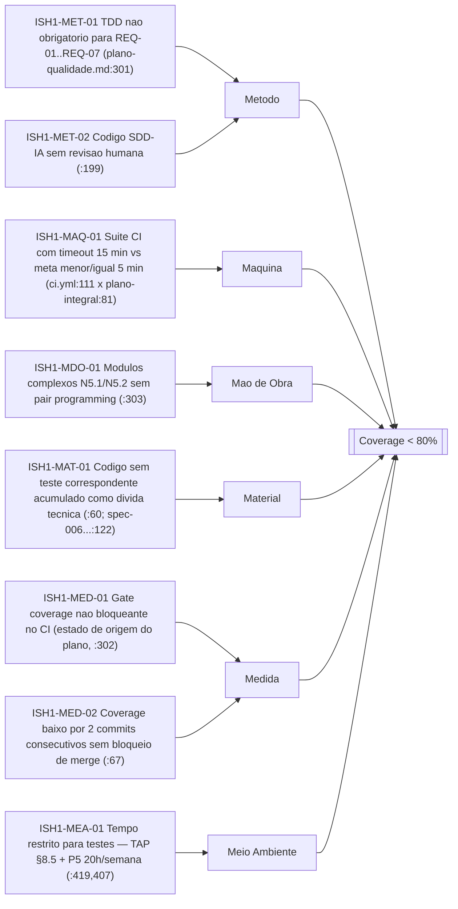
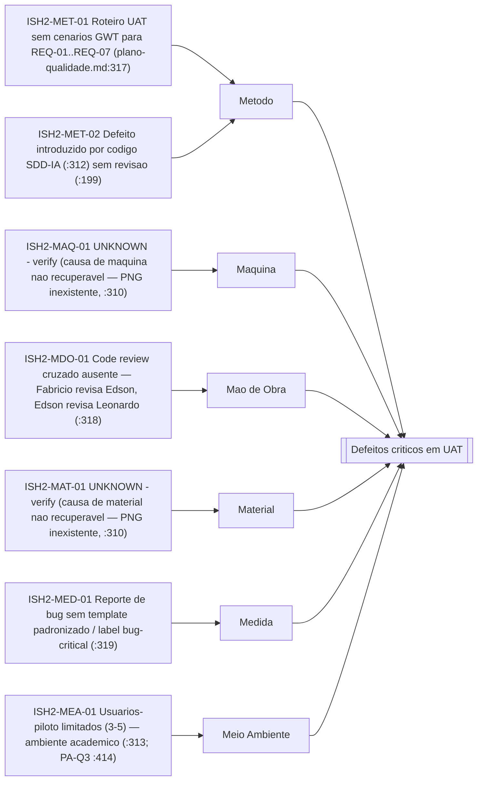
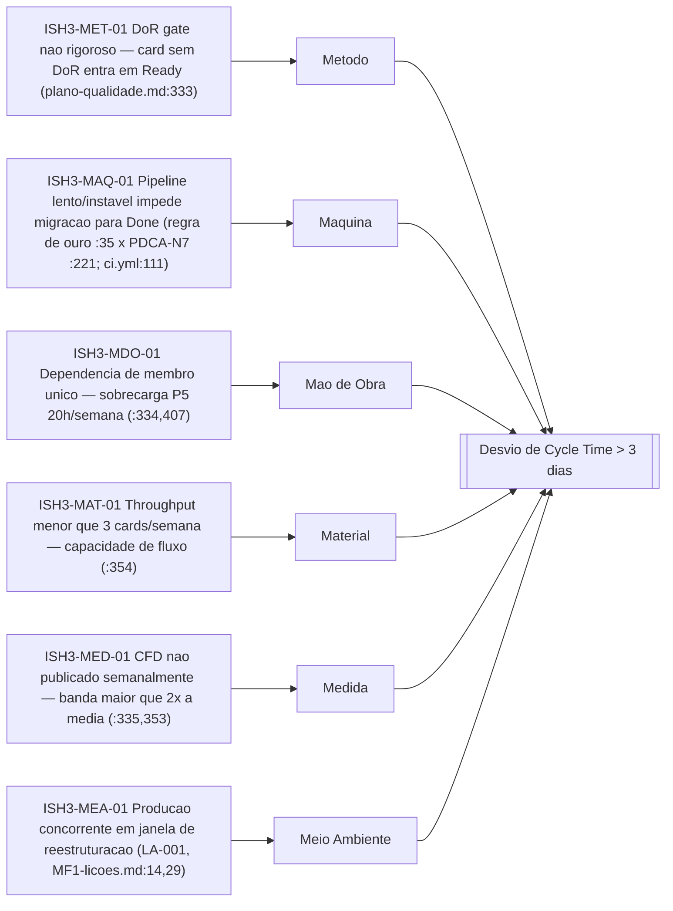

# SPEC spec-010 — qualidade-pdca-ishikawa-v1 — Entrega de qualidade REQ-10: 12 PDCAs consolidados + Ishikawa 6M (fase N6.3, onda 6 "Corrente da Qualidade")

## 1. Contexto e origem

Esta spec nasce da tarefa TA-0055, via handoff HF-0611 emitido por agent-nexus-prime-ultimate
(.ai/handoffs/HF-0611-spec-010-qualidade-pdca-ishikawa-v1.md:17), e implementa o item **B.6** da
LISTA-SPECS-PENDENTES-2026-11-02.md:38: especificar a entrega de qualidade da **REQ-10** —
"12 PDCAs + diagrama", fase **N6.3** da EAP (.ai/specs/spec-002-requisitos-review-round-1.spec.md:71;
critério de aceite no termo autorizativo: "12 PDCAs consolidados + diagrama de causa e efeito
documentado no Plano de Qualidade", docs/archive/tap-sections/req_1.0.md:25) — alinhada à onda 6
"Corrente da Qualidade" (A.19–A.22, docs/planos/plano-granular/plano-producao-agentes.md:145-152;
item D.3, LISTA...:60).

**Incorporação da parcela de consulta:** a consulta TA-0049 (agent-quality-architect-specialist)
foi respondida em .ai/handoffs/HF-0605-consulta-de-dominio.md:32-45 e é incorporada a esta emissão
por referência (HF-0605:41). Dois achados centrais da parcela dirigem esta spec: (i) **os 12 PDCAs
JÁ EXISTEM** como baseline — plano-qualidade.md v1.1.0 §5.6 (PDCA-N1..N12, um por fase EAP, formato
GMV de 6 campos: Problema → Ação → Responsável → Métrica → Verificação → Lição,
plano-qualidade.md:147,149-281) — e **NÃO são recriados aqui**; esta spec referencia-os como
baseline, consolida-os em 3 grupos por macro-fase (MF1/MF2/MF3) e registra status
executado/pendente; (ii) os **3 diagramas Ishikawa 6M** do plano §5.7
(plano-qualidade.md:283-335) estão materializados em PNGs que **não existem no repositório**
(diretório `diagrams/` inexistente — verificado 2026-11-03; drift adicional: FIG-5 aponta o mesmo
PNG de FIG-3, :326 vs :294), razão pela qual esta spec os especifica em formato **mermaid inline**
com causas específicas COGME rastreáveis.

**Ponto crítico de não-duplicação (SSOT):** o conteúdo substantivo dos 12 PDCAs e das 3 análises
Ishikawa permanece no plano (docs/planos/plano-granular/plano-qualidade.md, v1.1.0, :6). Esta spec
é o **registro canônico da entrega REQ-10/fase N6.3 na camada de specs** (.ai/specs/): referencia
o baseline por `arquivo:linha`, consolida por marco, registra status e especifica a forma mermaid
dos diagramas. Nenhum campo GMV é reescrito aqui.

**Delimitação ontológica (do plano, herdada):** o plano não duplica gates DoR/DoD do Escopo
(plano-qualidade.md:17) e consolida 12 fases EAP, não 13 (NC-Q4, plano-qualidade.md:369-370). A
fase N6.3 é canonicamente "Aplicação de Ferramentas da Qualidade (12 PDCAs + Ishikawa 6M)",
atribuída à macro-fase MF2 (plano-integral-tap-1-2-3-4-5.md:41) — o que resolve o
`UNKNOWN - verify` da parcela quanto à definição canônica de N6.3 (HF-0605:41).

## 2. Resolução de conflitos

| Tema | Decisão | Fonte vencedora | Texto superado |
|---|---|---|---|
| REQ-10 no **singular** ("diagrama", req_1.0.md:25; spec-002...:71) × **3 diagramas** no plano (plano-qualidade.md:283 "3 ANÁLISES"; :289, :305, :321; plano-integral:606 "três diagramas") | Reconciliação: **3 diagramas ≥ 1 exigido** — superset satisfaz o mínimo do termo autorizativo; a enumeração de 3 análises é leitura operacional do plano sobre o REQ-10 congelado (mesma lógica NC-Q1, plano-qualidade.md:361). Esta spec especifica os 3 (§3.2) e registra a reconciliação (§3.3) | req_1.0.md:25 (termo autorizativo define o mínimo) + plano-integral:606 (estado operacional do plano) | Leitura que exigisse exatamente 1 diagrama ou que declarasse os 3 como "não conformes" |
| **SSOT do plano de qualidade**: contrato do agente quality cita `.ai/specs/plano-qualidade.md` (agent-quality-architect-specialist.md:31) × arquivo real em `docs/planos/plano-granular/plano-qualidade.md` (430 linhas; inexistente em .ai/specs/ — verificado 2026-11-03) | SSOT real = `docs/planos/plano-granular/plano-qualidade.md` (v1.1.0, :6). O ponteiro do contrato é **drift registrado, não corrigido** nesta emissão (regra da tarefa: nenhum arquivo de terceiro editado) | docs/planos/plano-granular/plano-qualidade.md:1-6 (arquivo existente) | agent-quality-architect-specialist.md:31 (ponteiro morto — resolve-se por este mapa, nunca editando o prompt) |
| **Agrupamento por marco**: parcela TA-0049 propõe "MF1=N1-N4; MF2=N5-N8+N10; MF3=N9+N11-N12" (HF-0605:41, seguindo os arquivos de Lição do plano §5.6 — N8→MF2.md :237, N9→MF3.md :248) × EAP canônica: **N1-N4, N8, N9 → MF1; N5, N6, N7, N10 → MF2; N11, N12 → MF3** (plano-integral:36-47,62 — "6 fases / 4 fases / 2 fases") | Prevalece a **atribuição canônica da EAP** (hierarquia Art. 2.1/2.5 — termo autorizativo > plano; divergência plano×TAP é leitura operacional, NC-Q1, plano-qualidade.md:361). Os grupos desta spec (§3.1) seguem a EAP; os caminhos de Lição do plano (`MF1.md/MF2.md/MF3.md`, :160,171,182,193,204,215,226,237,248,259,270,281) permanecem como destinos de registro operacional — **desalinhamento registrado como pendência de saneamento, não corrigido** (drift adicional: plano cita `MF1.md`, arquivo real é `MF1-licoes.md`, verificado 2026-11-03) | plano-integral-tap-1-2-3-4-5.md:36-47,62 | HF-0605:41 (agrupamento da parcela); plano-qualidade.md:160,171,237,248 (destinos de Lição desalinhados da EAP) |
| **Drift gráfico**: FIG-5 aponta o mesmo PNG de FIG-3 (plano-qualidade.md:326 vs :294 — `fig-05-ishikawa-coverage.png`) e o diretório `diagrams/` não existe (FIG-1 :46, FIG-3 :294, FIG-4 :310, FIG-5 :326 — todos quebrados) | Esta spec **registra** o drift e substitui a **forma** de entrega dos diagramas por mermaid inline (§3.2), conforme parcela TA-0049 (HF-0605:41 "substituir PNGs"). O plano-qualidade.md **não é editado**; regeneração de PNGs é fora de escopo (§6) | parcela TA-0049 (HF-0605:41) + estado verificado do repositório (grep/find 2026-11-03) | plano-qualidade.md:294,326 (caminhos PNG duplicados/quebrados) |
| Gate de coverage: ação Ishikawa-1 "Configurar `--cov-fail-under=80` no pipeline CI" (plano-qualidade.md:302) × CI real já contém o gate (`.github/workflows/ci.yml:170`) | Status da ação: **implementado no CI atual** (ci.yml:170, verificado por grep 2026-11-03). A ação do plano permanece como fonte da causa ISH1-MED-01 (estado de origem); o status atual é reconciliado na tabela de IDs (§3.2, Ishikawa-1) | .github/workflows/ci.yml:170 (estado verificado, P-08) | plano-qualidade.md:302 (formulação de origem, pré-implementação) |

Nenhum outro conflito normativo conhecido entre as fontes citadas; tensão não registrada acima =
`UNKNOWN - verify` e escala ao arquiteto (Art. 2.5, constitution.md:78).

## 3. Domínio: baseline PDCA, Ishikawa 6M em mermaid e RACI da onda 6

Convenção: toda alegação carrega `arquivo:linha`; lacuna de evidência = literal
`UNKNOWN - verify` (P-08, constitution.md:98; MANIFEST.md:58).

### 3.1 Os 12 PDCAs consolidados por macro-fase (baseline referenciada, não recriada)

Formato GMV de 6 campos por PDCA — Problema → Ação → Responsável → Métrica → Verificação → Lição —
é definido no plano (plano-qualidade.md:147) e materializado nas 12 subseções §5.6
(:151-281). Agrupamento por macro-fase conforme EAP canônica (plano-integral:36-47,62;
conflito da parcela resolvido na §2, linha 3). **Contexto temporal de status (2026-11-03):**
MF1 encerrada em M2 (30/09/2026 — plano-integral:272,418); MF2 em curso (01/10–15/11/2026,
:272), fecha no M3 (15/11/2026, :97); MF3 pendente (16/11–15/12/2026, fecha no M4 15/12/2026,
:98).

| Grupo | PDCA | Fase EAP (EAP :36-47) | Problema (síntese da fonte) | Verificação planejada | Status em 2026-11-03 |
|---|---|---|---|---|---|
| MF1 Fundação | PDCA-N1 (plano-qualidade.md:151-160) | N1 (plano-integral:36) | escopo mal definido / premissas inválidas (:155) | M1 22/09/2026 (:159; marco :95) | marco vencido; evidência de resultado: `UNKNOWN - verify` |
| MF1 | PDCA-N2 (:162-171) | N2 (:37) | requisitos ambíguos/não rastreáveis (:166) | refinement semanal 23/09, 30/09 (:170) | datas vencidas; `UNKNOWN - verify` |
| MF1 | PDCA-N3 (:173-182) | N3 (:38) | arquitetura/DER não validados (:177) | M2 30/09/2026 (:181) | marco vencido; `UNKNOWN - verify` |
| MF1 | PDCA-N4 (:184-193) | N4 (:39) | ferramentas FOSS incompatíveis / ambiente instável (:188) | M2 30/09/2026 (:192) | marco vencido; `UNKNOWN - verify` |
| MF1 | PDCA-N8 (:228-237) | N8 (:43) | falhas de comunicação equipe/stakeholder (:232) | GitHub Issues (daily) + Projects (:236) | contínuo; `UNKNOWN - verify` |
| MF1 | PDCA-N9 (:239-248) | N9 (:44) | ADRs tardias / prompts não catalogados (:243) | /docs/decisoes/ + .ai/handoffs/ semanal (:247) | contínuo; `UNKNOWN - verify` |
| MF2 Construção | PDCA-N5 (:195-204) | N5 (:40) | código sem testes, coverage insuficiente, SDD-IA sem revisão (:199) | CI por push + review antes de merge (:203) | em curso (MF2 aberta); `UNKNOWN - verify` |
| MF2 | PDCA-N6 (:206-215) | N6 (:41) | defeitos críticos em UAT / coverage abaixo da meta (:210) | M3 15/11/2026 — relatório UAT + coverage.xml (:214) | pendente (M3 futuro) |
| MF2 | PDCA-N7 (:217-226) | N7 (:42) | pipeline lento (>5min, REQ-11) ou instável (:221) | GitHub Actions Insights semanal (:225) | em curso; `UNKNOWN - verify` |
| MF2 | PDCA-N10 (:250-259) | N10 (:45) | mudanças não registradas / scope creep >15% (:254) | Issues com label `change-request` (:258) | em curso; `UNKNOWN - verify` |
| MF3 Consolidação | PDCA-N11 (:261-270) | N11 (:46) | documentação desatualizada/inconsistente (:265) | M4 15/12/2026 — documentação consolidada (:269) | pendente (M4 futuro) |
| MF3 | PDCA-N12 (:272-281) | N12 (:47) | lições não consolidadas / SMART não verificados (:276) | M4 15/12/2026 — validação acadêmica + tag (:280) | pendente (M4 futuro) |

**Evidência de execução existente no repositório (parcial):** única lição registrada até hoje é
LA-001 (reestruturação de repositório, 22/09/2026) em
docs/conhecimento/licoes-aprendidas/MF1-licoes.md:1-31; MF2-licoes.md e MF3-licoes.md estão vazios
(0 B, verificado 2026-11-03). Não há registro por-PDCA dos resultados das verificações de M1/M2 →
status de execução dos PDCAs N1-N4, N8, N9 fica `UNKNOWN - verify` (nenhuma métrica de
cumprimento inventada — P-08). O requisito de consolidação da REQ-10 é sobre **documentação
dos ciclos** (req_1.0.md:25: "documentado no Plano de Qualidade") — atendida pelo baseline
plano-qualidade.md:149-281 —, não sobre evidência de execução integral.

### 3.2 Os 3 diagramas Ishikawa 6M em mermaid (substituição de forma ao PNG, com drift registrado)

**Reconstrução de causas (P-08):** as causas específicas por 6M do plano original estavam
materializadas nos PNGs inexistentes (plano-qualidade.md:294,310,326; diretório `diagrams/`
inexistente). Esta spec **reconstrói** as causas exclusivamente a partir de conteúdo citável do
corpus COGME (problemas dos PDCAs §5.6, ações corretivas derivadas §5.7 :299-303/:315-319/:331-335,
métricas e gatilhos §5.3 :55-69, premissas/restrições §5.11 :400-421, LA-001 de
MF1-licoes.md). Causa sem fonte citável não é incluída — o branch fica `UNKNOWN - verify`.
IDs rastreáveis no padrão `ISH<n>-<6M>-<NN>`, ligados às ações do plano-qualidade.md §5.7.
Formato mermaid `flowchart LR`, efeito à direita, 6M como ramos, causas como folhas
(HF-0605:41).

#### Ishikawa-1 — Efeito: Coverage menor que 80% (plano-qualidade.md:289-303)

| ID | Ação corretiva ligada (plano-qualidade.md §5.7) | Status (2026-11-03) |
|---|---|---|
| ISH1-MET-01 | TDD obrigatório para REQ-01 a REQ-07 — ação 1 (:301) | `UNKNOWN - verify` (sem evidência de execução no repositório) |
| ISH1-MED-01 | `--cov-fail-under=80` como gate bloqueante — ação 2 (:302) | **implementado no CI atual** (.github/workflows/ci.yml:170 — grep verificado; ver §2, linha 5) |
| ISH1-MDO-01 | Pair programming para módulos complexos (N5.1, N5.2) — ação 3 (:303) | `UNKNOWN - verify` |
| ISH1-MAQ-01 | Delta G-05 declarado, não contornado — cross-ref B.7 (LISTA...:39; spec-006...:119 NF-19) | não atendido (timeout 15min vs meta ≤5min — ci.yml:111 × plano-integral:81) |
| ISH1-MET-02, ISH1-MED-02, ISH1-MAT-01, ISH1-MEA-01 | gatilho de coverage (:67); dívida técnica (:60; spec-006...:122); restrição de tempo (:419) | `UNKNOWN - verify` / em curso (MF2) |

#### Ishikawa-2 — Efeito: Defeitos críticos em UAT (plano-qualidade.md:305-319)

| ID | Ação corretiva ligada (plano-qualidade.md §5.7) | Status (2026-11-03) |
|---|---|---|
| ISH2-MET-01 | Roteiro de UAT com cenários GWT para REQ-01 a REQ-07 — ação 1 (:317) | pendente — UAT de produto é B.5 (LISTA...:37), cross-ref |
| ISH2-MDO-01 | Code review cruzado — ação 2 (:318) | `UNKNOWN - verify` |
| ISH2-MED-01 | Label `bug-critical` com template padronizado — ação 3 (:319) | `UNKNOWN - verify` |
| ISH2-MAQ-01, ISH2-MAT-01 | causa específica não recuperável (PNG inexistente, :310) — sem conteúdo citável no corpus | `UNKNOWN - verify` (P-08 — reconstrução na próxima revisão do plano) |

#### Ishikawa-3 — Efeito: Desvio de Cycle Time maior que 3 dias (plano-qualidade.md:321-335)

| ID | Ação corretiva ligada (plano-qualidade.md §5.7) | Status (2026-11-03) |
|---|---|---|
| ISH3-MET-01 | DoR gate rigoroso (Escopo §2.6) — ação 1 (:333; fronteira declarada :17) | `UNKNOWN - verify` (operacionalização é do Kanban vivo, ADR-002) |
| ISH3-MDO-01 | Cross-training para reduzir dependência de membro único — ação 2 (:334) | `UNKNOWN - verify` |
| ISH3-MED-01 | Publicação semanal de CFD + ação se banda > 2× média — ação 3 (:335; gatilho :353) | `UNKNOWN - verify` |
| ISH3-MAQ-01, ISH3-MAT-01, ISH3-MEA-01 | regra de ouro (:35) + problema PDCA-N7 (:221) + LA-001 (MF1-licoes.md:14,29) | `UNKNOWN - verify` / em curso (MF2) |

**Delimitação produto × processo (herdada, I3):** Ishikawa-1 e Ishikawa-2 analisam qualidade de
**produto**; Ishikawa-3 analisa qualidade de **processo** (plano-qualidade.md:287).

### 3.3 Reconciliação REQ-10 (registro exigido pela tarefa)

REQ-10 exige "12 PDCAs + diagrama" **no singular** (req_1.0.md:25, via
spec-002-requisitos-review-round-1.spec.md:71). A entrega canônica do plano contém **3 diagramas**
(plano-qualidade.md:283,289,305,321; plano-integral:606). Registro: **3 ≥ 1** — o singular do
termo autorizativo é o mínimo exigido; a enumeração de 3 análises (2 de produto + 1 de processo,
:287) é superset que satisfaz o critério sem contradição. A contagem dos 12 PDCAs é atendida
1:1 pelas 12 subseções do plano §5.6 (:151-281), mapeadas na §3.1.

### 3.4 RACI da onda 6 "Corrente da Qualidade" (A.19–A.22)

Onda 6 (plano-producao-agentes.md:145-152): A.19 `agent-qa-sdet` — estratégia de testes e
cobertura ≥ 80% (:149); A.20 `agent-reviewer` — gate de revisão de código nível commit (:150);
A.21 `agent-gatekeeper` — gate de merge/DoD/rastreabilidade (:151); A.22 `agent-project-auditor`
— auditoria fim-a-fim PMBOK + qualidade (:152). RACI para a entrega REQ-10/N6.3 desta spec
(operacionaliza — não altera — os campos "Responsável" do plano §5.6 e a regra de ouro :35;
desvio = §2/CCB):

| Atividade | GP (plano :157,:212) | qa-sdet A.19 (:149) | reviewer A.20 (:150) | gatekeeper A.21 (:151) | auditor A.22 (:152) |
|---|---|---|---|---|---|
| Consolidar/operar os 12 PDCAs (plano-qualidade.md §5.6) | R/A | C | I | I | C |
| Produzir/manter os 3 Ishikawa 6M (§5.7; forma mermaid desta spec) | R/A | C | C | I | C |
| Verificar métricas de qualidade (coverage, defeitos — §5.3 :55-61) | A | R | C | C | I |
| Aplicar a regra de ouro no Done (CI verde + coverage + review + tasklist, :35) | I | C | R | A | I |
| Auditar a cadeia fim-a-fim REQ-10 (evidências + rastreabilidade) | C | I | I | C | R/A |

## 4. Critérios de aceite e testes

Critérios verificáveis desta emissão (checkbox, contrato DO #2 —
.opencode/agents/agent-sdd-specialist.md:85):

- [ ] AC-01: o arquivo `.ai/specs/spec-010-qualidade-pdca-ishikawa-v1.spec.md` existe com
  frontmatter conforme MANIFEST §1.1 (spec_id, specname, version, status, custody, created/updated,
  origin, task/sender, kill_switch, trace — .ai/specs/MANIFEST.md:27-44) e padrão de arquivo
  `spec_id-specname.spec.md` (:66), com ≤ 400 linhas (DO #3, .opencode/agents/agent-sdd-specialist.md:86).
- [ ] AC-02: fecha o item B.6 (LISTA...:38) — a fase N6.3 ("Aplicação de Ferramentas da Qualidade
  (12 PDCAs + Ishikawa 6M)", plano-integral:41) passa a ter artefato canônico na camada de specs,
  com REQ-10 citada (spec-002...:71; req_1.0.md:25).
- [ ] AC-03: os 12 PDCAs são **referenciados como baseline, não recriados**: a tabela §3.1 mapeia
  PDCA-N1..N12 cada um à sua subseção de plano-qualidade.md (12 subseções verificáveis em
  :151-281), com os 6 campos GMV presentes na fonte (formato :147) — verificação por contagem de
  subseções e campos, não por transcrição.
- [ ] AC-04: os 3 Ishikawa 6M estão especificados em mermaid `flowchart LR` (efeito à direita, 6M
  como ramos), cada um com 6 ramos; toda causa incluída carrega ID `ISH*-***-NN` com citação
  `arquivo:linha` do corpus COGME — zero causas genéricas sem fonte; ramos sem causa recuperável
  declarados `UNKNOWN - verify` (Ishikawa-2 Máquina/Material, plano-qualidade.md:310).
- [ ] AC-05: reconciliação singular/plural registrada (§3.3): REQ-10 singular (req_1.0.md:25,
  spec-002...:71) × 3 diagramas (plano-qualidade.md:283; plano-integral:606) = superset 3 ≥ 1.
- [ ] AC-06: status executado/pendente dos 12 PDCAs registrado na §3.1 com marcos citados
  (plano-integral:95-98,272,418) e `UNKNOWN - verify` onde não verificável (nenhuma métrica de
  execução inventada — P-08, constitution.md:98).
- [ ] AC-07: drifts registrados **sem correção de terceiros**: FIG-5 = mesmo PNG de FIG-3
  (plano-qualidade.md:326 vs :294); diretório `diagrams/` inexistente (:46,:294,:310,:326);
  ponteiro SSOT morto (agent-quality-architect-specialist.md:31); nome de arquivo de lição
  (`MF1.md` no plano :160 × real `MF1-licoes.md`); grouping MF da parcela (HF-0605:41) superado
  pela EAP (§2, linha 3). Nenhum desses arquivos foi editado por esta emissão.
- [ ] AC-08: RACI da onda 6 presente (§3.4) com A.19–A.22 citados
  (plano-producao-agentes.md:149-152).
- [ ] AC-09: 100% das alegações desta spec com citação `arquivo:linha` ou literal
  `UNKNOWN - verify`; zero PII (nomes próprios não replicados — papéis usados, P-04
  constitution.md:90); kill_switch herdado, sem instrução de bypass de gate (vetos 3-4,
  .opencode/agents/agent-sdd-specialist.md:42-43). **Quem valida:** agent-reviewer audita citações
  linha-a-linha e a testabilidade dos ACs (padrão spec-006...:143). **DoD desta spec:** (i) 12
  PDCAs mapeados em 3 grupos MF1/MF2/MF3; (ii) 3 Ishikawa mermaid com IDs rastreáveis; (iii) 4
  drifts registrados; (iv) RACI onda 6; (v) arquivo único criado sob .ai/specs/, nenhum outro
  arquivo editado, nada commitado.

## 5. Rastreabilidade

| Entrega | REQ/Fonte | Cadeia |
|---|---|---|
| 12 PDCAs (baseline) | REQ-10, fase N6.3 | TA-0055 ← HF-0611:17 ← B.6 (LISTA...:38) ← REQ-10 (spec-002...:71) ← req_1.0.md:25 ← N6.3 (plano-integral:41,80) → plano-qualidade.md:149-281 (§5.6; NC-Q4 :369-370) |
| 3 Ishikawa 6M (mermaid) | REQ-10, fase N6.3 | plano-qualidade.md:283-335 (§5.7; delimitação :287) ← plano-integral:606; parcela TA-0049 (HF-0605:32-45) |
| Consolidação por marco | REQ-10 + EAP | plano-integral:30,36-47,62 (macro-fases); :95-98,272,418 (marcos M1-M4 e gates MF) |
| Onda 6 / RACI | D.3 | LISTA...:60 ← plano-producao-agentes.md:145-152 (A.19-A.22) |
| Métricas verificadas | REQ-08/09/11 (cross-ref) | plano-qualidade.md:55-69; ci.yml:111,170; spec-006...:118-122,129 |
| Lições (evidência parcial) | PDCA Lição (GMV) | MF1-licoes.md:1-31 (LA-001); MF2/MF3-licoes.md 0 B |

Rastreabilidade da emissão: tarefa TA-0055 ← HF-0611 (.ai/handoffs/HF-0611-spec-010-qualidade-pdca-ishikawa-v1.md:17)
← item B.6 (LISTA...:38) ← REQ-10 (spec-002...:71) ← req_1.0.md:25. Covização REQ→US: REQ-10 é
Should (spec-002...:57,71) e não possui US própria — conversão REQ→US é GAP-07/E.4
(spec-002...:106; LISTA...:70), fora do escopo desta emissão. Adjacências NÃO cobertas aqui:
UAT de produto (B.5 — spec-009, emissão paralela), CI/CD executiva (B.7, LISTA...:39),
rastreabilidade de prompts (B.8, LISTA...:40).

## 6. Fora de escopo (YAGNI)

- **NFR consolidados (B.2)** — já emitidos como spec-006 (LISTA...:34; cross-ref apenas:
  spec-006...:118-122,129); esta spec não redefine métricas NFR.
- **UAT de produto (B.5)** — spec própria: `.ai/specs/spec-009-uat-produto-v1.spec.md` (emissão
  paralela TA-0054/HF-0610, verificada em disco 2026-11-03; LISTA...:37); aqui há apenas
  cross-ref (PDCA-N6 :206-215; Ishikawa-2 §3.2) — conteúdo da spec-009 não auditarizado aqui.
- **CI/CD executiva (B.7)** — pendente (LISTA...:39; parcial em spec-005 §8); o delta G-05 é
  declarado lá — aqui apenas o gatilho ISH1-MAQ-01/ISH3-MAQ-01 com citação (§2, linha 5).
- **Execução dos ciclos PDCA e verificação das métricas** — implementação/onda 6 (Art. 6.1,
  ciclo especifica → implementa → valida → registra); esta spec especifica a entrega documental
  REQ-10, não executa os ciclos.
- **Correção dos drifts registrados** (plano-qualidade.md, contrato do agente quality, nomes de
  arquivo de lição) — saneamento pertence à custódia de cada artefato (análogo ao registro de
  saneamento do plano, plano-qualidade.md:375-382); esta emissão apenas registra (§2, §4 AC-07).
- **Regeneração de PNGs / criação do diretório `diagrams/`** — forma substituída por mermaid
  inline (HF-0605:41); decisão de volta a PNGs = nova versão do plano.
- **Recriação/transcrição dos 12 PDCAs nesta spec** — SSOT permanece no plano (§1); duplicação
  violaria a não-redundância e criaria dupla custódia.
- **Dashboard próprio de qualidade** — decidido GMV: GitHub Insights + coverage.py + pytest
  (plano-qualidade.md:74-76).
- **Rastreabilidade de prompts SDD (B.8) e LGPD de produto (B.3)** — specs próprias pendentes
  (LISTA...:40,35).
- **Novas métricas/limiares de qualidade sem fonte citável** — vedado (P-08, constitution.md:98);
  lacunas marcadas `UNKNOWN - verify`.

## CHANGELOG

- 0.1.0 — 2026-11-03 (TA-0055 / HF-0611): emissão inicial. Entrega de qualidade REQ-10, fase
  N6.3 (item B.6, LISTA...:38): 12 PDCAs do plano-qualidade.md v1.1.0 §5.6 referenciados como
  baseline (não recriados) e consolidados em 3 grupos por macro-fase canônica MF1/MF2/MF3
  (plano-integral:36-47,62) com status executado/pendente e `UNKNOWN - verify` onde não
  verificável; 3 diagramas Ishikawa 6M especificados em mermaid com causas COGME específicas e
  IDs rastreáveis ISH*-***-NN ligados às ações §5.7 (substituição de forma ao PNG inexistente);
  reconciliação REQ-10 singular × 3 diagramas (3 ≥ 1); 4 drifts registrados sem correção de
  terceiros (FIG-5/FIG-3 :326 vs :294; diagrams/ inexistente; ponteiro SSOT morto
  agent-quality-architect-specialist.md:31; nome de arquivo de lição); RACI onda 6 (A.19-A.22);
  parcela TA-0049 (HF-0605:32-45) incorporada por referência. Arquivo único; nada commitado.

## CAMADAS FUNDAMENTAIS — MAPA (TA-0031)

| Camada | Seção nesta spec | Estado |
|---|---|---|
| (a) cabeçalho — spec_id, versão, status, custódia, datas, origem | frontmatter (`spec_id: spec-010`, `version: 0.1.0`, `status: draft`, `created/updated: 2026-11-03`, `origin: HF-0611`, `task: TA-0055`) | aplicada |
| (b) Contexto/origem | §1 Contexto e origem | aplicada |
| (c) Resolução de conflitos | §2 (5 conflitos: singular/plural; SSOT; agrupamento MF; drift gráfico; gate coverage) | aplicada |
| (d) Corpo de decisões/requisitos/contratos | §3 (3.1 baseline PDCA consolidada; 3.2 Ishikawa mermaid + tabelas de IDs; 3.3 reconciliação REQ-10; 3.4 RACI onda 6) | aplicada |
| (e) Critérios de aceite/testes | §4 (AC-01..AC-09 com validação/DoD) | aplicada |
| (f) Rastreabilidade | §5 + frontmatter `trace` | aplicada |
| (g) Fora de escopo (YAGNI) | §6 | aplicada |
| (h) Changelog | CHANGELOG (0.1.0) | aplicada |
