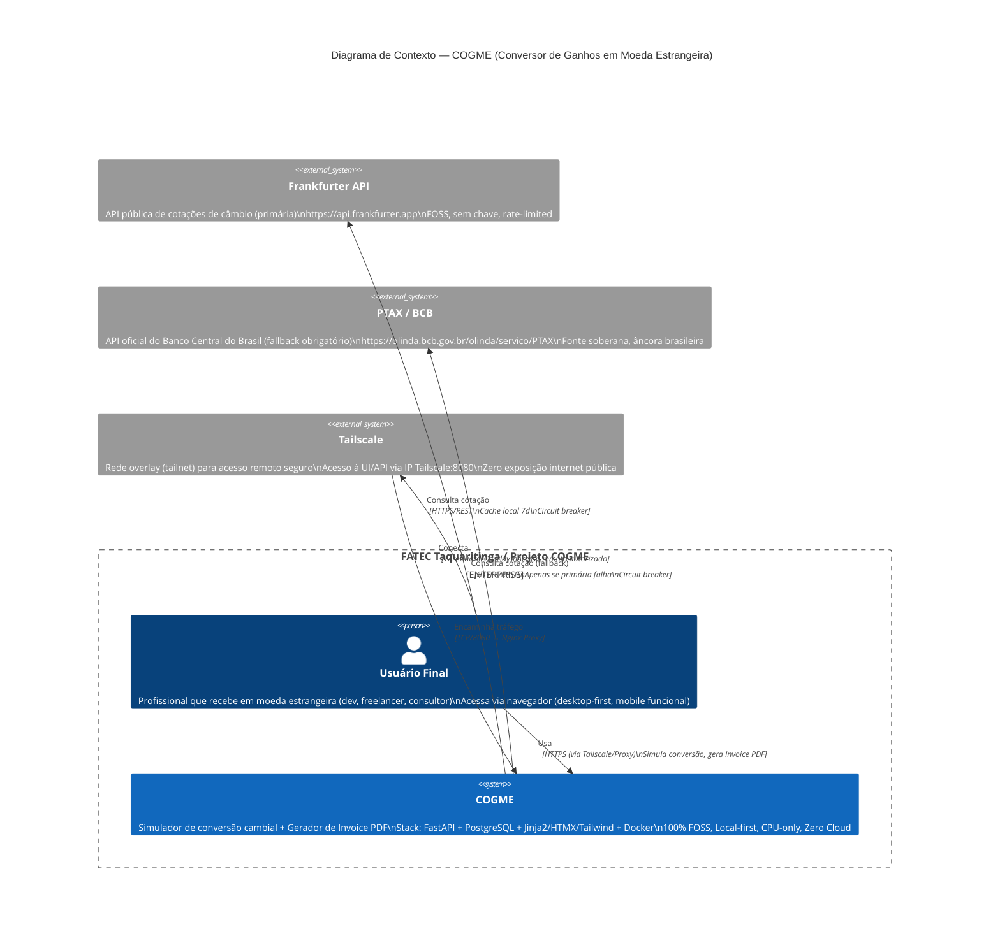

# Diagrama C4 — Nível 1: Contexto (System Context)

> **Finalidade**: Visão de alto nível do sistema COGME, seus **atores** (usuários, sistemas externos) e **fronteiras**. Mostra "o que" o sistema faz e "com quem" interage, sem detalhes internos.
> **Público**: Stakeholders não-técnicos (GP, Coordenação FATEC, Banca TCC), novos membros da equipe, auditores.
> **Ferramenta**: Mermaid.js (renderizável no GitHub, GitLab, VS Code, Obsidian, Notion).

---

## 1. Diagrama de Contexto (Mermaid)

---

## 2. Descrição dos Elementos

| Elemento | Tipo | Descrição | Responsabilidade |
|---|---|---|---|
| **Usuário Final** | Pessoa | Profissional que recebe USD/EUR no exterior; precisa converter para BRL e gerar invoice profissional | Fornece valor + moeda; recebe resultado + PDF |
| **COGME** | Sistema | Aplicação principal: Simulador + Invoice Generator | Orquestra fluxo; cache; fallback; PDF; persistência |
| **Frankfurter API** | Sistema Externo | Provedor primário de cotações (ECB, bancos centrais) | Fornece cotação atual USD/EUR → BRL |
| **PTAX / BCB** | Sistema Externo | Provedor fallback oficial (Banco Central do Brasil) | Fornece cotação PTAX (âncora soberana) |
| **Tailscale** | Sistema Externo | Rede overlay zero-trust para acesso remoto | Permite acesso seguro sem expor portas públicas |

---

## 3. Fluxos Principais (Use Cases)

| Fluxo | Ator Primário | Descrição | Sistemas Envolvidos |
|---|---|---|---|
| **UC-01: Simular Conversão** | Usuário Final | Usuário informa valor + moeda → COGME retorna valor em BRL com cotação usada | Usuário → COGME → (Frankfurter OU PTAX) |
| **UC-02: Gerar Invoice PDF** | Usuário Final | Usuário solicita PDF da simulação → COGME gera PDF bilingue (PT/EN) → Download | Usuário → COGME |
| **UC-03: Acesso Remoto** | Usuário Final | Usuário conecta via Tailscale → Acessa UI/API na porta 8080 | Usuário → Tailscale → COGME (Proxy) |
| **UC-04: Fallback Automático** | COGME (Sistema) | Frankfurter falha → Circuit Breaker abre → PTAX usado transparentemente | COGME → Frankfurter (falha) → PTAX (sucesso) |

---

## 4. Fronteiras e Isolamento (Segurança)

| Fronteira | Descrição | Controles |
|---|---|---|
| **Rede Interna (Docker)** | `cogme-internal` — isolada, sem internet | Apenas proxy tem acesso externo; DB sem rota para internet |
| **Acesso Externo** | Apenas via Tailscale (tailnet) → Proxy (8080) | Zero exposição internet pública; WireGuard; ACLs Tailscale |
| **Dados Sensíveis** | PII (email, CPF) criptografada/HMAC; segredos só em runtime | Argon2id (senhas); HMAC-SHA256 (lookup); `.env` não versionado |
| **Inferência LLM** | 100% Local (llama.cpp, Qwen3-30B-A3B Q4_K_M) | CPU-only; sem GPU; sem nuvem; hardware próprio |

---

## 5. Decisões Arquiteturais Relacionadas (ADRs)

| ADR | Título | Impacto no Contexto |
|---|---|---|
| **ADR-001** | Stack Tecnológica FOSS | Define stack completa (FastAPI, PostgreSQL, Docker, Jinja2/HTMX/Tailwind, llama.cpp) |
| **ADR-010** | Stack Infraestrutura | Define orquestração Docker Compose, Nginx proxy, PostgreSQL canônico, hierarquia APIs câmbio |
| **ADR-003** | Métricas de Fluxo | Define métricas (Cycle Time, Throughput, WIP, Coverage) — sem EVM |
| **ADR-017** | Dependência Argon2id | Define hash de senha (Argon2id, params OWASP) |
| **ADR-019** | Segurança Multiusuário | Define isolamento de dados, pseudonimização, LGPD by design |

---

## 6. Como Visualizar / Atualizar

1. **No GitHub**: Arquivo `.md` renderiza automaticamente o Mermaid
2. **No VS Code**: Extensão "Markdown Preview Mermaid Support"
3. **No Obsidian/Notion**: Colar o bloco Mermaid
4. **CLI**: `mmdc -i c4-context.md -o c4-context.png` (requer `@mermaid-js/mermaid-cli`)

> **Atualização**: Sempre que houver mudança de ator, sistema externo, ou fluxo principal. Revisão obrigatória em Gate 2 (Desenho) de cada wave.