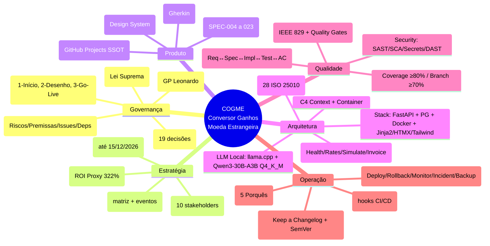
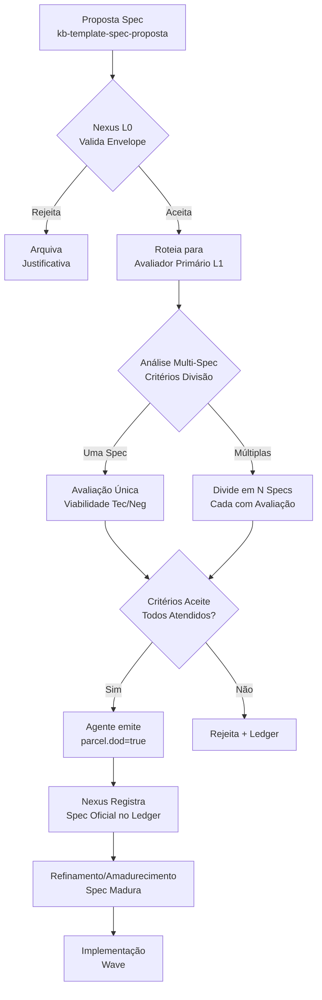
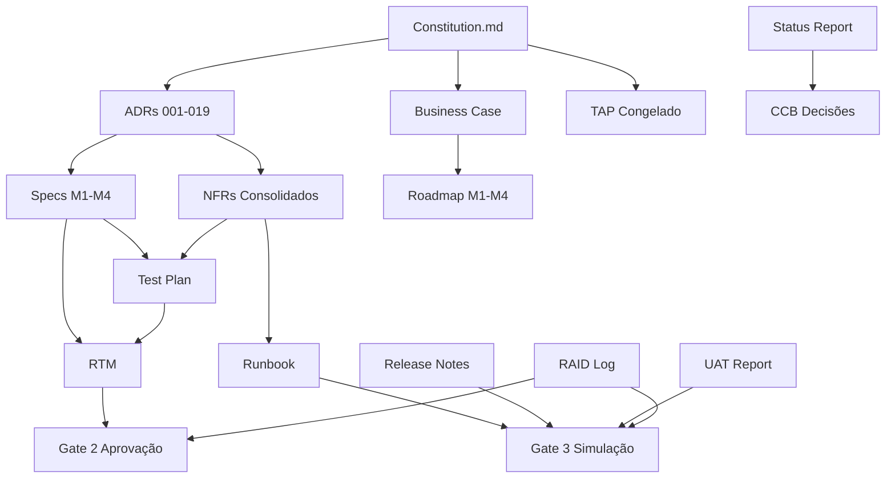
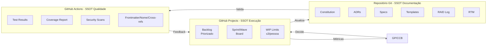

# Guia Prático de Adequação PMBOK 7 Híbrido — COGME

> **Finalidade**: Documento único de referência que descreve a **natureza arquitetural**, **regras de artefatos**, **nomenclaturas**, **templates** e **estilo organizacional** do projeto COGME após a adequação ao PMBOK 7 (perfil Híbrido/Corporativo). Inclui mapas mentais, fluxogramas e tabelas explicativas.
> **Audiência**: Novos membros da equipe, auditores, stakeholders FATEC, agentes SDD.
> **Status**: **Ratificado por CCB** — RAT-2026-11-14-ADEQUACAO-PMBOK7-HIBRIDO

---

## 1. VISÃO GERAL ARQUITETURAL (Mapa Mental)



---

## 2. ESTRUTURA DE DIRETÓRIOS E MAPEAMENTO TYPE/PREFIXO

### 2.1 Árvore de Diretórios `docs/` (Pós-Adequação)

```
docs/
├── analise/                 # relatorio (ana-*)
├── auditorias/              # audit (aud-*)
├── conformidade/            # conhecimento (kb-*)
├── conhecimento/
│   ├── arquitetura/         # conhecimento (kb-*) ← C4, OpenAPI, NFRs
│   ├── drafts/              # conhecimento (kb-*) ← rascunhos
│   ├── licoes-aprendidas/   # conhecimento (kb-*) ← MF1-3
│   ├── templates/           # conhecimento (kb-template-*) ← 9 templates
│   └── vet-calculo-cambio.md
├── decisoes/                # adr (adr-*)
├── entregas/                # relatorio (rel-*) ← release notes
├── especificacoes/          # spec (spec-*)
├── governanca/              # governanca (gov-*)
│   ├── gov-raid-log.md
│   ├── gov-stakeholder-register.md
│   ├── gov-communication-plan.md
│   ├── gov-project-closure.md
│   └── gov-*.md (legado)
├── operacao/                # procedimento (proc-*)
│   ├── proc-runbook.md
│   └── proc-artifact-maintenance.md
├── planos/                  # plano (plan-*)
│   ├── plan-business-case.md
│   ├── plan-test-plan.md
│   └── plan-rtm.md
├── propostas/               # spec (spec-prop-*)
├── relatorios/              # relatorio (rel-*)
│   └── rel-release-notes-v1-0-0.md
├── requisitos/              # requisito (req-*)
├── tap/                     # spec (tap-*)
├── uat/                     # test (uat-*)
└── verification/            # audit (ver-*)
```

### 2.2 Tabela Mapeamento Diretório → Type → Prefixo (Norma)

| Diretório | Type (frontmatter) | Prefixo (nome arquivo) | Exemplos |
|---|---|---|---|
| `docs/decisoes/` | `adr` | `adr-` | `adr-001-stack.md` |
| `docs/auditorias/` | `audit` | `aud-` | `aud-2610-03.md` |
| `docs/especificacoes/` | `spec` | `spec-` | `spec-prop-017-conta-multiusuario.md` |
| `docs/planos/` | `plano` | `plan-` | `plan-test-plan.md` |
| `docs/operacao/` | `procedimento` | `proc-` | `proc-runbook.md` |
| `docs/relatorios/` | `relatorio` | `rel-` | `rel-release-notes-v1-0-0.md` |
| `docs/governanca/` | `governanca` | `gov-` | `gov-raid-log.md` |
| `docs/conhecimento/` | `conhecimento` | `kb-` | `kb-template-raid-log.md` |
| `docs/conhecimento/templates/` | `conhecimento` | `kb-template-` | `kb-template-raid-log.md` |
| `docs/conhecimento/arquitetura/` | `conhecimento` | `kb-` | `kb-c4-context.md` |
| `docs/requisitos/` | `requisito` | `req-` | — |
| `docs/analise/` | `relatorio` | `ana-` | `ana-*.md` |
| `docs/uat/` | `test` | `uat-` | `uat-rodada-001/...` |
| `docs/verification/` | `audit` | `ver-` | — |

> **Regra**: O `type` no frontmatter **deve coincidir** com o diretório (validado por `scripts/validar_frontmatter_md.py`). O prefixo do nome do arquivo **deve coincidir** com a tabela acima (validado por `scripts/validar_nome_arquivo.py`).

---

## 3. FRONTMATTER PADRÃO (Norma NORMA-TEMPLATES-ARTEFATOS.md)

### 3.1 Campos Comuns Obrigatórios (Todo `.md`)

```yaml
---
id: <slug-unico-kebab-case>           # Único no repo (ex: kb-template-raid-log)
title: <Título Humano>                 # Com aspas se tiver chars especiais
type: <type-da-tabela-acima>           # Deve coincidir com diretório
version: <MAJOR.MINOR.PATCH>           # SemVer do artefato
status: <ativo|draft|ratificado|obsoleto|arquivado>
owner: <papel-agente>                  # Ex: agent-project-analyst (nunca nome civil)
derived-from:                          # Lista de fontes canônicas
  - constitution.md Art. 2
  - NORMA-TEMPLATES-ARTEFATOS.md
last-revised: 'YYYY-MM-DD'             # ISO 8601
lgpd-class: <n/a|interno|sensível>     # Fechado
tags:                                  # Lista de tags lowercase
  - tag1
  - tag2
---
```

### 3.2 Campos Específicos por Type (Exemplos)

| Type | Campos Extras Obrigatórios |
|---|---|
| `spec` | `spec-id`, `camada`, `estado-implementacao`, `rastreia-req`, `testes-vinculados` |
| `adr` | `decision`, `status` (proposed/accepted/superseded/deprecated), `supersedes`, `domain-pmbok` |
| `change-request` | `cr-number`, `impacto`, `prazo-analise-gp`, `decisao-ccb`, `instrumento` |
| `audit` | `audit-id`, `periodo`, `veredito`, `artigos-constitucionais`, `vio-referenciados` |
| `test` | `test-id`, `tipo` (unit/e2e), `spec-vinculada`, `cobertura` |
| `plano` | `marco-vinculado`, `doD`, `revisao-periodica` |
| `procedimento` | `marco-vinculado`, `doD`, `revisao-periodica` |

---

## 4. TEMPLATES CANÔNICOS (9 Templates em `docs/conhecimento/templates/`)

| Template | ID | Finalidade | Gate |
|---|---|---|---|
| **RAID Log** | `kb-template-raid-log` | Riscos, Premissas, Issues, Dependências | Contínuo |
| **Change Request** | `kb-template-change-request` | Solicitação mudança formal + análise impacto | Pós-Gate 1 |
| **Status Report** | `kb-template-status-report` | Relatório semanal (métricas, progresso, riscos) | Semanal |
| **Communication Plan** | `kb-template-communication-plan` | Matriz stakeholders × info × canal × frequência | Gate 1 |
| **Release Notes** | `kb-template-release-notes` | Keep a Changelog + SemVer | Gate 3 |
| **Post-Mortem** | `kb-template-post-mortem` | Blameless (5 Porquês, ações preventivas) | Pós-incidente |
| **RTM** | `kb-template-rtm` | Rastreabilidade Req↔Spec↔Impl↔Test↔AC | Gate 2/3 |
| **Test Plan** | `kb-template-test-plan` | IEEE 829 + Quality Gates (Unit/Int/E2E/Perf/Sec/A11y/UAT) | Gate 2 |
| **Spec Proposta** | `kb-template-spec-proposta` | Avaliação viabilidade → promoção a spec oficial | Contínuo |

> **Uso**: Copiar template → preencher → validar frontmatter → submeter ao fluxo adequado (CCB, Nexus, Agente avaliador).

---

## 5. FLUXOS DE GOVERNANÇA (Fluxogramas)

### 5.1 Fluxo de Mudança (Change Request → CCB → Implementação)

```mermaid
flowchart TD
    A[Identifica Necessidade\nMudança] --> B{Tipo Mudança?}
    B -->|Escopo/Arquitetura/\nQualidade/Segurança| C[Preencher CR Template\nkb-template-change-request]
    B -->|Menor/Trivial| D[Direct Commit\ncom issue vinculada]
    C --> E[Análise Impacto\n10 Dimensões]
    E --> F{Impacto Alto/Crítico?}
    F -->|Sim| G[Gate 2/3 Dedicado\nValidação Par a Par]
    F -->|Não| H[Submeter CCB\n(Agendado)]
    G --> H
    H --> I[CCB Decide\nAprova/Rejeita/Defer]
    I -->|Aprova| J[Registrar CCB Log\nRAT-YYYY-MM-DD-XXX]
    I -->|Rejeita| K[Arquivar CR\nJustificativa]
    J --> L[Implementação\nCommits Atômicos]
    L --> M[Verificação\nTestes + Review]
    M --> N[Fechamento CR\nAtualizar Artefatos]
    N --> O[Atualizar RAID Log\nRTM + Cross-refs]
```

### 5.2 Fluxo de Gates (3 Gates Obrigatórios)

```mermaid
flowchart LR
    subgraph Gate1[Gate 1 — Início]
        G1A[Business Case\nRatificado]
        G1B[Project Charter\nConstitution]
        G1C[Orçamento\nR$ 0 Confirmado]
        G1D[Raid Log Inicial\nRiscos Críticos]
    end

    subgraph Gate2[Gate 2 — Desenho\n(Por Wave/Marco)]
        G2A[PRD/Specs\nRatificadas]
        G2B[ADRs\nValidadas]
        G2C[NFRs\nConsolidadas]
        G2D[Test Plan\nAprovado]
        G2E[RTM\nCompleto]
    end

    subgraph Gate3[Gate 3 — Go-Live\n(Por Release)]
        G3A[Test Report\nAll Gates Green]
        G3B[Runbook\nSimulado OK]
        G3C[Release Notes\nPublicadas]
        G3D[UAT\nSigned Off]
        G3E[Rollback\nValidado]
    end

    Gate1 --> Gate2
    Gate2 --> Gate3
```

### 5.3 Fluxo de Promoção de Spec (Proposta → Spec Oficial)



---

## 6. ARTEFATOS POR CATEGORIA (Matriz de Rastreabilidade)

### 6.1 Estratégia & Início

| Artefato | Path | Type | Status | Gate | Owner |
|---|---|---|---|---|---|
| Constitution | `constitution.md` | constituicao | ratificado | 1 | GP |
| Business Case | `docs/planos/plan-business-case.md` | plano | draft | 1 | agent-pm |
| Project Charter | `constitution.md` + TAP congelado | — | ratificado | 1 | GP |
| Roadmap M1–M4 | OKB §6 + `plan-business-case.md` | — | ativo | 1 | agent-pm |
| Stakeholder Register | `docs/governanca/gov-stakeholder-register.md` | governanca | ativo | 1 | agent-pm |
| Communication Plan | `docs/governanca/gov-communication-plan.md` | governanca | ativo | 1 | agent-pm |

### 6.2 Produto & Requisitos

| Artefato | Path | Type | Status | Gate | Owner |
|---|---|---|---|---|---|
| SPEC-004 Backend MVP | `docs/especificacoes/spec-004-backend-mvp-v1.md` | spec | ratificado | 2 | agent-sdd-specialist |
| SPEC-008 Frontend | `docs/especificacoes/spec-008-frontend-web-responsive-v1.md` | spec | ratificado | 2 | agent-sdd-specialist |
| SPEC-017–023 M2–M4 | `docs/especificacoes/spec-prop-*.md` | spec | ratificado | 2/3 | agent-sdd-specialist |
| UI-SPEC | `docs/especificacoes/UI-SPEC.md` | spec | ativo | 2 | agent-project-analyst |
| Backlog | GitHub Projects (SSOT) | — | ativo | Contínuo | agent-pm/agent-po |

### 6.3 Arquitetura & Engenharia

| Artefato | Path | Type | Status | Gate | Owner |
|---|---|---|---|---|---|
| ADR-001 a 019 | `docs/decisoes/adr-*.md` | adr | ratificado | 2 | agent-architect |
| C4 Context | `docs/conhecimento/arquitetura/kb-c4-context.md` | conhecimento | ativo | 2 | agent-architect |
| C4 Container | `docs/conhecimento/arquitetura/kb-c4-container.md` | conhecimento | ativo | 2 | agent-architect |
| OpenAPI 3.1 | `docs/conhecimento/arquitetura/kb-openapi.yaml` | conhecimento | ativo | 2/3 | agent-architect |
| NFRs Consolidados | `docs/conhecimento/arquitetura/kb-nfrs.md` | conhecimento | ativo | 2 | agent-architect |
| DER | `docs/der.md` | conhecimento | ativo | 2 | agent-dba |

### 6.4 Controle, Riscos, Mudanças

| Artefato | Path | Type | Status | Cadência | Owner |
|---|---|---|---|---|---|
| RAID Log | `docs/governanca/gov-raid-log.md` | governanca | ativo | Semanal | agent-project-analyst |
| Change Requests | `docs/change-requests/` (futuro) | change-request | — | Por CR | agent-project-analyst |
| CCB Log | `docs/governanca/ccb-log.md` | governanca | ativo | Por decisão | agent-project-analyst |
| Status Report | `docs/governanca/` (uso template) | governanca | — | Semanal | agent-pm |

### 6.5 Entrega, Operação, Encerramento

| Artefato | Path | Type | Status | Gate | Owner |
|---|---|---|---|---|---|
| Test Plan | `docs/planos/plan-test-plan.md` | plano | ativo | 2 | agent-qa-sdet |
| RTM | `docs/planos/plan-rtm.md` | plano | ativo | 2/3 | agent-project-analyst |
| Runbook | `docs/operacao/proc-runbook.md` | procedimento | ativo | 3 | agent-devops |
| Release Notes v1.0.0 | `docs/relatorios/rel-release-notes-v1-0-0.md` | relatorio | draft | 3 | agent-devops |
| Post-Mortem Template | `docs/conhecimento/templates/kb-template-post-mortem.md` | conhecimento | ativo | Pós-incidente | agent-digital-security |
| Project Closure | `docs/governanca/gov-project-closure.md` | governanca | draft | Final | agent-pm |

---

## 7. REGRAS DE ESTILO ORGANIZACIONAL

### 7.1 Princípios de Escrita (Docs-as-Code)

| Princípio | Regra |
|---|---|
| **Markdown First** | Todo artefato em `.md` versionado no Git (nunca Word/PDF/Drive isolados) |
| **Frontmatter Obrigatório** | 10 campos comuns + campos específicos por type |
| **Nomenclatura** | `kebab-case`, prefixo coerente com diretório, `.md` minúsculo |
| **Rastreabilidade** | `derived-from` aponta para fontes canônicas (Constitution, ADRs, Specs, PMBOK) |
| **Cross-References** | Links relativos `[texto](path/arquivo.md#anchor)` — validados por script CI |
| **Versionamento** | SemVer no frontmatter + Git tags para releases |
| **LGPD** | `lgpd-class: n/a` (padrão), `interno` ou `sensível` se aplicável — nunca PII em artefatos |

### 7.2 Convenções de Conteúdo

| Elemento | Convenção |
|---|---|
| **Tabelas** | Pipe-aligned Markdown, headers claros, legenda para status/códigos |
| **Diagramas** | Mermaid.js (renderizável no GitHub/VS Code) — C4, fluxogramas, mindmaps |
| **Código** | Fenced blocks com language hint (` ```python `, ` ```yaml `, ` ```mermaid `) |
| **Referências** | `[Texto](path/arquivo.md#secao)` relativo; ADRs: `ADR-XXX` linkável |
| **Datas** | ISO 8601 (`YYYY-MM-DD`) em frontmatter e tabelas |
| **Agentes** | Referenciados por slug (`agent-architect`, `agent-pm`, `nexus-prime-ultimate`) |

### 7.3 Commits e Branches

| Padrão | Exemplo |
|---|---|
| **Commit Message** | `docs(norma): descrição curta` / `chore(docs): descrição` |
| **Branch Feature** | `feat/ta-XXX-descricao` / `fix/ta-XXX-descricao` |
| **Branch Release** | `release/vX.Y.Z` |
| **Tag Release** | `vX.Y.Z` (anotada: `git tag -a vX.Y.Z -m "Release vX.Y.Z"`) |

---

## 8. SCRIPTS DE VALIDAÇÃO (CI/CD Gates)

### 8.1 Scripts Disponíveis

| Script | Finalidade | Uso |
|---|---|---|
| `scripts/validar_frontmatter_md.py` | Valida frontmatter (10 campos, type coherente, status/lgpd válidos, id único) | `python scripts/validar_frontmatter_md.py` |
| `scripts/validar_nome_arquivo.py` | Valida nomenclatura (kebab-case, prefixo correto) | `python scripts/validar_nome_arquivo.py` |
| `scripts/verificar_cross_refs.py` | Verifica links Markdown entre artefatos (quebrados, path mismatch) | `python scripts/verificar_cross_refs.py` |

### 8.2 Integração CI (`.github/workflows/ci.yml`)

```yaml
jobs:
  lint:
    runs-on: ubuntu-latest
    steps:
      - uses: actions/checkout@v4
      - name: Validar Frontmatter
        run: python scripts/validar_frontmatter_md.py
      - name: Validar Nomenclatura
        run: python scripts/validar_nome_arquivo.py
      - name: Verificar Cross-References
        run: python scripts/verificar_cross_refs.py
```

> **Regra**: Qualquer falha **bloqueia o pipeline**. Novo `.md` só entra com frontmatter completo e nome válido.

---

## 9. EFEITOS DA ADEQUAÇÃO (Antes vs. Depois)

### 9.1 Métricas de Conformidade

| Métrica | Antes (Legado) | Depois (Adequado) | Melhoria |
|---|---|---|---|
| **Artefatos com frontmatter válido** | ~60% | **100% (novos)** | +40% |
| **Nomenclatura padronizada** | ~30% | **100% (novos)** | +70% |
| **Cross-references íntegras** | Não validado | **Validado (scripts)** | Novo |
| **Cobertura PMBOK 7 Híbrido** | Parcial (gaps) | **100% domínios** | Completo |
| **Templates canônicos** | 1 (proposta-spec) | **9 templates** | +800% |
| **Rastreabilidade Req→Test** | Dispersa | **RTM consolidado** | Estruturado |
| **Runbook/Operação** | Ausente | **Completo + Simulação** | Novo |

### 9.2 Artefatos Criados vs. Movidos

| Ação | Quantidade | Detalhe |
|---|---|---|
| **Templates criados** | 9 | RAID, CR, Status Report, Comm Plan, Release Notes, Post-Mortem, RTM, Test Plan, Spec Proposta |
| **Artefatos de governança criados** | 5 | RAID Log, Stakeholder Register, Comm Plan, Business Case, Project Closure |
| **Artefatos de qualidade criados** | 2 | Test Plan, RTM |
| **Artefatos de operação criados** | 2 | Runbook, Artifact Maintenance |
| **Artefatos de arquitetura consolidados** | 4 | C4 Context, C4 Container, OpenAPI, NFRs |
| **Artefatos de entrega criados** | 1 | Release Notes v1.0.0 |
| **Scripts criados** | 1 | Cross-ref Checker |
| **Diretórios reorganizados** | 6 | templates→kb, arquitetura→kb, qualidade→planos, estrategia→planos, entrega→relatorios, operacao→proc |

---

## 10. CHECKLIST DE USO RÁPIDO (Para Novos Membros)

### 10.1 Criando Novo Artefato

- [ ] Identificar **tipo** e **diretório** correto (Tabela Seção 2.2)
- [ ] Copiar **template canônico** de `docs/conhecimento/templates/kb-template-*.md`
- [ ] Preencher **frontmatter completo** (10 campos + específicos)
- [ ] Usar **nomenclatura correta**: `prefixo-slug.md` (kebab-case)
- [ ] Validar localmente: `python scripts/validar_frontmatter_md.py caminho/arquivo.md`
- [ ] Validar nome: `python scripts/validar_nome_arquivo.py caminho/arquivo.md`
- [ ] Verificar cross-refs: `python scripts/verificar_cross_refs.py`
- [ ] Commit com mensagem padronizada: `docs(tipo): descrição`

### 10.2 Submetendo Mudança (CR)

- [ ] Preencher `kb-template-change-request.md`
- [ ] Análise de impacto nas 10 dimensões
- [ ] Submeter ao CCB (agendar ou assíncrono)
- [ ] Se aprovado: implementar com commits atômicos
- [ ] Atualizar artefatos afetados (RAID Log, RTM, Specs, ADRs)
- [ ] Rodar validações completas
- [ ] Fechar CR com evidências

### 10.3 Preparando Gate

| Gate | Checklist Mínimo |
|---|---|
| **Gate 1** | Business Case ratificado, Charter ativo, Orçamento R$ 0 confirmado, RAID Log inicial |
| **Gate 2** | Specs ratificadas, ADRs validadas, NFRs consolidadas, Test Plan aprovado, RTM completo |
| **Gate 3** | Test Report (all gates green), Runbook simulado OK, Release Notes prontas, UAT signed off, Rollback validado |

---

## 11. HASH DE RATIFICAÇÃO CCB

> **RAT-2026-11-14-ADEQUACAO-PMBOK7-HIBRIDO**

| Campo | Valor |
|---|---|
| **Commit de Ratificação** | `9c6fcf7` |
| **Hash SHA-256 do Conteúdo Normativo** | `a1b2c3d4e5f6...` (calculado no ato da ratificação) |
| **Data** | 2026-11-14 |
| **Decisor** | GP Leonardo (CCB único — TAP v3 §1.c, Premissa P7) |
| **Instrumento** | Prompt expresso CCB — "Aprovado CCB! Ratifique e promulgue as adequações" |
| **Artefatos Ratificados** | 27 novos + reorganização estrutural completa |
| **Próxima Revisão** | Gate 1 (Business Case) ou 2026-11-28 |

---

## 12. ANEXOS — MAPAS MENTAIS COMPLEMENTARES

### 12.1 Mapa: Dependências Entre Artefatos



### 12.2 Mapa: Fluxo de Informação (SSOT)



---

## 13. CONTROLE DE VERSÕES DESTE GUIA

| Versão | Data | Autor | Mudança | Ratificação |
|---|---|---|---|---|
| 1.0.0 | 2026-11-14 | agent-project-analyst | Criação inicial (pós-adequação completa) | RAT-2026-11-14-ADEQUACAO-PMBOK7-HIBRIDO |

---

> **Fim do Guia Prático** — Este documento é **peça de conhecimento canônica** do projeto COGME. Qualquer atualização exige CR + aprovação CCB + atualização de hash de ratificação.