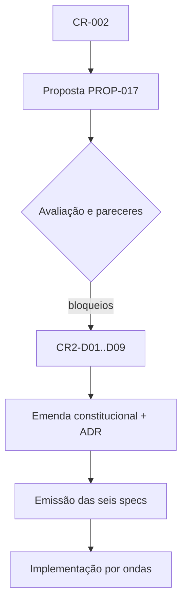

# Proposta de Spec — Contas multiusuário, dados da prestadora e histórico de invoices

## 1. Ideia / Draft

**Título da proposta:** Contas multiusuário, dados da prestadora, carteira de clientes e histórico de invoices

**Autor:** PO/GP — manifestação humana de 2026-11-13

**Data:** 2026-11-13

**Contexto / problema que resolve:**

O COGME atual é local e sem autenticação (`spec-004:54`; `spec-008:242`). A rota de invoice gera PDF, mas não vincula o documento a um titular e não mantém histórico (`spec-007:42-54`; `src/backend/routers/invoices.py:40-60`). A demanda introduce identidade, isolamento por proprietário, persistência opcional de simulações, cadastro de empresa/cliente/banco, histórico de invoices e emissão bilíngue.

Isso reverte **OS-01** — autenticação/cadastro multiusuário rejeitado como fora de escopo (`spec-002:142,154-165`) e exige emenda constitucional prévia (`constitution.md:45-47`).

**Emenda constitucional E-20 ratificada em 2026-11-14** (`constitution.md` v1.3.0): escopo expandido para identidade/multiusuário, prestadora/banco, clientes, histórico, invoice bilíngue, lifecycle conta. Marco M4 estendido para 30/12/2026 (ADR-018). Decisões CR2-D01..D09 ratificadas por CCB/GP (`docs/decisoes/ccb-CR-002.md`).

**Descrição breve da solução proposta:**

Introduzir uma camada de contas e autorização por proprietário, ampliar o modelo canônico de invoice e criar registros para simulações salvas, prestadora, clientes e contas bancárias. O idioma da invoice será derivado do país do cliente. O ciclo de vida da conta terá estados ativo/dormente e exclusão definitiva, sujeito às decisões LGPD/GDPR.

**Escopo inicial (DENTRO):**

- cadastro, login, logout, recuperação de senha e sessão individual;
- login por email, CPF ou CNPJ e identificador interno opaco;
- perfil do usuário, empresa prestadora e contas bancárias de depósito;
- carteira de clientes ativa/inativa e clientes fictícios sem cadastro;
- simulação salva por opt-in;
- histórico de simulações e invoices do próprio usuário;
- invoice finalizada imutável, com snapshot de prestadora, cliente, banco e idioma;
- invoice PT-BR para cliente `BR` e EN para cliente estrangeiro;
- exclusão definitiva e estado dormente, conforme decisões CR2-D02..CR2-D04.

**Fora de escopo (NÃO está):**

- equipes, organizações, papéis administrativos e painel admin;
- OAuth, SSO, MFA, federação de identidade e recuperação por SMS;
- integração com plataformas de pagamento ou transferência;
- NF-e/NFS-e, numeração fiscal oficial e envio automático de email;
- i18n integral da interface e dos erros — apenas a invoice será bilíngue;
- escrow, grupos, departamentos, multiempresa por usuário e billing SaaS;
-uso de serviço de nuvem de terceiros para PII, sessão ou email;
- retenção de invoice que contrarie obrigação legal: essa parte depende de CR2-D03.

## 2. Análise de Derivação Multi-Spec

**Resultado:** múltiplas specs. A demanda contém seis domínios com contratos, tabelas, riscos e ciclos de vida próprios.

| Critério de divisão | Aplica-se? | Justificativa |
|---|---:|---|
| Domínios técnicos disjuntos | Sim | Identidade, cadastro de prestadora, carteira de clientes, histórico, idioma e privacidade têm contratos e tabelas distintos. |
| Ciclos de vida independentes | Sim | Identidade/privacidade, cliente e invoice finalizada têm estados próprios. |
| Requisitos regulatórios separados | Sim | LGPD/GDPR e retenção afetam todos os domínios, mas exigem contrato e parecer próprios. |
| Dependências com desenvolvimento paralelo | Sim | Perfil/bank e client directory dependem da identidade, mas podem ser especificados em paralelo após o gate de privacidade. |

| Spec derivada | Título | Escopo resumido | Agente dono sugerido |
|---|---|---|---|
| SPEC-017 | Identidade, aliases, senha e sessões | Login, recovery, autorização por owner | `agent-digital-security` + `agent-backend-dev` |
| SPEC-018 | Perfil da prestadora e contas bancárias | MEI/PJ, CNPJ, endereço, bank/wire data | `agent-dba` + `agent-business-analysis-specialist` |
| SPEC-019 | Carteira de clientes | Cliente salvo, ativo/inativo, snapshot de invoice | `agent-business-analysis-specialist` + `agent-dba` |
| SPEC-020 | Simulações e histórico de invoices | Opt-in de simulação, owner, status, imutabilidade | `agent-sdd-specialist` + `agent-dba` |
| SPEC-021 | Invoice bilíngue | Regra país→idioma, templates PT-BR/EN | `agent-frontend-dev` + `agent-sdd-specialist` |
| SPEC-022 | Ciclo de vida e privacidade | Dormente, exclusão, retenção, LGPD/GDPR | `agent-compliance-governance` + `agent-project-analyst` |

O levantamento detalhado e a ordem de emissão estão no §13.

## 3. Viabilidade Técnica

| Critério | Avaliação | Observações |
|---|---|---|
| Tecnologias necessárias existem no stack? | Sim | FastAPI, SQLAlchemy async, PostgreSQL, Alembic, Jinja2 e WeasyPrint já estão no stack (`pyproject.toml:11-23`). |
| Requer nova dependência? | Sim | Hash de senha exige Argon2id; propose-se `argon2-cffi`, FOSS e sem custo recorrente. Transportar email pode usar SMTP local sem biblioteca. |
| Impacta arquitetura/contratos? | Sim, alto | Cria fronteira de autenticação/autorização, novas rotas, schemas e migrações. |
| Complexidade | Alta | Sessions, recovery, aliases, isolamento, snapshots, lifecycle e obrigações regulatórias. |
| Riscos técnicos | Elevados | Enumeração de identifiers, session fixation, CSRF, reset abuse, vazamento entre owners, alias rotation e histórico mutável. |

A segurança de storage deve ser definida na SPEC-017: senha com Argon2id; token de sessão/reset aleatório, armazenado apenas como hash; cookie `HttpOnly`, `Secure` em HTTPS e `SameSite`; rotação de sessão após login; CSRF em operações mutáveis; rate limit em login e reset.

## 4. Viabilidade Negocial

| Critério | Avaliação | Observações |
|---|---|---|
| Alinhado com produto/roadmap? | Parcial | Resolve a demanda direta, mas o roadmap vigente exclui multiusuário (OS-01) e termina em 15/12/2026. |
| Valor mensurável? | Sim | Titular real, histórico confiável, cadastro reutilizável e invoice no idioma do destinatário. |
| ROI | Positivo, condicionado | Reduz retrabalho de dados e permite continuidad; exige re-planejamento. |
| Dependências externas | Sim | CCB, auditoria, compliance/jurídico, segurança e decisão de canal de email. |
| Urgência | Alta | A demanda parte do usuário, mas não deve apressar bypass de LGPD/GDPR ou escopo congelado. |

## 5. Custo Técnico Estimado

| Item | Estimativa | Notas |
|---|---:|---|
| Desenvolvimento | 144–216 h | Identidade, seis specs, dados, APIs, UI e migrações. |
| Design/UX | 40–64 h | Login/recovery, perfil, clientes, históricos e idioma. |
| QA/testes | 64–96 h | Unit, integração PostgreSQL, autorização, segurança, UAT e i18n. |
| Auditoria/compliance/security | 16–32 h | Threat model, LGPD/GDPR, retenção e revisão. |
| Infra recorrente | R$ 0 | Stack local/autohospedada; canal de email depende de CR2-D06. |
| Dívida/operação | Média | Manutenção de aliases, dormência, retenção e SMTP. |
| **Total** | **264–408 h** | Não cabe no prazo M4 vigente sem novo marco ou redução material do escopo. |

## 6. Aderência ao Projeto / Produto

- **Constituição:** condicional. A demanda viola Art. 1.2 e exige emenda (`constitution.md:45-47`).
- **AGENT_TOPOLOGY:** compatível; arquitetura, DBA, backend, frontend, segurança, compliance e SDD possuem donos no roster.
- **LGPD/GDPR:** não aderente até CR2-D02..D04. A proposta adota minimização, privacy by design, erase/dormência, logs sem PII e soberania de dados; decisões jurídicas permanecem com CCB.
- **FOSS/soberania:** compatível via Argon2id, PostgreSQL local e SMTP local/autohospedado. Nenhum PII pode trafegar por cloud não autorizada (`constitution.md:101-107`).
- **YAGNI:** mantidos apenas identidade individual, um perfil prestadora por conta, carteira de clientes e histórico próprio. Equipes/admin/SSO ficam fora.

## 7. Critérios de Aceite para Promoção à Spec

- [x] Viabilidade técnica: **Sim**, com riscos e controles declarados.
- [x] Viabilidade negocial: **Parcial**, com replanejamento obrigatório.
- [ ] Custo aprovado pelo PO/PM.
- [ ] Aderência constitucional: emenda ratificada.
- [x] Riscos mapeados com mitigação.
- [x] Done e specs derivadas definidos.

**Resultado da avaliação:** aprovada como **proposta multi-spec em tramitação**, ainda não promovida a specs oficiais. A emissão oficial depende de CR-002 e das decisões listadas no §15.

## 8. Agentes Responsáveis pela Análise e Decisão

**Avaliador primário:** `agent-business-analysis-specialist` (requisitos, processos e análise de negócio).

**Consultados obrigatórios:** `agent-architect`, `agent-dba`, `agent-digital-security`, `agent-compliance-governance`, `agent-sdd-specialist`, `agent-frontend-dev`, `agent-qa-sdet`.

**Decisor:** CCB/GP humano (`constitution.md:153-159`).

| Atividade | Avaliador primário |-compliance/security | CCB/GP |
|---|:---:|:---:|:---:|
| Consolidar requisitos e user stories | R/A | C | I |
| Validar arquitetura e modelo | R | C | I |
| Threat model e LGPD/GDPR | C | R/A | I |
| Aprovar custo, escopo e marco | C | C | R/A |
| Promover specs | R | C | A |

## 9. Fluxo de Vida da Proposta

## 10. Próximos Passos

| Ação | Responsável | Prazo/condição |
|---|---|---|
| Emitir parecer de arquitetura | `agent-architect` | antes do CCB |
| Emitir threat model | `agent-digital-security` | antes do CCB |
| Emitir parecer LGPD/GDPR e retenção | `agent-compliance-governance` | antes do CCB |
| Deliberar CR2-D01..D09 | CCB/GP | após pareceres |
| Ratificar emenda e ADR | CCB/GP | antes de código |
| Emitir SPEC-017..022 | `agent-sdd-specialist` | após ratificação |
| Definir UAT e ondas | QA + PO | junto do backlog |

## 11. Metadados de Controle

| Campo | Valor |
|---|---|
| ID da proposta | PROP-017 |
| Status | draft |
| Specs propostas | SPEC-017, SPEC-018, SPEC-019, SPEC-020, SPEC-021, SPEC-022 |
| CR | `docs/change-requests/cr-002-cadastro-usuarios-multiusuario.md` |
| Issue GitHub | https://github.com/leonardosetti/COGME/issues/35 |
| Avaliador primário | `agent-business-analysis-specialist` |
| Decisão | pendente do CCB/GP |

## 12. Regras e Modelo de Dados Propostos

### 12.1 Identidade e login

- O login aceita email, CPF ou CNPJ normalizados; todos resolvem para um único `users.id`.
- Email: trim + casefold; CPF/CNPJ: apenas dígitos e validação de dígito verificador.
- `email` e `cpf` são imutáveis após o cadastro. CNPJ pode mudar, mas o alias de login é rotacionado atomicamente.
- `internal_username_hash` é HMAC-SHA-256 com chave secreta do servidor sobre um identificador aleatório; não é hash simples de CPF/email, que permitiria enumeração.
- Password: Argon2id; nunca hash reversível nem log.
- Aliases: `kind ∈ {email, cpf, cnpj}` e unicidade `(kind, lookup_hmac)`.
- Toda consulta de recurso filtra por `owner_user_id` derivado da sessão; IDs enviados pelo cliente não são autorização.

### 12.2 Tabelas e campos

| Tabela | Campos propostos | Constraints/observações |
|---|---|---|
| `users` | `id UUID PK`, `internal_username_hash BYTEA`, `name`, `email`, `phone`, `cpf`, `password_hash`, `status`, `dormant_since`, `last_login_at`, `created_at`, `updated_at` | `status ∈ {active,dormant}`; email/CPF únicos e imutáveis; hash interno único. |
| `user_login_identifiers` | `id UUID PK`, `user_id FK`, `kind`, `lookup_hmac BYTEA`, `created_at`, `retired_at` | `UNIQUE(kind, lookup_hmac)`; `UNIQUE(user_id, kind)` enquanto ativo. |
| `user_sessions` | `id UUID PK`, `user_id FK`, `token_hash BYTEA`, `created_at`, `last_seen_at`, `expires_at`, `revoked_at` | token único; revogação e expiração fail-closed. |
| `password_reset_tokens` | `id UUID PK`, `user_id FK`, `token_hash BYTEA`, `created_at`, `expires_at`, `used_at` | single-use; TTL a ratificar em CR2-D06. |
| `provider_profiles` | `user_id UUID PK/FK`, `legal_name`, `category`, `cnpj`, `address`, `city`, `state`, `postal_code`, `country_code`, timestamps | `category ∈ {mei,legal_entity}`; CNPJ obrigatório apenas para `legal_entity`. |
| `provider_bank_accounts` | `id UUID PK`, `user_id FK`, `account_type`, `bank_code`, `bank_name`, `branch`, `account_number`, `account_digit`, `swift_bic`, `iban`, `account_holder`, `currency`, `is_primary`, timestamps | dados bancários cifrados/segredos; uma conta primária por usuário; snapshot em invoice. |
| `clients` | `id UUID PK`, `owner_user_id FK`, `name`, `tax_id`, `address`, `country_code`, `is_active`, `deactivated_at`, timestamps | `is_active` obrigatório; país ISO 3166-1; cliente fictício não é salvo aqui. |
| `simulations` | `id UUID PK`, `owner_user_id FK`, `currency`, `regime`, `amount`, `quantity`, `spread_pct`, `iof_pct`, resultados, `rate`, `rate_source`, `quoted_at`, `bulletin`, `stale`, `created_at` | snapshot tipado; decimais e valores reproduzíveis. |
| `account_lifecycle_events` | `id UUID PK`, `user_id FK`, `event_type`, `from_status`, `to_status`, `created_at` | evento sem PII; `ON DELETE CASCADE` com a conta. |
| `invoices` | modelo de `spec-007` + `owner_user_id`, `client_id`, `simulation_id`, `status`, `locale`, `client_country_code`, `finalized_at`, `supersedes_invoice_id` | owner obrigatório; `status ∈ {draft,finalized}`; locale `pt-BR|en`; FKs explícitas; finalized imutável. |

`fx_quotes` permanece inalterada. A alteração de `invoices` deve ser uma emenda de migration, preservando `upgrade` e `downgrade`.

### 12.3 Integridade e histórico

- Finalização copia prestadora, banco, cliente, simulação/cotação, valores e idioma para a invoice.
- Alterações posteriores em perfil, cliente ou conta bancária não alteram invoice finalizada.
- Simulação salva guarda a cotação usada; listar histórico não recalcula o resultado com taxa vigente.
- Invoice rascunho pode ser editada; invoice finalizada é somente leitura.
- Clonagem, quando aprovada, cria novo rascunho com novo número e `supersedes_invoice_id`.
- Listagens paginadas ordenam por data e identificador; usuário só acessa recursos com o próprio `owner_user_id`.

### 12.4 Idioma da invoice

- Fonte canônica: `client.country_code`.
- `BR` → `pt-BR`; qualquer outro código → `en`.
- Cliente fictício exige país explícito; request sem país é inválido.
- Templates separados `invoice_pt_br.html` e `invoice_en.html`; erros da API permanecem PT-BR.
- `invoice.locale` e `client_country_code` ficam no snapshot para auditoria histórica.

### 12.5 Exclusão, dormência e privacidade — **DECISÕES RATIFICADAS (CCB-CR-002)**

- **Dormência (CR2-D04 ratificada):** 180 dias sem login → status `dormant`; revoga sessões e bloqueia criação/alteração; dados permanecem conforme retenção ratificada. Reativação exige reset de senha + verificação de identidade.
- **Exclusão definitiva (CR2-D03 ratificada):** Remove usuário, aliases, sessões, tokens, perfil, banco, clientes, simulações, eventos de lifecycle. **Invoices finalizadas: retenção legal mínima 5 anos (art. 206 §5º CC) + anonimização irreversível pós-período.** Rota DELETE de esquecimento obrigatória (spec-015 CP-3).
- **LGPD/GDPR (CR2-D02 ratificada):** Controlador = usuário titular. Base legal art. 7º V LGPD (execução de contrato — invoice carrega dados de terceiros/cliente). GDPR aplica-se se oferta/monitoramento alcançar pessoas no EEE/UK. Direitos do titular operantes via erase local (single-user design).
- **Logs/artefatos (spec-015 CP-2 ratificada):** PII real **nunca** entra em logs, testes, seeds, handoffs ou exemplos técnicos. Verificação automatizada de logs sem PII/valores/corpo.
- **Retenção `fx_quotes` (resolvido):** Dados públicos, LGPD n/a; política de manutenção futura (não critério LGPD).

## 13. Levantamento de Specs de Relação Direta

### 13.1 Novas specs a gerar — **GATES ATUALIZADOS PÓS-RATIFICAÇÃO**

| Ordem | Spec | Entregável | Dependência | Gate |
|---:|---|---|---|---|
| 1 | SPEC-022 — `account-lifecycle-privacy-v1` | retenção 5a+anonimização, dormência 180d, erase local, LGPD/GDPR (controlador=titular, base art.7ºV) | CR-002 + **D2/D3/D4/D6 ratificadas** | **Gate B — LIBERADO** |
| 2 | SPEC-017 — `identity-access-session-v1` | aliases (HMAC), Argon2id, reset 1h TTL, sessão regenerada, owner-check, CSRF, rate-limit | CR-002 + SPEC-022 + ADR-017 + ADR-019 | **Gate C — LIBERADO** |
| 3 | SPEC-018 — `provider-profile-bank-account-v1` | MEI/PJ, CNPJ rotaciona alias, bank accounts criptografados, snapshot invoice | SPEC-017 + SPEC-022 | **Gate D — PARALELO** |
| 4 | SPEC-019 — `client-directory-v1` | clientes ativo/inativo, país ISO, fictício exige país, snapshot invoice | SPEC-017 + SPEC-022 | **Gate D — PARALELO** |
| 5 | SPEC-020 — `simulation-invoice-history-v1` | save opt-in, owner, status draft/finalized, snapshots FX, histórico imutável | SPEC-017/018/019 + D1 ratificada | **Gate D — PARALELO** |
| 6 | SPEC-021 — `invoice-bilingual-v1` | `client.country_code` → `BR`=pt-BR / demais=en; templates separados; fictício exige país | SPEC-019 + CR2-D05 ratificada | **Gate D — PARALELO** |

### 13.2 Specs existentes a emendar, não duplicar

- `spec-002`: revogar OS-01 e criar user stories candidatas.
- `spec-004`: contrato HTTP, autenticação, persistência e autorização.
- `spec-007`: owner, status, locale, FKs e snapshots de `invoices`.
- `spec-008`: telas de conta/perfil/cliente/histórico e template bilíngue.
- `spec-015`: decisões LGPD executivas e retenção compatível com SPEC-022.
- `constitution.md`, TAP e plano de gerenciamento: emenda, marco, custo e capacidade.

### 13.3 Critério de “relação direta”

Uma spec é relacionada direta se altera identidade, propriedade, persistência, lifecycle ou renderização da invoice. Alterações apenas editoriais, sem contrato ou schema, não geram spec nova.

## 14. Critérios de Aceite e DoD das Specs Derivadas

- Toda tabela nova tem migration com `upgrade`/`downgrade`, FK, índices e teste PostgreSQL.
- Nenhum recurso owned é acessível por outro usuário; testes de IDOR/autorização são obrigatórios.
- Email e CPF não possuem endpoint de alteração; CNPJ rotaciona alias na mesma transação.
- Password/reset/session nunca aparecem em log; cookies e CSRF seguem a SPEC-017.
- Invoice finalizada é imutável e contém snapshots completos de issuer, client, bank, simulation/quote, amounts e locale.
- Invoice `BR` é PT-BR; invoice estrangeira é EN; cliente fictício sem país é rejeitado.
- Simulação só persiste quando o usuário salva explicitamente.
- Exclusão e dormência passam por testes de lifecycle, retenção e fail-closed.
- Logs, fixtures e documentação usam exclusivamente dados sintéticos.

## 15. Decisões e UNKNOWNs — **TODAS RATIFICADAS (2026-11-14, CCB-CR-002)**

| ID | Decisão | Veredito | Instrumento |
|----|---------|----------|-------------|
| **CR2-D01** | Emenda constitucional identity/multiuser/history/directories/i18n | **RATIFICADA** — E-20 (constitution.md v1.3.0) | RAT-2026-11-14-E20 |
| **CR2-D02** | Controlador/titular, bases LGPD/GDPR, escopo territorial | **RATIFICADA** — Controlador=titular; base art.7ºV; GDPR se oferta EEE/UK | CCB-CR-002 |
| **CR2-D03** | Retenção/anonimização invoices pós-exclusão | **RATIFICADA** — 5 anos (art.206§5ºCC) + anonimização irreversível; erase local | CCB-CR-002 |
| **CR2-D04** | Dormência: prazo e efeito | **RATIFICADA** — 180 dias sem login → `dormant`; revoga sessões; reativação = reset+verificação | CCB-CR-002 |
| **CR2-D05** | Regra país→idioma | **RATIFICADA** — `client.country_code`: `BR`→pt-BR, demais→en; fictício exige país | CCB-CR-002 |
| **CR2-D06** | Canal email, TTL reset, rotação pepper HMAC | **RATIFICADA** — SMTP local/autohospedado; TTL 1h; pepper rotacionado 90d | CCB-CR-002 |
| **CR2-D07** | Escopo MVP / re-priorização backlog | **RATIFICADA** — Cenário A Completo no M4 estendido (30/12/2026) | CCB-CR-002 + ADR-018 |
| **CR2-D08** | Ciclo Rascunho/Finalizada / clonagem | **RATIFICADA** — rascunho editável; finalizada imutável; clone = novo rascunho + `supersedes_invoice_id` | CCB-CR-002 |
| **CR2-D09** | Marco/custo | **RATIFICADA** — **Não criar M5; estender M4 para 30/12/2026**; AI-driven processing alocado | CCB-CR-002 + ADR-018 |

**UNKNOWNs residuais:**
1. CNPJ fora do escopo LGPD — confirmar com parecer jurídico (não bloqueia; tratado como dado comum se identificar pessoa natural).

## CHANGELOG

- **0.1.0 — 2026-11-13:** proposta multi-spec emitida a partir da CR-002; regras de identidade, aliases, locale e lifecycle; modelo de dez tabelas (nove novas + emenda de `invoices`); seis specs derivadas e critérios de emissão. Status draft; nenhum código, migração ou decisão humana ratificada.
- **0.2.0 — 2026-11-14:** **Todas decisões CR2-D01..D09 ratificadas por CCB/GP** (docs/decisoes/ccb-CR-002.md). Emenda E-20 em constitution.md v1.3.0. ADRs 017, 018, 019 emitidas. Gates B/C/D liberados. §12.5 reescrito com vereditos. §13.1 atualizado com gates. §15 com tabela de vereditos. UNKNOWN CNPJ LGPD documentado.
