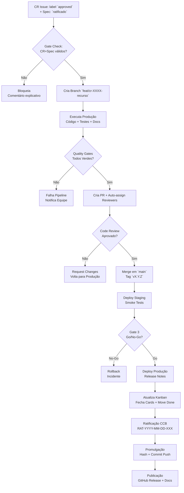

# Runbook: Workflow de Aprovação CR + Spec → Produção de Recursos

> **Finalidade**: Automatizar o fluxo desde a aprovação de um **Change Request (CR)** + **Spec** até a **produção, teste, documentação, ratificação, promulgação e publicação** do recurso correspondente.
> **Gatilho**: Label `approved` adicionada a Issue tipo `change-request` **E** Spec correspondente com status `ratificado`.
> **Princípio**: **Nenhum recurso entra em produção sem CR+Spec aprovados + DoD atendido + Gates validados**.

---

## 1. ARQUITETURA DO WORKFLOW



---

## 2. GATILHOS (Triggers)

### 2.1 Gatilho Principal (GitHub Actions)
```yaml
# .github/workflows/cr-spec-approval.yml
on:
  issues:
    types: [labeled, unlabeled]
  # Também disparar quando Spec for ratificada (commit em docs/especificacoes/spec-*.md)
  push:
    paths:
      - 'docs/especificacoes/spec-*.md'
      - 'docs/change-requests/cr-*.md'
```

### 2.2 Condições de Disparo (AND)
| Condição | Verificação |
|---|---|
| **CR Aprovado** | Issue com label `change-request` **E** label `approved` **E** sem label `blocked` |
| **Spec Ratificada** | Arquivo `docs/especificacoes/spec-XXX.md` existe **E** frontmatter `status: ratificado` |
| **Rastreabilidade** | CR referencia Spec (`spec-prop-XXX` ou `spec-XXX`) **E** Spec referencia CR |
| **Dependências** | Todas as CRs/Specs bloqueadoras (`blocks:` no frontmatter) estão `approved`/`ratificado` |

---

## 3. PASSOS DE PRODUÇÃO (Job `produce`)

### 3.1 Setup do Ambiente
```bash
# 1. Checkout com fetch depth 0 (para tags)
git fetch --tags --depth=0 origin

# 2. Cria branch de feature
BRANCH="feat/cr-${CR_NUMBER}-${SLUG}"
git checkout -b "$BRANCH" main

# 3. Configura identidade do bot
git config user.name "cogme-bot"
git config user.email "bot@cogme.local"
```

### 3.2 Geração de Código (Agent SDD)
```bash
# Invoca agent-sdd-specialist via Nexus
nexus-prime-ultimate dispatch \
  --agent agent-sdd-specialist \
  --task "Implementar recurso conforme CR-${CR_NUMBER} + Spec-${SPEC_ID}" \
  --context "CR:${CR_NUMBER}, Spec:${SPEC_ID}, Branch:${BRANCH}" \
  --output "src/, tests/, migrations/"
```

### 3.3 Geração de Testes
```bash
# Unit + Integration + E2E (conforme Test Plan)
pytest tests/ -xvs --cov=src --cov-fail-under=80

# Gera relatório de cobertura
pytest --cov=src --cov-report=xml:coverage.xml
```

### 3.4 Geração de Documentação
```bash
# Atualiza CHANGELOG/Release Notes (template)
python scripts/generate_release_notes.py --cr ${CR_NUMBER} --spec ${SPEC_ID}

# Atualiza RTM (rastreabilidade)
python scripts/update_rtm.py --cr ${CR_NUMBER} --spec ${SPEC_ID}

# Valida cross-references
python scripts/verificar_cross_refs.py
```

---

## 4. QUALITY GATES (Job `quality-gates`)

| Gate | Comando | Threshold | Bloqueia? |
|---|---|---|---|
| **G1 - Lint/Type** | `ruff check . && mypy --strict src/` | 0 erros | ✅ Sim |
| **G2 - Unit Tests** | `pytest tests/unit --cov=src --cov-fail-under=80` | ≥ 80% linhas | ✅ Sim |
| **G3 - Integration** | `pytest tests/integration` | 100% pass | ✅ Sim |
| **G4 - E2E** | `pytest tests/e2e` | 100% pass | ✅ Sim |
| **G5 - Security** | `bandit -r src/ && trufflehog filesystem .` | 0 High/Crit | ✅ Sim |
| **G6 - FOSS** | `license-checker --onlyAllow OSI` | 0 non-FOSS | ✅ Sim |
| **G7 - A11y** | `axe-core tests/e2e/` | 0 AA violations | ✅ Sim |
| **G8 - Cross-refs** | `python scripts/verificar_cross_refs.py` | 0 broken | ✅ Sim |

---

## 5. CODE REVIEW AUTOMÁTICO (Job `review`)

### 5.1 Reviewers Automáticos (baseado em labels)
| Label no CR/Spec | Reviewer (GitHub User/Team) |
|---|---|
| `area:integracao` | `@leonardosetti` (GP/Arch) |
| `area:seguranca` | `@leonardosetti` (Security) |
| `area:escopo` | `@edsonsilva11` (PO/BA) |
| `area:qualidade` | `@edsonsilva11` (QA) |
| `area:operacao` | `@leonardosetti` (DevOps) |
| `sdd-ia` | `nexus-prime-ultimate` (Agent Review) |

### 5.2 Critérios de Aprovação
- [ ] Todos os Quality Gates **Verdes**
- [ ] Pelo menos **1 aprovação humana** (exceto `sdd-ia` que é agent)
- [ ] Zero `Request Changes` pendentes
- [ ] `DoD` do template CR atendido (checklist no corpo da Issue)

---

## 6. DEPLOY E GATES (Jobs `deploy-staging`, `gate3`, `deploy-prod`)

### 6.1 Deploy Staging (Automático pós-Merge)
```bash
# Tag temporária para staging
git tag -f "staging-${BRANCH}" && git push origin "staging-${BRANCH}"

# GitHub Actions workflow `deploy-staging.yml` roda:
# - docker compose -f docker-compose.staging.yml up -d
# - Smoke tests (scripts/smoke_tests.sh)
# - Health checks (/health, /health/db, /v1/rates/USD)
```

### 6.2 Gate 3 (Go/No-Go Manual)
```yaml
# Pausa workflow aguardando aprovação manual
- name: Gate 3 - Go/No-Go
  uses: trstringer/manual-approval@v1
  with:
    secret: ${{ github.token }}
    approvers: leonardosetti  # GP/CCB único
    minimum-approvals: 1
    issue-url: "https://github.com/leonardosetti/COGME/issues/${CR_NUMBER}"
```

### 6.3 Deploy Produção (Pós-Go)
```bash
# Tag de release SemVer
VERSION=$(python scripts/calc_version.py --cr ${CR_NUMBER})
git tag -a "v${VERSION}" -m "Release v${VERSION} - CR-${CR_NUMBER}"
git push origin "v${VERSION}"

# Deploy via workflow `deploy-prod.yml`
# - docker compose -f docker-compose.prod.yml up -d
# - Smoke tests + Health checks
# - Rollback automático se falhar (tag anterior)
```

---

## 7. PÓS-DEPLOY (Job `post-deploy`)

### 7.1 Atualização Kanban (GitHub Projects)
```bash
# Move cards para Done
gh project item-edit 2 --owner leonardosetti --id ${CARD_ID} --field Status "Done"

# Fecha Issues relacionadas
gh issue close ${CR_NUMBER} --reason "completed"
gh issue close ${SPEC_ISSUE_NUMBER} --reason "completed"

# Comentário automático com resumo
gh issue comment ${CR_NUMBER} --body "
## ✅ Recurso Produzido e Publicado
- **Versão**: v${VERSION}
- **Commit**: ${COMMIT_SHA}
- **Deploy**: ${DEPLOY_URL}
- **Release Notes**: docs/relatorios/rel-release-notes-v${VERSION}.md
- **Ratificação**: RAT-$(date +%Y-%m-%d)-XXX
"
```

### 7.2 Ratificação CCB (Automática + Manual)
```bash
# Gera entrada no CCB Log
python scripts/generate_ccb_log.py \
  --cr ${CR_NUMBER} \
  --spec ${SPEC_ID} \
  --version v${VERSION} \
  --commit ${COMMIT_SHA} \
  --ratificacao "RAT-$(date +%Y-%m-%d)-$(printf %03d $((RANDOM%999)))"

# Commita CCB Log atualizado
git add docs/governanca/ccb-log.md
git commit -m "chore(ccb): ratificação CR-${CR_NUMBER} + Spec-${SPEC_ID} v${VERSION}"
git push origin main
```

### 7.3 Promulgação e Publicação
```bash
# GitHub Release automático (via tag push)
# Workflow `release.yml` cria Release com:
# - Release Notes de docs/relatorios/rel-release-notes-vX.Y.Z.md
# - Assets (se houver binários)
# - Changelog completo

# Atualiza documentação publicada (se houver site)
# curl -X POST "https://api.cogme.local/webhook/docs-rebuild" || true
```

---

## 8. ROLLBACK E TRATAMENTO DE FALHAS

### 8.1 Falha em Quality Gates
```yaml
# Notifica no Discord/Slack
- name: Notify Failure
  if: failure()
  run: |
    curl -X POST "${{ secrets.DISCORD_WEBHOOK }}" \
      -H "Content-Type: application/json" \
      -d '{"content": "❌ **Quality Gates Falharam**\nCR: '${CR_NUMBER}'\nSpec: '${SPEC_ID}'\nBranch: '${BRANCH}'\nPipeline: '${{ github.server_url }}/${{ github.repository }}/actions/runs/'${{ github.run_id }}'"}'

# Abre Issue de incidente se crítico
gh issue create --title "[INCIDENTE] Quality Gates CR-${CR_NUMBER}" --body "..."
```

### 8.2 Falha no Gate 3 / Deploy
```bash
# Rollback automático para tag anterior
PREV_TAG=$(git tag --sort=-v:refname | grep -v "staging-" | head -2 | tail -1)
git checkout "$PREV_TAG"
docker compose -f docker-compose.prod.yml up -d
# Smoke tests de validação rollback
```

### 8.3 Incidente P0/P1
```bash
# Cria Post-Mortem template
cp docs/conhecimento/templates/kb-template-post-mortem.md \
   docs/operacao/proc-post-mortem-PM-$(date +%Y-%m-%d)-${CR_NUMBER}.md

# Notifica CCB + Equipe
# Escalação Nível 3 (Constitution Art. 7)
```

---

## 9. HOOKS DE INTEGRAÇÃO (Scripts Auxiliares)

### 9.1 `scripts/cr_spec_trigger.py` — Verifica Gatilho
```python
#!/usr/bin/env python3
"""Verifica se CR+Spec atendem condições para disparar pipeline."""

import subprocess
import sys
import re
from pathlib import Path

def check_cr_approved(cr_number):
    """Verifica se Issue CR tem label approved e não blocked."""
    result = subprocess.run(
        ["gh", "issue", "view", str(cr_number), "--json", "labels,state"],
        capture_output=True, text=True
    )
    # ... parse labels ...

def check_spec_ratified(spec_id):
    """Verifica se Spec tem status ratificado."""
    spec_file = Path(f"docs/especificacoes/spec-{spec_id}.md")
    # ... parse frontmatter ...

def check_dependencies(cr_number):
    """Verifica se CRs/Specs bloqueadoras estão aprovadas."""
    # ... query GitHub Issues/Projects ...

if __name__ == "__main__":
    # Lógica principal
    pass
```

### 9.2 `scripts/update_kanban.py` — Sincroniza Kanban
```python
#!/usr/bin/env python3
"""Atualiza GitHub Projects (Kanban) baseado em eventos."""

import json
import subprocess

def move_to_done(card_id):
    subprocess.run(["gh", "project", "item-edit", "2", 
                    "--owner", "leonardosetti",
                    "--id", card_id,
                    "--field", "Status", "Done"])

def close_related_issues(cr_number, spec_issue_number):
    subprocess.run(["gh", "issue", "close", str(cr_number), "--reason", "completed"])
    subprocess.run(["gh", "issue", "close", str(spec_issue_number), "--reason", "completed"])
```

---

## 10. CONFIGURAÇÃO GITHUB ACTIONS (`.github/workflows/cr-spec-approval.yml`)

```yaml
name: CR+Spec Approval → Production

on:
  issues:
    types: [labeled, unlabeled]
  push:
    paths:
      - 'docs/especificacoes/spec-*.md'
      - 'docs/change-requests/cr-*.md'

permissions:
  contents: write
  issues: write
  pull-requests: write
  actions: read

jobs:
  check-trigger:
    runs-on: ubuntu-latest
    outputs:
      should_run: ${{ steps.check.outputs.should_run }}
      cr_number: ${{ steps.check.outputs.cr_number }}
      spec_id: ${{ steps.check.outputs.spec_id }}
    steps:
      - uses: actions/checkout@v4
      - id: check
        run: python scripts/cr_spec_trigger.py

  produce:
    needs: check-trigger
    if: needs.check-trigger.outputs.should_run == 'true'
    runs-on: ubuntu-latest
    steps:
      - uses: actions/checkout@v4
        with: { fetch-depth: 0 }
      - name: Setup Python/Node
        uses: actions/setup-python@v5
        with: { python-version: '3.12' }
      - name: Produzir Recurso
        run: |
          python scripts/produce_resource.py \
            --cr ${{ needs.check-trigger.outputs.cr_number }} \
            --spec ${{ needs.check-trigger.outputs.spec_id }}

  quality-gates:
    needs: produce
    runs-on: ubuntu-latest
    steps:
      - uses: actions/checkout@v4
      - name: Quality Gates
        run: |
          ruff check . && mypy --strict src/
          pytest tests/unit --cov=src --cov-fail-under=80
          pytest tests/integration
          pytest tests/e2e
          bandit -r src/
          trufflehog filesystem .
          python scripts/verificar_cross_refs.py

  review:
    needs: quality-gates
    runs-on: ubuntu-latest
    steps:
      - name: Create PR & Assign Reviewers
        run: python scripts/create_pr_and_assign.py

  gate3:
    needs: review
    runs-on: ubuntu-latest
    steps:
      - uses: trstringer/manual-approval@v1
        with:
          secret: ${{ secrets.GITHUB_TOKEN }}
          approvers: leonardosetti
          minimum-approvals: 1

  deploy-prod:
    needs: gate3
    runs-on: ubuntu-latest
    steps:
      - name: Deploy Produção
        run: python scripts/deploy_prod.py

  post-deploy:
    needs: deploy-prod
    runs-on: ubuntu-latest
    steps:
      - name: Atualiza Kanban + Ratificação CCB
        run: python scripts/post_deploy.py

  rollback:
    needs: [deploy-prod, gate3]
    if: failure()
    runs-on: ubuntu-latest
    steps:
      - name: Rollback Automático
        run: python scripts/rollback.py
```

---

## 11. CHECKLIST DE DOd (Definition of Done) — Por Recurso

| Item | Verificação | Responsável |
|---|---|---|
| **Código** | Implementado conforme Spec + CR | Agent SDD |
| **Testes** | Unit (≥80%) + Int + E2E + Perf + Sec + A11y | Agent QA |
| **Docs** | Release Notes + RTM atualizado + Cross-refs OK | Agent Analyst |
| **Quality Gates** | Todos 8 gates verdes | CI/CD |
| **Code Review** | 1+ aprovação humana + agent review | Reviewers |
| **Deploy Staging** | Smoke tests passam | DevOps |
| **Gate 3** | CCB Go/No-Go assinado | GP/CCB |
| **Deploy Prod** | Health checks OK + Rollback testado | DevOps |
| **Kanban** | Cards movidos Done + Issues fechadas | Bot |
| **Ratificação** | CCB Log entry + Hash + Push | GP/CCB |
| **Promulgação** | GitHub Release + Docs publicadas | Bot |

---

## 12. CONTROLE DE VERSÕES

| Versão | Data | Autor | Mudança | Ratificação |
|---|---|---|---|---|
| 1.0.0 | 2026-11-14 | agent-devops | Criação inicial (workflow CR+Spec→Produção) | GP (CCB) |

---

> **Integração**: Este runbook deve ser referenciado no `Runbook` principal (`docs/operacao/proc-runbook.md`) seção "Workflow CR+Spec" e no `CI-CD-GOV-001` como gate de qualidade obrigatório para recursos derivados de CR+Spec.