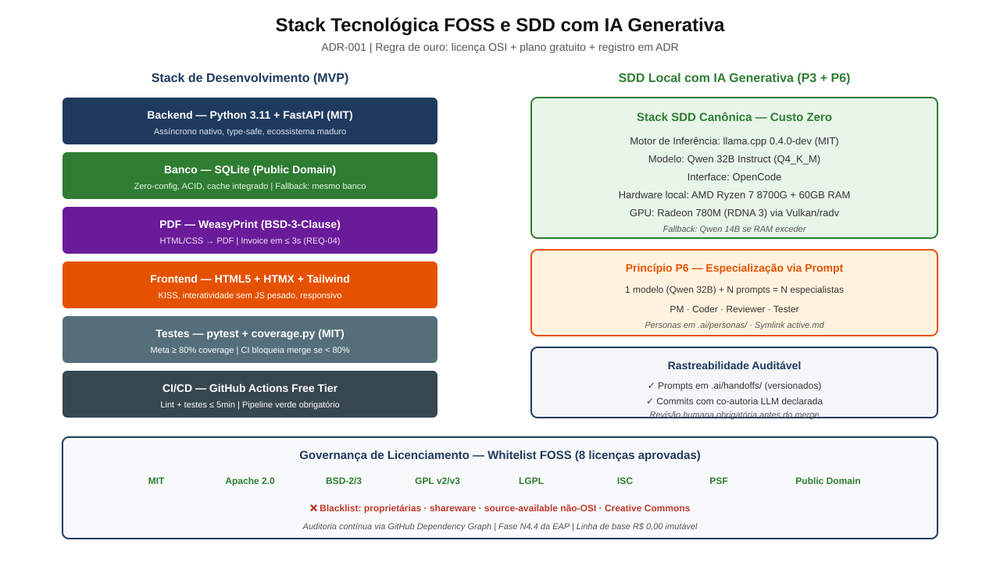
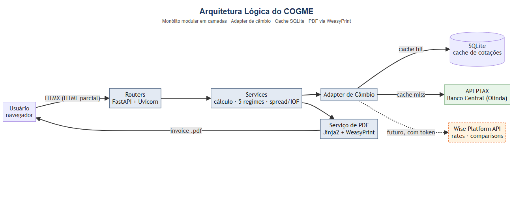
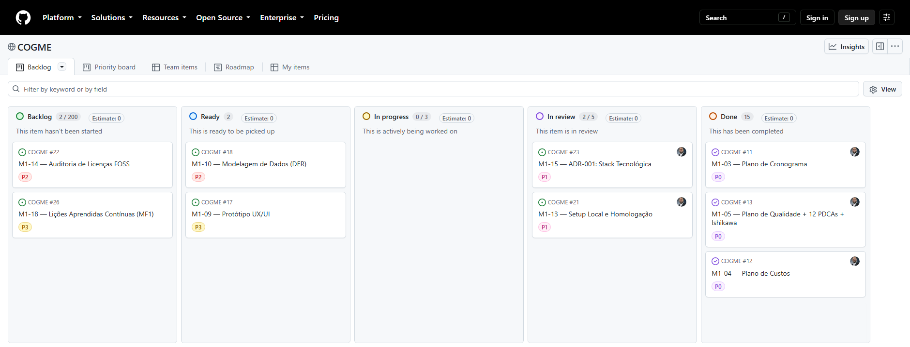
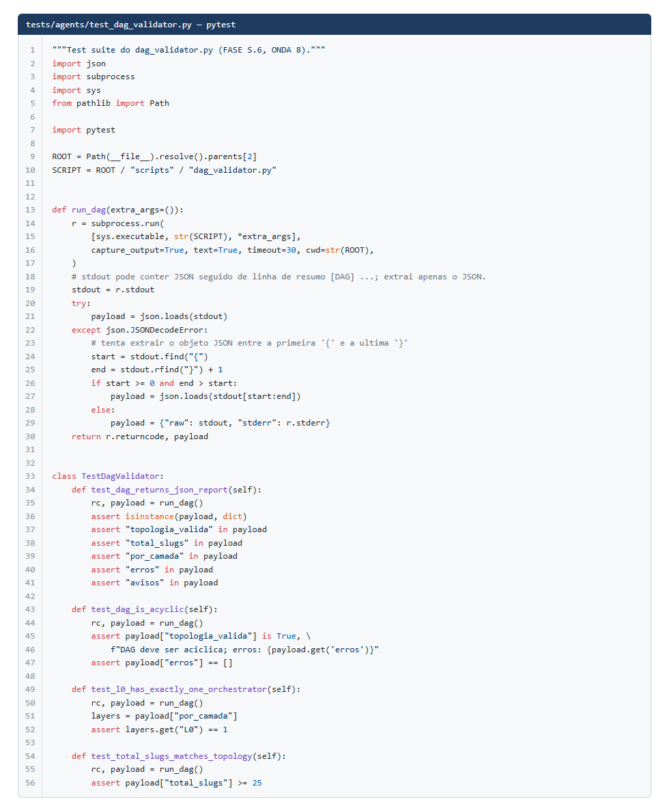
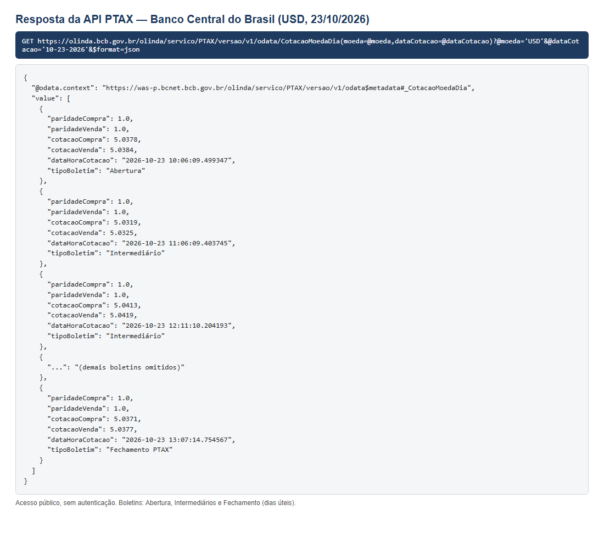

# 3 DESENVOLVIMENTO

**Rastreabilidade:** EAP N3 (Modelagem), N4 (Ambiente), N5 (Desenvolvimento), N6 (Qualidade), N7 (DevOps) · ADR-001 (Stack FOSS) · REQ-01 a REQ-15.
**Domínios PMBOK® 7ª:** Abordagem de Desenvolvimento e Ciclo de Vida · Entrega · Trabalho do Projeto.
**Princípios PMBOK® 7ª aplicados:** "Focar no valor"; "Incorporar qualidade nos processos e nas entregas"; "Fazer a adaptação (tailoring) com base no contexto".

O COGME usa uma **abordagem de desenvolvimento adaptativa**: fluxo contínuo Kanban com entregas incrementais, sem sprints, aplicado a um escopo de MVP congelado. Pelo Domínio de Abordagem de Desenvolvimento e Ciclo de Vida do PMBOK® 7ª, a escolha se justifica por três fatores: equipe pequena, requisitos que ainda podem ser refinados (regras de cálculo) e necessidade de feedback rápido. O ciclo de vida tem três macro-fases: **MF1 Fundação** (01/09–30/09), **MF2 Construção** (01/10–15/11) e **MF3 Consolidação** (16/11–15/12).

O código segue o **Specification-Driven Development (SDD)**: especificar → implementar → validar. A IA generativa roda localmente e gera código a partir de especificações validadas. Todo trecho gerado passa por revisão humana e por testes antes do merge.

---

## 3.1 Tecnologias / Plataformas / Códigos

### 3.1.1 Tecnologias (Stack do Produto — ADR-001)

| Camada | Tecnologia | Versão | Licença | Função no COGME | Justificativa |
| --- | --- | --- | --- | --- | --- |
| Linguagem | Python | 3.11 | PSF | Lógica de negócio e API | Ecossistema maduro, domínio da equipe |
| Backend / API | FastAPI | ≥ 0.100 (projeto) · 0.162.0 (estável) | MIT | Endpoints assíncronos de simulação, cotação e PDF | Assíncrono nativo, documentação OpenAPI automática (REQ-14) |
| Servidor ASGI | Uvicorn | 0.54.0 (estável) | BSD-3 | Executa a aplicação FastAPI | Padrão do FastAPI |
| Banco de dados | SQLite | 3.x | Domínio público | Cache de cotações e persistência local (REQ-07) | Zero configuração, ACID, suficiente para o MVP |
| Fonte de cotações | API PTAX do Banco Central do Brasil (Olinda, OData/JSON) | v1 | Dados abertos governamentais | Cotações oficiais de compra e venda de USD/EUR → BRL (REQ-01) | Pública, gratuita, sem chave; taxa de referência oficial |
| Geração de PDF | WeasyPrint | ≥ 59.0 (projeto) · 70.0 (estável) | BSD-3 | Invoice em PDF a partir de HTML/CSS (REQ-04) | FOSS, aproveita templates HTML |
| Frontend | HTML5 + HTMX + Tailwind CSS | HTMX 2.0.11 · Tailwind 4.3.3 (estáveis) | HTMX: 0BSD · Tailwind: MIT | Interface responsiva com atualização parcial sem SPA (REQ-06) | Leve, sem framework JS pesado (KISS) |
| Templates | Jinja2 | 3.1.6 (estável) | BSD-3 | Renderização de páginas e do HTML da invoice | Integração nativa com FastAPI |
| Testes | pytest + coverage.py | pytest ≥ 7.0 (projeto) · 9.1.1 (estável) · coverage.py 7.17.0 (estável) | MIT / Apache-2.0 | Testes unitários e de integração, coverage ≥ 80 % (REQ-08) | Padrão Python |
| Análise estática | flake8 + mypy | flake8 7.4.1 · mypy 2.4.0 (estáveis) | MIT | Lint e tipagem no CI | Qualidade preventiva |

Fonte: Elaborado pelos autores (2026), com base na ADR-001.

**Nota sobre as versões:**
- **"(projeto)"** é a versão mínima declarada na documentação do COGME: README, Plano de Custos e ADR-001. Por exemplo, FastAPI ≥ 0.100, WeasyPrint ≥ 59.0, pytest ≥ 7.0 e llama.cpp 0.4.0-dev.
- **"(estável)"** é a versão estável mais recente na documentação oficial de cada projeto (PyPI e npm), consultada em 25/10/2026. Ela serve de referência de compatibilidade e não indica o que foi instalado: o `requirements.txt` e o `pyproject.toml` estão vazios no repositório.
- O Uvicorn aparece no README como servidor de execução (`uvicorn src.backend.main:app`). O Jinja2 é o mecanismo de templates usado em conjunto com o FastAPI.
- Todas as licenças estão na whitelist FOSS do Plano de Custos. O 0BSD do HTMX é uma licença permissiva aprovada pela OSI.



Figura 3.1 — Stack tecnológica FOSS e SDD com IA generativa (ADR-001).
Fonte: Repositório COGME, `docs/slides_apresentacao/stack.svg` (2026).

### 3.1.2 Plataformas e Ferramentas de Apoio

| Plataforma | Uso | Custo |
| --- | --- | --- |
| GitHub (repositório público) | Versionamento, Pull Requests, revisão em pares | Free Tier |
| GitHub Projects | Kanban SSOT (Backlog → Ready → In Progress → Code Review → Done) | Free Tier |
| GitHub Insights | Métricas de fluxo (Cycle Time, Throughput, CFD) | Free Tier |
| GitHub Actions | Pipeline CI: lint (flake8 + mypy) → testes (pytest + coverage ≥ 80 %) → relatório, em ≤ 5 min (REQ-11) | Free Tier |
| VS Code | IDE da equipe | Gratuito (MIT, núcleo Code-OSS) |
| llama.cpp + Qwen (execução local em CPU) + OpenCode | IA generativa local para SDD; 25 agentes especializados governados pela `constitution.md` | FOSS / licença autorizada |
| draw.io / Mermaid | Diagramas (EAP, fluxos, CFD) | FOSS |
| API PTAX — Banco Central do Brasil | Fonte oficial das cotações USD/EUR → BRL | Gratuito (dados abertos) |
| Wise Platform API (sandbox) | **Em avaliação:** cotação e comparação de plataformas de pagamento internacional | Exige conta e token |

Fonte: Elaborado pelos autores (2026).

### 3.1.3 Arquitetura e Organização do Código

Arquitetura em camadas (monólito modular), conforme a estrutura do repositório:

```
src/
├── backend/            # FastAPI + SQLite
│   ├── main.py         # ponto de entrada da aplicação (uvicorn src.backend.main:app)
│   ├── routers/        # camada de apresentação da API (endpoints HTTP)
│   ├── services/       # regras de negócio: conversão, regimes, spread/IOF, PDF, adapter da API de câmbio
│   └── models/         # entidades e acesso a dados (SQLite / cache)
├── frontend/           # HTMX + Tailwind
│   ├── templates/      # páginas e template HTML da invoice
│   └── static/         # CSS/JS estáticos
└── shared/             # schemas compartilhados (validação de entrada/saída)
tests/
├── unit/               # testes de regras de cálculo
└── integration/        # testes de endpoints, cache e geração de PDF
```



Figura 3.2 — Arquitetura lógica do COGME.
Fonte: Elaborado pelos autores (2026).

**Padrões e práticas de código:**
- **Adapter pattern** na integração com a API de câmbio, para trocar de provedor sem mexer na regra de negócio (mitiga RE-01).
- **Cache com TTL** no SQLite para reduzir ≥ 50 % das chamadas externas (REQ-07).
- **Conventional Commits** (`feat`, `fix`, `docs`, `test`, `ci`, `chore`) e coautoria declarada em commits feitos com IA.
- **TDD** nos fluxos críticos (cálculo cambial, regimes, PDF).
- **Clean Code / KISS**, slugs e código em inglês, mensagens ao usuário em PT-BR (Constituição P-10).
- **Segurança:** baseline OWASP, sem segredos versionados, falha fechada (*fail-closed*).

**Fluxo de trabalho do desenvolvimento (Kanban):** o código é desenvolvido em fluxo contínuo no GitHub Projects, com gates de qualidade entre as colunas.


Figura 3.3 — Fluxo Kanban oficial com gates de qualidade e WIP limits (ADR-002 e ADR-004).
Fonte: Repositório COGME, `docs/diagramas/integracao/fig-2-fluxo-kanban-oficial.png` (2026).



Figura 3.4 — Quadro Kanban do COGME no GitHub Projects (situação em 25/10/2026).
Fonte: https://github.com/users/leonardosetti/projects/2, capturado em 25/10/2026.
> Capturar de novo depois que a equipe ajustar o quadro, antes da entrega.


Figura 3.5 — Pacotes de trabalho da Macro-Fase 2 (Construção): desenvolvimento, qualidade, DevOps e gestão de mudanças.
Fonte: Repositório COGME, `docs/diagramas/eap/fig-eap-mf2-construcao.png` (2026).

**Situação do código-fonte no repositório (25/10/2026):** o esqueleto do produto foi criado no commit `9a0e13e` (21/09/2026, "estrutura inicial de código, testes e CI/CD"), mas todos os arquivos de `src/` estão **vazios** no `main` (`main.py`, `models/`, `routers/`, `services/`, `schemas.py`, `index.html`). A branch `stage` não tem `src/`. Ainda não há código publicado de cálculo de spread/IOF nem do adapter PTAX. O que existe de código executável hoje é a **infraestrutura de governança e agentes** (`scripts/`) e sua suíte de testes (`tests/agents/`, 20 arquivos). Isso confirma a questão Q-05 (atraso no backend) do Plano de Riscos.

**Exemplo de teste automatizado (pytest):** os testes do projeto seguem o padrão pytest com classes de teste e asserções objetivas. A Figura 3.7 mostra uma suíte real, que verifica se a topologia dos agentes forma um grafo acíclico (DAG) com um único orquestrador na camada L0.



Figura 3.7 — Suíte de testes pytest do validador da topologia de agentes (`tests/agents/test_dag_validator.py`).
Fonte: Repositório COGME (2026).

> **Pendente:** as figuras do cálculo de spread/IOF (N5.1) e do adapter PTAX (N5.2) entram quando esse código for publicado no repositório (responsável: Fabricio de Lima Cabral).

### 3.1.4 Integração com APIs Externas

**a) API PTAX — Banco Central do Brasil (adotada)**

| Item | Descrição |
| --- | --- |
| Serviço | Olinda — Dados Abertos do BCB, recurso `PTAX` v1 (protocolo OData, resposta JSON) |
| Endpoint de exemplo | `https://olinda.bcb.gov.br/olinda/servico/PTAX/versao/v1/odata/CotacaoMoedaDia(moeda=@moeda,dataCotacao=@dataCotacao)?@moeda='USD'&@dataCotacao='10-23-2026'&$format=json` |
| Autenticação | Nenhuma: acesso público e gratuito |
| Campos retornados | `cotacaoCompra`, `cotacaoVenda`, `paridadeCompra`, `paridadeVenda`, `dataHoraCotacao`, `tipoBoletim` |
| Periodicidade | Boletins de **Abertura** (≈ 10h), **Intermediários** (de hora em hora) e **Fechamento** (depois das 13h), só em **dias úteis** |
| Exemplo real (23/10/2026, USD) | Abertura 10h06: compra R$ 5,03780 / venda R$ 5,03840 |
| Tratamento no COGME | Adapter `PTAX` + cache SQLite. Fora dos dias úteis, usa o último boletim disponível e informa o tipo de boletim e a data/hora (ver RE-14) |



Figura 3.6 — Resposta real da API PTAX do Banco Central para o dólar (USD) em 23/10/2026: boletins de abertura, intermediários e fechamento.
Fonte: Banco Central do Brasil, serviço Olinda (consulta em 25/10/2026). Elaborado pelos autores.

**b) Wise Platform API (em avaliação para evolução)**

A intenção da equipe é integrar APIs de empresas de pagamento internacional, começando pela Wise, para comparar quanto o profissional recebe em cada plataforma. A documentação consultada (docs.wise.com, versão 2026Q4) mostra:

| Recurso da Wise | Função | Acesso |
| --- | --- | --- |
| `GET /rates` (Exchange Rates) | Cotações atuais e históricas por par de moedas | **Exige token** (teste sem token devolveu HTTP 401 `missing_token`) |
| `GET /comparisons` (Comparison) | Preço e prazo de vários provedores de transferência, incluindo concorrentes, com dados coletados cerca de 1 vez por hora | **Exige autenticação**; dados "informativos", não devem ser usados em fluxos críticos |
| Simulations | Simula estados de transferência, cartões e KYC no ambiente **sandbox** | Sandbox (`api.wise-sandbox.com`), com conta de teste |

**Conclusão técnica:** a Wise **não tem API pública aberta**. A integração exige conta, token guardado como segredo (variável de ambiente, nunca versionado) e confirmação de que o uso acadêmico é gratuito. Ela fica fora do caminho crítico do MVP e entra como evolução, mediante `change-request` + ADR (RE-15, OP-05). O *adapter pattern* do backend já permite incluir esse provedor sem mudar a regra de negócio.

### 3.1.5 Ambiente e Execução

| Item | Descrição |
| --- | --- |
| Pré-requisitos | Python 3.11+, Git; bibliotecas nativas do WeasyPrint (Pango) |
| Instalação | `python -m venv .venv` → ativar → `pip install -r requirements.txt` |
| Execução | `uvicorn src.backend.main:app --reload --port 8000` |
| Testes | `pytest --cov=src --cov-report=term-missing --cov-fail-under=80` |
| Homologação | Ambiente local (sem nuvem paga — Plano de Custos) |
| Estado atual dos testes | 118 testes passando, 1 ignorado (auditoria AUD-2610-02, 23/10/2026). Esses testes cobrem a **infraestrutura de agentes e scripts** (`tests/agents/`). As pastas `tests/unit/` e `tests/integration/` do produto ainda estão vazias. A cobertura ≥ 80 % (REQ-08) do código do produto será medida depois da publicação do backend |

Fonte: Elaborado pelos autores (2026).

---

## 3.2 Funcionalidades

### 3.2.1 Funcionalidades do MVP

| REQ | Funcionalidade | Descrição para o usuário | Critério de aceite | Status |
| --- | --- | --- | --- | --- |
| REQ-01 | Simulação cambial com cotação oficial | O usuário informa um valor em USD ou EUR e recebe o equivalente em BRL pela cotação PTAX mais recente (boletim do dia ou último dia útil) | Cotação via API PTAX/BCB com latência ≤ 2 s | Em desenvolvimento |
| REQ-02 | 5 regimes de contratação | Cálculo dos ganhos por **hora, dia, semana, mês ou valor fixo** (ex.: US$ 30/h × 160 h/mês) | 100 % dos regimes operacionais no UAT | Em desenvolvimento |
| REQ-03 | Encargos financeiros (spread + IOF) | Mostra o valor bruto, o spread da instituição, o IOF e o **valor líquido** que chega em reais | Cálculo auditável com 2 casas decimais | Em desenvolvimento |
| REQ-04 | Emissão de invoice em PDF | Gera uma invoice (fatura de prestação de serviço ao exterior) com os dados da simulação | Geração em ≤ 3 s via WeasyPrint | Em desenvolvimento |
| REQ-05 | Desempenho | Resposta rápida em qualquer simulação | ≤ 3 s em 95 % das requisições | Em desenvolvimento |
| REQ-06 | Interface responsiva | Funciona em desktop e celular | Chrome, Firefox e Edge (últimas 2 versões) | Em desenvolvimento |
| REQ-07 | Cache de cotações | Reaproveita cotações recentes e continua funcionando se a API falhar | Redução ≥ 50 % das chamadas à API | Em desenvolvimento |

Fonte: Elaborado pelos autores (2026), com base no TAP (Tabela 2).

### 3.2.2 Requisitos de Suporte (não funcionais / de processo)

| REQ | Entrega | Critério |
| --- | --- | --- |
| REQ-08 | Cobertura de testes | ≥ 80 % |
| REQ-09 | UAT | Zero defeitos críticos ou bloqueantes |
| REQ-10 | Ferramentas da qualidade | 12 PDCAs + 3 Ishikawa 6M |
| REQ-11 | Pipeline CI | Lint + testes em ≤ 5 min |
| REQ-12 | ADRs | Mínimo 3 (emitidas: 001–004; 005 pendente) |
| REQ-13 | Rastreabilidade de prompts SDD | 100 % catalogados em `.ai/handoffs/` |
| REQ-14 | Documentação técnica | Arquitetura + OpenAPI aprovadas |
| REQ-15 | Licenciamento FOSS | 100 % das dependências OSI-approved |

### 3.2.3 Fluxo Principal de Uso (Caso de Uso "Simular ganhos e emitir invoice")

1. O usuário acessa a página inicial do COGME.
2. Escolhe a moeda de origem (USD ou EUR) e o regime de contratação (hora/dia/semana/mês/fixo).
3. Informa o valor e a quantidade (ex.: horas trabalhadas no mês).
4. Informa ou escolhe o spread da instituição e a alíquota de IOF aplicável. **[A CONFIRMAR: o usuário informa ou o sistema sugere?]**
5. O sistema obtém a cotação PTAX (do cache, se estiver válida; senão, da API do Banco Central) e mostra: valor bruto em moeda estrangeira, cotação usada (com data/hora), spread, IOF e valor líquido em BRL.
6. Opcionalmente, o usuário preenche os dados da invoice (prestador, tomador, descrição do serviço) e gera o PDF.
7. O sistema gera e baixa o PDF em até 3 s.

**Fluxos alternativos:** API indisponível → usa a última cotação em cache e avisa; entrada inválida → mensagem de erro em PT-BR, sem quebrar a página.

### 3.2.4 Funcionalidade Evolutiva — Comparador de Plataformas de Pagamento Internacional

| Item | Descrição |
| --- | --- |
| Objetivo | Comparar o valor líquido recebido em BRL por plataforma (ex.: Wise e outros provedores da Comparison API) com a referência PTAX |
| Fonte | Wise Platform API (`/comparisons`, `/rates`) |
| Prioridade | *Could* (fora do MVP), sujeita a `change-request` + ADR |
| Pré-condições | Conta e token da Wise (sandbox), confirmação de gratuidade, token fora do repositório |
| Riscos / oportunidade | RE-15, OP-05 (Plano de Riscos 2.8) |

**Responsáveis pela construção:** frontend (N5.3) com Leonardo Setti; backend, integração PTAX e PDF (N5.1, N5.2, N5.4) com Fabricio Cabral; testes e UAT (N6) com Edson Silva.
**[PERGUNTA 13]** Há telas prontas? Prints da tela de simulação e da invoice enriqueceriam muito esta seção (Figuras 3.x).

---

**Controle de Versões — Seção 3**

| Versão | Data | Alteração | Responsável |
| --- | --- | --- | --- |
| 1.0 | 25/10/2026 | Emissão inicial | [A CONFIRMAR] |
