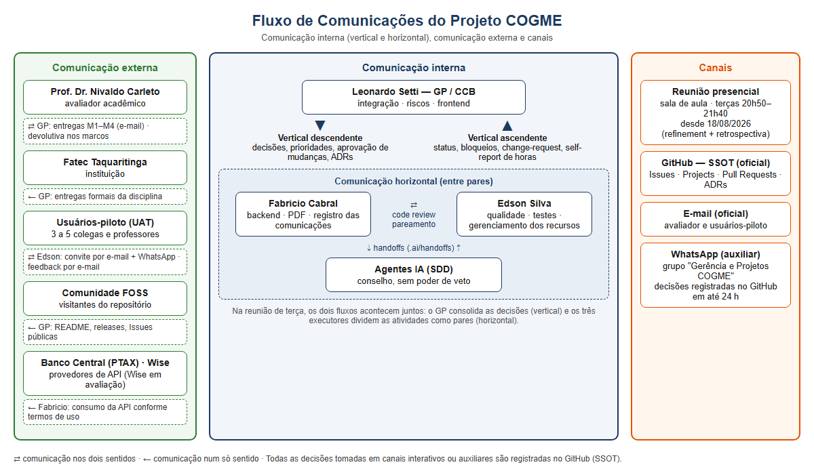

# 2.7 GERENCIAMENTO DAS COMUNICAÇÕES DO PROJETO

**Responsável pelo registro das comunicações:** Fabricio de Lima Cabral.
**Rastreabilidade ao TAP:** Objetivo "e" do TAP (estabelecer canais de comunicação iniciais) · Premissas P1, P7 e P8 · EAP N8 (N8.1 Matriz de Comunicação, N8.2 Canais Oficiais).
**Domínios PMBOK® 7ª:** Partes Interessadas · Planejamento · Trabalho do Projeto · Medição.
**Princípios PMBOK® 7ª aplicados:** "Envolver-se efetivamente com as partes interessadas"; "Criar um ambiente colaborativo da equipe do projeto"; "Ser um administrador diligente, respeitoso e cuidadoso" (transparência).
**Processos PMBOK® 6ª (dicionário):** 10.1 Planejar o Gerenciamento das Comunicações · 10.2 Gerenciar as Comunicações · 10.3 Monitorar as Comunicações.

O PMBOK® 7ª trata a comunicação de forma transversal. No Domínio de Planejamento, ela é planejada de acordo com as necessidades de informação de cada parte interessada. No Domínio de Partes Interessadas, serve para manter o engajamento. No Domínio de Trabalho do Projeto, é exercida no dia a dia. No COGME, o **GitHub é o canal oficial e a fonte única de verdade (SSOT)**: toda informação relevante precisa estar registrada em Issue, Pull Request, commit ou documento versionado. Conversa informal que não foi registrada não vale como decisão (Constituição P-05: "silêncio documental = defeito").

### Métodos de comunicação adotados

| Método (PMBOK®) | Definição | Uso no COGME |
| --- | --- | --- |
| Interativo | Troca em tempo real entre duas ou mais pessoas | Reuniões de refinement e retrospectiva, encontros em aula, chamadas de pareamento |
| Empurrado (*push*) | Enviado a destinatários específicos | Notificações do GitHub (menções, review requests), e-mail ao avaliador nos marcos |
| Puxado (*pull*) | Disponível para consulta quando o interessado quiser | README, planos em `docs/`, GitHub Projects, Insights (CFD), OKB, ADRs |

Fonte: Elaborado pelos autores (2026).

---

## 2.7.1 Comunicação Interna

A comunicação interna acontece entre os membros da equipe e entre a equipe e o avaliador acadêmico. Ela se divide em **vertical** (segue a hierarquia de autoridade) e **horizontal** (entre pares do mesmo nível).

### 2.7.1.0 Reuniões Presenciais da Equipe (em sala de aula)

O principal canal de comunicação interativa do projeto foram as **reuniões presenciais em sala de aula** entre os executores do projeto: **Leonardo Setti**, **Fabricio Cabral** e **Edson Silva**. As conversas começaram junto com a disciplina de Gerência de Projetos, na **terceira semana de agosto de 2026** (primeiro encontro na terça-feira, 18/08/2026). Desde então, acontecem **todas as terças-feiras, das 20h50 às 21h40** (50 minutos).

Foi nesses encontros que os temas do projeto foram tomando forma: a escolha do problema (conversão de ganhos em moeda estrangeira), o escopo do MVP, a governança híbrida (PMBOK® 7ª + Kanban), a stack FOSS e a divisão das áreas de conhecimento entre os membros. A cronologia do Kanban confirma isso. Os primeiros cards do GitHub (#1 "Levantamento de requisitos" e #2 "Termo de Abertura do Projeto") foram criados em 20/08/2026, dois dias depois do primeiro encontro. A EAP foi incorporada ao TAP em 24/08/2026.

| Atributo | Definição |
| --- | --- |
| Participantes | Leonardo David Silva Setti (GP), Fabricio de Lima Cabral, Edson Luis Silva |
| Local | Sala de aula da Fatec Taquaritinga, durante a disciplina de Gerência de Projetos |
| Periodicidade | Semanal, às terças-feiras |
| Horário | 20h50 às 21h40 |
| Início | Terceira semana de agosto de 2026 (18/08/2026), junto com o início da disciplina |
| Método (PMBOK®) | Comunicação interativa (face a face, síncrona) |
| Pauta típica | (1) decisões do projeto; (2) separação e distribuição das atividades entre os membros; (3) andamento das entregas e dos marcos; (4) dúvidas e impedimentos |
| Função no Kanban | Faz o papel do **Refinement semanal** (ADR-002): é onde os cards são priorizados, recebem responsável e entram em *Ready*. A cada duas terças, inclui também a **Retrospectiva quinzenal** (o que funcionou, o que melhorar, ações, revisão do quadro de riscos) |
| Registro | Decisões e atribuições passam para o GitHub (cards com o campo "Atribuição", labels, milestone, comentários e ADRs) |

Fonte: Elaborado pelos autores (2026).

**Comunicação vertical e horizontal na mesma reunião:** nos encontros de terça, os dois fluxos se misturam. A comunicação é **vertical** quando o GP (Leonardo), como decisor único/CCB, consolida as decisões e as passa para a equipe. É **horizontal** quando os três executores discutem como pares, propõem soluções e negociam a divisão do trabalho conforme a disponibilidade de cada um (Premissa P5, até 20 h por semana).

**Principais resultados dos encontros (confirmados pelo Kanban):**

| Período | Tema moldado nas reuniões | Evidência no GitHub |
| --- | --- | --- |
| Ago/2026 (3ª e 4ª semanas) | Definição do problema, levantamento de requisitos e kick-off do TAP | Issues #1 e #2 (20/08); EAP no TAP (24/08); TAP v1 anexado (26/08) |
| Final de ago/2026 | Planejamento da entrega documental formal | Issue #7 "Entrega da Documentação formal" (28/08) |
| Set/2026 | Divisão das áreas de conhecimento: Leonardo (Integração, arquitetura, stack, ADRs, CI), Fabricio (Escopo, Cronograma, Custos, Requisitos Funcionais, Setup Local), Edson (Qualidade/PDCA/Ishikawa, RNF, Protótipo UX/UI, DER, Auditoria de Licenças, RACI) | 21 cards M1-01 a M1-21 criados em 19/09, com o campo "Atribuição" preenchido |
| Até 22/09/2026 | Fechamento do marco M1 | Milestone M1 encerrada com 14 cards concluídos |
| Set–Out/2026 | Modelagem e ambiente (M2) e planos de Recursos, Comunicações e Riscos | Milestone M2 com cards em *Ready*/*In review* |

Fonte: Elaborado pelos autores (2026), com base no GitHub Projects do COGME (consultado em 25/10/2026).

### 2.7.1.1 Comunicação Vertical

**Descendente (GP → Equipe):**

| Informação | Emissor | Receptor | Canal | Frequência |
| --- | --- | --- | --- | --- |
| Decisões do projeto e separação das atividades | GP | Fabricio, Edson | Reunião presencial em sala de aula | Semanal (terças, 20h50–21h40) |
| Prioridades do backlog (P0–P3, MoSCoW) | GP | Desenvolvedores | GitHub Projects + reunião de terça | Semanal |
| Decisões de mudança (aprovação/rejeição) | GP (CCB) | Equipe | Comentário na Issue `change-request` | Até 24 h após a análise |
| Decisões arquiteturais | GP | Equipe | ADR em `docs/decisoes/` + aviso na Issue | Por evento |
| Métricas de fluxo (Cycle Time, Throughput, CFD) | GP | Equipe | GitHub Insights + resumo na retrospectiva | Semanal |
| Diretrizes de governança (Constituição, regras de agentes) | GP | Equipe | `constitution.md` + commit | Por emenda |

**Ascendente (Equipe → GP):**

| Informação | Emissor | Receptor | Canal | Frequência |
| --- | --- | --- | --- | --- |
| Status diário (o que fiz, o que farei, impedimentos) | Desenvolvedores | GP | Daily assíncrona em Issue | Diária (15 min) |
| Impedimentos / bloqueios | Qualquer membro | GP | Label `blocked` + menção @GP | Imediato |
| Solicitação de mudança | Qualquer membro | GP | Issue com label `change-request` | Por evento |
| Self-report de horas | Desenvolvedores | GP | Comentário semanal / campo no card | Semanal |
| Riscos identificados | Qualquer membro | GP | Issue com label `risk` | Por evento |

**Equipe ↔ Avaliador acadêmico (vertical externa à equipe):**

| Informação | Emissor | Receptor | Canal | Frequência |
| --- | --- | --- | --- | --- |
| Entregas dos marcos (documentos, MVP, apresentação) | GP | Prof. Dr. Nivaldo Carleto | Entrega acadêmica (plataforma da Fatec / e-mail) + link do repositório | M1, M2, M3, M4 |
| Feedback e avaliação | Prof. Dr. Nivaldo Carleto | Equipe | Aula / devolutiva | Após cada marco |
| Mudanças que alteram marco ou escopo do MVP | GP | Prof. Dr. Nivaldo Carleto | Comunicação no marco seguinte + ADR | Por evento (Plano de Integração §1.7.3) |

Fonte: Elaborado pelos autores (2026).

### 2.7.1.2 Comunicação Horizontal

| Informação | Entre | Canal | Frequência |
| --- | --- | --- | --- |
| Discussão das decisões e negociação da divisão de tarefas | Leonardo ↔ Fabricio ↔ Edson | Reunião presencial em sala de aula | Semanal (terças, 20h50–21h40) |
| Revisão de código e documentação | Dev ↔ Dev | Pull Request (review + comentários em linha) | Por card em *Code Review* |
| Dúvidas técnicas, avisos rápidos e pareamento | Leonardo ↔ Fabricio ↔ Edson | Reunião de terça ou grupo de WhatsApp "Gerência e Projetos COGME" + resumo registrado na Issue | Sob demanda |
| Dependências entre cards | Dev ↔ Dev | Referência cruzada nas Issues (`#n`) | Por evento |
| Lições aprendidas | Todos ↔ Todos | Retrospectiva quinzenal + `docs/conhecimento/licoes-aprendidas/` | Quinzenal / fim de macro-fase |
| Handoffs de especificação para os agentes IA | Dev ↔ Agentes | `.ai/handoffs/` (catálogo de prompts SDD, REQ-13) | Por ciclo SDD |

Fonte: Elaborado pelos autores (2026).

**Regra de registro:** toda decisão tomada num canal informal (mensageiro, conversa presencial) precisa ser escrita na Issue correspondente em até 24 h para valer.

**Canais oficiais declarados (card M1-20, #28, concluído):** GitHub Issues (daily assíncrona), GitHub Projects (SSOT) e e-mail (comunicação com o Prof. Dr. Nivaldo Carleto). A reunião presencial de terça é o canal interativo da equipe. O que ela decide precisa estar registrado nesses canais oficiais.

**Canal auxiliar (não oficial):** a equipe usa o grupo de WhatsApp **"Gerência e Projetos COGME"** para comunicação rápida entre os executores: avisos, dúvidas, combinados de horário e lembretes de entrega. É um canal ágil, mas não substitui os canais oficiais. Pela regra de registro, qualquer decisão tomada no grupo precisa ser passada para a Issue correspondente no GitHub em até 24 h para valer.

| Canal | Classificação | Uso |
| --- | --- | --- |
| GitHub Issues / Projects / Pull Requests | Oficial (SSOT) | Decisões, atribuições, status, mudanças, revisões |
| E-mail | Oficial | Comunicação com o Prof. Dr. Nivaldo Carleto e com os usuários-piloto |
| Reunião presencial de terça (sala de aula) | Oficial (interativo) | Decisões do projeto, divisão de atividades, refinement e retrospectiva |
| WhatsApp — grupo "Gerência e Projetos COGME" | Auxiliar, não oficial | Avisos e dúvidas rápidas; contato inicial com usuários-piloto |

Fonte: Elaborado pelos autores (2026).

**Retrospectiva:** acontece **na reunião de terça-feira** (20h50–21h40), a cada duas semanas, dentro do mesmo encontro do refinement.

---

## 2.7.2 Comunicações Externas

| Parte interessada externa | Interesse / necessidade de informação | O que é comunicado | Canal | Responsável | Frequência |
| --- | --- | --- | --- | --- | --- |
| Fatec Taquaritinga (instituição) | Cumprimento da ementa e dos prazos letivos | Entregas formais dos marcos | Plataforma acadêmica da disciplina | GP | M1–M4 |
| Prof. Dr. Nivaldo Carleto (avaliador / cliente simulado) | Qualidade da aplicação do PMBOK e do produto | Documentação, MVP, apresentação final | E-mail, aula, repositório público | GP | Marcos |
| Usuários-piloto (3 a 5 colegas e professores) | Usabilidade e utilidade da ferramenta | Convite para o UAT, roteiro de testes e pedido de feedback | **Contato:** e-mail e mensagem no WhatsApp · **Feedback:** por e-mail | Edson | Período de UAT (data a definir, antes do M3) |
| Comunidade FOSS / visitantes do repositório | Entender, usar e contribuir | README, LICENSE (MIT), Issues públicas, releases | GitHub | GP | Contínua / por release |
| Banco Central do Brasil (API PTAX — Olinda) | Uso dentro dos termos dos dados abertos | Consumo da API conforme a documentação; acompanhamento de mudanças no serviço | Portal de Dados Abertos do BCB | Fabricio | Na integração + verificação mensal |
| Wise (Wise Platform API, em avaliação) | Acesso autorizado à API | Pedido de conta/token de sandbox; dúvidas sobre dados de comparação (canal indicado pela Wise: comparison@wise.com) | docs.wise.com / e-mail | Fabricio | Só se o CCB aprovar a integração |
| Mantenedores das bibliotecas FOSS | Correção de defeitos | Report de bugs, se necessário | Issues dos projetos upstream | Quem encontrar o problema | Por evento |

Fonte: Elaborado pelos autores (2026).

**Princípios das comunicações externas:**
- **LGPD primária (Constituição P-04):** nenhuma comunicação externa expõe dados pessoais de usuários-piloto. Os feedbacks são anonimizados.
- **Soberania de dados (P-02/P-03):** documentos e código do projeto não são enviados a serviços de IA em nuvem de terceiros.
- **Linguagem:** narrativa em PT-BR. Código, slugs e contratos técnicos em EN (Constituição P-10).

**Comunicação com os usuários-piloto (UAT):**

| Etapa | Canal | Responsável | Observação |
| --- | --- | --- | --- |
| 1. Convite | E-mail + mensagem no WhatsApp | Edson | O WhatsApp serve só como aviso. O convite formal, com o roteiro de testes, vai por e-mail |
| 2. Envio do roteiro e do acesso ao MVP | E-mail | Edson | Roteiro cobrindo os fluxos críticos: simulação, regimes, spread/IOF, PDF (REQ-09) |
| 3. Coleta do feedback | **E-mail** | Edson | Registro formal das respostas, que permite rastreabilidade |
| 4. Consolidação | Relatório de UAT no repositório + Issues para os defeitos | Edson | Feedback anonimizado (LGPD): nenhum nome ou contato vai para o repositório |

Fonte: Elaborado pelos autores (2026).

**Data do UAT:** ainda não definida. Deve acontecer antes do marco M3 (15/11/2026) e será marcada na reunião de terça, com card próprio na milestone M3.

---

## 2.7.3 Representar as Comunicações

### 2.7.3.1 Matriz de Comunicação (consolidada)

| # | Comunicação | Objetivo | Emissor → Receptor | Método | Canal | Frequência | Registro |
| --- | --- | --- | --- | --- | --- | --- | --- |
| C0 | Reunião presencial da equipe | Tomar decisões do projeto e separar as atividades | Leonardo ↔ Fabricio ↔ Edson | Interativo | Sala de aula (Fatec) | Semanal, terças 20h50–21h40, desde 18/08/2026 | Cards atribuídos no GitHub Projects + ADRs |
| C1 | Daily assíncrona | Sincronizar o andamento e expor impedimentos | Devs → Equipe | Push | GitHub Issue | Diária | Issue "Daily" |
| C2 | Refinement | Priorizar e preparar cards (DoR) | GP ↔ Equipe | Interativo | Na reunião de terça (C0) + GitHub Projects | Semanal | Backlog atualizado |
| C3 | Retrospectiva | Melhoria contínua e revisão de riscos | Todos | Interativo | Na reunião de terça (C0) | Quinzenal (terças) | Lições aprendidas + risk backlog |
| C4 | Code Review | Garantir a qualidade e espalhar conhecimento | Dev ↔ Dev | Interativo / Push | Pull Request | Por card | Comentários do PR |
| C5 | Relatório de métricas | Mostrar a saúde do fluxo | GP → Equipe | Pull | GitHub Insights (CFD) | Semanal | Print / resumo na retro |
| C6 | Solicitação de mudança | Controlar o escopo | Qualquer → GP | Push | Issue `change-request` | Por evento | Issue + ADR (se alterar marco) |
| C7 | Alerta de risco/bloqueio | Reagir rápido a ameaças | Qualquer → GP | Push | Label `risk`/`blocked` | Imediato | Issue |
| C8 | Entrega de marco | Avaliação acadêmica | GP → Avaliador | Push | Plataforma da Fatec / e-mail | M1–M4 | Tag/release + PDF |
| C9 | Devolutiva do avaliador | Corrigir o rumo | Avaliador → Equipe | Interativo | Aula / e-mail | Após o marco | Issue com ações corretivas |
| C10 | Convite e feedback do UAT | Validar o MVP | Edson ↔ Usuários-piloto | Push / Interativo | Convite por e-mail + WhatsApp; feedback por e-mail | Janela do UAT (data a definir, antes do M3) | Relatório de UAT |
| C11 | Publicação de release | Divulgar uma versão | GP → Comunidade | Pull | GitHub Releases + README | M3, M4 | Release notes |
| C12 | Avisos e dúvidas rápidas | Agilizar a coordenação entre os executores | Leonardo ↔ Fabricio ↔ Edson | Interativo / Push | WhatsApp "Gerência e Projetos COGME" (auxiliar) | Sob demanda | Decisões copiadas para a Issue em até 24 h |

Fonte: Elaborado pelos autores (2026).

### 2.7.3.2 Diagrama de Fluxo das Comunicações

Figura — Fluxo de Comunicações do Projeto COGME (vertical, horizontal e externa).
Fonte: Elaborado pelos autores (2026).

### 2.7.3.3 Monitoramento das Comunicações

| Indicador | Meta | Fonte |
| --- | --- | --- |
| Dailies registradas | ≥ 80 % dos dias úteis por membro | Issues "Daily" |
| Tempo de resposta a um *review request* | ≤ 24 h | Pull Requests |
| Decisões informais registradas no GitHub | 100 % em até 24 h | Auditoria na retrospectiva |
| Change-requests respondidas no SLA | 100 % (análise ≤ 48 h, decisão ≤ 24 h) | Issues `change-request` |
| Entregas de marco no prazo | 100 % | Milestones do GitHub |
| Presença nas reuniões de terça | 100 % dos executores | Lista de presença / ata curta na Issue |

Fonte: Elaborado pelos autores (2026).

### 2.7.3.4 Situação do Kanban (GitHub Projects) em 25/10/2026

| Coluna | Cards | Itens |
| --- | :-: | --- |
| Backlog | 2 | #22 M1-14 Auditoria de Licenças FOSS (P2) · #26 M1-18 Lições Aprendidas MF1 (P3) |
| Ready | 2 | #18 M1-10 Modelagem de Dados — DER (P2) · #17 M1-09 Protótipo UX/UI (P3) |
| In progress | 0 / 3 | — |
| In review | 2 / 5 | #21 M1-13 Setup Local e Homologação (P1) · #23 M1-15 ADR-001 Stack (P1) |
| Done | 15 | M1-01 a M1-08, M1-11, M1-12, M1-16, M1-17, M1-19, M1-20, M1-21 |

| Milestone | Prazo | Situação |
| --- | --- | --- |
| M1 — Entrega Parcial Documental | 22/09/2026 | Encerrada (14 cards concluídos) |
| M2 — Ambiente e Modelagem | 30/09/2026 | **Aberta, 6 cards pendentes** (≈ 25 dias de atraso) |
| Calibração — Baseline de Métricas | 03/10/2026 | Aberta, sem cards |
| M3 — MVP Funcional (Beta) | 15/11/2026 | Aberta, sem cards |
| M4 — Encerramento | 15/12/2026 | Aberta, sem cards |

Fonte: GitHub Projects do COGME (https://github.com/users/leonardosetti/projects/2), consultado em 25/10/2026.

> **Nota de atualização:** a equipe vai ajustar o quadro antes da entrega (responsáveis, cards de M3/M4, registro das reuniões). Antes de submeter, refazer esta tabela com a situação do quadro na data da entrega. O atraso do M2 continua registrado como questão Q-01 no Plano de Riscos (2.8).

---

**Controle de Versões — Seção 2.7**

| Versão | Data | Alteração | Responsável |
| --- | --- | --- | --- |
| 1.0 | 25/10/2026 | Emissão inicial (rascunho para revisão em pares) | Fabricio de Lima Cabral |
