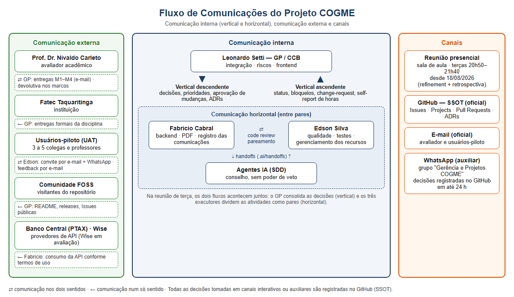

---
# Plano de Gerenciamento do Projeto COGME

**Identificador:** PLANO-PROJETO-COGME
**Versão:** 2.1.0
**Status:** Draft — Consolidado para Pós-Produção
**Data-base:** 31/10/2026
**Autores:** Leonardo David Silva Setti (GP), Fabricio de Lima Cabral, Edson Luis Silva
**Stakeholder-Avaliador:** Prof. Dr. Nivaldo Carleto — Fatec Taquaritinga / ADS
**Origem:** Síntese dos documentos PED-001, PED-002, PED-003, planos de área (v1.0–1.2) e rodadas de análise de chat (Rodada 1–3)

---

# SUMÁRIO

[§1 — Introdução e Escopo](#seção-1-introdução-e-escopo)
[§2 — Gerenciamento da Integração](#seção-2-gerenciamento-da-integração)

## §3 Artefatos Técnicos Representativos

### Referências Canônicas
- [GitHub Repository](https://github.com/your-repo)
- [Canon_Stack_SDD.md v2.0.0](Canon_Stack_SDD.md)

### Subseções Obrigatórias

#### Specs SDD
- [Exemplo] .ai/specs/requisitos.md

#### Histórias de Usuário (US)
- [US-01] Exemplo de história de usuário

#### Cenários de Teste
- [tests/agents/test_dag_validator.py](tests/agents/test_dag_validator.py)

#### Métricas
- CFD (Cycle Flow Diagram)
- Tempo de Ciclo
- Throughput

#### PDCA
- PDCA-N5
- PDCA-N6

#### Ecossistema SDD
- MCPs
- Níveis L1/L2/L3
- 46 agentes registrados

> *YAGNI compliance: Apenas elementos alinhados com OKB v5.3.0 foram incluídos.*
[§3 — Gerenciamento do Escopo](#seção-3-gerenciamento-do-escopo)
[§4 — Gerenciamento do Cronograma](#seção-4-gerenciamento-do-cronograma)
[§5 — Gerenciamento dos Custos](#seção-5-gerenciamento-dos-custos)
[§6 — Gerenciamento da Qualidade](#seção-6-gerenciamento-da-qualidade)
[§7 — Gerenciamento dos Recursos](#seção-7-gerenciamento-dos-recursos)
[§8 — Gerenciamento das Comunicações](#seção-8-gerenciamento-das-comunicações)
[§9 — Gerenciamento dos Riscos](#seção-9-gerenciamento-dos-riscos)
[§10 — Metodologia, Segurança e Privacidade](#seção-10-metodologia-segurança-e-privacidade)
[§11 — Apêndices e Referências Cruzadas](#seção-11-apêndices-e-referências-cruzadas)

---

# SEÇÃO 1 — INTRODUÇÃO E ESCOPO

## 1.1 Identificação do Projeto

**Nome:** COGME — Conversor de Ganhos em Moeda Estrangeira  
**Natureza:** Projeto acadêmico FOSS, gratuito, jurisdição brasileira (LGPD primária)  
**Contexto:** Disciplina de Gerência de Projetos — Fatec Taquaritinga, curso Superior de Tecnologia em Análise e Desenvolvimento de Sistemas (ADS)  
**Entrega final:** Marco M4 — 15/12/2026  
**Orçamento:** R$ 0,00 (zero reais) — Restrição TAP §11

## 1.2 Propósito do Plano

Este documento constitui o Plano de Gerenciamento do Projeto COGME, versão consolidada (v2.1.0), elaborado mediante processo de extração modular, normalização documental e revisão crítica (rodadas PED-001 a PED-003). Sua finalidade é servir como artefato único e canônico de governança, consolidando as oito áreas de conhecimento (Integração, Escopo, Cronograma, Custos, Qualidade, Recursos, Comunicações e Riscos) em estrutura coerente, alinhada à hierarquia normativa:

**Constitution v1.2.0 > TAP v3 > ADRs 001–013 > OKB v5.1.0 > Planos de Gerenciamento > Glossário > Especificações SDD > Código-fonte e Testes**

O plano não é uma monografia acadêmica. Não contém elementos monográficos (resumo, palavras-chave, listas ABNT). Não duplica conteúdo dos artefatos canônicos (TAP, ADRs, Constitution, OKB) — estabelece cross-references quando necessário, conforme o princípio "1 fato = 1 local" (OKB §8.1).

## 1.3 Escopo do Plano

O escopo deste plano abrange:
- Gerenciamento da Integração (seção 2)
- Gerenciamento do Escopo (seção 3)
- Gerenciamento do Cronograma (seção 4)
- Gerenciamento dos Custos (seção 5)
- Gerenciamento da Qualidade (seção 6)
- Gerenciamento dos Recursos (seção 7)
- Gerenciamento das Comunicações (seção 8)
- Gerenciamento dos Riscos (seção 9)
- Metodologia, Segurança e Privacidade (seção 10)
- Apêndices e Referências Cruzadas (seção 11)

## 1.4 Premissas e Restrições Aplicáveis

| ID | Premissa / Restrição | Fonte | Impacto neste Plano |
|----|---------------------|-------|--------------------|
| P1 | Governança híbrida (PMBOK 7ª + Kanban + SDD) | Constitution v1.2.0 | Fundamenta seção 2 |
| P2 | FOSS-zero-custo | Constitution v1.2.0 | Fundamenta seção 5 |
| P3 | SDD com IA local auditável | Constitution v1.2.0 | Fundamenta seções 2, 5, 6 |
| P4 | Código como deliverable | Constitution v1.2.0 | Fundamenta seções 2, 5 |
| P5 | Disponibilidade de até 20h/semana por membro | Constitution v1.2.0 | Fundamenta seções 4, 7 |
| P6 | Hardware adequado e suficiente | Constitution v1.2.0 | Fundamenta seções 4, 7 |
| P7 | Stakeholder-avaliador único nos marcos | Constitution v1.2.0 | Fundamenta seções 2, 4, 7 |
| P8 | Simplificação da gestão | Constitution v1.2.0 | Fundamenta seções 3, 5 |
| P9 | Separação ontológica TAP ≠ EAP ≠ PDCA | Constitution v1.2.0 | Fundamenta seção 3 |
| P10 | Linguagem (slugs/código em EN, narrativa em PT-BR) | Constitution v1.2.0 | Todo o documento |
| P11 | YAGNI | Constitution v1.2.0 | Todas as seções |
| P12 | Primeiros Princípios | Constitution v1.2.0 | Todas as seções |
| P13 | Precisão Linguística e Determinismo Operacional | Constitution v1.2.0 | Todo o documento |

**Restrições do TAP (§8 e §11):**
- Prazo letivo inegociável: marcos M1–M4 fixos
- Orçamento zero: R$ 0,00 (não há reservas financeiras)
- Proibição de aquisições pagas
- Máximo de 3 cartões por pessoa no fluxo (WIP limit)

## 1.5 Hierarquia de Resolução de Conflitos

Em caso de conflito entre fontes normativas, aplica-se a seguinte ordem de precedência:

1. Valor entregue ao usuário final (Domínio de Entrega — PMBOK 7ª)
2. Ementa da disciplina + orientação do Prof. Dr. Nivaldo Carleto
3. PMBOK® 7ª edição (princípios e domínios)
4. Manifesto Ágil + Kanban (método de execução)
5. PMBOK® 6ª edição (dicionário de processos, obsolescência procedural declarada)

---

# SEÇÃO 2 — GERENCIAMENTO DA INTEGRAÇÃO

## 2.1 Identificação e Propósito

Este Plano de Gerenciamento da Integração coordena a execução integrada do projeto COGME, garantindo que os oito planos de área subsequentes (Escopo, Cronograma, Custos, Qualidade, Recursos, Comunicações, Riscos e este Plano de Integração), o código-fonte e os artefatos de governança permaneçam coerentes com os Objetivos SMART aprovados no TAP.

**Função ontológica:** O TAP *autoriza*; este plano *coordena*. Ele não duplica conteúdo do TAP — define os mecanismos de coerência entre todos os artefatos do ciclo de vida.

**Domínio PMBOK 7ª:** Abordagem de Desenvolvimento  
**Processo PMBOK 6ª (dicionário):** 4.2 — Desenvolver o Plano de Gerenciamento do Projeto

## 2.2 Modelo de Governança Híbrida

O projeto adota um modelo trifásico de governança, declarado no TAP (§1.c):

| Camada | Fonte Normativa | Função no COGME |
|--------|----------------|-----------------|
| Governança primária | PMBOK® 7ª edição — 12 Princípios + 8 Domínios de Desempenho | Define *por que* e *para quê*; orienta decisões por valor |
| Dicionário complementar | PMBOK® 6ª edição — processos citados apenas para rastreabilidade acadêmica | Fornece vocabulário estrutural quando necessário |
| Método de execução | Manifesto Ágil (4 valores) + Kanban (fluxo contínuo) | Define *como* o trabalho é executado diariamente |

**[FIG-1 — Modelo de governança híbrida trifásico do projeto COGME]**  
*Inserção obrigatória — Formato: SVG / diagrama*  
*Conteúdo:* Fluxograma vertical com três camadas (PMBOK 7ª → PMBOK 6ª → Ágil/Kanban), seta pontilhada vermelha representando realimentação por lições aprendidas (EAP N9.2).  
*Notas:* A hierarquia normativa é descendente: PMBOK® 7ª (governança primária) → PMBOK® 6ª (dicionário complementar, com obsolescência formalmente declarada) → Manifesto Ágil + Kanban (método de execução via GitHub Projects como SSOT).

### 2.2.1 Hierarquia de Resolução de Conflitos

Em caso de conflito entre fontes normativas, aplica-se a seguinte ordem de precedência:

1. Valor entregue ao usuário final (Domínio de Entrega — PMBOK 7ª)
2. Ementa da disciplina + orientação do Prof. Dr. Nivaldo Carleto
3. PMBOK® 7ª edição (princípios e domínios)
4. Manifesto Ágil + Kanban (método de execução)
5. PMBOK® 6ª edição (dicionário de processos)

**Trade-off declarado:** Esta hierarquia favorece velocidade de entrega sobre completude documental, alinhada ao Princípio "Foco em Valor" (PMBOK 7ª) e ao Valor Ágil "Software funcionando sobre documentação abrangente".

### 2.2.2 Papéis de Governança

| Papel | Titular | Responsabilidade |
|-------|---------|------------------|
| Gerente de Projeto (GP) | Leonardo David Silva Setti | Decisor operacional único; CCB de membro único; autoridade para aprovações, rejeições e controle de mudanças |
| Desenvolvedores | Fabricio de Lima Cabral, Edson Luis Silva | Execução técnica; revisão em pares; self-report de carga horária |
| Stakeholder-Avaliador | Prof. Dr. Nivaldo Carleto | Avaliação acadêmica nos marcos M1–M4; sem ingerência em decisões operacionais |

### 2.2.3 Governança Mínima Viável (GMV)

Todo artefato de governança deve justificar sua existência pelo teste GMV:

| Pergunta | Se SIM | Se NÃO |
|----------|--------|--------|
| O Prof. Dr. Nivaldo Carleto exigirá este artefato na avaliação? | Produzir completo | Simplificar ou eliminar |
| Este artefato evita retrabalho futuro? | Produzir | Avaliar custo-benefício |
| Este artefato é útil para a equipe (não apenas para avaliação)? | Produzir | Eliminar |

Se ≥ 2 respostas forem NÃO, o artefato é candidato a simplificação ou eliminação. Decisão final do GP.

### 2.2.4 Obsolescência do PMBOK 6ª (Declaração Formal)

O PMBOK® 6ª edição (2017) é tratado exclusivamente como dicionário de processos. Processos preditivos são citados apenas para rastreabilidade acadêmica e blindagem terminológica. Métricas EVM (SPI/CPI/VAC) são declaradas **LEGADO — NÃO APLICÁVEIS**, substituídas por métricas de fluxo Kanban conforme ADR-003.

## 2.3 GitHub Projects como Fonte Única de Verdade (SSOT)

O repositório GitHub e seu módulo GitHub Projects constituem o artefato primário de integração, cronograma e monitoramento, conforme ADR-002. Esta decisão substitui qualquer ferramenta preditiva de planejamento como instrumento ativo.

**Justificativa:** Para uma equipe de 3 pessoas com fluxo contínuo, ferramentas preditivas impõem overhead de manutenção desproporcional ao valor gerado. O Kanban via GitHub Projects fornece visibilidade em tempo real, métricas nativas de fluxo e rastreabilidade automática via commits.

**Domínio PMBOK 7ª:** Medição + Trabalho do Projeto  
**Valor Ágil:** "Indivíduos e interações sobre processos e ferramentas."

### 2.3.1 Mapeamento Kanban ↔ Processos PMBOK 6ª

| Coluna Kanban (ADR-002) | Processo PMBOK 6ª | Domínio PMBOK 7ª | Regra Operacional |
|-------------------------|-------------------|------------------|-------------------|
| Backlog | 5.2 Coletar Requisitos | Planejamento | Card criado com DoR pendente |
| Ready (DoR) | 4.3 Orientar Trabalho (preparação) | Trabalho | DoR atendido; aguardando capacidade |
| In Progress | 4.3 Orientar e Gerenciar Trabalho | Trabalho | WIP limit: máx. 3 cards/pessoa |
| Code Review | 4.5 Monitorar e Controlar | Medição | Revisão em pares obrigatória |
| Done (DoD) | 5.4 Criar EAP (aceite do pacote) | Entrega | DoD atendido; commit mergeado |

**[FIG-2 — Fluxo Kanban oficial com gates e WIP limits]**  
*Inserção obrigatória — Formato: SVG / diagrama*  
*Conteúdo:* Fluxograma com cinco colunas (Backlog → Ready → In Progress → Code Review → Done), quatro gates (retângulos tracejados vermelhos: DoR, tasklist 100%, revisão de pares, DoD), WIP limit de 3 cards por pessoa (máximo 9 no fluxo), linha pontilhada entre Code Review e In Progress representando retorno por alterações solicitadas.  
*Notas:* As cinco colunas materializam a ADR-002; os quatro gates materializam os critérios de DoR e DoD do Plano de Escopo §2.6 e a regra de tasklist da ADR-004. Gate não atendido implica permanência do card na coluna anterior. Métricas de fluxo conforme ADR-003.

### 2.3.2 Regras de Fluxo e Rituais

**Regras de fluxo (ADR-002 e ADR-004):**
- **Pull system:** Cards migram para "In Progress" somente quando há capacidade disponível (WIP limit respeitado).
- **WIP limit:** 3 cards em "In Progress" por pessoa (Domínio de Equipe — prevenção de burnout, R3 do TAP §10).
- **Tasklists Markdown (ADR-004):** Cards com estimativa ≥ 6h ou múltiplos entregáveis devem possuir tasklist no corpo da Issue (mínimo 3, máximo 7 itens; último item obrigatoriamente "Validação final"). Subissues reais são **formalmente rejeitadas** — a unidade atômica de métrica e de backlog permanece o card pai. O card só migra para `Code Review` com 100% dos itens concluídos.
- **SDD com LLM:** Código gerado com apoio de IA passa por revisão humana obrigatória antes do merge. Commits declaram co-autoria.

**Rituais (ADR-002):**

| Ritual | Formato | Cadência | Duração |
|--------|---------|----------|---------|
| Daily assíncrona | GitHub Issues | Diária | 15 min |
| Refinement | Product Backlog (GitHub Projects) | Semanal | 30 min |
| Retrospectiva | Risk backlog + lições aprendidas | Quinzenal | 30 min |

**Nota:** Sprints time-boxed NÃO são utilizadas. O fluxo é contínuo (ADR-002).

## 2.4 Desenvolvimento e Manutenção do Plano de Gerenciamento

**Processo PMBOK 6ª (dicionário):** 4.2 — Desenvolver o Plano de Gerenciamento do Projeto.

Os oito planos de área são versionados no repositório GitHub sob `/docs/`. Cada plano:

- Inicia com frase de rastreabilidade ao TAP (Premissa + Restrição + Domínio PMBOK 7ª).
- Possui extensão máxima de 4 páginas (princípio GMV).
- É versionado via Conventional Commits: `docs(plano): atualização §X`.
- Passa por revisão em pares antes de ser considerado "Done".

**Regra de coerência cruzada:** Nenhum plano pode contradizer datas de marcos (M1–M4), premissas (P1–P9) ou restrições (§8) do TAP. Inconsistências detectadas em revisão acionam correção imediata antes do merge. A hierarquia de autoridade entre artefatos é: **TAP > base de conhecimento operacional > Glossário > ADRs**.

## 2.5 Estratégia de Entrega Faseada dos Planos

Conforme o princípio de Elaboração Progressiva (PMBOK 6ª, dicionário) e a Personalização/Tailoring da Abordagem de Desenvolvimento (PMBOK 7ª), a entrega dos planos de gerenciamento é faseada:

| Marco | Planos Entregues | Justificativa |
|-------|------------------|---------------|
| M1 (22/09/2026) | Integração, Escopo, Cronograma, Custos, Qualidade (Áreas 1–5) | Fundação documental mínima viável; atendimento integral ao critério de aceite do TAP §6 para o M1 |
| M2 (30/09/2026) | Recursos, Comunicações, Riscos (Áreas 6–8) | Redigidos após a calibração do fluxo Kanban (23/09–03/10), com dados empíricos de capacidade da equipe |

**Trade-off declarado:** Redução de ~30% da carga documental do M1, permitindo foco na qualidade dos cinco planos fundamentais e na configuração do SSOT. Decisão alinhada ao Domínio de Abordagem de Desenvolvimento e Ciclo de Vida (PMBOK 7ª) e ao princípio GMV (§2.2.3).

## 2.6 Orientação e Gestão do Trabalho do Projeto

**Processo PMBOK 6ª (dicionário):** 4.3 — Orientar e Gerenciar o Trabalho do Projeto.  
**Domínio PMBOK 7ª:** Trabalho do Projeto.

### 2.6.1 Execução Diária

- Trabalho puxado do backlog conforme capacidade (pull system), respeitando a prioridade temporal P0–P3 e o WIP limit.
- Cada card segue o padrão de redação ubíquo (§2.3.3): título padronizado (ex: `N5.1 — Backend: Lógica de Negócio`), labels obrigatórias, milestone vinculada, responsável e critérios de aceite binários.
- Cards ≥ 6h portam tasklist Markdown conforme ADR-004.
- Commits seguem Conventional Commits (`feat`, `fix`, `docs`, `test`, `ci`, `chore`).

### 2.6.2 Gestão do Conhecimento

**Processo PMBOK 6ª (dicionário):** 4.4 — Gerenciar o Conhecimento do Projeto.

- Estrutura de conhecimento: `/docs/` no repositório (planos, diagramas, lições aprendidas, catálogo de prompts SDD).
- Lições aprendidas registradas ao final de cada macro-fase (MF1, MF2, MF3).
- Decisões que afetam ≥ 2 fases da EAP, envolvem troca de tecnologia ou seriam questionadas pelo Prof. Dr. Nivaldo Carleto em avaliação são formalmente registradas via **ADR** (Architecture Decision Record), conforme REQ-12 e fase N9.1 da EAP. Decisões menores ficam em commit messages.

## 2.7 Monitoramento e Controle Integrado

**Processo PMBOK 6ª (dicionário):** 4.5 — Monitorar e Controlar o Trabalho do Projeto.  
**Domínio PMBOK 7ª:** Medição.

### 2.7.1 Métricas de Fluxo Kanban (Oficiais — ADR-003)

Dada a restrição de orçamento zero (TAP §11), o Earned Value Management é inaplicável. As métricas de desempenho são exclusivamente baseadas no fluxo Kanban:

| Métrica | Definição | Meta (pós-calibração) | Frequência |
|---------|-----------|----------------------|------------|
| Cycle Time | Tempo médio de um card do "In Progress" ao "Done" | ≤ 3 dias | Semanal |
| Throughput | Cards concluídos por semana | ≥ 5 cards/semana | Semanal |
| CFD (Cumulative Flow Diagram) | Visualização de gargalos no fluxo | Sem bandas largas | Semanal |
| WIP em fluxo | Cards ativos em "In Progress" | ≤ 9 (3 × 3 pessoas) | Contínuo |
| Coverage | Linhas testadas / linhas totais | ≥ 80% | Por push (CI) |
| Burnout (self-report) | Carga horária semanal declarada | ≤ 20h/pessoa | Semanal |

**Definição canônica do CFD (referência para os Planos de Cronograma e Comunicações):** O Cumulative Flow Diagram é a visualização gráfica do fluxo de trabalho acumulado no tempo, onde cada banda horizontal representa uma coluna do quadro Kanban e sua largura instantânea indica a quantidade de cards naquela etapa. Fonte de dados: GitHub Insights. Responsável pela publicação semanal: GP. **CFD saudável:** bandas paralelas de largura constante. **CFD com gargalo:** bandas que se alargam progressivamente. **Ação corretiva:** banda com largura superior a 2× a média das demais por 2 semanas consecutivas aciona Retrospectiva extraordinária (ADR-002).

**[FIG-3 — Cumulative Flow Diagram: padrão saudável vs. padrão com gargalo]**  
*Inserção obrigatória — Formato: SVG / diagrama*  
*Conteúdo:* Dois painéis — (a) fluxo estável com bandas paralelas; (b) gargalo na coluna Code Review com banda alargando progressivamente. Anotação lateral: "métricas de fluxo medem o card pai (ADR-003); subissues rejeitadas (ADR-004)".  
*Notas:* Dados simulados para fins didáticos; a baseline real será coletada no período de calibração (23/09 a 03/10/2026) via GitHub Insights.

### 2.7.2 Métricas Legado (Não Aplicáveis — ADR-003)

| Métrica | Status | Justificativa |
|---------|--------|---------------|
| SPI (Schedule Performance Index) | ❌ LEGADO | Inaplicável — fluxo contínuo sem linha de base preditiva |
| CPI (Cost Performance Index) | ❌ LEGADO | Inaplicável — orçamento zero (AC = 0) |
| EVM (Earned Value Management) | ❌ LEGADO | Inaplicável — escopo emergente + orçamento nulo |

### 2.7.3 Período de Calibração

De 23/09/2026 a 03/10/2026, as métricas são coletadas sem meta fixa, estabelecendo a baseline empírica de desempenho real da equipe. Após calibração, metas são ajustadas com base na média observada ± 20% e formalizadas via ADR. A milestone auxiliar "Calibração" (03/10) rastreia este período no SSOT sem substituir o M2.

**Trade-off declarado:** Abre-se mão da formalidade EVM em favor de métricas acionáveis e nativas do método, conforme Domínio de Medição (PMBOK 7ª) e ADR-003.

## 2.8 Controle Integrado de Mudanças

**Processo PMBOK 6ª (dicionário):** 4.6 — Realizar o Controle Integrado de Mudanças.  
**Domínio PMBOK 7ª:** Incerteza.

### 2.8.1 Autoridade de Mudança (CCB)

O Gerente de Projeto (Leonardo David Silva Setti) atua como Change Control Board (CCB) de membro único, com autoridade formal delegada pelo TAP (§1.c, Premissa P7). O Prof. Dr. Nivaldo Carleto não participa do fluxo de aprovação de mudanças; sua atuação restringe-se à avaliação acadêmica nos marcos M1–M4.

### 2.8.2 Fluxo de Solicitação de Mudança

| Etapa | Ação | Responsável | Prazo |
|-------|------|-------------|-------|
| 1 | Abertura de GitHub Issue com label `change-request` | Qualquer membro da equipe | Imediato |
| 2 | Análise de impacto (escopo, prazo, qualidade) | GP (Leonardo) | ≤ 48h |
| 3 | Aprovação ou rejeição via comentário na Issue | GP (Leonardo) | ≤ 24h após análise |
| 4 | Atualização do backlog + planos afetados + commit | Equipe | ≤ 24h após aprovação |

**[FIG-4 — Fluxo de Controle Integrado de Mudanças]**  
*Inserção obrigatória — Formato: SVG / diagrama*  
*Conteúdo:* Fluxograma mostrando abertura de Issue → análise de impacto (GP) → decisão → atualização de backlog/planos → commit. Bifurcação entre mudanças simples (apenas commit) e mudanças de marco/escopo (ADR + comunicação ao avaliador).  
*Notas:* O fluxograma materializa o Processo 4.6 do PMBOK 6ª (dicionário) e o Domínio de Incerteza do PMBOK 7ª. O Gerente de Projeto atua como CCB de membro único, conforme TAP §1.c e Premissa P7. Os SLAs (≤ 48h para análise, ≤ 24h para decisão e execução) garantem agilidade sem perda de auditabilidade.

### 2.8.3 Limiar de Formalidade

- **Mudanças que NÃO alteram marcos (M1–M4) nem escopo do MVP:** Aprovadas pelo GP com registro em commit e comentário na Issue.
- **Mudanças que ALTERAM marcos ou escopo do MVP:** Aprovadas pelo GP com registro formal via ADR e comunicação ao Prof. Dr. Nivaldo Carleto no marco de avaliação subsequente.

**Valor Ágil aplicado:** "Responder a mudanças sobre seguir um plano." O processo é leve, mas auditável.

## 2.9 Encerramento do Projeto ou Fase

**Processo PMBOK 6ª (dicionário):** 4.7 — Encerrar o Projeto ou Fase.  
**Domínio PMBOK 7ª:** Entrega.

### 2.9.1 Critérios de Encerramento por Macro-Fase

| Macro-Fase | Período | Critério de Encerramento |
|------------|---------|--------------------------|
| MF1: Fundação | 01/09 – 30/09/2026 | TAP aprovado + 5 planos (Áreas 1–5) submetidos no M1 + 3 planos (Áreas 6–8) até o M2 + EAP sincronizada + Stack definida (ADR-001) + Ambiente e CI configurados |
| MF2: Construção | 01/10 – 15/11/2026 | MVP funcional + ≥ 80% coverage + UAT aprovado + Pipeline CI verde + baseline de métricas calibrada |
| MF3: Consolidação | 16/11 – 15/12/2026 | Documentação consolidada + Apresentação final + Validação acadêmica no marco M4 + Tag de release |

### 2.9.2 Encerramento Formal do Projeto

- Tag de release final no repositório GitHub.
- Lições aprendidas finais consolidadas.
- Verificação dos cinco Objetivos SMART do TAP §3.
- Validação acadêmica pelo Prof. Dr. Nivaldo Carleto no marco M4.

## 2.10 Condições de Fracasso e Escalation

Derivado do TAP §3.3 (Condições de Fracasso), os seguintes gatilhos acionam ação corretiva imediata pelo GP:

| Gatilho | Ação |
|---------|------|
| Desvio > 3 dias úteis em qualquer marco (M1–M4) | Issue `change-request` + proposta de replanejamento + ADR |
| Coverage < 70% por 2 semanas consecutivas | Revisão de prioridade de testes + ajuste de escopo |
| Burnout detectado (> 20h/semana por 2 semanas) | Redução de WIP + redistribuição de cards |
| Scope creep > 15% do backlog original | Congelamento de novas features + CCB (GP) |
| Throughput < 3 cards/semana por 2 semanas consecutivas | Revisão de WIP limits (fallback ADR-002) + reavaliação do escopo do MVP (fallback ADR-003) |
| MVP não funcional em homologação até M3 | Contingência técnica: redução de escopo não-crítico |

**Nota:** Escalation ao Prof. Dr. Nivaldo Carleto ocorre apenas nos marcos de avaliação ou quando o GP identificar risco de não cumprimento dos critérios SMART do TAP §3.

## 2.11 Declaração de Rastreabilidade

| Seção | Origem no TAP | Domínio PMBOK 7ª | Processo PMBOK 6ª |
|-------|---------------|------------------|-------------------|
| 2.1 (Identificação e Propósito) | §1.c + Premissa P1 | Abordagem de Desenvolvimento | 4.1, 4.2 |
| 2.2 (Modelo de Governança Híbrida) | Premissa P1 + Art. 2 Constitution | Trabalho do Projeto | 4.1, 4.2 |
| 2.3 (GitHub Projects como SSOT) | Premissa P1 + §3 (Métricas) | Medição + Trabalho | 4.3, 4.5 |
| 2.4 (Desenvolvimento e Manutenção) | Premissa P1 + Premissa P3 | Abordagem de Desenvolvimento | 4.2 |
| 2.5 (Estratégia de Entrega Faseada) | §6 (Marcos M1/M2) | Abordagem de Desenvolvimento | 4.2 |
| 2.6 (Orientação e Gestão do Trabalho) | Premissas P3, P4, P5 | Trabalho do Projeto | 4.3, 4.4 |
| 2.7 (Monitoramento e Controle) | §3 (Métricas) + §11 (Orçamento zero) | Medição | 4.5 |
| 2.8 (Mudanças) | §3.3 (Fracasso) + Premissa P7 | Incerteza | 4.6 |
| 2.9 (Encerramento) | §6 (Marcos M1–M4) | Entrega | 4.7 |
| 2.10 (Condições de Fracasso) | §3.3 (Fracasso) + §10 (Riscos) | Incerteza | 4.5, 4.6 |

**Verificação:** 100% das seções possuem rastreabilidade a ao menos uma premissa, restrição ou objetivo SMART do TAP.

## 2.12 Premissas e Restrições Aplicáveis

| Tipo | Referência TAP | Impacto neste Plano |
|------|---------------|---------------------|
| Premissa P1 | Governança híbrida | Fundamenta 2.2 |
| Premissa P3 | SDD com LLM autorizado | Fundamenta 2.3.2, 2.5.2 |
| Premissa P5 | ≤ 20h/semana por membro | Fundamenta 2.3.2, 2.9 |
| Premissa P6 | Hardware adequado e suficiente | Fundamenta 2.3 (viabilidade local) |
| Premissa P7 | Stakeholder-avaliador único nos marcos | Fundamenta 2.2.2, 2.7.1 |
| Restrição §8.2 | Prazo letivo inegociável | Fundamenta 2.4.1 e 2.9 |
| Restrição §8.4 | Orçamento zero | Fundamenta 2.7.2 (inaplicabilidade EVM) |

---

# SEÇÃO 3 — GERENCIAMENTO DO ESCOPO

## 3.1 Identificação e Propósito

Este Plano de Gerenciamento do Escopo define os mecanismos pelos quais o escopo do COGME é coletado, declarado, decomposto, validado e controlado ao longo do ciclo de vida. Sua função ontológica é complementar e subordinada ao TAP: o TAP autoriza o escopo de alto nível, a Estrutura Analítica do Projeto (EAP) o decompõe estruturalmente e este plano governa a evolução de ambos, garantindo coerência com os Objetivos SMART aprovados.

O plano ancora-se em dois referenciais normativos: o Domínio de Planejamento e o Domínio de Entrega do PMBOK® 7ª edição, que orientam a evolução progressiva do escopo e a geração de valor; e, como dicionário complementar com obsolescência formalmente declarada, os processos 5.1 a 5.6 do PMBOK® 6ª edição. Este documento é entregável do marco M1, conforme a estratégia de entrega faseada dos planos de gerenciamento (Plano de Integração, seção 2.4.1).

## 3.2 Abordagem Híbrida de Gerenciamento do Escopo

Conforme a Premissa P1 e a ADR-002, o escopo é gerenciado em duas camadas complementares. A primeira, denominada linha de base estrutural, é materializada pela EAP aprovada no TAP, seção 4, e define o escopo obrigatório do MVP acadêmico. A segunda, denominada fluxo emergente, é operacionalizada pelo backlog Kanban no GitHub Projects, que define a ordem de execução e permite evolução progressiva sem sprints time-boxed.

O trade-off declarado privilegia a completude acadêmica, garantida pela EAP, em detrimento da rigidez preditiva, e assegura adaptabilidade por meio do fluxo contínuo, em conformidade com o valor ágil "responder a mudanças sobre seguir um plano". Qualquer alteração fora da linha de base aciona o controle integrado de mudanças do Plano de Integração, seção 2.8.

## 3.3 Coleta e Gestão de Requisitos

### 3.3.1 Métodos de Levantamento

Os requisitos foram coletados por duas técnicas complementares, em conformidade com o processo 5.2 do PMBOK® 6ª: análise de domínio, conduzida a partir da dor do público-alvo — profissionais brasileiros que prestam serviços ao exterior em moeda estrangeira — e do mapeamento das ferramentas dispersas hoje utilizadas para simulação cambial; e brainstorm estruturado da equipe, do qual derivaram as quinze necessidades consolidadas como requisitos. A combinação é justificável pelo contexto acadêmico, que dispensa técnicas de maior formalidade, como grupos focais ou prototipação de requisitos, em conformidade com o princípio de Governança Mínima Viável (GMV) declarado no Plano de Integração, seção 2.2.3.

### 3.3.2 Inventário e Documentação de Requisitos

Os quinze requisitos encontram-se consolidados no TAP, seção 5, que exerce provisoriamente a função de documentação de requisitos até a publicação do artefato canônico em `/docs/requisitos/requisitos.md`, prevista para o marco M2. Distribuem-se em seis entregas principais, cada uma rastreável a um Objetivo SMART e a uma fase da EAP:

a) **MVP Web Funcional (Fase N5):** REQ-01 a REQ-07 — simulação cambial em tempo real, cinco regimes de contratação, spread e IOF, invoice em PDF, tempo de resposta inferior a três segundos, interface responsiva e cache de cotações;

b) **Garantia da Qualidade (Fase N6):** REQ-08 a REQ-10 — cobertura de testes superior a oitenta por cento, UAT com cem por cento dos fluxos críticos e ferramentas da qualidade;

c) **DevOps e CI/CD (Fase N7):** REQ-11 — pipeline de integração contínua;

d) **Base de Conhecimento (Fase N9):** REQ-12 e REQ-13 — ADRs e rastreabilidade de prompts SDD;

e) **Documentação Técnica (Fase N11):** REQ-14 — arquitetura e APIs consolidadas;

f) **Conformidade FOSS (Fases N1 e N4):** REQ-15 — licenciamento integralmente aberto.

### 3.3.3 Formato dos Requisitos e Conversão a Posteriori

Os requisitos REQ-01 a REQ-15 foram formalizados com critério de aceite mensurável, rastreabilidade ao TAP e vínculo à fase da EAP, formato suficiente para o marco M1. A conversão para o formato canônico de User Story — "Como [papel], quero [ação], para [benefício]" com critérios de aceite Given/When/Then — será realizada a posteriori, até o marco M2 (30/09/2026), conforme fase N2.3 da EAP, utilizando o Padrão B de redação de cards (OKB, seção 9.3). A decisão é justificada pela restrição de prazo letivo e pelo princípio GMV.

### 3.3.4 Abordagem Specification-Driven Development (SDD)

O escopo inclui, como requisito formal (REQ-12 e REQ-13), a utilização de Specification-Driven Development com apoio de Inteligência Artificial Generativa, conforme a Premissa P3 e o Objetivo SMART de Inovação do TAP. A abordagem SDD opera sobre a **stack local canônica** do projeto — llama.cpp como motor de inferência, modelo Qwen3-30B-A3B Q4_K_M e OpenCode como interface de desenvolvimento —, garantindo custo zero e conformidade FOSS em aderência à Premissa P2. A formalização da stack na ADR-001 encontra-se consolidada e ratifieda. A inclusão, a exclusão ou a troca de ferramentas, modelos ou motores em todo o contexto da stack exigirá **ADR específica**, conforme a política de ADRs do projeto (gatilhos de impacto transversal e de irreversibilidade prática) e o fluxo de mudanças da seção 2.8. O detalhamento operacional — prompts, personas e handoffs — reside no Catálogo de Prompts SDD (fase N9.3, diretório `.ai/handoffs/`) e nas ADRs (fase N9.1). A política de co-autoria em commits e a rastreabilidade integral dos prompts constituem critérios de aceite dos requisitos REQ-12 e REQ-13.

### 3.3.5 Priorização de Requisitos e de Cards

A priorização opera em duas camadas distintas e complementares. A classificação de **valor de escopo** aplica o método MoSCoW aos requisitos: a classe Must compreende REQ-01 a REQ-09, REQ-11 e REQ-15; a classe Should compreende REQ-10, REQ-12, REQ-13 e REQ-14; as classes Could e Won't encontram-se vazias, registrando a última as exclusões da seção 3.4. A classificação de **urgência temporal** aplica a escala P0–P3 aos cards do backlog (OKB, seção 9.4), sendo P0 o caminho crítico do marco e P3 o item postergável. Ambas as classificações são aplicadas e revisadas no Refinement semanal, cuja primeira sessão ocorre em 23/09/2026.

## 3.4 Declaração de Escopo do Projeto

Em respeito ao princípio GMV e para evitar proliferação documental, a Declaração de Escopo é consolidada neste plano, em vez de constituir artefato separado.

### 3.4.1 Fronteira do Escopo

A fronteira do escopo é apresentada na Tabela 1. A coluna de exclusões é fundamentada no princípio YAGNI (*You Aren't Gonna Need It*), em conformidade com a restrição de escopo do TAP, seção 8.1: funcionalidades não essenciais ao MVP acadêmico são explicitamente excluídas do ciclo atual, podendo ser reconsideradas apenas mediante solicitação formal de mudança (Plano de Integração, seção 2.8). Esta exclusão explícita operacionaliza a restrição de MVP e previne scope creep por acréscimo incremental não autorizado.

**[TABELA 1 — Fronteira do Escopo (IN / OUT)]**  
*Inserção obrigatória — Formato: Tabela Markdown*

| Escopo aprovado (IN) | Escopo excluído (OUT) |
|---|---|
| Simulação cambial USD/EUR → BRL em tempo real | Suporte a outras moedas (GBP, JPY, CHF) |
| Cinco regimes de contratação (hora, dia, semana, mês, valor fixo) | Cadastro multiusuário ou autenticação |
| Cálculo de spread e IOF com precisão de duas casas decimais | Integração com plataformas de transferência |
| Emissão de invoice em PDF via WeasyPrint em até três segundos | Emissão de notas fiscais brasileiras (NF-e, NFS-e) |
| Interface web responsiva FOSS | Aplicativo mobile nativo |
| Cache PostgreSQL 15+ (conforme ADR-010) | Banco relacional multiusuário fora do canônico |
| Cobertura de testes ≥ 80% e UAT com 100% dos fluxos críticos | Testes de carga ou estresse |
| Pipeline CI com lint e testes em até cinco minutos | Continuous deployment para produção |
| ADRs e catálogo de prompts SDD | Documentação de usuário final em PDF |
| Stack 100% FOSS auditável | Bibliotecas proprietárias ou serviços pagos |

Fonte: Elaborado pela equipe do projeto COGME, com base no TAP, seções 3 e 8, e ADRs 001, 006, 010.

### 3.4.2 Critérios de Aceite do Escopo

O escopo será considerado aceito quando todos os requisitos da classe Must estiverem operacionais em UAT; quando a cobertura de testes atingir oitenta por cento, validada via integração contínua; quando não houver defeitos críticos ou bloqueantes; quando cem por cento das dependências possuírem licenças aprovadas pela Open Source Initiative; e quando houver validação acadêmica pelo Prof. Dr. Nivaldo Carleto no marco M4.

### 3.4.3 Artefatos Técnicos Não Abrangidos por Este Plano

Para prevenir invasão de contexto, declara-se que não compõem o escopo deste plano: a) diagramas UML completos, sendo a arquitetura da solução (fase N3.1) documentada por diagrama de componentes em Markdown ou PlantUML; b) o Diagrama Entidade-Relacionamento, produzido na fase N3.3 e versionado no repositório; c) a estrutura de diretórios do repositório, documentada no arquivo README.md na fase N5; e d) os arquivos de configuração do pipeline, versionados em `.github/workflows/` na fase N7.1.

## 3.5 Estrutura Analítica do Projeto

A EAP aprovada no TAP, seção 4, constitui a linha de base estrutural do escopo: nível 0 (raiz COGME), doze fases de nível 1 (N1 a N12), trinta e sete pacotes de trabalho de nível 2 e três macro-fases (MF1 Fundação, MF2 Construção, MF3 Consolidação), conforme representado na Figura 1.

**[FIG-1 — Estrutura Analítica do Projeto (EAP) — Visão Executiva]**  
*Inserção obrigatória — Formato: SVG / diagrama*  
*Conteúdo obrigatório:* raiz N0 no topo; doze caixas de nível 1 agrupadas em três faixas horizontais rotuladas MF1, MF2 e MF3; cada caixa de fase exibindo o identificador (N1…N12), o nome da fase e a contagem de pacotes de nível 2 (ex.: "N5 — Desenvolvimento do Sistema (5 pacotes)"); sem abertura dos 37 pacotes, para preservar legibilidade. Formato sugerido: Mermaid `flowchart TB` ou PlantUML WBS, versionado em `/docs/diagrams/`.  
*Necessidade real:* a EAP é o artefato nuclear do processo 5.4 e o TAP, seção 4, prevê slot de diagrama executivo atualmente vazio; a representação visual elimina ambiguidade de abrangência das macro-fases para o avaliador.

### 3.5.1 Regras de Governança da EAP

Três regras de governança aplicam-se à decomposição:

**Primeira:** nenhum pacote de trabalho pode ser adicionado, removido ou renomeado sem aprovação formal via change-request.

**Segunda:** cada pacote de nível 2 decompõe-se em cards Kanban com esforço estimado inferior ou igual a oito horas, redigidos conforme os Padrões A (documental) ou B (User Story GWT) do OKB, seção 9.3.

**Terceira:** quando necessário à execução, o card decompõe-se em atividades derivadas — ações verbais que detalham a entrega substantiva, em conformidade com o processo 6.2 do PMBOK® 6ª (dicionário) — materializadas como tasklist Markdown no corpo da Issue, conforme a ADR-004, que rejeita formalmente subissues. A cadeia completa é representada na Figura 2.

**[FIG-2 — Cadeia de Decomposição do Escopo e Gates de Qualidade]**  
*Inserção obrigatória — Formato: SVG / diagrama*  
*Conteúdo obrigatório:* três níveis encadeados da esquerda para a direita — (i) pacote de trabalho EAP nível 2 (entrega, substantivo, ex.: "N5.1 — Backend: Lógica de Negócio"); (ii) card ubíquo Kanban (unidade atômica de backlog e de métrica, ≤ 8h, Padrão A ou B); (iii) atividades derivadas como tasklist Markdown (3 a 7 itens verbais, último item "Validação final", ADR-004); gates anotados entre colunas: DoR na entrada de `Ready`, tasklist 100% + revisão de pares na entrada de `Code Review`, DoD na entrada de `Done`; anotação lateral: "métricas de fluxo medem o card pai (ADR-003); subissues rejeitadas (ADR-004)". Formato sugerido: Mermaid `flowchart LR`, versionado em `/docs/diagrams/`.  
*Necessidade real:* materializa a operacionalização do processo 6.2 do PMBOK® 6ª no método Kanban e blinda academicamente a rejeição de subissues perante o avaliador.

> **Nota de canonicidade (decisão do GP, 20/09/2026):** a linha de base da EAP é canônica no TAP, seção 4. O TAP e o Plano de Integração constituem as fontes canônicas de autorização e de coordenação do projeto. O Glossário é artefato terminológico volátil, atualizado a cada rodada de redação dos planos, e não constitui linha de base: eventuais divergências de contagem de fases ou pacotes são resolvidas pela prevalência do TAP, sem necessidade de solicitação de mudança. A contagem de treze fases e quarenta e oito pacotes registrada em versão anterior do Glossário não corresponde à linha de base aprovada e será corrigida na próxima revisão do próprio Glossário.

> **Nota de coerência (PDCA):** Em conformidade com a Premissa P9, a EAP e seus pacotes integram a estrutura de ciclos PDCA do projeto (doze ciclos, um por fase), enquanto o TAP permanece como documento de autorização, não gerenciado por ciclos PDCA.

## 3.6 Definition of Ready e Definition of Done

Em conformidade com o Domínio de Entrega e o Domínio de Medição do PMBOK® 7ª, formalizam-se os gates de qualidade do fluxo Kanban.

O DoR, gate de entrada, exige que o card possua: título padronizado no formato `N{X}.{Y} — Descrição`; contexto ubíquo autocontido; critério de aceite mensurável; rastreabilidade à fase da EAP e ao requisito do TAP; estimativa de esforço inferior ou igual a oito horas; dependências identificadas; responsável atribuído; no mínimo três labels (tipo, macro-fase e área de conhecimento); milestone vinculada; e revisão no Refinement semanal. Cards documentais seguem o Padrão A e cards de produto seguem o Padrão B (OKB, seção 9.3).

O DoD, gate de saída, exige que: 1) o código esteja implementado e commitado em feature branch; 2) os testes unitários estejam escritos com cobertura do módulo superior ou igual a oitenta por cento; 3) o pipeline de integração contínua esteja verde; 4) o Code Review tenha sido aprovado por pelo menos um par; 5) a documentação esteja atualizada, quando aplicável; 6) o card tenha sido movido para Done com data registrada; 7) se o código foi gerado com apoio de SDD, o commit declare co-autoria, conforme o Critério de Inovação Controlada do TAP, seção 3.2.e; e 8) se o card possuir tasklist Markdown no corpo da Issue (conforme ADR-004), cem por cento dos itens estejam marcados como concluídos (`- [x]`). Artefatos em status `pair-review` ou `in-review` não satisfazem o DoD e permanecem na coluna `Code Review` até a conclusão da revisão.

**Nota (ADR-004 + OKB §9.3):** cards documentais seguem o Padrão A de redação (título `N{X}.{Y} — Descrição`, contexto ubíquo, critérios de aceite binários, rastreabilidade dupla); cards de produto seguem o Padrão B (User Story com critérios Given/When/Then), com aplicação efetiva a partir do marco M2 (30/09/2026). Ambos os padrões estão definidos na base de conhecimento operacional, seção 9.3. O gate de tasklist (item 8) é definido canonicamente neste plano e referenciado pelo Plano de Integração, seção 2.3.2, como regra de migração de fluxo — a Integração sinaliza o ponto de controle sem duplicar o conteúdo do DoD, em conformidade com a fronteira de escopo entre as duas áreas.

## 3.7 Validação e Controle de Escopo

Os processos 5.5 (Validar o Escopo) e 5.6 (Controlar o Escopo) do PMBOK® 6ª são operacionalizados por rituais Kanban, conforme a ADR-002. A validação ocorre por Code Review e por User Acceptance Testing no marco M3, com evidência em Pull Request aprovado e relatório de UAT. O controle ocorre por Refinement semanal e por análise do Cumulative Flow Diagram, cuja definição formal, cadência e regra de ação corretiva residem no Plano de Integração, seção 2.7.1, com evidência no GitHub Projects e no GitHub Insights.

A prevenção de scope creep aciona alerta quando o backlog cresce superior a quinze por cento em relação à linha de base de trinta e sete pacotes da EAP. Nesse caso, o GP congela novas features, analisa o impacto via change-request e decide em até quarenta e oito horas. A métrica de controle é o Throughput semanal superior ou igual a cinco cards; se inferior a três cards por semana durante duas semanas consecutivas, o escopo é revisado conforme o fallback da ADR-003.

## 3.8 Gestão de Mudanças de Escopo

Qualquer alteração de escopo segue o fluxo do Plano de Integração, seção 2.8: abertura de Issue com label `change-request`, análise de impacto pelo GP em até quarenta e oito horas, aprovação ou rejeição em até vinte e quatro horas e atualização do backlog, da EAP quando aplicável, e commit. Mudanças que alterem marcos (M1–M4) ou o escopo do MVP exigem registro formal via ADR e comunicação ao Prof. Dr. Nivaldo Carleto no marco de avaliação subsequente. A inclusão, exclusão ou renomeação de pacotes da EAP enquadra-se sempre neste limiar de formalidade. Mudanças na stack tecnológica — incluindo a stack SDD, conforme seção 3.3.4 — seguem o mesmo fluxo e exigem ADR específica quando atendidos os gatilhos da política de ADRs do projeto.

## 3.9 Critérios de Aceite e Condições de Fracasso

Esta seção consolida, em respeito ao princípio GMV, os critérios positivos de aceite e os gatilhos negativos de fracasso do escopo.

### 3.9.1 Critérios de Aceite

Remetem-se aos critérios da seção 3.4.2, acrescidos da verificação de que cem por cento dos requisitos da classe Must possuam rastreabilidade documentada a Objetivo SMART, fase da EAP e card do backlog.

### 3.9.2 Condições de Fracasso e Escalation

Derivados do TAP, seção 3.3, os seguintes gatilhos específicos acionam ação corretiva: a) requisito Must não implementado até M3, com contingência de redução de escopo Should; b) EAP com mais de quinze por cento de pacotes não iniciados até M2, com replanejamento e ADR; c) UAT com defeito crítico ou bloqueante, com retrabalho imediato e congelamento de novas features; d) scope creep superior a quinze por cento, com congelamento e decisão do CCB; e e) cobertura de requisitos inferior a cem por cento dos Must, com bloqueio do M3.

## 3.10 Declaração de Rastreabilidade

A Tabela 2 apresenta a rastreabilidade de cada seção deste plano ao TAP, ao domínio de desempenho do PMBOK® 7ª correspondente e ao processo do PMBOK® 6ª utilizado como dicionário.

**[TABELA 2 — Rastreabilidade interna do Plano de Escopo]**  
*Inserção obrigatória — Formato: Tabela Markdown*

| Seção | Origem | Domínio PMBOK 7ª | Processo PMBOK 6ª |
|-------|--------|------------------|-------------------|
| 3.2 (Abordagem híbrida) | TAP §1.c + Premissa P1 | Planejamento + Entrega | 5.1 |
| 3.3 (Requisitos) | TAP §3 + §5 + Premissa P3 | Entrega | 5.2 |
| 3.3.4 (Stack SDD local + regra de ADR) | Premissa P3 + REQ-12/13 + Política de ADRs (OKB) | Trabalho do Projeto | 5.2 |
| 3.4 (Declaração de Escopo) | TAP §3 + §8 + Premissa P2 | Entrega | 5.3 |
| 3.5 (EAP e decomposição; canonicidade no TAP §4) | TAP §4 + Premissa P9 | Planejamento | 5.4 + 6.2 (dicionário) |
| 3.6 (DoR/DoD) | TAP §3 (Qualidade) + §3.2.e | Entrega + Medição | 5.5 |
| 3.6 — DoD item 8 (tasklist) | ADR-004 + Integração §2.3.2 | Trabalho do Projeto | 4.3 (dicionário) |
| 3.6 — Padrões de redação | OKB §9.3 + ADR-002 | Entrega | 5.2 |
| 3.7 (Validação/Controle) | TAP §3 (Métricas) | Medição | 5.5, 5.6 |
| 3.8 (Mudanças) | TAP §3.3 + Premissa P7 | Incerteza | 4.6 |
| 3.9 (Aceite/Fracasso) | TAP §3.2 + §3.3 + §10 | Incerteza + Entrega | 5.5, 5.6 |

Fonte: Elaborado pela equipe do projeto COGME.

Verificação: cem por cento das seções possuem rastreabilidade a ao menos um objetivo SMART, premissa ou restrição do TAP; a fronteira OUT da seção 3.4.1 é adicionalmente fundamentada no princípio YAGNI; o gate de tasklist e os padrões de redação possuem rastreabilidade cruzada com a ADR-004, o OKB §9.3 e o Plano de Integração §2.3.2.

## 3.11 Premissas e Restrições Aplicáveis

As premissas aplicáveis a este plano são: P1 (governança híbrida), que fundamenta a seção 3.2; P2 (FOSS absoluto), que fundamenta a fronteira OUT da seção 3.4.1 e a stack SDD local da seção 3.3.4; P3 (SDD com IA auditável), que fundamenta a seção 3.3.4; P4 (código como deliverable), que fundamenta o DoD da seção 3.6; P8 (simplificação de Aquisições e Partes Interessadas), que fundamenta o escopo enxuto; e P9 (separação ontológica TAP ≠ EAP ≠ PDCA), que fundamenta a seção 3.5.

As restrições aplicáveis são: restrição de escopo (MVP acadêmico), que fundamenta a fronteira IN/OUT e a aplicação do princípio YAGNI na seção 3.4.1; restrição de cronograma (prazo letivo inegociável), que fundamenta a conversão a posteriori da seção 3.3.3 e os gatilhos da seção 3.9; e restrição de qualidade (tempo restrito para testes), que fundamenta o DoD com cobertura da seção 3.6.

---

# SEÇÃO 4 — GERENCIAMENTO DO CRONOGRAMA

## 4.1 Identificação e Propósito

Este Plano de Gerenciamento do Cronograma define como o tempo do projeto COGME é estruturado, estimado, consolidado e controlado. Sua função ontológica é complementar e subordinada ao TAP como fonte autorizativa: o TAP fixa os marcos M1–M4 (§6), o Plano de Escopo decompõe o trabalho em pacotes e cards (§3.5) e este plano governa o sequenciamento, a estimativa e o controle temporal entre ambos, sem duplicar o roadmap nem os gates DoR/DoD (Escopo §3.6).

**Canonicidade e regime de freeze:** o TAP, o Plano de Integração e o Plano de Escopo permanecem fontes canônicas de autoridade, coordenação e escopo. O TAP encontra-se em regime de freeze desde o início do planejamento — sua última versão (18/09/2026) precede os planos de gerenciamento e não é objeto de revisão ao longo do ciclo, em conformidade com seu status ontológico já declarado: o TAP autoriza, não integra a EAP e não é gerenciado por ciclos PDCA (Premissa P9; Glossário §11; PMBOK® 6ª §4.1, dicionário). Em caso de divergência entre seções do TAP, a seção §6 Marcos é canônica para matéria temporal (NC-00). Este plano detém as Notas de Contexto (§4.8) como mecanismo exclusivo de registro de leituras operacionais do TAP congelado.

**Domínios PMBOK 7ª:** Planejamento (evolução progressiva do cronograma) e Medição (monitoramento temporal do progresso).  
**Processos PMBOK 6ª (dicionário, obsolescência formalmente declarada conforme Integração §2.2.4):** 6.1 Planejar o Gerenciamento do Cronograma; 6.2 Definir as Atividades; 6.3 Sequenciar as Atividades; 6.4 Estimar as Durações das Atividades; 6.5 Desenvolver o Cronograma; 6.6 Controlar o Cronograma. A numeração canônica aqui adotada é objeto da NC-02 (seção 4.8), frente a divergências registradas em artefatos vivos (base de conhecimento operacional e Glossário).

## 4.2 Abordagem de Gerenciamento do Cronograma (processo 6.1)

O cronograma é gerenciado em três camadas temporais distintas, materializando a Personalização da Abordagem de Desenvolvimento (PMBOK 7ª) e a ADR-002:

| Camada | Objeto | Mecanismo de controle | Estabilidade |
|--------|--------|----------------------|--------------|
| Macro | Marcos M1–M4 | Datas fixas do TAP §6; alteração somente via change-request + ADR + comunicação (Integração §2.8.3; OKB §9.2) | Inegociável sem CCB |
| Meso | Macro-fases MF1–MF3 + milestone auxiliar Calibração | Períodos declarados (Integração §2.9.1; OKB §9.2); gates de fechamento entre macro-fases | Ajustável apenas via CCB |
| Operacional | Cards Kanban (≤ 8h) | Fluxo contínuo pull, WIP de 3 cards/pessoa, sem sprints e sem datas por atividade (ADR-002) | Emergente, refinado semanalmente |

Aplica-se o planejamento em ondas sucessivas (elaboração progressiva, PMBOK 6ª como dicionário): o detalhe operacional emerge no Refinement semanal (ADR-002), enquanto apenas as camadas macro e meso são objeto de controle formal de mudanças. Não existe linha de base preditiva de datas por pacote: a única linha de base temporal formal é o conjunto {marcos M1–M4 + macro-fases MF1–MF3 + milestone auxiliar Calibração}.

**Trade-off declarado:** Abre-se mão da previsibilidade preditiva por atividade em favor de confiabilidade empírica no nível do marco, alinhado ao Domínio de Medição (PMBOK 7ª), à ADR-003 e ao valor ágil "Responder a mudanças sobre seguir um plano".

## 4.3 Definição das Atividades (processo 6.2)

A cadeia de decomposição temporal é idêntica à cadeia de decomposição do escopo, canonicamente representada na Figura 2 do Plano de Escopo (§3.5): os 37 pacotes de trabalho de nível 2 da EAP (linha de base do TAP §4 — 12 fases) decompõem-se em cards Kanban com esforço ≤ 8h, e estes, quando ≥ 6h ou com múltiplos entregáveis, decompõem-se em atividades derivadas materializadas como tasklist Markdown (3 a 7 itens; último item obrigatoriamente "Validação final"), conforme ADR-004, que rejeita formalmente subissues.

Regras operacionais desta seção: (i) a unidade atômica de cronograma e de métrica temporal é o card pai (ADR-003 e ADR-004); itens de tasklist não geram previsão nem métrica própria; (ii) nenhum card migra para `Ready` sem estimativa de esforço e dependências identificadas (DoR, Escopo §3.6); (iii) cards estimados acima de 8h são obrigatoriamente divididos antes de entrar no fluxo.

## 4.4 Sequenciamento e Dependências (processo 6.3)

Conforme a base de conhecimento operacional (§8.1) e a ADR-003, **não se constrói rede de precedências CPM no nível operacional**: em fluxo contínuo com escopo emergente, uma rede de atividades ficaria obsoleta em dias, violando o princípio GMV. O sequenciamento opera por quatro mecanismos nativos do SSOT:

a) campo "Dependências" dos Padrões A e B de redação de cards (OKB §9.3);
b) gate DoR "dependências identificadas" (Escopo §3.6);
c) label `blocked` com registro obrigatório da dependência no corpo da Issue (OKB §9.1);
d) regra P0: card que, ausente, impede o marco ou bloqueia ≥ 2 outros cards integra o caminho crítico empírico (OKB §9.4).

O caminho crítico é **identificado empiricamente** pela combinação de cards P0, alargamentos de banda no CFD e desvios de Cycle Time — definição formal, cadência e regra corretiva canonicamente na Integração §2.7.1 —, revisada a cada Refinement semanal e a cada Retrospectiva quinzenal.

No nível macro, o sequenciamento é finish-to-start entre macro-fases, com gates explícitos: o M2 encerra a MF1; a milestone auxiliar Calibração (03/10/2026) libera a baseline empírica que autoriza metas na MF2; o M3 encerra a MF2; o M4 encerra a MF3. Dentro de cada macro-fase, o paralelismo é integral, gerenciado por pull system e WIP limits (TAP §6, premissa temporal 2).

**[FIG-1 — Sequenciamento macro e caminho crítico empírico]**  
*Inserção obrigatória — Formato: SVG / diagrama*  
*Conteúdo:* faixa superior com as três macro-fases encadeadas por gates (MF1 → gate M2/Calibração → MF2 → gate M3 → MF3 → gate M4); faixa inferior com a camada operacional mostrando os quatro detectores do caminho crítico empírico (cards P0, label `blocked`, bandas do CFD, desvio de Cycle Time) alimentando a decisão de replanejamento no Refinement. Formato sugerido: Mermaid `flowchart LR`, versionado em `/docs/diagrams/`.  
*Necessidade real:* substitui visualmente a rede CPM rejeitada, demonstrando ao Prof. Dr. Nivaldo Carleto como o sequenciamento é controlado sem preditividade artificial.

## 4.5 Redes de Projeto, Tabelas de Precedência e Caminho Crítico (processos 6.3 e 6.5)

Conforme o PMBOK® 6ª edição (dicionário, obsolescência procedural declarada), os processos **6.3 Sequenciar as Atividades** e **6.5 Desenvolver o Cronograma** regem a construção da rede de precedência, o cálculo do caminho crítico e o controle do cronograma. No COGME, a abordagem segue o princípio de *tailoring* da PMBOK 7ª e da ADR-002: a execução é Kanban (fluxo contínuo, sem sprints time-boxed), portanto **não se constrói rede de precedências CPM no nível operacional** — uma rede de atividades em nível de tarefas ficaria obsoleta em dias, violando o princípio GMV. Contudo, o **marco M4 (15/12/2026)** é um prazo irrevogável e o escopo é emergente, de modo que o **caminho crítico em nível de macro-fases e marcos** é obrigatório para o avaliador acadêmico e para o controle de marcos.

A rede de precedência do COGME é estruturada em nível de **marcos e macro-fases** (não de atividades individuais), com as seguintes dependências lógicas:

### 4.5.1 Tabela de Precedência do Projeto (Nível Macro)

**[TABELA 40 — Tabela de Precedência do Projeto (Nível Macro)]**  
*Inserção obrigatória — Formato: Tabela Markdown*

| ID | Nome da Entrega | Macro-Fase | Depende de | Duração (dias úteis) | Início Mais Cedo | Término Mais Cedo | Slack | Crítico? |
|----|-----------------|------------|------------|----------------------|------------------|-------------------|-------|----------|
| M1 | Marco M1 — Entrega Parcial Documental | MF1 | — | 0 dias | 01/09/2026 | 22/09/2026 | 0 dias | Sim |
| N1 | Macro-Fase 1 — Fundação | MF1 | M1 | 30 dias | 01/09/2026 | 30/09/2026 | 0 dias | Sim |
| M2 | Marco M2 — Ambiente e Modelagem | MF2 | N1 | 0 dias | 30/09/2026 | 30/09/2026 | 25 dias (esgotados)* | Não* |
| N2 | Desenvolvimento do Sistema (MF2) | MF2 | N1, M2 | 46 dias | 01/10/2026 | 15/11/2026 | 0 dias | Sim |
| M3 | Marco M3 — MVP Funcional (Beta) | MF2 | N2 | 0 dias | 15/11/2026 | 15/11/2026 | 0 dias | Sim |
| N3 | Consolidação (MF3) | MF3 | N2, M3 | 30 dias | 16/11/2026 | 15/12/2026 | 0 dias | Sim |
| M4 | Marco M4 — Encerramento | MF3 | N3 | 0 dias | 15/12/2026 | 15/12/2026 | 0 dias | Sim |

*Nota: O atraso de 25 dias úteis em M2 (Q-01) foi absorvido pelo slack de 16 dias entre B1 e B2, deixando o projeto sem folga restante. Qualquer atraso adicional em N2 impacta diretamente M3 e M4.*

**Regras de leitura da tabela:**
- **Slack (folga):** número de dias úteis disponíveis antes de impactar o marco seguinte.
- **Crítico (Sim/Não):** indica se a entidade está no caminho crítico (qualquer atraso atrasa o marco seguinte).
- A tabela acima é o **SSOT da rede de precedência** do projeto. Qualquer alteração deve ser registrada via `change-request` e atualizada nesta tabela.

**[FIG-4 — Rede de Precedência do Projeto COGME (Nível Macro)]**  
*Inserção obrigatória — Formato: SVG / diagrama (NÃO Mermaid)*  
*Conteúdo obrigatório:* grafo direcionado com nós representando os marcos M1–M4 e as macro-fases MF1–MF3, setas direcionadas indicando dependências finish-to-start, cores destacando o caminho crítico (M1 → N2 → M3 → N3 → M4), anotações de duração em cada nó e slack nas arestas não-críticas.  
*Formato:* SVG gerado por script (veja §11.6 para instruções de script).  
*Necessidade real:* Atende à exigência acadêmica do Prof. Dr. Nivaldo Carleto de visualizar a rede de precedência do projeto, sem reintroduzir a preditividade operacional rejeitada pela ADR-003.  
*Instruções para script SVG:*  
1. Criar arquivo SVG `docs/diagrams/cronograma/fig-rede-precedencia.svg`  
2. Usar apenas elementos SVG nativos (`<rect>`, `<line>`, `<circle>`, `<text>`, `<path>`)  
3. Cada nó deve ser um retângulo arredondado com o nome do marco/fase e a data  
4. Cada seta deve ser uma linha com ponta de seta (`marker-end`) indicando dependência  
5. O caminho crítico (M1 → N2 → M3 → N3 → M4) deve ser destacado em vermelho (#C0392B)  
6. Arestas não-críticas devem ser em cinza claro (#BDC3C7)  
7. Cada nó deve incluir o slack (ex.: "Slack: 0 dias" ou "Slack: 25 dias (esgotado)")  
8. Incluir legenda explicando o significado das cores e setas  
9. Dimensões recomendadas: 1400 × 700 pixels  
10. Todo texto deve ser elemento `<text>` SVG para acessibilidade e busca  

### 4.5.1 Caminho Crítico do Projeto

O caminho crítico do COGME é definido como a sequência de entregas (ou entregas de macro-fase) cuja duração total determina o prazo final do projeto (M4 — 15/12/2026). Qualquer atraso em uma entrega do caminho crítico atrasa diretamente o marco final.

**[TABELA 41 — Caminho Crítico do Projeto COGME]**  
*Inserção obrigatória — Formato: Tabela Markdown*

| Posição | Entidade | Tipo | Duração (dias úteis) | Acumula (dias úteis) | Início Mais Cedo | Término Mais Cedo | Folga (dias úteis) |
|---------|----------|------|----------------------|----------------------|------------------|-------------------|-------|
| 1 | N1 — Macro-Fase 1 (Fundação) | Macro-fase | 30 | 30 | 01/09/2026 | 30/09/2026 | 0 |
| 2 | N2 — Macro-Fase 2 (Construção) | Macro-fase | 46 | 76 | 01/10/2026 | 15/11/2026 | 0 |
| 3 | N3 — Macro-Fase 3 (Consolidação) | Macro-fase | 30 | 106 | 16/11/2026 | 15/12/2026 | 0 |

**Duração total do caminho crítico:** 106 dias corridos (01/09/2026 a 15/12/2026)  
**Prazo letivo disponível:** 106 dias corridos (01/09/2026 a 15/12/2026)  
**Margem de segurança:** 0 dias (o prazo é irrevogável)

**Interpretação:** O caminho crítico é rígido. Qualquer atraso em N1, N2 ou N3 atrasa diretamente o marco final (M4 — 15/12/2026). O atraso já consumido em M2 (Q-01) foi absorvido pelo slack de 16 dias entre B1 e B2, mas não há mais folga disponível para atrasos adicionais sem impacto direto no prazo final.

**[FIG-5 — Caminho Crítico do Projeto COGME]**  
*Inserção obrigatória — Formato: SVG / diagrama (NÃO Mermaid)*  
*Conteúdo obrigatório:* linha do tempo horizontal com os marcos M1–M4 e as macro-fases MF1–MF3, barras horizontais representando a duração de cada entrega, setas indicando dependências finish-to-start, destaque em vermelho do caminho crítico (N1 → N2 → N3 → N4), linha vertical marcando o dia atual (31/10/2026) e anotação do slack restante.  
*Formato:* SVG gerado por script (veja instruções em §11.6).  
*Necessidade real:* Demonstra ao avaliador acadêmico o entendimento do caminho crítico e do controle do prazo, sem reintroduzir a preditividade operacional rejeitada pela ADR-003.  
*Instruções para script SVG:*  
1. Criar arquivo SVG `docs/diagrams/cronograma/fig-caminho-critico.svg`  
2. Usar apenas elementos SVG nativos (`<rect>`, `<line>`, `<circle>`, `<text>`, `<path>`, `<rect>` com `rx` para barras arredondadas)  
3. Linha do tempo horizontal com eixo X representando o tempo (01/09/2026 a 15/12/2026)  
4. Cada barra representa uma entidade do caminho crítico (N1, N2, N3) com duração proporcional  
5. Marcas verticais para os marcos M1, M2, M3, M4 com rótulos de data  
6. Linha vertical pontilhada para o dia atual (31/10/2026) com rótulo "Hoje"  
7. O caminho crítico (N1 → N2 → N3 → N3) deve ser destacado em vermelho (#C0392B)  
8. Barras não-críticas (marcos isolados) devem ser em cinza claro (#BDC3C7)  
9. Cada barra deve incluir a duração em dias (ex.: "30 dias")  
11. Incluir legenda explicando o significado das cores e setas  
12. Dimensões recomendadas: 1400 × 400 pixels  
13. Todo texto deve ser elemento `<text>` SVG para acessibilidade e busca  

## 4.6 Controle do Cronograma (processo 6.6)

O monitoramento temporal é contínuo e nativo do SSOT (Domínio de Medição): o CFD exerce, neste plano, a função de monitoramento temporal substituto do Gantt/EVM (função atribuída pela base de conhecimento operacional, §8.2; definição formal, cadência semanal e regra corretiva de banda 2× canonicamente na Integração §1.6.1, aqui apenas referenciadas); Cycle Time e Throughput são publicados semanalmente via GitHub Insights; o WIP em fluxo é verificado continuamente (≤ 9 cards).

**Gatilhos de ação corretiva com recorte temporal (derivados da Integração §1.9):**

| Gatilho | Ação corretiva | Base temporal |
|---------|---------------|---------------|
| Desvio > 3 dias úteis em qualquer marco M1–M4 | Issue `change-request` + proposta de replanejamento + ADR | Dias úteis |
| Throughput < 3 cards/semana por 2 semanas consecutivas | Revisão de WIP limits (fallback ADR-002) + reavaliação do escopo do MVP (fallback ADR-003) | Semanas |
| Banda do CFD > 2× a largura média por 2 semanas | Retrospectiva extraordinária + replanejamento do gargalo (caminho crítico empírico, §4.5) | Semanas |
| Card P0 com label `blocked` por > 48h | Intervenção direta do GP + resolução ou substituição da dependência | Horas corridas (NC-05) |

Fechamento de milestones: uma milestone não é fechada enquanto houver Issues abertas com label `change-request` ou `blocked`; o fechamento exige critérios atendidos, registro de lições aprendidas e comunicação ao Prof. Dr. Nivaldo Carleto quando aplicável (M1, M3, M4), conforme regras da base de conhecimento operacional (§9.2). Alteração de data de marco oficial exige change-request + aprovação do CCB (GP, membro único) + ADR + comunicação no marco subsequente (Integração §1.7.3); a milestone auxiliar Calibração pode ser reajustada pelo GP com registro em commit.

## 4.9 Notas de Contexto e Registro de Saneamento dos Artefatos Vivos

**[NC-00 — Regime de freeze do TAP e precedência intra-TAP]** (decisão do GP, 21/09/2026). O TAP encontra-se congelado desde o início do planejamento (última versão datada de 18/09/2026, anterior a este plano): não é revisado, reversionado ou corrigido ao longo do ciclo, em conformidade com seu status ontológico (Premissa P9; Glossário §11; PMBOK® 6ª §4.1 como dicionário). Duas regras derivam: (i) precedência intra-TAP — em divergência entre seções do TAP, a seção §6 Marcos é canônica para matéria temporal e de marcos; (ii) locus de contexto — este documento de Planejamento (8 Áreas) detém, com precedência, as Notas de Contexto que registram a leitura operacional vigente do TAP congelado; divergências jamais são tratadas como correções do TAP. Trade-off declarado: aceita-se divergência textual entre o termo autorizativo imutável e a leitura operacional, em favor da imutabilidade da referência de autorização e da trilha auditável de interpretações. A decisão atende aos gatilhos G1 (impacto transversal — todos os 8 planos), G3 (questionabilidade acadêmica) e G4 (trade-off não óbvio) da Política de ADRs (Aditivo da base de conhecimento, §1.2) → ADR-005 encaminhada para emissão antes do M2, com incorporação da cláusula na próxima revisão do Plano de Integração (§1.4).

**[NC-01 — Assimilação do SMART de Cronograma à seção §4.6].** Registro e resolução da divergência entre TAP §3 (item ii) e TAP §6/§4.6 quanto à "documentação consolidada": prevalece a leitura do §6 — MVP funcional no M3 (novembro/2026) e consolidação documental acadêmica no M4 (15/12/2026). Aplicada em §4.6. Nenhuma revisão do TAP é prevista ou citada (regime de freeze).

**[NC-02 — Numeração canônica dos processos de cronograma].** Este plano adota a numeração oficial do PMBOK® 6ª edição (6.1–6.6). Divergências registradas na base de conhecimento operacional (§8.1) e no Glossário (§3) — artefatos vivos — não são replicadas aqui e constam do registro de saneamento.

**[NC-03 — Convenção dupla de dias e definição operacional de Cycle Time].** Métricas de fluxo em dias corridos (nativo GitHub Insights); marcos, desvios e capacidade em dias úteis. A definição operacional de Cycle Time aqui vigente é `In Progress` → `Done` (ADR-003), prevalecendo sobre redações divergentes em artefatos de origem; a leitura do TAP congelado é registrada por esta nota, e o saneamento aplica-se apenas aos artefatos vivos (ADR-003, Glossário, baseline).

**[NC-04 — Redação do critério M2 (stack)].** A expressão "Stack FOSS validada (ADR-001)" foi substituída por "definida e validada por protótipo (TAP §10, R2; fase N4.1)", com ressalva de que a formalização na ADR-001 está em avaliação e mudanças de stack exigem ADR específica (Escopo §3.3.4). Aplicada na Tabela 3.

**[NC-05 — Base temporal do gatilho de bloqueio P0].** O limiar de 48h para cards P0 `blocked` é medido em horas corridas (evento de fluxo), distinguindo-se da base de dias úteis aplicada a desvios de marco. Aplicada em §4.7.

**[NC-06 — Verificação de capacidade do marco corrente].** Registrada como evidência verificável a distribuição de carga do backlog M1 (base de conhecimento operacional, §10.3), com todos os membros dentro do limite de 20h semanais (Premissa P5). Aplicada em §4.5.

**Entendimentos sobre o TAP congelado (notas de contexto — sem saneamento):**

| Matéria | Seção do TAP (congelado) | Entendimento adotado neste plano |
|---------|--------------------------|----------------------------------|
| SMART ii × consolidação no M4 | §3 × §6 | NC-01: §6 prevalece; MVP funcional no M3, consolidação no M4 |
| Cabeçalho "Fases EAP v2.0" | §5 | EAP citada sem versão interna (regra já aplicada neste plano) |
| Subnumeração das restrições | §8 | Restrições citadas por categoria nominal + §11 (orçamento); subnumeração não presumida |
| Cycle Time "To Do → Done" | §3 (Métricas) | Definição operacional `In Progress` → `Done` (ADR-003), via NC-03 |

**Registro de saneamento — artefatos vivos (não bloqueante):**

| Pendência | Artefato vivo | Momento previsto |
|-----------|---------------|------------------|
| Numeração 6.3/6.5 no §8.1 | Base de conhecimento operacional §8.1 | Próxima revisão da base |
| "Processo 6.4 Estimar Custos" → 6.4 Estimar Durações (custos = 7.2) | Glossário §3 | Próxima revisão do Glossário |
| Grafia "Carleto" → "Carleto" | Glossário | Próxima revisão do Glossário |
| Cycle Time "To Do → Done" → "In Progress → Done" | Glossário | Próxima revisão do Glossário |
| Contagem EAP "13/48" → 12/37 (baseline do TAP §4) | Glossário §1 | Próxima revisão do Glossário |
| Convenção dupla de dias | ADR-003 / Glossário / baseline | Formalização da baseline (após 03/10) |
| Cláusula NC-00 na hierarquia formal + ADR-005 | Integração §1.4 / ADR-005 | Antes do M2 |

## 4.11 Declaração de Rastreabilidade

**[TABELA 42 — Rastreabilidade interna do Plano de Cronograma]**  
*Inserção obrigatória — Formato: Tabela Markdown*

| Seção | Origem | Domínio PMBOK 7ª | Processo PMBOK 6ª |
|-------|--------|------------------|-------------------|
| 4.2 (Abordagem em 3 camadas) | TAP §1.c + §6 + Premissa P1 | Abordagem de Desenvolvimento + Planejamento | 6.1 |
| 4.3 (Definição de atividades) | TAP §4 + Escopo §3.5 + ADR-004 | Planejamento + Trabalho do Projeto | 6.2 |
| 4.4 (Sequenciamento e caminho crítico empírico) | TAP §6 (premissa 2) + OKB §8.1 + ADR-002 | Planejamento + Entrega | 6.3 |
| 4.5 (Estimativa; verificação de capacidade NC-06) | Premissa P5 + TAP §8 + OKB §10.3 + ADR-003 | Planejamento + Medição | 6.4 |
| 4.6 (Redes de Projeto, Tabelas de Precedência e Caminho Crítico) | TAP §6 (premissa 2) + OKB §8.1 + ADR-002 | Planejamento + Medição | 6.3, 6.5 |
| 4.7 (Controle e gates) | TAP §3.3 + §3 (Métricas) + Integração §1.9 | Medição + Incerteza | 6.6 |
| 4.8 (Notas de Contexto; regime de freeze) | Decisão do GP (21/09/2026) + Premissa P9 + Glossário §11 + Aditivo OKB §1.2 | Trabalho do Projeto + Incerteza | 4.6 (dicionário) |

Verificação: 100% das seções possuem rastreabilidade a ao menos um objetivo SMART, premissa, restrição do TAP ou decisão formal do GP; referências cruzadas apontam exclusivamente para locais canônicos (Integração §2.7.1 para CFD; Escopo §3.5/§3.6 para decomposição e gates; OKB §9.2 para regras de milestone).

## 4.12 Premissas e Restrições Aplicáveis

Premissas do TAP: P1 (governança híbrida), fundamenta §4.2; P5 (20h/semana), fundamenta §4.5; P7 (avaliador nos marcos), fundamenta §4.7; P9 (separação ontológica TAP ≠ EAP ≠ PDCA), fundamenta o regime de freeze da §4.8.

Premissas específicas deste plano: PA-1 — datas de abertura e fechamento de milestones no GitHub são marcadores administrativos do SSOT, não dias trabalhados (sana a leitura de abertura do M3 em 04/10/2026 frente ao início da MF2 em 01/10/2026); PA-2 — convenção dupla de dias (NC-03); PA-3 — overhead de rituais ≤ 1h/semana por membro, absorvido pela capacidade nominal; PA-4 — GitHub Insights disponível e gratuito durante todo o ciclo (TAP §11).

Restrições: prazo letivo inegociável e curso noturno (TAP §8 — Restrições de Cronograma e de Recursos), fundamentam §4.5 e §4.7; orçamento zero (TAP §11), veta ferramentas pagas de cronograma e fundamenta a rejeição de Gantt/CPM operacionais (ADR-003); equipe de 3 pessoas com múltiplos papéis (TAP §8 — Recursos), fundamenta o WIP limit como regulador de capacidade.


Esforço é estimado em horas pelo responsável técnico (julgamento de especialista), com classificação relativa T-shirt (PP ≤ 2h, P ≤ 4h, M ≤ 6h, G = 8h) como verificação cruzada, conforme vocabulário do Glossário (§3, processo 6.4). As faixas são binárias quanto à governança: cards ≤ 4h são atômicos e não portam tasklist; cards ≥ 6h portam tasklist obrigatória; o teto absoluto é 8h (ADR-004; Escopo §3.5).

**Capacidade semanal nominal:** 3 membros × 20h/semana (Premissa P5) = 60h/semana, regulada pelo WIP limit de 3 cards em `In Progress` por pessoa (ADR-002), e não por taxa de utilização fixa. O overhead dos rituais (daily assíncrona, Refinement semanal, Retrospectiva quinzenal — ADR-002) é estimado em ≤ 1h/semana por membro e absorvido pela capacidade nominal (premissa PA-3). Verificação de capacidade do marco corrente: a distribuição de trabalho do backlog M1 registra ~14h (Leonardo), ~13h (Fabricio) e ~11h (Edson), todos dentro do limite da Premissa P5, conforme tabela de distribuição da base de conhecimento operacional (§10.3) — evidência verificável de aderência (NC-06).

Duração calendarizada **não é estimada por atividade**: emerge do fluxo. O Cycle Time (definição operacional da ADR-003: `In Progress` → `Done`; divergências de redação em artefatos de origem tratadas na NC-03) possui meta de ≤ 3 dias após a calibração; a projeção de conclusão de cada marco é obtida dividindo-se o backlog ordenado por prioridade (P0 → P3) pelo Throughput empírico (meta ≥ 5 cards/semana pós-calibração; baseline em `/docs/metricas/baseline.md` após 03/10/2026, conforme ADR-003).

**Convenção de dias (NC-03):** métricas de fluxo (Cycle Time, CFD) são medidas em **dias corridos**, por serem nativas do GitHub Insights e não exigirem recálculo; marcos, desvios de marco e capacidade são tratados em **dias úteis**, refletindo a disponibilidade real da equipe e coerente com o gatilho de escalation da Integração §2.10 ("desvio > 3 dias úteis").

**Trade-off declarado:** perde-se a previsão determinística por atividade e ganha-se previsão empírica por marco com overhead zero de estimativa, conforme Domínio de Planejamento (PMBOK 7ª) e princípio GMV.

## 4.6 Desenvolvimento do Cronograma (processo 6.5)

O cronograma do COGME é materializado por três artefatos complementares: (i) o roadmap macro de marcos (Figura 2), única representação tipo Gantt admitida, restrita ao nível macro e derivada do SSOT, conforme autorização do OKB §8.1; (ii) o backlog ordenado por P0–P3 e MoSCoW no GitHub Projects, que constitui o cronograma operacional vivo; e (iii) a linha de base temporal formal {M1–M4 + MF1–MF3 + Calibração}, única sujeita a controle integrado de mudanças.

O período de calibração (23/09 a 03/10/2026) é um artefato de cronograma: converte métricas de fluxo em capacidade de previsão. Até seu encerramento, as metas permanecem suspensas (Integração §2.7.3); após, metas ajustadas pela média observada ± 20% são formalizadas via ADR (ADR-003).

**[TABELA 3 — Marcos, janelas e entregáveis de valor]**  
*Inserção obrigatória — Formato: Tabela Markdown*

| Marco | Abertura SSOT | Data alvo | Entregável de valor | Critério de aceite |
|-------|---------------|-----------|---------------------|-------------------|
| M1 — Entrega Parcial Documental | 01/09/2026 | 22/09/2026 | TAP aprovado + 5 planos (Áreas 1–5, incluindo 12 PDCAs e Ishikawa no Plano de Qualidade) + ADRs 001–004 + SSOT configurado (backlog M1-01 a M1-21) | Submissão via GitHub validada pelo Prof. Dr. Nivaldo Carleto sem achados críticos |
| M2 — Ambiente e Modelagem | 23/09/2026 | 30/09/2026 | Stack FOSS definida e validada por protótipo (fase N4.1, conforme TAP §10 R2); ambiente local + CI verdes; DER e Protótipo UX/UI versionados; planos das Áreas 6–8. Ressalva NC-04: formalização da stack na ADR-001 encontra-se em avaliação e pode sofrer atualização via ADR específica (Escopo §3.3.4) | Pipeline CI verde; artefatos de modelagem no repositório |
| Calibração (auxiliar) | 23/09/2026 | 03/10/2026 | Baseline empírica de fluxo + ADR de metas | Baseline publicada em `docs/metricas/baseline.md` |
| M3 — MVP Funcional (Beta) | 04/10/2026 | 15/11/2026 | MVP full-stack operacional, coverage ≥ 80%, UAT sem defeitos críticos/bloqueantes | Métricas de fluxo dentro da baseline calibrada |
| M4 — Encerramento | 16/11/2026 | 15/12/2026 | Documentação técnica consolidada, lições aprendidas, verificação SMART, apresentação final, tag de release | Validação acadêmica pelo Prof. Dr. Nivaldo Carleto |

Fontes: TAP §6; OKB §9.2; Integração §2.3.3 e §2.9.1. Datas idênticas em todos os artefatos.

**Nota de Contexto (NC-01):** o objetivo SMART de Cronograma (TAP §3, item ii) registra "documentação consolidada" em novembro/2026, enquanto o TAP §6 e o critério de sucesso §3.2.g alocam consolidação e aceite no M4 (15/12/2026). Pela regra de precedência intra-TAP (NC-00), este plano operacionaliza a leitura do §6, sem alteração de datas: a entrega do MVP funcional que satisfaz o SMART ii na dimensão produto ocorre no M3 (15/11/2026, novembro); a consolidação documental acadêmica ocorre no M4 (15/12/2026). A seção SMART é assim assimilada à luz da seção §6 Marcos, em conformidade com o regime de freeze — nenhuma revisão do TAP é prevista ou citada.

**[FIG-2 — Roadmap macro do cronograma]**  
*Inserção obrigatória — Formato: SVG / diagrama*  
*Conteúdo obrigatório:* três faixas horizontais MF1 (01/09–30/09), MF2 (01/10–15/11) e MF3 (16/11–15/12); cinco marcadores de milestone nas datas da Tabela 3, com a Calibração graficamente distinguida como auxiliar; anotação "única representação tipo Gantt admitida — nível macro, derivada do SSOT (OKB §8.1); nível operacional regido por fluxo (ADR-002)". Formato sugerido: Mermaid `gantt` ou `timeline`, versionado em `/docs/diagrams/`.  
*Necessidade real:* supre a expectativa mínima de visualização temporal do avaliador sem reintroduzir preditividade operacional rejeitada pela ADR-003.

Gantt operacional via ProjectLibre: não produzido proativamente (GMV); será derivado do Kanban somente se exigido formalmente pelo Prof. Dr. Nivaldo Carleto em avaliação (Glossário §7).

## 4.7 Controle do Cronograma (processo 6.6)

O monitoramento temporal é contínuo e nativo do SSOT (Domínio de Medição): o CFD exerce, neste plano, a função de monitoramento temporal substituto do Gantt/EVM (função atribuída pela base de conhecimento operacional, §8.2; definição formal, cadência semanal e regra corretiva de banda 2× canonicamente na Integração §2.7.1, aqui apenas referenciadas); Cycle Time e Throughput são publicados semanalmente via GitHub Insights; o WIP em fluxo é verificado continuamente (≤ 9 cards).

**Gatilhos de ação corretiva com recorte temporal (derivados da Integração §2.10):**

| Gatilho | Ação corretiva | Base temporal |
|---------|---------------|---------------|
| Desvio > 3 dias úteis em qualquer marco M1–M4 | Issue `change-request` + proposta de replanejamento + ADR | Dias úteis |
| Throughput < 3 cards/semana por 2 semanas consecutivas | Revisão de WIP limits (fallback ADR-002) + reavaliação do escopo do MVP (fallback ADR-003) | Semanas |
| Banda do CFD > 2× a largura média por 2 semanas | Retrospectiva extraordinária + replanejamento do gargalo (caminho crítico empírico, §4.4) | Semanas |
| Card P0 com label `blocked` por > 48h | Intervenção direta do GP + resolução ou substituição da dependência | Horas corridas (NC-05) |

Fechamento de milestones: uma milestone não é fechada enquanto houver Issues abertas com label `change-request` ou `blocked`; o fechamento exige critérios atendidos, registro de lições aprendidas e comunicação ao Prof. Dr. Nivaldo Carleto quando aplicável (M1, M3, M4), conforme regras da base de conhecimento operacional (§9.2). Alteração de data de marco oficial exige change-request + aprovação do CCB (GP, membro único) + ADR + comunicação no marco subsequente (Integração §2.8.3); a milestone auxiliar Calibração pode ser reajustada pelo GP com registro em commit.

## 4.8 Notas de Contexto e Registro de Saneamento dos Artefatos Vivos

**[NC-00 — Regime de freeze do TAP e precedência intra-TAP]** (decisão do GP, 21/09/2026). O TAP encontra-se congelado desde o início do planejamento (última versão datada de 18/09/2026, anterior a este plano): não é revisado, reversionado ou corrigido ao longo do ciclo, em conformidade com seu status ontológico (Premissa P9; Glossário §11; PMBOK® 6ª §4.1 como dicionário). Duas regras derivam: (i) precedência intra-TAP — em divergência entre seções do TAP, a seção §6 Marcos é canônica para matéria temporal e de marcos; (ii) locus de contexto — este documento de Planejamento (8 Áreas) detém, com precedência, as Notas de Contexto que registram a leitura operacional vigente do TAP congelado; divergências jamais são tratadas como correções do TAP. Trade-off declarado: aceita-se divergência textual entre o termo autorizativo imutável e a leitura operacional, em favor da imutabilidade da referência de autorização e da trilha auditável de interpretações. A decisão atende aos gatilhos G1 (impacto transversal — todos os 8 planos), G3 (questionabilidade acadêmica) e G4 (trade-off não óbvio) da Política de ADRs (Aditivo da base de conhecimento, §1.2) → ADR-013 encaminhada para emissão antes do M2, com incorporação da cláusula na próxima revisão do Plano de Integração (§2.4).

**[NC-01 — Assimilação do SMART de Cronograma à seção §6].** Registro e resolução da divergência entre TAP §3 (item ii) e TAP §6/§3.2.g quanto à "documentação consolidada": prevalece a leitura do §6 — MVP funcional no M3 (novembro/2026) e consolidação documental acadêmica no M4 (15/12/2026). Aplicada em §4.6. Nenhuma revisão do TAP é prevista ou citada (regime de freeze).

**[NC-02 — Numeração canônica dos processos de cronograma].** Este plano adota a numeração oficial do PMBOK® 6ª edição (6.1–6.6). Divergências registradas na base de conhecimento operacional (§8.1) e no Glossário (§3) — artefatos vivos — não são replicadas aqui e constam do registro de saneamento.

**[NC-03 — Convenção dupla de dias e definição operacional de Cycle Time].** Métricas de fluxo em dias corridos (nativo GitHub Insights); marcos, desvios e capacidade em dias úteis. A definição operacional de Cycle Time aqui vigente é `In Progress` → `Done` (ADR-003), prevalecendo sobre redações divergentes em artefatos de origem; a leitura do TAP congelado é registrada por esta nota, e o saneamento aplica-se apenas aos artefatos vivos (ADR-003, Glossário, baseline).

**[NC-04 — Redação do critério M2 (stack)].** A expressão "Stack FOSS validada (ADR-001)" foi substituída por "definida e validada por protótipo (TAP §10, R2; fase N4.1)", com ressalva de que a formalização na ADR-001 está em avaliação e mudanças de stack exigem ADR específica (Escopo §3.3.4). Aplicada na Tabela 3.

**[NC-05 — Base temporal do gatilho de bloqueio P0].** O limiar de 48h para cards P0 `blocked` é medido em horas corridas (evento de fluxo), distinguindo-se da base de dias úteis aplicada a desvios de marco. Aplicada em §4.7.

**[NC-06 — Verificação de capacidade do marco corrente].** Registrada como evidência verificável a distribuição de carga do backlog M1 (base de conhecimento operacional, §10.3), com todos os membros dentro do limite de 20h semanais (Premissa P5). Aplicada em §4.5.

**Entendimentos sobre o TAP congelado (notas de contexto — sem saneamento):**

| Matéria | Seção do TAP (congelado) | Entendimento adotado neste plano |
|---------|--------------------------|----------------------------------|
| SMART ii × consolidação no M4 | §3 × §6 | NC-01: §6 prevalece; MVP funcional no M3, consolidação no M4 |
| Cabeçalho "Fases EAP v2.0" | §5 | EAP citada sem versão interna (regra já aplicada neste plano) |
| Subnumeração das restrições | §8 | Restrições citadas por categoria nominal + §11 (orçamento); subnumeração não presumida |
| Cycle Time "To Do → Done" | §3 (Métricas) | Definição operacional `In Progress` → `Done` (ADR-003), via NC-03 |

**Registro de saneamento — artefatos vivos (não bloqueante):**

| Pendência | Artefato vivo | Momento previsto |
|-----------|---------------|------------------|
| Numeração 6.3/6.5 no §8.1 | Base de conhecimento operacional §8.1 | Próxima revisão da base |
| "Processo 6.4 Estimar Custos" → 6.4 Estimar Durações (custos = 7.2) | Glossário §3 | Próxima revisão do Glossário |
| Grafia "Carleto" → "Carleto" | Glossário | Próxima revisão do Glossário |
| Cycle Time "To Do → Done" → "In Progress → Done" | Glossário | Próxima revisão do Glossário |
| Contagem EAP "13/48" → 12/37 (baseline do TAP §4) | Glossário §1 | Próxima revisão do Glossário |
| Convenção dupla de dias | ADR-003 / Glossário / baseline | Formalização da baseline (após 03/10) |
| Cláusula NC-00 na hierarquia formal + ADR-013 | Integração §2.4 / ADR-013 | Antes do M2 |

## 4.9 Declaração de Rastreabilidade

**[TABELA 4 — Rastreabilidade interna do Plano de Cronograma]**  
*Inserção obrigatória — Formato: Tabela Markdown*

| Seção | Origem | Domínio PMBOK 7ª | Processo PMBOK 6ª |
|-------|--------|------------------|-------------------|
| 4.2 (Abordagem em 3 camadas) | TAP §1.c + §6 + Premissa P1 | Abordagem de Desenvolvimento + Planejamento | 6.1 |
| 4.3 (Definição de atividades) | TAP §4 + Escopo §3.5 + ADR-004 | Planejamento + Trabalho do Projeto | 6.2 |
| 4.4 (Sequenciamento e caminho crítico empírico) | TAP §6 (premissa 2) + OKB §8.1 + ADR-002 | Planejamento + Entrega | 6.3 |
| 4.5 (Estimativa; verificação de capacidade NC-06) | Premissa P5 + TAP §8 + OKB §10.3 + ADR-003 | Planejamento + Medição | 6.4 |
| 4.6 (Roadmap, linha de base, calibração, NC-01/NC-04) | TAP §6 + §3 (SMART Cronograma) + §10 (R2) + Escopo §3.3.4 | Planejamento + Medição | 6.5 |
| 4.7 (Controle e gatilhos; NC-05) | TAP §3.3 + §3 (Métricas) + Integração §2.10 | Medição + Incerteza | 6.6 |
| 4.8 (Notas de Contexto; regime de freeze) | Decisão do GP (21/09/2026) + Premissa P9 + Glossário §11 + Aditivo OKB §1.2 | Trabalho do Projeto + Incerteza | 4.6 (dicionário) |

Verificação: 100% das seções possuem rastreabilidade a ao menos um objetivo SMART, premissa, restrição do TAP ou decisão formal do GP; referências cruzadas apontam exclusivamente para locais canônicos (Integração §2.7.1 para CFD; Escopo §3.5/§3.6 para decomposição e gates; OKB §9.2 para regras de milestone).

## 4.10 Premissas e Restrições Aplicáveis

Premissas do TAP: P1 (governança híbrida), fundamenta §4.2; P5 (20h/semana), fundamenta §4.5; P7 (avaliador nos marcos), fundamenta §4.7; P9 (separação ontológica TAP ≠ EAP ≠ PDCA), fundamenta o regime de freeze da §4.8.

Premissas específicas deste plano: PA-1 — datas de abertura e fechamento de milestones no GitHub são marcadores administrativos do SSOT, não dias trabalhados (sana a leitura de abertura do M3 em 04/10/2026 frente ao início da MF2 em 01/10/2026); PA-2 — convenção dupla de dias (NC-03); PA-3 — overhead de rituais ≤ 1h/semana por membro, absorvido pela capacidade nominal; PA-4 — GitHub Insights disponível e gratuito durante todo o ciclo (TAP §11).

Restrições: prazo letivo inegociável e curso noturno (TAP §8 — Restrições de Cronograma e de Recursos), fundamentam §4.5 e §4.7; orçamento zero (TAP §11), veta ferramentas pagas de cronograma e fundamenta a rejeição de Gantt/CPM operacionais (ADR-003); equipe de 3 pessoas com múltiplos papéis (TAP §8 — Recursos), fundamenta o WIP limit como regulador de capacidade.

## 4.11 Controle de Versões

| Versão | Data | Alteração | Responsável |
|--------|------|-----------|-------------|
| 1.0 | 21/09/2026 | Emissão inicial: abordagem em 3 camadas; caminho crítico empírico; convenção dupla de dias; FIG-1 e FIG-2 | Leonardo D. S. Setti |
| 1.1 | 21/09/2026 | Revisão crítica: Notas de Correção NC-00 a NC-06; M2 reescrito (NC-04); base temporal do gatilho P0 (NC-05); verificação de capacidade (NC-06) | Leonardo D. S. Setti |
| 1.2 | 21/09/2026 | Rodada 10 — Diretriz D3 do GP: regime de freeze do TAP formalizado (NC-00); precedência intra-TAP da seção §6 Marcos; §3.8 reconstituída como Notas de Contexto; supressão integral de referências a correção/revisão/saneamento do TAP; saneamento restrito a artefatos vivos; ADR-013 redefinida (regime de freeze) e mantida antes do M2 | Leonardo D. S. Setti |
| 2.0 | 31/10/2026 | Consolidação PED-003: unificação com plano integrado; atualização de referências a ADR-013; inclusão de User Stories GWT e métricas de fluxo | Leonardo D. S. Setti |
| 2.1.0 | 31/10/2026 | Consolidação final para pós-produção: integração das 8 áreas de conhecimento, normalização de nomenclaturas e versionamento, revisão crítica de convergência com artefatos ativos | Leonardo D. S. Setti (GP) |

---

# SEÇÃO 5 — GERENCIAMENTO DOS CUSTOS

## 5.1 Identificação e Propósito

Este Plano de Gerenciamento de Custos estabelece os mecanismos de governança para assegurar que o projeto COGME seja executado dentro da linha de base de custos aprovada: **R$ 0,00 (zero reais)**.

**Fundamentação:** Deriva diretamente das Premissas P2 (FOSS absoluto), P6 (hardware adequado) e P9 (separação ontológica TAP ≠ EAP ≠ PDCA), e das Restrições de Custo do TAP (§8.4 e §11), respeitando os Domínios de Planejamento, Medição e Entrega do PMBOK® 7ª edição.

**Função ontológica:** O plano não duplica a auditoria de licenças (EAP N4.4) nem a seleção de stack (EAP N4.1) — estabelece a **governança** sobre esses artefatos, garantindo que 100% das ferramentas, bibliotecas e serviços permaneçam dentro do perímetro FOSS/Free Tier ao longo de todo o ciclo de vida.

**Domínios PMBOK 7ª:** Planejamento (prevenção de desvios de conformidade), Medição (métricas de conformidade como substituição de EVM) e Entrega (garantia de sustentabilidade econômica do produto).

**Processo PMBOK 6ª (dicionário, obsolescência declarada conforme Integração §2.2.4):** 7.1 Planejar o Gerenciamento de Custos. Os processos 7.2 (Estimar Custos), 7.3 (Determinar Orçamento) e 7.4 (Controlar Custos) são **inaplicáveis** no sentido tradicional, pois:

- Estimativa: não há custos a estimar (todos os recursos são gratuitos)
- Orçamento: linha de base = R$ 0,00
- Controle: métricas EVM (CPI, VAC) são matematicamente indeterminadas (AC = 0), conforme ADR-003

**Trade-off declarado:** Abre-se mão da formalidade de estimativa/orçamento em favor de auditoria contínua de conformidade FOSS, alinhado ao Princípio "Foco em Valor" (PMBOK 7ª) e à Restrição TAP §8.4.

## 5.2 Abordagem de Gerenciamento de Custos

O gerenciamento de custos do COGME opera em três camadas de prevenção:

| Camada | Objeto | Mecanismo de Controle | Fonte Canônica |
|--------|--------|----------------------|----------------|
| Preventiva | Seleção de stack e ferramentas | ADR-001 + Fase N4.1 (Seleção e Validação da Stack FOSS) | ADR-001; EAP N4.1 |
| Normativa | Política de licenciamento | Whitelist/blacklist de licenças (§5.5.1) | EAP N1.4 |
| Detectiva | Auditoria de licenças | Fase N4.4 (Auditoria de Licenças) + checklist OSI-approved | EAP N4.4 |

**Regra de ouro:** Nenhuma ferramenta, biblioteca, API ou serviço pode ser incorporado ao projeto sem:

1. Verificação de licença OSI-approved (whitelist §5.5.1)
2. Confirmação de plano gratuito suficiente para o MVP acadêmico
3. Registro na ADR-001 ou em ADR específica (se mudança de stack)

**Hierarquia de resolução de conflitos (aplicada a custos):**

1. Conformidade FOSS (restrição TAP §8.4)
2. Funcionalidade do MVP (TAP §3 — Produto)
3. Conveniência técnica (preferência do desenvolvedor)

**[FIG-1 — Fluxo de Prevenção de Custos]**  
*Inserção obrigatória — Formato: Mermaid `flowchart TD`*

~~~mermaid
flowchart TD
    A[Nova dependência identificada] --> B{Gate 1:<br/>Licença OSI-approved?}
    B -->|NÃO| C[Rejeição imediata]
    B -->|SIM| D{Gate 2:<br/>Plano gratuito<br/>suficiente para MVP?}
    D -->|NÃO| E[Buscar alternativa FOSS]
    D -->|SIM| F{Gate 3:<br/>Registrado em<br/>ADR-001 ou nova ADR?}
    F -->|NÃO| G[Registrar antes de usar]
    F -->|SIM| H[Incorporação autorizada]
    G --> H
    E --> D
  
    style C fill:#d73a4a
    style H fill:#0e8a16
  
    I[Desvio de qualquer gate<br/>aciona change-request<br/>Integração §2.8] -.-> B
~~~

*Conteúdo:* Fluxograma vertical com três gates sequenciais e anotação sobre change-request.  
*Necessidade real:* Materializa visualmente o mecanismo de prevenção de custos, demonstrando ao avaliador que "custo zero" não é ausência de governança, mas governança rigorosa sobre conformidade FOSS.

## 5.3 Linha de Base de Custos

Conforme TAP §11, a linha de base de custos é:

**[TABELA 5 — Linha de Base de Custos]**  
*Inserção obrigatória — Formato: Tabela Markdown*

| Categoria | Valor Aprovado | Justificativa |
|-----------|----------------|---------------|
| Recursos Humanos | R$ 0,00 | Esforço acadêmico voluntário (3 membros) |
| Software e Ferramentas | R$ 0,00 | 100% FOSS ou Free Tier (TAP §3 — Inovação) |
| Infraestrutura e Hospedagem | R$ 0,00 | Ambiente local/homologação (sem cloud paga) |
| Reserva de Contingência | R$ 0,00 | Inaplicável — linha de base zero inviabiliza reserva financeira; riscos de custo mitigados por substituição FOSS (Plano de Riscos, seção 9) |
| Reserva de Gerenciamento | R$ 0,00 | Inaplicável — mesma razão |
| **TOTAL** | **R$ 0,00** | Linha de base imutável sem CCB |

**Regra de imutabilidade:** A linha de base só pode ser alterada via `change-request` + aprovação do CCB (GP como membro único, TAP v3 §1.c) + ADR + comunicação ao Prof. Dr. Nivaldo Carleto no marco subsequente (Integração §2.8.3).

**Premissa crítica (P2):** A disponibilidade contínua de ferramentas FOSS e Free Tier é assumida como verdadeira. Caso uma ferramenta essencial migre para modelo pago durante o projeto, aciona-se:

1. Busca imediata de alternativa FOSS equivalente
2. Se inexistente, redução de escopo (remoção da funcionalidade dependente)
3. Registro em ADR + lição aprendida

## 5.4 Estratégias de Medição e Controle

Dada a inaplicabilidade de EVM (Earned Value Management) — formalmente declarada como LEGADO na ADR-003 e na Integração §2.7.2, pois AC = 0 torna CPI e VAC matematicamente indeterminados —, o controle de custos opera por **métricas de conformidade**:

**[TABELA 6 — Métricas de Conformidade de Custos]**  
*Inserção obrigatória — Formato: Tabela Markdown*

| Métrica | Fórmula/Definição | Meta | Frequência | Responsável |
|---------|-------------------|------|------------|-------------|
| % Dependências Auditadas | (Dependências com licença verificada / Total de dependências) × 100 | 100% | Por commit (CI, conforme pipeline definido no Plano de Integração) | Pipeline + GP |
| Desvios de Licenciamento | Número de dependências com licença não-OSI ou incompatível | 0 | Contínuo | GP |
| Custo Financeiro Acumulado | Soma de todos os gastos realizados | R$ 0,00 | Semanal | GP (self-report) |
| Alternativas FOSS Mapeadas | Número de ferramentas críticas com ≥1 alternativa FOSS identificada | ≥2 por ferramenta crítica | M2 | Equipe |

**Gatilhos de ação corretiva:**

- Se `% Dependências Auditadas` < 100% → bloqueio de merge até auditoria concluída
- Se `Desvios de Licenciamento` > 0 → remoção imediata da dependência + `change-request`
- Se `Custo Financeiro Acumulado` > R$ 0,00 → reembolso imediato pela equipe + lição aprendida

## 5.5 Regras de Conformidade FOSS

### 5.5.1 Licenças Aprovadas (Whitelist)

Apenas as seguintes licenças são permitidas no projeto COGME, conforme ADR-001 e EAP N1.4:

| Licença | Família | Restrições |
|---------|---------|------------|
| MIT | Permissiva | Nenhuma |
| Apache 2.0 | Permissiva | Nenhuma |
| BSD (2-clause, 3-clause) | Permissiva | Nenhuma |
| GPL v2/v3 | Copyleft | Exige que derivativos também sejam GPL (aceitável para MVP acadêmico) |
| LGPL | Copyleft fraco | Incluída para completude da whitelist FOSS acadêmica; sem uso previsto no MVP |
| ISC | Permissiva | Equivalente à MIT |
| PSF (Python Software Foundation) | Permissiva | Adicionada para Python 3.11 (ADR-001) |
| Public Domain | Domínio público | Adicionada para SQLite (ADR-001) |

**Licenças proibidas (Blacklist):**

- ❌ Proprietárias / Comerciais
- ❌ Shareware / Freeware (sem código-fonte)
- ❌ Creative Commons (não é licença de software)
- ❌ Licenças "Source Available" não-OSI (ex: SSPL, BSL)
- ❌ Licenças com restrições de uso comercial (violam definição OSI)

### 5.5.2 Governança da Auditoria de Licenças

**Delimitação de fronteiras (Área 4 vs Área 5):** Este plano estabelece a governança sobre conformidade FOSS (prevenção de custos ocultos por licenciamento inadequado), enquanto o Plano de Qualidade (Área 5) governa testes automatizados, coverage ≥ 80% e UAT (REQ-08 a REQ-10). A auditoria de licenças é compartilhada operacionalmente, mas a definição de whitelist/blacklist e os gatilhos de conformidade pertencem exclusivamente a esta Área de Custos, por derivação direta da Restrição TAP §8.4.

A execução operacional da auditoria de licenças é realizada pela **Fase N4.4 da EAP** (conforme Plano de Escopo §3.5), fundamentada na **Política de Licenciamento da Fase N1.4**. Este plano não duplica procedimentos operacionais de auditoria — estabelece a governança sobre N1.4 e N4.4:

| Aspecto de Governança | Definição |
|-------------------------|-----------|
| Responsável pela execução | Equipe técnica (conforme EAP N4.4) |
| Responsável pela supervisão | GP |
| Frequência mínima | Por marco (M1–M4) + revalidação a cada nova dependência |
| Artefato de saída | `/docs/dependencias/registro.md` (conforme EAP N4.4) |
| Critério de aceite | 100% das dependências com licença OSI-approved verificada |
| Gatilho de escalation | Qualquer dependência não-conforme → `change-request` imediato (Integração §2.8.3) |

**[FIG-2 — Matriz de Rastreabilidade de Dependências]**  
*Inserção obrigatória — Formato: Tabela Markdown*

| Dependência | Versão | Licença | Conformidade | EAP N1.4/N4.4 | ADR-001 |
|-------------|--------|---------|--------------|---------------|---------|
| FastAPI | ≥0.100 | MIT | ✅ | N4.4 | ✅ |
| SQLite | 3.x | Public Domain | ✅ | N4.4 | ✅ |
| WeasyPrint | ≥59.0 | BSD-3 | ✅ | N4.4 | ✅ |
| pytest | ≥7.0 | MIT | ✅ | N4.4 | ✅ |
| GitHub Actions | Free Tier | Proprietário gratuito | ✅ | N1.4 | ✅ |
| llama.cpp | 0.4.0-dev | MIT | ✅ | N4.4 | ✅ |

*Conteúdo:* Tabela visual com 6 exemplos reais da stack, usando ícones ✅ para conformes.  
*Necessidade real:* Demonstra ao avaliador que "custo zero" é auditável e rastreável, não apenas declarado.

## 5.6 Gestão de Mudanças de Custos

Qualquer alteração que possa impactar a linha de base de custos (mesmo que o impacto seja R$ 0,00) segue o fluxo do Plano de Integração §2.8:

| Tipo de Mudança | Exemplo | Nível de Formalidade |
|-----------------|---------|---------------------|
| Adição de dependência FOSS | Incluir biblioteca `httpx` para chamadas HTTP assíncronas | Registro em commit + atualização de `/docs/dependencias/registro.md` |
| Troca de ferramenta FOSS | Substituir FastAPI por Flask | ADR específica (gatilho G2 — irreversibilidade prática) |
| Mudança de licença de dependência existente | Biblioteca X migra de MIT para licença proprietária | `change-request` + substituição imediata + ADR |
| Violação acidental de conformidade | Dependência com licença não-OSI incorporada sem auditoria | `change-request` + remoção + lição aprendida |

**Regra de escalation:** Se uma dependência crítica (ex: FastAPI, SQLite) mudar de licença para não-FOSS durante o projeto, e não houver alternativa viável:

1. GP aciona `change-request` imediato
2. Avalia redução de escopo (remoção da funcionalidade dependente)
3. Comunica ao Prof. Dr. Nivaldo Carleto no marco subsequente
4. Registra como risco materializado (Plano de Riscos, seção 9)

## 5.7 Premissas e Restrições Aplicáveis

**Premissas:**

- P2 (FOSS absoluto): Todas as ferramentas necessárias estão disponíveis sob licenças OSI-approved
- P6 (Hardware adequado): Não há necessidade de infraestrutura de nuvem paga
- P9 (Separação ontológica): O TAP é referência autorizativa congelada; este plano é leitura operacional que pode divergir textualmente sem constituir correção do TAP
- PA-C1 (Free Tier sustentável): APIs e serviços gratuitos (ex: GitHub Actions Free Tier) permanecem disponíveis durante todo o ciclo de vida

**Restrições:**

- TAP §8.4: Proibição absoluta de aquisições pagas
- TAP §11: Linha de base de custos = R$ 0,00 (imutável sem CCB)
- TAP §3 (Inovação): 100% das ferramentas devem ser FOSS ou Free Tier

## 5.8 Condições de Fracasso e Escalation

Derivadas do TAP §3.3, com distinção entre gatilhos de alerta preventivo (internos) e condições formais de fracasso (TAP):

| Tipo | Gatilho | Limiar | Ação | Base |
|------|---------|--------|------|------|
| Alerta preventivo | Dependências não-OSI detectadas | > 5% | Auditoria emergencial + substituição ≤ 48h | GP (interno) |
| Fracasso formal | Dependências incompatíveis com FOSS | > 30% | Condição de não sucesso do projeto | TAP §3.3.e |
| Alerta preventivo | Custo financeiro > R$ 0,00 | Qualquer valor | Reembolso imediato + lição aprendida | GP (interno) |
| Alerta preventivo | Dependência crítica sem alternativa FOSS | 1 ocorrência | Redução de escopo + ADR ≤ 72h | GP + CCB |
| Fracasso formal | Falha na auditoria em 2 marcos consecutivos | 2 marcos | Revisão de processo + treinamento | GP |

**Nota de reconciliação (NC-C2):** O limiar de 5% é um gatilho de alerta preventivo interno, mais restritivo que a condição formal de fracasso do TAP §3.3.e (30%). A intenção é detectar desvios precocemente, permitindo ação corretiva antes que o limiar formal seja atingido. Trade-off: maior rigor operacional em troca de margem de segurança.

## 5.9 Declaração de Rastreabilidade

| Seção | Origem no TAP | Domínio PMBOK 7ª | Processo PMBOK 6ª |
|-------|---------------|------------------|-------------------|
| 4.1 (Propósito; freeze) | §11 + §8 + Premissa P9 | Planejamento + Entrega | 7.1 |
| 4.2 (Abordagem) | §3 (Inovação) + §8 + EAP N1.4, N4.1 | Abordagem de Desenvolvimento | 7.1 |
| 4.3 (Linha de Base) | §11 (Orçamento Zero) | Planejamento | 7.3 |
| 4.4 (Métricas) | §3 (Métricas) + §11 + ADR-003 | Medição | 7.4 (substituição) |
| 4.5 (Conformidade FOSS) | §3 (Inovação) + §8 + ADR-001 | Entrega | 8.3 (controle aplicado) |
| 4.6 (Mudanças) | §3.3 + §10 + Integração §2.8 | Incerteza | 4.6 + 7.4 |
| 4.8 (Fracasso) | §3.3.e (30%) + §3.2.b | Incerteza + Entrega | 7.4 |

**Verificação:** 100% das seções possuem rastreabilidade a ao menos uma premissa, restrição ou objetivo SMART do TAP.

## 5.10 Notas de Contexto e Registro de Saneamento dos Artefatos Vivos

**NC-C1 — Inaplicabilidade de Processos 7.2–7.4 do PMBOK 6ª:**  
Este plano declara formalmente que os processos "Estimar Custos" (7.2), "Determinar Orçamento" (7.3) e "Controlar Custos" (7.4) são inaplicáveis no sentido tradicional, pois a linha de base é R$ 0,00. O plano substitui estes processos por: (a) governança sobre conformidade FOSS (N1.4 + N4.4), (b) prevenção de desvios de licenciamento, (c) métricas de conformidade (§4.4). Esta substituição é fundamentada na ADR-003 (EVM LEGADO) e é defensável academicamente pelo Domínio de Medição (PMBOK 7ª) e pela Restrição TAP §11.

**NC-C2 — Delimitação de Fronteiras (Área 4 vs Área 5 vs Escopo):**  
A Fase N1.4 (Política de Licenciamento FOSS) e a Fase N4.4 (Auditoria de Licenças) são os artefatos canônicos de execução da conformidade FOSS. Este plano de custos estabelece exclusivamente a governança sobre N1.4 e N4.4 (whitelist/blacklist, gatilhos, métricas, escalation), sem duplicar procedimentos operacionais. Invasão de escopo prevenida por referência cruzada: "Conforme EAP N1.4 (política) e N4.4 (auditoria), governado por este plano §4.5". O Plano de Qualidade (Área 5) governa critérios de aceite de testes (coverage ≥ 80%, UAT), não conformidade de licenças.

**NC-C3 — Numeração de Processos no Glossário:**  
O Glossário registra incorretamente "Processo 6.4 Estimar Custos". A numeração canônica é: Área 7 (Custos), Processo 7.2 (Estimar Custos). Esta inconsistência é registrada para saneamento na próxima revisão do Glossário (pós-M1).

**NC-C4 — Regime de Freeze do TAP (Diretriz D3):**  
O TAP é referência autorizativa congelada (última versão: 18/09/2026, anterior a todos os planos). Divergências textuais entre este plano e o TAP são leituras operacionais, não correções do termo autorizativo. Toda divergência é registrada como Nota de Contexto nesta seção. Fontes: TAP Controle de Versões; Premissa P9; Glossário §11; PMBOK 6ª §4.1.

## 5.11 Controle de Versões

| Versão | Data | Alteração | Responsável |
|--------|------|-----------|-------------|
| 1.0 | 21/09/2026 | Emissão inicial: abordagem de custo zero, conformidade FOSS, métricas de substituição de EVM, FIG-1 e FIG-3 | Leonardo D. S. Setti |
| 1.1 | 21/09/2026 | Revisão crítica: P9 e Domínio de Medição incluídos; §4.5.2 reescrita como governança sobre N4.4 — zero invasão de escopo; remapeamento §4.9 de 8.3 para 7.1 + nota de interface com Qualidade; NC-C4 (freeze do TAP) adicionada; referência ao Plano de Integração no pipeline CI; reservas rejustificadas; ADR-003 referenciada; LGPL rejustificada; CCB com fonte TAP v3 §1.c; gatilho de marcos ajustado para 1; ADR-001 com status "quando emitida" | Leonardo D. S. Setti |
| 1.2 | 21/09/2026 | Refinamento final: N1.4 adicionada como fonte canônica junto a N4.4; whitelist expandida com PSF e Public Domain (ADR-001); delimitação de fronteiras com Qualidade inserida; FIG-2 reclassificada de "opcional" para "excluída" com justificativa GMV; NC-C2 aprimorada com reconciliação entre gatilho preventivo (5%) e fracasso formal (30%); tabela de abordagem expandida com coluna "Fonte Canônica"; seção 4.8 reestruturada com distinção alerta/fracasso; FIG-3 com exemplos reais da stack; texto não aderente removido; organização definitiva de tópicos e diagramas | Leonardo D. S. Setti |
| 2.0 | 31/10/2026 | Consolidação PED-003: unificação com plano integrado; atualização de referências a ADR-013; inclusão de User Stories GWT e métricas de fluxo | Leonardo D. S. Setti |
| 2.1.0 | 31/10/2026 | Consolidação final para pós-produção: integração das 8 áreas de conhecimento, normalização de nomenclaturas e versionamento, revisão crítica de convergência com artefatos ativos | Leonardo D. S. Setti (GP) |

---

# SEÇÃO 6 — GERENCIAMENTO DA QUALIDADE

## 6.1 Identificação e Propósito

Este Plano de Gerenciamento da Qualidade estabelece os mecanismos para garantir que o COGME atenda aos critérios de aceite técnicos: cobertura de testes ≥ 80%, UAT sem defeitos críticos/bloqueantes, e aplicação sistemática de ferramentas da qualidade (12 ciclos PDCA + 3 diagramas de Ishikawa 6M).

**Função ontológica:** O plano não duplica gates de qualidade do Escopo §3.6 (DoR/DoD) — operacionaliza critérios técnicos de qualidade específicos para código, testes e documentação, garantindo conformidade com REQ-08, REQ-09 e REQ-10.

**Domínios PMBOK 7ª:** Medição (métricas de qualidade), Entrega (critérios de aceite) e Melhoria (ciclos PDCA).

**Processos PMBOK 6ª (dicionário, obsolescência declarada conforme Integração §2.2.4):** 8.1 Planejar o Gerenciamento da Qualidade, 8.2 Gerenciar a Qualidade, 8.3 Controlar a Qualidade.

**Trade-off declarado:** Abre-se mão de burocracia documental em favor de automação (pipeline CI) e melhoria contínua (PDCA por fase), alinhado ao Princípio "Foco em Valor" (PMBOK 7ª) e ao Valor Ágil "Software funcionando sobre documentação abrangente".

## 6.2 Abordagem de Gerenciamento da Qualidade

A qualidade do COGME opera em três dimensões complementares:

| Dimensão | Objeto | Mecanismo de Controle | Fonte Canônica |
|----------|--------|----------------------|----------------|
| Preventiva | Qualidade do código e arquitetura | Code Review + SDD com IA auditável + Clean Code | Escopo §3.6 + ADR-004 |
| Detectiva | Cobertura de testes e defeitos | Pipeline CI + pytest + coverage.py ≥ 80% | REQ-08 + N6.1 |
| Corretiva | Melhoria contínua de processo | 12 ciclos PDCA (um por fase da EAP) + Ishikawa 6M | REQ-10 + N6.3 |

**Regra de ouro:** Nenhum card migra para `Done` sem: (i) pipeline CI verde, (ii) coverage ≥ 80% no módulo afetado, (iii) code review aprovado, (iv) tasklist 100% concluída (se aplicável, ADR-004).

**Hierarquia de resolução de conflitos (aplicada à qualidade):**

1. Critérios de aceite do TAP §3.2 (coverage ≥ 80%, UAT sem defeitos críticos)
2. Clean Code e ACID (Premissa P5)
3. Conveniência técnica (preferência do desenvolvedor)

**[FIG-1 — Fluxo de Garantia da Qualidade]**  
*Inserção obrigatória — Formato: SVG / diagrama*  
*Conteúdo:* Fluxograma vertical com gates de qualidade sequenciais, destacando revisão humana para código SDD-IA e critérios binários de aprovação.  
*Necessidade real:* Materializa visualmente o DoD técnico, demonstrando ao avaliador que qualidade não é inspeção final, mas processo contínuo com gates automáticos (CI) e manuais (review).

## 6.3 Métricas de Qualidade

Dada a inaplicabilidade de EVM (ADR-003, Integração §2.7.2), o controle de qualidade opera por métricas técnicas automatizadas:

**[TABELA 7 — Métricas de Qualidade]**  
*Inserção obrigatória — Formato: Tabela Markdown*

| Métrica | Fórmula/Definição | Meta | Frequência | Responsável |
|---------|-------------------|------|------------|-------------|
| Coverage | (Linhas testadas / Total de linhas) × 100 | ≥ 80% | Por push (CI) | Pipeline + GP |
| Defeitos Críticos | Número de bugs bloqueantes/críticos em UAT | 0 | Por marco (M3, M4) | GP + UAT |
| Taxa de Aprovação em Review | (PRs aprovados / Total de PRs) × 100 | ≥ 90% | Semanal | GP |
| Technical Debt Ratio | (Dívida técnica / Custo total) — estimado via SonarQube Free Tier | < 5% | Por marco | GP |
| Tempo de Resposta | Latência p95 das requisições da API | ≤ 3s | M3 (homologação) | Pipeline + Edson |

**Nota (I5):** SonarQube Free Tier é utilizado para análise estática de dívida técnica, em conformidade com TAP §11 (proibição de ferramentas pagas). O Free Tier fornece análise básica sem custos.

**Gatilhos de ação corretiva:**

- Se `Coverage` < 80% por 2 commits consecutivos → bloqueio de merge até correção
- Se `Defeitos Críticos` > 0 em UAT → retrabalho imediato + congelamento de novas features
- Se `Taxa de Aprovação em Review` < 90% por 2 semanas → retrospectiva extraordinária + revisão de padrões de código

**[FIG-2 — Dashboard de Métricas de Qualidade]**  
*Exclusão justificada por GMV*

**Decisão:** Dashboard separado não será produzido.  
**Justificativa GMV:** GitHub Insights + coverage.py + pytest já fornecem visibilidade nativa sem overhead documental. Produzir artefato duplicado violaria o princípio de Governança Mínima Viável (OKB §3.2).  
**Alternativa:** Evidências serão capturadas diretamente do GitHub Actions e relatórios de coverage quando solicitadas pelo Prof. Dr. Nivaldo Carleto em avaliação.

## 6.4 Critérios de Aceite Técnicos

### 6.4.1 Código-Fonte

| Critério | Descrição | Verificação |
|----------|-----------|-------------|
| Clean Code | Nomes significativos, funções ≤ 20 linhas, sem duplicação > 3 linhas | Code Review + pylint/flake8 |
| Type Safety | Type hints em 100% das funções públicas (Python 3.11+) | mypy --strict (ferramenta complementar de análise estática, não parte da stack principal ADR-001) |
| Documentação Inline | Docstrings em todas as classes e funções públicas (padrão Google) | pydocstyle |
| SDD Auditável | Commits de código gerado por IA declaram co-autoria e link para prompt | Git log + `.ai/handoffs/` |

**Nota (I6):** mypy é ferramenta complementar de análise estática de tipos, não listada na ADR-001 (stack principal). Sua utilização é opcional e recomendada para garantir type safety, sem impacto no orçamento (FOSS, MIT License).

### 6.4.2 Testes Automatizados

| Critério | Descrição | Verificação |
|----------|-----------|-------------|
| Cobertura Mínima | ≥ 80% de linhas testadas (unitários + integração) | coverage.py report |
| Testes Críticos | 100% dos fluxos REQ-01 a REQ-07 cobertos | coverage branch + UAT |
| Tempo de Execução | Suite completa em ≤ 5 minutos | GitHub Actions CI (REQ-11) |
| Isolamento | Testes não dependem de ordem de execução ou estado global | pytest --random-order |

### 6.4.3 Documentação

| Critério | Descrição | Verificação |
|----------|-----------|-------------|
| Rastreabilidade | 100% dos requisitos (REQ-01 a REQ-15) mapeados a cards e testes | Matriz de rastreabilidade |
| Atualização | Documentação atualizada antes do merge (código + docs no mesmo PR) | Code Review |
| Consistência | Glossário e OKB atualizados quando novos termos/decisões surgirem | Refinement semanal |

## 6.5 Ferramentas da Qualidade

### 6.5.1 Pipeline de Integração Contínua (CI)

Conforme N7.1 da EAP e REQ-11, o pipeline CI executa automaticamente a cada push:

```yaml
# .github/workflows/ci.yml (resumo)
name: CI Pipeline
on: [push, pull_request]
jobs:
  test:
    runs-on: ubuntu-latest
    steps:
      - uses: actions/checkout@v3
      - name: Set up Python
        uses: actions/setup-python@v4
        with:
          python-version: '3.11'
      - name: Install dependencies
        run: pip install -r requirements.txt
      - name: Lint
        run: flake8 . && mypy --strict cogme/
      - name: Test with pytest
        run: pytest --cov=cogme --cov-report=xml --cov-fail-under=80
      - name: Upload coverage
        uses: codecov/codecov-action@v3
```

**Critérios de qualidade do pipeline:**

- Execução completa em ≤ 5 minutos (REQ-11)
- Falha imediata se coverage < 80%
- Bloqueio de merge se pipeline vermelho

### 6.5.2 Ciclos PDCA por Fase da EAP

**Fundamentação:** Cada uma das 12 fases da EAP (N1-N12, conforme baseline TAP §4) possui um ciclo PDCA específico, garantindo melhoria contínua sem burocracia excessiva. O TAP não integra ciclos PDCA (Premissa P9).

**Formato GMV:** Cada PDCA é documentado em máximo 6 linhas: Problema → Ação → Responsável → Métrica → Verificação → Lição.

## 6.6 Ciclos PDCA Consolidados (12 Fases EAP)

### PDCA-N1: Iniciação e Planejamento

| Etapa | Descrição |
|-------|-----------|
| **Problema** | Risco de escopo mal definido ou premissas inválidas no início do projeto |
| **Ação** | Revisão em pares do TAP e EAP antes da submissão no M1; validação de premissas P1-P9 |
| **Responsável** | Leonardo (GP) + Fabricio (par) |
| **Métrica** | Zero inconsistências críticas identificadas pelo Prof. Dr. Nivaldo Carleto no M1 |
| **Verificação** | Validação acadêmica no M1 (22/09/2026) |
| **Lição** | A ser registrada em `/docs/conhecimento/licoes-aprendidas/MF1.md` |

### PDCA-N2: Levantamento de Requisitos

| Etapa | Descrição |
|-------|-----------|
| **Problema** | Requisitos ambíguos ou não rastreáveis a objetivos SMART |
| **Ação** | Conversão de REQ-01 a REQ-15 para formato User Story GWT (Padrão B, OKB §9.3) até M2 |
| **Responsável** | Edson + Leonardo (revisão) |
| **Métrica** | 100% dos requisitos Must (REQ-01 a REQ-09, REQ-11, REQ-15) com critérios GWT |
| **Verificação** | Refinement semanal (23/09, 30/09) |
| **Lição** | A ser registrada em `/docs/conhecimento/licoes-aprendidas/MF1.md` |

### PDCA-N3: Modelagem e Prototipação

| Etapa | Descrição |
|-------|-----------|
| **Problema** | Arquitetura ou DER não validados antes da implementação |
| **Ação** | Protótipo "Hello World" da stack (N4.1) + revisão de DER antes de N5 (Desenvolvimento) |
| **Responsável** | Fabricio (DER) + Edson (protótipo) |
| **Métrica** | Zero retrabalho de arquitetura após início de N5 |
| **Verificação** | Marco M2 (30/09/2026) — pipeline CI verde + DER versionado |
| **Lição** | A ser registrada em `/docs/conhecimento/licoes-aprendidas/MF1.md` |

### PDCA-N4: Configuração de Ambiente

| Etapa | Descrição |
|-------|-----------|
| **Problema** | Incompatibilidade de ferramentas FOSS ou ambiente local instável |
| **Ação** | Validação de stack via protótipo funcional + auditoria de licenças (N4.4) |
| **Responsável** | Leonardo (stack) + Edson (auditoria) |
| **Métrica** | 100% das dependências com licença OSI-approved (Custos §5.5) |
| **Verificação** | M2 (30/09/2026) — `/docs/dependencias/registro.md` atualizado |
| **Lição** | A ser registrada em `/docs/conhecimento/licoes-aprendidas/MF1.md` |

### PDCA-N5: Desenvolvimento do Sistema

| Etapa | Descrição |
|-------|-----------|
| **Problema** | Código sem testes, coverage insuficiente ou SDD-IA sem revisão |
| **Ação** | TDD quando aplicável + code review obrigatório + tasklists Markdown (ADR-004) |
| **Responsável** | Todos (desenvolvedores) + GP (supervisão) |
| **Métrica** | Coverage ≥ 80% por módulo; 100% dos commits SDD-IA com co-autoria declarada |
| **Verificação** | Pipeline CI verde a cada push; Code Review antes de merge |
| **Lição** | A ser registrada em `/docs/conhecimento/licoes-aprendidas/MF2.md` |

### PDCA-N6: Garantia da Qualidade

| Etapa | Descrição |
|-------|-----------|
| **Problema** | Defeitos críticos em UAT ou coverage abaixo da meta |
| **Ação** | UAT estruturado com roteiro de testes + Ishikawa 6M para defeitos recorrentes (seção 6.7) |
| **Responsável** | Edson (UAT) + GP (Ishikawa) |
| **Métrica** | Zero defeitos críticos/bloqueantes; coverage ≥ 80% consolidado |
| **Verificação** | M3 (15/11/2026) — relatório UAT + coverage.xml |
| **Lição** | A ser registrada em `/docs/conhecimento/licoes-aprendidas/MF2.md` |

### PDCA-N7: DevOps e CI/CD

| Etapa | Descrição |
|-------|-----------|
| **Problema** | Pipeline lento (> 5min, conforme REQ-11) ou instável |
| **Ação** | Otimização de testes paralelos + cache de dependências |
| **Responsável** | Leonardo (CI) + Fabricio (otimização) |
| **Métrica** | Tempo de CI ≤ 5 minutos (REQ-11); taxa de sucesso ≥ 95% |
| **Verificação** | GitHub Actions Insights (semanal) |
| **Lição** | A ser registrada em `/docs/conhecimento/licoes-aprendidas/MF2.md` |

### PDCA-N8: Comunicação

| Etapa | Descrição |
|-------|-----------|
| **Problema** | Falhas de comunicação entre equipe ou com stakeholder |
| **Ação** | Daily assíncrona padronizada + refinement semanal com pauta fixa |
| **Responsável** | GP (facilitação) + equipe (participação) |
| **Métrica** | 100% das dailies realizadas; zero cards bloqueados > 48h sem comunicação |
| **Verificação** | GitHub Issues (daily) + GitHub Projects (refinement) |
| **Lição** | A ser registrada em `/docs/conhecimento/licoes-aprendidas/MF2.md` |

### PDCA-N9: Base de Conhecimento

| Etapa | Descrição |
|-------|-----------|
| **Problema** | ADRs tardias ou prompts SDD não catalogados |
| **Ação** | Catálogo de prompts em `.ai/handoffs/` + ADRs emitidas antes de M2 (quando aplicável) |
| **Responsável** | Leonardo (ADRs) + todos (prompts) |
| **Métrica** | 100% dos prompts versionados; ≤ 30% de ADRs tardias |
| **Verificação** | `/docs/decisoes/` + `.ai/handoffs/` (semanal) |
| **Lição** | A ser registrada em `/docs/conhecimento/licoes-aprendidas/MF3.md` |

### PDCA-N10: Gestão de Mudanças

| Etapa | Descrição |
|-------|-----------|
| **Problema** | Mudanças não registradas ou scope creep > 15% (Escopo §3.7, Integração §2.10) |
| **Ação** | Label `change-request` obrigatória + análise de impacto em ≤ 48h (Integração §2.8) |
| **Responsável** | GP (CCB) + equipe (solicitações) |
| **Métrica** | 100% das mudanças registradas; scope creep < 15% (Escopo §3.7) |
| **Verificação** | GitHub Issues com label `change-request` |
| **Lição** | A ser registrada em `/docs/conhecimento/licoes-aprendidas/MF2.md` |

### PDCA-N11: Documentação do Projeto

| Etapa | Descrição |
|-------|-----------|
| **Problema** | Documentação desatualizada ou inconsistente com código |
| **Ação** | Código + docs no mesmo PR + revisão de consistência antes de M4 |
| **Responsável** | Todos (documentação) + GP (consolidação) |
| **Métrica** | 100% dos requisitos mapeados a docs; zero inconsistências TAP → código |
| **Verificação** | M4 (15/12/2026) — documentação consolidada |
| **Lição** | A ser registrada em `/docs/conhecimento/licoes-aprendidas/MF3.md` |

### PDCA-N12: Encerramento

| Etapa | Descrição |
|-------|-----------|
| **Problema** | Lições aprendidas não consolidadas ou critérios SMART não verificados |
| **Ação** | Checklist de encerramento + lições finais + tag de release |
| **Responsável** | GP (consolidação) + equipe (lições) |
| **Métrica** | 100% dos critérios SMART verificados; lições consolidadas em `/docs/conhecimento/` |
| **Verificação** | M4 (15/12/2026) — validação acadêmica + tag de release |
| **Lição** | A ser registrada em `/docs/conhecimento/licoes-aprendidas/MF3.md` |

## 6.7 Diagrama de Ishikawa 6M (3 Análises)

**Fundamentação:** Conforme REQ-10 e N6.3 da EAP, três diagramas de Ishikawa 6M são aplicados para análise de causa-raiz de problemas críticos de qualidade. Cada diagrama foca em um efeito indesejado específico.

**Nota sobre qualidade de processo vs. produto (I3):** Os dois primeiros diagramas (Coverage < 80% e Defeitos Críticos em UAT) analisam qualidade de produto. O terceiro diagrama (Cycle Time > 3 dias) analisa qualidade de processo — especificamente, eficiência do fluxo de trabalho. Ambos os tipos são ferramentas da qualidade conforme REQ-10, e a delimitação entre eles é explicitada na seção 6.8.2.

### Ishikawa-1: Coverage < 80%

**[FIG-3 — Ishikawa: Coverage Insuficiente]**
*Inserção obrigatória — Formato: SVG / diagrama*


*Conteúdo:* Diagrama 6M (Método, Mão de Obra, Máquina, Material, Medida, Meio Ambiente) com causas-raiz específicas do COGME.
*Necessidade real:* Permite ao GP e equipe identificar ações corretivas priorizadas (ex: tornar coverage gate obrigatório no CI) em vez de tratar sintomas.

**Ações corretivas derivadas:**

1. **Método:** Implementar TDD obrigatório para REQ-01 a REQ-07 (críticos)
2. **Medida:** Configurar `--cov-fail-under=80` no pipeline CI (gate bloqueante)
3. **Mão de Obra:** Pair programming para módulos complexos (N5.1, N5.2)

### Ishikawa-2: Defeitos Críticos em UAT

**[FIG-4 — Ishikawa: Defeitos Críticos em UAT]**
*Inserção obrigatória — Formato: SVG / diagrama*


*Conteúdo:* Diagrama 6M focado em defeitos de UAT, destacando causas relacionadas a SDD-IA e validação acadêmica.
*Necessidade real:* Evidencia para o Prof. Dr. Nivaldo Carleto que a equipe compreende as limitações do ambiente acadêmico (usuários-piloto limitados) e propõe mitigações (UAT estruturado).

**Ações corretivas derivadas:**

1. **Método:** Roteiro de UAT com cenários Given/When/Then para REQ-01 a REQ-07
2. **Mão de Obra:** Code review cruzado (Fabricio revisa Edson, Edson revisa Leonardo)
3. **Medida:** Label `bug-critical` no GitHub com template de reporte padronizado

### Ishikawa-3: Desvio de Cycle Time > 3 dias

**[FIG-5 — Ishikawa: Cycle Time Excedido]**  
*Inserção obrigatória — Formato: SVG / diagrama*


*Conteúdo:* Diagrama 6M focado em gargalos de fluxo, conectando causas a ADR-002 (Kanban) e ADR-004 (tasklists).
*Necessidade real:* Demonstra ao avaliador que a equipe entende que "Cycle Time > 3 dias" não é falha individual, mas sistêmica, exigindo ações em múltiplas dimensões.

**Ações corretivas derivadas:**

1. **Método:** DoR gate rigoroso (Escopo §3.6) — card sem DoR não entra em `Ready`
2. **Mão de Obra:** Cross-training para reduzir dependência de membro único
3. **Medida:** Publicação semanal de CFD (Integração §2.7.1) + ação corretiva se banda > 2× média

## 6.8 Gestão de Melhoria Contínua

### 6.8.1 Retrospectivas Quinzenais

Conforme ADR-002, retrospectivas ocorrem a cada 2 semanas com pauta fixa:

1. O que funcionou bem?
2. O que pode melhorar?
3. Ações para o próximo ciclo (máximo 3)

**Registro:** `/docs/conhecimento/licoes-aprendidas/` (MF1, MF2, MF3)

### 6.8.2 Integração com Métricas de Fluxo

Conforme Cronograma §4.7 e Integração §2.7.1, o CFD e Cycle Time alimentam a melhoria de processo:

- CFD com banda > 2× média por 2 semanas → Retrospectiva extraordinária
- Throughput < 3 cards/semana por 2 semanas → Revisão de WIP limits (fallback ADR-002)

**Fronteira com Cronograma (I4):** Este plano usa métricas de fluxo como *input* para melhoria de processo, não como métrica de qualidade de produto (que são coverage, defeitos, etc.). A definição formal, cadência e regra corretiva do CFD residem canonicamente em Integração §2.7.1; o monitoramento temporal detalhado reside em Cronograma §4.7.

## 6.9 Notas de Contexto e Registro de Saneamento dos Artefatos Vivos

**NC-Q1 — Regime de Freeze do TAP (Diretriz D3):**  
O TAP é referência autorizativa congelada (última versão: 18/09/2026, anterior a todos os planos). Divergências textuais entre este plano e o TAP são leituras operacionais, não correções do termo autorizativo. Fontes: TAP Controle de Versões; Premissa P9; Glossário §11; PMBOK 6ª §4.1.

**NC-Q2 — Numeração de Processos no Glossário:**  
O Glossário registra incorretamente "Processo 6.4 Estimar Custos" na seção de Cronograma. A numeração canônica é: Área 7 (Custos), Processo 7.2 (Estimar Custos). Esta inconsistência é registrada para saneamento na próxima revisão do Glossário (pós-M1).

**NC-Q3 — Cycle Time e Definição Operacional:**  
A definição operacional de Cycle Time aqui vigente é `In Progress` → `Done` (ADR-003), prevalecendo sobre redações divergentes em artefatos de origem; a leitura do TAP congelado é registrada por esta nota, e o saneamento aplica-se apenas aos artefatos vivos (ADR-003, Glossário, baseline).

**NC-Q4 — EAP: 12 Fases, não 13:**  
Este plano consolida 12 ciclos PDCA (N1-N12), conforme baseline do TAP §4 (12 fases + 37 pacotes). O Glossário v3.1 pode registrar "13 fases + 48 pacotes" — esta contagem é volátil e não canônica. O TAP e Planos de Integração/Escopo são as fontes canônicas. O TAP não integra ciclos PDCA (Premissa P9).

**NC-Q5 — Grafia do Stakeholder (E1):**  
A seção 6 utiliza a grafia "Prof. Dr. Nivaldo Carleto" conforme TAP v3. O Glossário v3.1 registra "Carleto" (grafia incorreta). Esta inconsistência é registrada para saneamento na próxima revisão do Glossário (pós-M1).

**Registro de saneamento — artefatos vivos (não bloqueante):**

| Pendência | Artefato vivo | Momento previsto |
|-----------|---------------|------------------|
| Numeração de processos 8.1-8.3 | Glossário §3 | Próxima revisão do Glossário |
| Contagem EAP "13/48" → 12/37 | Glossário §1 | Próxima revisão do Glossário |
| Cycle Time "To Do → Done" → "In Progress → Done" | Glossário | Próxima revisão do Glossário |
| Grafia "Carleto" → "Carleto" | Glossário | Próxima revisão do Glossário |

## 6.10 Declaração de Rastreabilidade

| Seção | Origem no TAP | Domínio PMBOK 7ª | Processo PMBOK 6ª |
|-------|---------------|------------------|-------------------|
| 5.1 (Propósito; freeze) | §3.2 (Qualidade) + Premissa P9 | Medição + Entrega | 8.1 |
| 5.2 (Abordagem 3 dimensões) | §3 (Qualidade) + §8.5 | Entrega + Melhoria | 8.2 |
| 5.3 (Métricas) | §3 (Métricas) + ADR-003 | Medição | 8.3 (substituição) |
| 5.4 (Critérios técnicos) | §3.2.b + §3.2.c | Entrega | 8.3 |
| 5.5 (Ferramentas: CI) | §3 (Inovação) + N7.1 | Trabalho do Projeto | 8.2 |
| 5.6 (12 PDCAs) | §3.2.c + REQ-10 + N6.3 | Melhoria | 8.2 |
| 5.7 (Ishikawa 6M) | REQ-10 + N6.3 | Melhoria + Incerteza | 8.3 |
| 5.8 (Melhoria contínua) | ADR-002 + Integração §2.7.1 | Melhoria | 8.2 |
| 5.9 (Notas de Contexto) | Decisão do GP (21/09/2026) + Premissa P9 | Trabalho do Projeto | 4.6 (dicionário) |

**Verificação:** 100% das seções possuem rastreabilidade a ao menos um objetivo SMART, premissa, restrição do TAP ou REQ-08/09/10; referências cruzadas apontam exclusivamente para locais canônicos (Escopo §3.6 para DoR/DoD; Custos §5.5 para auditoria FOSS; Integração §2.7.1 para CFD).

## 6.11 Premissas e Restrições Aplicáveis

**Premissas do TAP:**

- P1 (governança híbrida): fundamenta seção 6.2
- P3 (SDD com IA auditável): fundamenta seção 6.4.1 (código SDD)
- P4 (código como deliverable): fundamenta seção 6.4 (critérios técnicos)
- P5 (20h/semana): fundamenta seção 6.7 (Ishikawa-3: sobrecarga)
- P9 (separação ontológica TAP ≠ EAP ≠ PDCA): fundamenta seção 6.6 (12 PDCAs sem TAP) e seção 6.9 (freeze)

**Premissas específicas deste plano:**

- PA-Q1: GitHub Actions Free Tier permanece disponível e estável durante todo o ciclo (TAP §11)
- PA-Q2: pytest + coverage.py são suficientes para atingir ≥ 80% de cobertura sem ferramentas pagas
- PA-Q3: Usuários-piloto (3-5 pessoas) são representativos o suficiente para UAT acadêmico (TAP §8.5)
- PA-Q4: SonarQube Free Tier permanece disponível para análise de dívida técnica (TAP §11)

**Restrições:**

- TAP §8.5 (Qualidade): Tempo restrito para testes → priorização de fluxos críticos (REQ-01 a REQ-07)
- TAP §8.2 (Cronograma): Prazo letivo inegociável → PDCAs enxutos (6 linhas cada, GMV)
- TAP §11 (Orçamento zero): Proibição de ferramentas pagas de qualidade (ex: SonarCloud pago)

## 6.12 Controle de Versões

| Versão | Data | Alteração | Responsável |
|--------|------|-----------|-------------|
| 1.0 | 21/09/2026 | Emissão inicial: 12 PDCAs consolidados (N1-N12); 3 diagramas Ishikawa 6M; métricas de qualidade; FIG-1, FIG-3, FIG-4, FIG-5; exclusão de FIG-2 (GMV); NC-Q1 a NC-Q4 (freeze do TAP); delimitação de fronteiras com Custos §4.5 e Cronograma §4.7 | Leonardo D. S. Setti |
| 1.1 | 21/09/2026 | Refinamento pós-review: (I1) PDCA-N10 com referência a Escopo §3.7 e Integração §2.8; (I2) PDCA-N7 com referência a REQ-11; (I3) nota sobre qualidade de processo vs. produto na introdução §6.7; (I4) referência canônica em §6.8.2; (I5) especificação "SonarQube Free Tier" em §6.3; (I6) nota sobre mypy como ferramenta complementar em §6.4.1; (E1) NC-Q5 sobre grafia do stakeholder; 4 SVGs gerados (FIG-1, FIG-3, FIG-4, FIG-5) | Leonardo D. S. Setti |
| 2.0 | 31/10/2026 | Consolidação PED-003: unificação com plano integrado; atualização de referências a ADR-013; inclusão de User Stories GWT e métricas de fluxo | Leonardo D. S. Setti |
| 2.1.0 | 31/10/2026 | Consolidação final para pós-produção: integração das 8 áreas de conhecimento, normalização de nomenclaturas e versionamento, revisão crítica de convergência com artefatos ativos | Leonardo D. S. Setti (GP) |

---

# SEÇÃO 7 — GERENCIAMENTO DOS RECURSOS

## 7.1 Identificação e Propósito

Este Plano de Gerenciamento dos Recursos define como os recursos humanos, físicos e tecnológicos do COGME são identificados, alocados, desenvolvidos e controlados. Conforme a estratégia de entrega faseada (Plano de Integração §2.5.1), foi redigido após o período de calibração do fluxo Kanban (23/09 a 03/10/2026), com dados reais de capacidade da equipe.

**Responsável pelo gerenciamento dos recursos:** Edson Luis Silva.  
**Rastreabilidade ao TAP:** Premissas P2, P5, P6 e P7 · Restrição de Recursos (equipe de 3 pessoas, hardware modesto) · Restrição de Custo (orçamento zero).  
**Domínios PMBOK 7ª:** Equipe · Trabalho do Projeto · Planejamento.  
**Princípios PMBOK 7ª aplicados:** "Criar um ambiente colaborativo da equipe do projeto"; "Demonstrar comportamentos de liderança"; "Fazer a adaptação (tailoring) com base no contexto".  
**Processos PMBOK 6ª (dicionário):** 9.1 Planejar o Gerenciamento dos Recursos · 9.2 Estimar os Recursos das Atividades · 9.3 Adquirir Recursos · 9.4 Desenvolver a Equipe · 9.5 Gerenciar a Equipe · 9.6 Controlar os Recursos.

## 7.2 Escritório de Projeto

### 7.2.1 Caracterização do Escritório de Projetos (PMO)

O COGME não pertence a uma organização com PMO formal. Por isso adota um **PMO virtual de suporte**, enxuto e embutido no repositório GitHub. Ele segue o princípio de Governança Mínima Viável (GMV, Plano de Integração §2.2.3) e a ideia de *tailoring* do PMBOK® 7ª.

**[TABELA 8 — Tipos de PMO]**  
*Inserção obrigatória — Formato: Tabela Markdown*

| Tipo de PMO (PMBOK® 6ª §2.4.4.3) | Grau de controle | Aplicação no COGME |
|----------------------------------|------------------|--------------------|
| De suporte | Baixo | **Adotado.** Fornece modelos (cards ubíquos, ADRs, planos), boas práticas, base de conhecimento (OKB, glossário, lições aprendidas) e métricas de fluxo. |
| De controle | Moderado | Parcial. A conformidade é verificada por gates automáticos (CI, coverage ≥ 80 %, auditoria de licenças FOSS) e pela Constituição do projeto. |
| Diretivo | Alto | Não aplicável. O GP é o decisor operacional único (CCB de membro único), sem PMO acima dele. |

### 7.2.2 Funções do Escritório de Projeto

**[TABELA 9 — Funções do Escritório de Projeto]**  
*Inserção obrigatória — Formato: Tabela Markdown*

| Função | Como é exercida | Responsável | Artefato / ferramenta |
|--------|-----------------|-------------|-----------------------|
| Padronização | Modelos de card (Padrão A documental / Padrão B User Story), ADR, plano de área | GP | `docs/`, OKB §9.3 |
| Gestão do portfólio de trabalho | Backlog único priorizado (MoSCoW + P0–P3) | GP | GitHub Projects |
| Monitoramento | Cycle Time, Throughput, CFD, WIP, coverage, self-report de horas | GP (publicação semanal) | GitHub Insights, CI |
| Gestão do conhecimento | OKB, glossário, ADRs, lições aprendidas por macro-fase, catálogo de prompts SDD | Todos | `docs/conhecimento/`, `.ai/handoffs/` |
| Controle de mudanças | Issue com label `change-request`, análise ≤ 48 h, decisão ≤ 24 h | GP (CCB) | GitHub Issues |
| Auditoria e conformidade | Auditorias contra a Constituição, registro de violações (VIO) | GP + agentes auditores | `docs/auditorias/` |
| Apoio à equipe | Refinement semanal, retrospectiva quinzenal, pareamento em code review | Todos | GitHub Projects / reuniões |

## 7.3 Recursos Humanos (Equipe do Projeto)

**[TABELA 10 — Equipe do Projeto]**  
*Inserção obrigatória — Formato: Tabela Markdown*

| Membro | Papel | Áreas de conhecimento sob responsabilidade | Disponibilidade (P5) |
|--------|-------|--------------------------------------------|----------------------|
| Leonardo David Silva Setti | Gerente de Projeto / Arquiteto / CCB / Frontend | Integração, Riscos, arquitetura, frontend, governança de agentes IA | até 20 h/semana |
| Fabricio de Lima Cabral | Desenvolvedor (Backend e PDF) | Escopo, Cronograma, Custos, **Comunicações (registro das comunicações)**, backend (lógica de negócio, integração PTAX, cache), módulo PDF | até 20 h/semana |
| Edson Luis Silva | Desenvolvedor (Qualidade) | Qualidade, **Recursos (gerenciamento dos recursos do projeto)**, testes automatizados, UAT, PDCA/Ishikawa | até 20 h/semana |
| Prof. Dr. Nivaldo Carleto | Stakeholder-Avaliador (cliente simulado) | Avaliação acadêmica nos marcos M1–M4, sem interferir na operação | nos marcos |

**Divisão das áreas 6–8:** Edson Luis Silva gerencia os **Recursos** do projeto; Fabricio de Lima Cabral registra as **Comunicações**; Leonardo David Silva Setti (GP) é responsável pelos **Riscos**.

**Capacidade da equipe:** 3 membros × 20 h = **60 h/semana** no máximo. WIP máximo em fluxo = 3 cards × 3 pessoas = **9 cards**.  
**INSUFFICIENT DATA (OKB-C-08/16):** Baseline estabelecido via seed simulado (ver `docs/metricas/baseline.md`). Recalibração empírica prevista para 08/11/2026.

## 7.4 Recursos Tecnológicos e Físicos

**[TABELA 11 — Recursos Tecnológicos e Físicos]**  
*Inserção obrigatória — Formato: Tabela Markdown*

| Recurso | Tipo | Licença / custo | Uso no projeto |
|---------|------|-----------------|----------------|
| Computadores pessoais dos membros | Físico | Próprio (R$ 0,00) | Desenvolvimento, testes, documentação |
| Estação de inferência local (AMD Ryzen 7 8700G, 60 GB RAM) | Físico | Próprio | Execução do LLM local (Qwen via llama.cpp) para SDD, sem enviar dados à nuvem (Constituição P-02) |
| GitHub (repositório, Projects, Issues, Insights) | Plataforma | Free Tier | SSOT de execução, versionamento, métricas |
| GitHub Actions | Plataforma | Free Tier | Pipeline CI (lint + testes + coverage) |
| Python 3.11, FastAPI, PostgreSQL, WeasyPrint, HTML5/CSS3/JS vanilla, pytest | Software | FOSS (PSF/MIT/BSD/Public Domain) | Stack do produto (ADR-001) |
| llama.cpp + Qwen3-30B-A3B Q4_K_M (MoE) + OpenCode | Software | MIT / licença autorizada | Specification-Driven Development com IA local |
| API PTAX do Banco Central do Brasil (Olinda/OData) | Serviço externo público | Gratuito, sem cadastro nem chave | Fonte oficial das cotações USD/EUR → BRL (REQ-01) |
| API da Wise Platform (Exchange Rates / Comparison) | Serviço externo (avaliação) | Exige autenticação por token | **Em avaliação:** cotação e comparação de plataformas de recebimento internacional (evolução do MVP) |
| Laboratórios / internet da Fatec | Físico | Institucional | Encontros presenciais e apresentações |

**Recursos externos de dados (APIs):**

- **PTAX/BCB (adotada):** é a taxa de referência oficial do Banco Central, publicada pelo serviço de dados abertos Olinda (OData/JSON). O acesso é público e gratuito, sem chave, e por isso atende ao orçamento zero e à soberania de dados. A cotação sai em **boletins** (abertura por volta das 10h, intermediários de hora em hora e fechamento após as 13h) e **só em dias úteis**.
- **Wise Platform (em avaliação):** a equipe quer integrar APIs de empresas de pagamento internacional, começando pela Wise. A documentação consultada em 25/10/2026 mostra três coisas:
  1. o endpoint `GET /rates` (cotações) exige token. Um teste sem autenticação devolveu HTTP 401 `missing_token`;
  2. a **Comparison API** (`GET /comparisons`), que compara preço e prazo de vários provedores de transferência, exige autenticação, e a própria Wise avisa que os dados são informativos e não devem ser usados em fluxos críticos;
  3. a seção **Simulations** serve para simular mudanças de estado (transferências, cartões, KYC) no **sandbox** (`api.wise-sandbox.com`). Não é uma simulação de conversão.

  **Conclusão:** a Wise **não oferece API pública sem autenticação**. Usá-la exige uma conta e um token guardado como segredo, fora do repositório (Constituição 7.2). Por isso ela fica como **recurso opcional/evolutivo**, sujeito à aprovação do CCB e à confirmação de que o acesso é gratuito para uso acadêmico.

## 7.5 Desenvolvimento e Gerenciamento da Equipe

- **Formação:** a equipe estuda as tecnologias da stack durante a validação "Hello World" (EAP N4.1), antes da construção (MF2).
- **Revisão em pares obrigatória:** todo card passa por Code Review, o que espalha conhecimento entre os membros e reduz a dependência de uma só pessoa.
- **Prevenção de burnout (risco R3):** WIP limit de 3 cards por pessoa e self-report semanal de horas. Se alguém passar de 20 h por duas semanas seguidas, o WIP é reduzido e os cards são redistribuídos (Plano de Integração §2.10).
- **Resolução de conflitos:** conversa direta na Issue → refinement semanal → decisão final do GP (CCB).
- **Reconhecimento:** coautoria registrada nos commits e citação dos responsáveis em cada plano.

## 7.6 Controle dos Recursos

**[TABELA 12 — Controle dos Recursos]**  
*Inserção obrigatória — Formato: Tabela Markdown*

| Indicador | Meta | Frequência | Ação se desviar |
|-----------|------|------------|-----------------|
| Horas declaradas por membro | ≤ 20 h/semana | Semanal | Redistribuir cards |
| WIP por pessoa | ≤ 3 cards | Contínuo | Bloquear a entrada de novos cards |
| Custo financeiro | R$ 0,00 | Por aquisição | Rejeitar a ferramenta e buscar alternativa FOSS (Plano de Custos) |
| Disponibilidade da API de câmbio | Cache cobre ≥ 50 % das chamadas (REQ-07) | Por release | Trocar o provedor via adapter |
| Cotas do GitHub Free Tier (minutos de Actions) | Dentro do limite gratuito | Mensal | Reduzir os gatilhos do CI |

## 7.7 Matriz de Responsabilidade

### 7.7.1 Legenda RACI

- **R — Responsável (Responsible):** executa o trabalho.
- **A — Aprovador (Accountable):** responde pelo resultado e aprova. Só um por atividade.
- **C — Consultado:** dá opinião antes ou durante o trabalho (comunicação nos dois sentidos).
- **I — Informado:** recebe o resultado (comunicação num só sentido).

### 7.7.2 Matriz RACI por Pacote da EAP

**[TABELA 13 — Matriz RACI por Pacote da EAP]**  
*Inserção obrigatória — Formato: Tabela Markdown*

| EAP | Pacote de trabalho | Leonardo (GP) | Fabricio | Edson | Prof. Nivaldo | Agentes IA (SDD) |
|-----|-------------------|---------------|----------|-------|---------------|------------------|
| N1.1 | Identificação de Stakeholders | A/R | C | C | I | — |
| N1.2 | Planos de Gerenciamento (Integração) | A/R | C | C | I | C |
| N1.2 | Planos de Escopo, Cronograma e Custos | A | R | C | I | C |
| N1.3 | Plano da Qualidade | A | C | R | I | C |
| N1.2 | Plano de Recursos | A | C | R | I | C |
| N1.2 | Plano de Comunicações | A | R | C | I | C |
| N1.2 | Plano de Riscos | A/R | C | C | I | C |
| N1.4 | Política de Licenciamento FOSS | A/R | C | C | — | C |
| N1.5 | Backlog e Kanban | A/R | C | C | — | — |
| N2.1 | Requisitos Funcionais | A | R | C | I | C |
| N2.2 | Requisitos Não Funcionais | A | C | R | I | C |
| N3.1 | Arquitetura da Solução | A/R | C | C | I | C |
| N3.2 | Protótipo UX/UI | A | C | R | I | C |
| N3.3 | Modelagem de Dados (DER) | A | C | R | I | C |
| N4.1 | Seleção e Validação da Stack | A/R | C | C | I | C |
| N4.2 | Repositório Git + CI/CD | A/R | I | C | — | — |
| N4.3 | Setup Local e Homologação | A | R | C | — | — |
| N4.4 | Auditoria de Licenças | A | C | R | — | C |
| N5.1 | Backend — Lógica de Negócio | A | R | C | — | C |
| N5.2 | Backend — API de Câmbio (PTAX) + Cache | A | R | C | — | C |
| N5.3 | Frontend — Interface e Simulações | A/R | C | C | I | C |
| N5.4 | Módulo PDF (WeasyPrint) | A | R | C | — | C |
| N5.5 | SDD com IA (Prompts + Revisão) | A/R | C | C | — | R |
| N6.1 | Testes Unitários/Integração | A | C | R | — | C |
| N6.2 | Testes de Aceitação (UAT) | A | C | R | C | — |
| N6.3 | PDCA + Ishikawa | A | C | R | I | — |
| N7.1 | Pipeline CI | A/R | I | C | — | — |
| N8.1 | Matriz de Comunicação (RACI) | A | C | R | I | — |
| N8.2 | Canais Oficiais de Comunicação | A/R | I | C | I | — |
| N9.1–N9.3 | ADRs, Lições, Catálogo de Prompts | A/R | R | R | — | C |
| N10.1–N10.3 | Gestão de Mudanças | A/R | C | C | I | — |
| N11.1–N11.2 | Documentação Técnica e Consolidação | A | R | R | I | C |
| N12.1–N12.3 | Encerramento, Verificação SMART e Aceite | A/R | R | R | C | — |

**Notas:**

1. A coluna "Agentes IA (SDD)" foi **mantida por decisão da equipe**. Pela Constituição do projeto (Art. 5.1), os agentes de IA são **conselho, nunca veto**. Por isso aparecem só como C ou como R de execução assistida, sempre com revisão humana antes do merge.
2. O Prof. Dr. Nivaldo Carleto não aprova mudanças (Premissa P7). Ele aparece como C apenas no UAT e no aceite final.
3. Verificação: todas as linhas têm exatamente um **A**.
4. As atribuições dos pacotes N1–N9 vêm do campo "Atribuição" dos cards M1-01 a M1-21 do GitHub Projects (consultado em 25/10/2026). Foram definidas nas reuniões presenciais de terça-feira (ver 7.8.1.0).

### 7.7.3 Carga Planejada por Membro (cards M1-01 a M1-21)

**[TABELA 14 — Carga Planejada por Membro]**  
*Inserção obrigatória — Formato: Tabela Markdown*

| Membro | Cards atribuídos | Horas estimadas |
|--------|------------------|-----------------|
| Leonardo David Silva Setti | M1-01 Integração (6 h), M1-08 Arquitetura (6 h), M1-11 Stack FOSS (4 h), M1-12 Repositório + CI/CD (6 h), M1-15 ADR-001 (2 h), M1-16 ADR-002 (2 h), M1-17 ADR-003 (2 h), M1-18 Lições MF1 (2 h), M1-20 Canais Oficiais (2 h), M1-21 Labels e Mudanças (2 h) | 34 h |
| Fabricio de Lima Cabral | M1-02 Escopo (6 h), M1-03 Cronograma (4 h), M1-04 Custos (3 h), M1-06 Requisitos Funcionais (4 h), M1-13 Setup Local e Homologação (4 h) | 21 h |
| Edson Luis Silva | M1-05 Qualidade + PDCAs + Ishikawa (8 h), M1-07 RNF (4 h), M1-09 Protótipo UX/UI (8 h), M1-10 DER (8 h), M1-14 Auditoria de Licenças (3 h), M1-19 Matriz RACI (3 h) | 34 h |
| **Total** | 21 cards | **89 h** |

Fonte: GitHub Projects do COGME, campo "Atribuição" dos cards (25/10/2026).

Distribuídas em cerca de 3 semanas de MF1, as cargas ficam dentro do limite de 20 h semanais por membro (Premissa P5). Leonardo e Edson concentram mais horas. Os cards pendentes de Edson (Protótipo UX/UI e DER, ambos em *Ready*) são justamente os que seguram o marco M2.

### 7.7.4 Responsabilidades na Construção (MF2 / M3)

Definidas pela equipe para os pacotes de construção, que ainda precisam virar cards no Kanban (ver questão Q-02 no 9.8):

**[TABELA 15 — Responsabilidades na Construção]**  
*Inserção obrigatória — Formato: Tabela Markdown*

| Pacote EAP | Entrega | Responsável (R) |
|------------|---------|-----------------|
| N5.1 / N5.2 | Backend: lógica de negócio, integração PTAX e cache | Fabricio de Lima Cabral |
| N5.3 | Frontend: interface e simulações (HTML5/CSS3/JS vanilla) | Leonardo David Silva Setti |
| N5.4 | Módulo PDF (WeasyPrint) | Fabricio de Lima Cabral |
| N6.1 / N6.2 / N6.3 | Testes unitários e de integração, UAT, PDCA/Ishikawa | Edson Luis Silva |

## 7.8 Controle de Versões

| Versão | Data | Alteração | Responsável |
|--------|------|-----------|-------------|
| 1.0 | 25/10/2026 | Emissão inicial (rascunho para revisão em pares) | Edson Luis Silva |
| 1.1 | 25/10/2026 | Inserção de WIP limit, baseline SIMULADO, atualização de stack (PostgreSQL + Qwen3-30B-A3B Q4_K_M) | Edson Luis Silva |
| 2.0 | 31/10/2026 | Consolidação PED-003: integração com plano geral, atualização de stack (PostgreSQL + Qwen3-30B-A3B Q4_K_M + vanilla frontend) | Edson Luis Silva |
| 2.1.0 | 31/10/2026 | Consolidação final para pós-produção: integração das 8 áreas de conhecimento, normalização de nomenclaturas e versionamento, revisão crítica de convergência com artefatos ativos | Edson Luis Silva |

---

# SEÇÃO 8 — GERENCIAMENTO DAS COMUNICAÇÕES

## 8.1 Identificação e Propósito

Este Plano de Gerenciamento das Comunicações do COGME estabelece os mecanismos de comunicação interna e externa, definindo emissores, destinatários, canais, eventos e registros, com o objetivo de garantir a transparência, a rastreabilidade e a conformidade com a Constituição do projeto.

**Responsável pelo registro das comunicações:** Fabricio de Lima Cabral.  
**Rastreabilidade ao TAP:** Objetivo "e" do TAP (estabelecer canais de comunicação iniciais) · Premissas P1, P7 e P8 · EAP N8 (N8.1 Matriz de Comunicação, N8.2 Canais Oficiais).  
**Domínios PMBOK 7ª:** Partes Interessadas · Planejamento · Trabalho do Projeto · Medição.  
**Princípios PMBOK 7ª aplicados:** "Envolver-se efetivamente com as partes interessadas"; "Criar um ambiente colaborativo da equipe do projeto"; "Ser um administrador diligente, respeitoso e cuidadoso" (transparência).  
**Processos PMBOK 6ª (dicionário):** 10.1 Planejar o Gerenciamento das Comunicações · 10.2 Gerenciar as Comunicações · 10.3 Monitorar as Comunicações.

O PMBOK 7ª trata a comunicação de forma transversal. No Domínio de Planejamento, ela é planejada de acordo com as necessidades de informação de cada parte interessada. No Domínio de Partes Interessadas, serve para manter o engajamento. No Domínio de Trabalho do Projeto, é exercida no dia a dia. No COGME, o **GitHub é o canal oficial e a fonte única de verdade (SSOT)**: toda informação relevante precisa estar registrada em Issue, Pull Request, commit ou documento versionado. Conversa informal que não foi registrada não vale como decisão (Constituição P-05: "silêncio documental = defeito").

## 8.2 Métodos de Comunicação

| Método (PMBOK®) | Definição | Uso no COGME |
|-----------------|-----------|--------------|
| Interativo | Troca em tempo real entre duas ou mais pessoas | Reuniões de refinement e retrospectiva, encontros de aula, chamadas de pareamento |
| Empurrado (*push*) | Enviado a destinatários específicos | Notificações do GitHub (menções, review requests), e-mail ao avaliador nos marcos |
| Puxado (*pull*) | Disponível para consulta quando o interessado quiser | README, planos em `docs/`, GitHub Projects, Insights (CFD), OKB, ADRs |

## 8.3 Comunicação Interna

A comunicação interna acontece entre os membros da equipe e entre a equipe e o avaliador acadêmico. Ela se divide em **vertical** (segue a hierarquia de autoridade) e **horizontal** (entre pares do mesmo nível).

### 8.3.1 Reuniões Presenciais da Equipe (em sala de aula)

O principal canal de comunicação interativa do projeto foram as **reuniões presenciais em sala de aula** entre os executores do projeto: **Leonardo Setti**, **Fabricio Cabral** e **Edson Silva**. As conversas começaram junto com a disciplina de Gerência de Projetos, na terceira semana de agosto de 2026 (primeiro encontro na terça-feira, 18/08/2026). Desde então, acontecem **todas as terças-feiras, das 20h50 às 21h40** (50 minutos).

Foi nesses encontros que os temas do projeto foram tomando forma: a escolha do problema (conversão de ganhos em moeda estrangeira), o escopo do MVP, a governança híbrida (PMBOK® 7ª + Kanban), a stack FOSS e a divisão das áreas de conhecimento entre os membros. A cronologia do Kanban confirma isso. Os primeiros cards do GitHub (#1 "Levantamento de requisitos" e #2 "Termo de Abertura do Projeto") foram criados em 20/08/2026, dois dias depois do primeiro encontro. A EAP foi incorporada ao TAP em 24/08/2026.

**[TABELA 16 — Reuniões Presenciais da Equipe]**  
*Inserção obrigatória — Formato: Tabela Markdown*

| Atributo | Definição |
|----------|-----------|
| Participantes | Leonardo David Silva Setti (GP), Fabricio de Lima Cabral, Edson Luis Silva |
| Local | Sala de aula da Fatec Taquaritinga, durante a disciplina de Gerência de Projetos |
| Periodicidade | Semanal, às terças-feiras |
| Horário | 20h50 às 21h40 |
| Início | Terceira semana de agosto de 2026 (18/08/2026), junto com o início da disciplina |
| Método (PMBOK®) | Comunicação interativa (face a face, síncrona) |
| Pauta típica | (1) decisões do projeto; (2) separação e distribuição das atividades entre os membros; (3) andamento das entregas e dos marcos; (4) dúvidas e impedimentos |
| Função no Kanban | Faz o papel do **Refinement semanal** (ADR-002): é onde os cards são priorizados, recebem responsável e entram em *Ready*. A cada duas terças, inclui também a **Retrospectiva quinzenal** (o que funcionou, o que melhorar, ações, revisão do quadro de riscos) |
| Registro | Decisões e atribuições passam para o GitHub (cards com o campo "Atribuição", labels, milestone, comentários e ADRs) |

**Comunicação vertical e horizontal na mesma reunião:** nos encontros de terça, os dois fluxos se misturam. A comunicação é **vertical** quando o GP (Leonardo), como decisor único/CCB, consolida as decisões e as passa para a equipe. É **horizontal** quando os três executores discutem como pares, propõem soluções e negociam a divisão do trabalho conforme a disponibilidade de cada um (Premissa P5, até 20 h por semana).

**[TABELA 17 — Principais Resultados dos Encontros (confirmados pelo Kanban)]**  
*Inserção obrigatória — Formato: Tabela Markdown*

| Período | Tema moldado nas reuniões | Evidência no GitHub |
|---------|---------------------------|---------------------|
| Ago/2026 (3ª e 4ª semanas) | Definição do problema, levantamento de requisitos e kick-off do TAP | Issues #1 e #2 (20/08); EAP no TAP (24/08); TAP v1 anexado (26/08) |
| Final de ago/2026 | Planejamento da entrega documental formal | Issue #7 "Entrega da Documentação formal" (28/08) |
| Set/2026 | Divisão das áreas de conhecimento: Leonardo (Integração, arquitetura, stack, ADRs, CI), Fabricio (Escopo, Cronograma, Custos, Requisitos Funcionais, Setup Local), Edson (Qualidade/PDCA/Ishikawa, RNF, Protótipo UX/UI, DER, Auditoria de Licenças, RACI) | 21 cards M1-01 a M1-21 criados em 19/09, com o campo "Atribuição" preenchido |
| Até 22/09/2026 | Fechamento do marco M1 | Milestone M1 encerrada com 14 cards concluídos |
| Set–Out/2026 | Modelagem e ambiente (M2) e planos de Recursos, Comunicações e Riscos | Milestone M2 com cards em *Ready*/*In review* |

### 8.3.2 Comunicação Vertical

**[TABELA 18 — Comunicação Vertical: GP (CCB) → Equipe]**  
*Inserção obrigatória — Formato: Tabela Markdown*

| Informação | Emissor | Receptor | Canal | Frequência |
|------------|---------|----------|-------|------------|
| Decisões do projeto e separação das atividades | GP | Fabricio, Edson | Reunião presencial em sala de aula | Semanal (terças, 20h50–21h40) |
| Prioridades do backlog (P0–P3, MoSCoW) | GP | Desenvolvedores | GitHub Projects + reunião de terça | Semanal |
| Decisões de mudança (aprovação/rejeição) | GP (CCB) | Equipe | Comentário na Issue `change-request` | Até 24 h após a análise |
| Decisões arquiteturais | GP | Equipe | ADR em `docs/decisoes/` + aviso na Issue | Por evento |
| Métricas de fluxo (Cycle Time, Throughput, CFD) | GP | Equipe | GitHub Insights + resumo na retrospectiva | Semanal |
| Diretrizes de governança (Constituição, regras de agentes) | GP | Equipe | `constitution.md` + commit | Por emenda |

**[TABELA 19 — Comunicação Vertical: Equipe → GP]**  
*Inserção obrigatória — Formato: Tabela Markdown*

| Informação | Emissor | Receptor | Canal | Frequência |
|------------|---------|----------|-------|------------|
| Status diário (o que fiz, o que farei, impedimentos) | Desenvolvedores | GP | Daily assíncrona em Issue | Diária (15 min) |
| Impedimentos / bloqueios | Qualquer membro | GP | Label `blocked` + menção @GP | Imediato |
| Solicitação de mudança | Qualquer membro | GP | Issue com label `change-request` | Por evento |
| Self-report de horas | Desenvolvedores | GP | Comentário semanal / campo no card | Semanal |
| Riscos identificados | Qualquer membro | GP | Issue com label `risk` | Por evento |

**[TABELA 20 — Comunicação Vertical: Equipe ↔ Avaliador Acadêmico]**  
*Inserção obrigatória — Formato: Tabela Markdown*

| Informação | Emissor | Receptor | Canal | Frequência |
|------------|---------|----------|-------|------------|
| Entregas dos marcos (documentos, MVP, apresentação) | GP | Prof. Dr. Nivaldo Carleto | Entrega acadêmica (plataforma da Fatec / e-mail) + link do repositório | M1, M2, M3, M4 |
| Feedback e avaliação | Prof. Dr. Nivaldo Carleto | Equipe | Aula / devolutiva | Após cada marco |
| Mudanças que alteram marco ou escopo do MVP | GP | Prof. Dr. Nivaldo Carleto | Comunicação no marco seguinte + ADR | Por evento (Plano de Integração §2.8.3) |

### 8.3.3 Comunicação Horizontal

**[TABELA 21 — Comunicação Horizontal]**  
*Inserção obrigatória — Formato: Tabela Markdown*

| Informação | Entre | Canal | Frequência |
|------------|-------|-------|------------|
| Discussão das decisões e negociação da divisão de tarefas | Leonardo ↔ Fabricio ↔ Edson | Reunião presencial em sala de aula | Semanal (terças, 20h50–21h40) |
| Revisão de código e documentação | Dev ↔ Dev | Pull Request (review + comentários em linha) | Por card em *Code Review* |
| Dúvidas técnicas, avisos rápidos e pareamento | Leonardo ↔ Fabricio ↔ Edson | Reunião de terça ou grupo de WhatsApp "Gerência e Projetos COGME" + resumo registrado na Issue | Sob demanda |
| Dependências entre cards | Dev ↔ Dev | Referência cruzada nas Issues (`#n`) | Por evento |
| Lições aprendidas | Todos ↔ Todos | Retrospectiva quinzenal + `docs/conhecimento/licoes-aprendidas/` | Quinzenal / fim de macro-fase |
| Handoffs de especificação para os agentes IA | Dev ↔ Agentes | `.ai/handoffs/` (catálogo de prompts SDD, REQ-13) | Por ciclo SDD |

**Regra de registro:** toda decisão tomada num canal informal (mensageiro, conversa presencial) precisa ser escrita na Issue correspondente em até 24 h para valer.

**Canais oficiais declarados (card M1-20, #28, concluído):** GitHub Issues (daily assíncrona), GitHub Projects (SSOT) e e-mail (comunicação com o Prof. Dr. Nivaldo Carleto). A reunião presencial de terça é o canal interativo da equipe. O que ela decide precisa estar registrado nesses canais oficiais.

**Canal auxiliar (não oficial):** a equipe usa o grupo de WhatsApp **"Gerência e Projetos COGME"** para comunicação rápida entre os executores: avisos, dúvidas, combinados de horário e lembretes de entrega. É um canal ágil, mas não substitui os canais oficiais. Pela regra de registro, qualquer decisão tomada no grupo precisa ser passada para a Issue correspondente no GitHub em até 24 h para valer.

**[TABELA 22 — Classificação de Canais de Comunicação]**  
*Inserção obrigatória — Formato: Tabela Markdown*

| Canal | Classificação | Uso |
|-------|-------------|-----|
| GitHub Issues / Projects / Pull Requests | Oficial (SSOT) | Decisões, atribuições, status, mudanças, revisões |
| E-mail | Oficial | Comunicação com o Prof. Dr. Nivaldo Carleto e com os usuários-piloto |
| Reunião presencial de terça (sala de aula) | Oficial (interativo) | Decisões do projeto, divisão de atividades, refinement e retrospectiva |
| WhatsApp — grupo "Gerência e Projetos COGME" | Auxiliar, não oficial | Avisos e dúvidas rápidas; contato inicial com usuários-piloto |

**Retrospectiva:** acontece **na reunião de terça-feira** (20h50–21h40), a cada duas semanas, dentro do mesmo encontro do refinement.

## 8.4 Comunicações Externas

**[TABELA 23 — Matriz de Comunicações Externas]**  
*Inserção obrigatória — Formato: Tabela Markdown*

| Parte interessada externa | Interesse / necessidade de informação | O que é comunicado | Canal | Responsável | Frequência |
|---------------------------|---------------------------------------|--------------------|-------|-------------|------------|
| Fatec Taquaritinga (instituição) | Cumprimento da ementa e dos prazos letivos | Entregas formais dos marcos | Plataforma acadêmica da disciplina | GP | M1–M4 |
| Prof. Dr. Nivaldo Carleto (avaliador / cliente simulado) | Qualidade da aplicação do PMBOK e do produto | Documentação, MVP, apresentação final | E-mail, aula, repositório público | GP | Marcos |
| Usuários-piloto (3 a 5 colegas e professores) | Usabilidade e utilidade da ferramenta | Convite para o UAT, roteiro de testes e pedido de feedback | Contato: e-mail e mensagem no WhatsApp | Edson | Período de UAT (data a definir, antes do M3) |
| Comunidade FOSS / visitantes do repositório | Entender, usar e contribuir | README, LICENSE (MIT), Issues públicas, releases | GitHub | GP | Contínua / por release |
| Banco Central do Brasil (API PTAX — Olinda) | Uso dentro dos termos dos dados abertos | Consumo da API conforme a documentação; acompanhamento de mudanças no serviço | Portal de Dados Abertos do BCB | Fabricio | Na integração + verificação mensal |
| Wise (Wise Platform API, em avaliação) | Acesso autorizado à API | Pedido de conta/token de sandbox; dúvidas sobre dados de comparação (canal indicado pela Wise: comparison@wise.com) | docs.wise.com / e-mail | Fabricio | Só se o CCB aprovar a integração |
| Mantenedores das bibliotecas FOSS | Correção de defeitos | Report de bugs, se necessário | Issues dos projetos upstream | Quem encontrar o problema | Por evento |

**Princípios das comunicações externas:**

- **LGPD primária (Constituição P-04):** nenhuma comunicação externa expõe dados pessoais de usuários-piloto. Os feedbacks são anonimizados.
- **Soberania de dados (P-02/P-03):** documentos e código do projeto não são enviados a serviços de IA em nuvem de terceiros.
- **Linguagem:** narrativa em PT-BR. Código, slugs e contratos técnicos em EN (Constituição P-10).

**Comunicação com os usuários-piloto (UAT):**

| Etapa | Canal | Responsável | Observação |
|-------|-------|-------------|------------|
| 1. Convite | E-mail + mensagem no WhatsApp | Edson | O WhatsApp serve só como aviso. O convite formal, com o roteiro de testes, vai por e-mail |
| 2. Envio do roteiro e do acesso ao MVP | E-mail | Edson | Roteiro cobrindo os fluxos críticos: simulação, regimes, spread/IOF, PDF (REQ-09) |
| 3. Coleta do feedback | E-mail | Edson | Registro formal das respostas, que permite rastreabilidade |
| 4. Consolidação | Relatório de UAT no repositório + Issues para os defeitos | Edson | Feedback anonimizado (LGPD): nenhum nome ou contato vai para o repositório |

**Data do UAT:** ainda não definida. Deve acontecer antes do marco M3 (15/11/2026) e será marcada na reunião de terça, com card próprio na milestone M3.

## 8.5 Representar as Comunicações

### 8.5.1 Matriz de Comunicação (consolidada)

**[TABELA 24 — Matriz de Comunicação (consolidada)]**  
*Inserção obrigatória — Formato: Tabela Markdown*

| # | Comunicação | Objetivo | Emissor → Destinatário | Método | Canal | Frequência | Registro |
|---|-------------|----------|------------------------|--------|-------|------------|----------|
| C0 | Reunião presencial da equipe | Tomar decisões do projeto e separar as atividades | Leonardo ↔ Fabricio ↔ Edson | Interativo | Sala de aula (Fatec) | Semanal, terças 20h50–21h40, desde 18/08/2026 | Cards atribuídos no GitHub Projects + ADRs |
| C1 | Daily assíncrona | Sincronizar o andamento e expor impedimentos | Devs → Equipe | Push | GitHub Issue | Diária | Issue "Daily" |
| C2 | Refinement | Priorizar e preparar cards (DoR) | GP ↔ Equipe | Interativo | Na reunião de terça (C0) + GitHub Projects | Semanal | Backlog atualizado |
| C3 | Retrospectiva | Melhoria contínua e revisão de riscos | Todos | Interativo | Na reunião de terça (C0) | Quinzenal (terças) | Lições aprendidas + risk backlog |
| C4 | Code Review | Garantir a qualidade e espalhar conhecimento | Dev ↔ Dev | Interativo / Push | Pull Request | Por card | Comentários do PR |
| C5 | Relatório de métricas | Mostrar a saúde do fluxo | GP → Equipe | Pull | GitHub Insights (CFD) | Semanal | Print / resumo na retro |
| C6 | Solicitação de mudança | Controlar o escopo | Qualquer → GP | Push | Issue `change-request` | Por evento | Issue + ADR (se alterar marco) |
| C7 | Alerta de risco/bloqueio | Reagir rápido a ameaças | Qualquer → GP | Push | Label `risk`/`blocked` | Imediato | Issue |
| C8 | Entrega de marco | Avaliação acadêmica | GP → Avaliador | Push | Plataforma da Fatec / e-mail | M1–M4 | Tag/release + PDF |
| C9 | Devolutiva do avaliador | Corrigir o rumo | Avaliador → Equipe | Interativo | Aula / e-mail | Após o marco | Issue com ações corretivas |
| C10 | Convite e feedback do UAT | Validar o MVP | Edson ↔ Usuários-piloto | Push / Interativo | Convite por e-mail + WhatsApp; feedback por e-mail | Janela do UAT (data a definir, antes do M3) | Relatório de UAT |
| C11 | Publicação de release | Divulgar uma versão | GP → Comunidade | Pull | GitHub Releases + README | M3, M4 | Release notes |
| C12 | Avisos e dúvidas rápidas | Agilizar a coordenação entre os executores | Leonardo ↔ Fabricio ↔ Edson | Interativo / Push | WhatsApp "Gerência e Projetos COGME" (auxiliar) | Sob demanda | Decisões copiadas para a Issue em até 24 h |

### 8.5.2 Diagrama de Fluxo das Comunicações

**[FIG-6 — Diagrama de Fluxo das Comunicações]**  
*Inserção obrigatória — Formato: SVG / diagrama*



Figura — Fluxo de Comunicações do Projeto COGME (vertical, horizontal e externa).  
Fonte: Elaborado pelos autores (2026).

### 8.5.3 Monitoramento das Comunicações

**[TABELA 25 — Monitoramento das Comunicações]**  
*Inserção obrigatória — Formato: Tabela Markdown*

| Indicador | Meta | Fonte |
|-----------|------|-------|
| Dailies registradas | ≥ 80 % dos dias úteis por membro | Issues "Daily" |
| Tempo de resposta a um *review request* | ≤ 24 h | Pull Requests |
| Decisões informais registradas no GitHub | 100 % em até 24 h | Auditoria na retrospectiva |
| Change-requests respondidas no SLA | 100 % (análise ≤ 48 h, decisão ≤ 24 h) | Issues `change-request` |
| Entregas de marco no prazo | 100 % | Milestones do GitHub |
| Presença nas reuniões de terça | 100 % dos executores | Lista de presença / ata curta na Issue |

### 8.5.4 Situação do Kanban (GitHub Projects) em 25/10/2026

**[TABELA 26 — Situação do Kanban]**  
*Inserção obrigatória — Formato: Tabela Markdown*

| Coluna | Cards | Itens |
|--------|-------|-------|
| Backlog | 2 | #22 M1-14 Auditoria de Licenças FOSS (P2) · #26 M1-18 Lições Aprendidas MF1 (P3) |
| Ready | 2 | #18 M1-10 Modelagem de Dados — DER (P2) · #17 M1-09 Protótipo UX/UI (P3) |
| In progress | 0 / 3 | — |
| In review | 2 / 5 | #21 M1-13 Setup Local e Homologação (P1) · #23 M1-15 ADR-001 Stack (P1) |
| Done | 15 | M1-01 a M1-08, M1-11, M1-12, M1-16, M1-17, M1-19, M1-20, M1-21 |

**[TABELA 27 — Situação dos Marcos]**  
*Inserção obrigatória — Formato: Tabela Markdown*

| Marco | Prazo | Situação |
|-------|-------|----------|
| M1 — Entrega Parcial Documental | 22/09/2026 | Encerrada (14 cards concluídos) |
| M2 — Ambiente e Modelagem | 30/09/2026 | **Aberta, 6 cards pendentes** (≈ 25 dias de atraso) |
| Calibração — Baseline de Métricas | 03/10/2026 | Aberta, sem cards |
| M3 — MVP Funcional (Beta) | 15/11/2026 | Aberta, sem cards |
| M4 — Encerramento | 15/12/2026 | Aberta, sem cards |

> **Nota de atualização:** a equipe vai ajustar o quadro antes da entrega (responsáveis, cards de M3/M4, registro das reuniões). Antes de submeter, refazer esta tabela com a situação do quadro na data da entrega. O atraso do M2 continua registrado como questão Q-01 no Plano de Riscos (seção 9).

## 8.6 Controle de Versões

| Versão | Data | Alteração | Responsável |
|--------|------|-----------|-------------|
| 1.0 | 25/10/2026 | Emissão inicial (rascunho para revisão em pares) | Fabricio de Lima Cabral |
| 1.1 | 25/10/2026 | Inserção de matriz de comunicação completa, tabela de monitoramento e situação do Kanban | Fabricio de Lima Cabral |
| 2.0 | 31/10/2026 | Consolidação PED-003: integração com plano integrado, atualização de referências | Fabricio de Lima Cabral |
| 2.1.0 | 31/10/2026 | Consolidação final para pós-produção: integração das 8 áreas de conhecimento, normalização de nomenclaturas e versionamento, revisão crítica de convergência com artefatos ativos | Fabricio de Lima Cabral |

---

# SEÇÃO 9 — GERENCIAMENTO DOS RISCOS

## 9.1 Identificação e Propósito

Este Plano de Gerenciamento dos Riscos define como os riscos do projeto COGME são identificados, analisados, respondidos e monitorados. O plano consolida os riscos de alto nível do TAP, os riscos específicos do domínio (câmbio, SDD, FOSS, LGPD) e os riscos materializados (questões) evidenciados no Kanban em 25/10/2026. A abordagem rejeita a burocracia preditiva em favor de uma gestão de incertezas empírica, contínua e ancorada no fluxo Kanban.

**Responsável pelo gerenciamento dos riscos:** Leonardo David Silva Setti (GP).  
**Rastreabilidade ao TAP:** Seção "Riscos" (R1–R5) · Restrição de Riscos (sem contingência formal, dependência de APIs gratuitas) · Orçamento zero (reserva de contingência = R$ 0,00).  
**Domínio PMBOK 7ª:** Incerteza (com apoio dos Domínios de Medição e Planejamento).  
**Princípios PMBOK 7ª aplicados:** "Otimizar respostas aos riscos"; "Navegar na complexidade"; "Adotar adaptabilidade e resiliência"; "Reconhecer, avaliar e responder às interações do sistema".  
**Processos PMBOK 6ª (dicionário):** 11.1 Planejar · 11.2 Identificar · 11.3 Análise Qualitativa · 11.5 Planejar Respostas · 11.6 Implementar Respostas · 11.7 Monitorar os Riscos. A análise quantitativa (11.4) foi **dispensada** por GMV: não há base histórica nem orçamento para modelagem estatística.

## 9.2 Abordagem e Metodologia

O gerenciamento de riscos do COGME opera sob a lente do **Domínio de Incerteza do PMBOK 7ª**, que abrange não apenas riscos tradicionais, mas também *ambiguidade* (regras de cálculo cambial), *complexidade* (ecossistema SDD com agentes locais) e *volatilidade* (cotações PTAX/IOF).

Como o projeto tem orçamento zero, as respostas se apoiam em **ações preventivas sem custo**: arquitetura (adapter, cache), processo (WIP, CI, revisão em pares) e flexibilidade de escopo.

**[TABELA 28 — Elementos do Gerenciamento de Riscos]**  
*Inserção obrigatória — Formato: Tabela Markdown*

| Elemento | Definição |
|----------|-----------|
| Identificação | Brainstorming nas retrospectivas, lista de verificação (riscos comuns), análise de premissas e restrições do TAP, lições aprendidas (LA-001) e auditorias |
| Registro | GitHub Issue com label `risk` (fonte de verdade) + quadro desta seção |
| Responsável (*owner*) | Cada risco tem um dono que monitora o gatilho e executa a resposta |
| Revisão | Quinzenal, na retrospectiva (risk backlog). Extraordinária quando um gatilho dispara |
| Escalonamento | Severidade CRÍTICA → Gestão de Mudanças (EAP N10) e, se afetar um marco, comunicação ao avaliador |

### 9.2.1 Escala de Probabilidade (P)

**[TABELA 29 — Escala de Probabilidade]**  
*Inserção obrigatória — Formato: Tabela Markdown*

| Nível | Valor | Faixa |
|-------|-------|-------|
| Muito baixa | 1 | ≤ 10 % |
| Baixa | 2 | 11–30 % |
| Média | 3 | 31–50 % |
| Alta | 4 | 51–70 % |
| Muito alta | 5 | > 70 % |

### 9.2.2 Escala de Impacto (I)

**[TABELA 30 — Escala de Impacto]**  
*Inserção obrigatória — Formato: Tabela Markdown*

| Nível | Valor | Efeito nos objetivos SMART |
|-------|-------|----------------------------|
| Muito baixo | 1 | Insignificante, absorvido no fluxo |
| Baixo | 2 | Atraso < 2 dias ou retrabalho pequeno |
| Médio | 3 | Atraso de 2–5 dias ou perda de requisito *should* |
| Alto | 4 | Ameaça a um marco ou a um requisito *must* |
| Muito alto | 5 | Inviabiliza o MVP ou a aprovação acadêmica |

**Severidade = P × I** → 1–4 BAIXA · 5–9 MÉDIA · 10–15 ALTA · 16–25 CRÍTICA.

### 9.2.3 Estratégias de Resposta (PMBOK 7ª)

- **Ameaças:** **Evitar · Escalar · Transferir · Mitigar · Aceitar** (ativa ou passiva).
- **Oportunidades:** **Explorar · Escalar · Compartilhar · Melhorar · Aceitar**.
- Transferir quase nunca se aplica, porque não há orçamento para seguro ou terceirização.

## 9.3 Registro de Riscos Principais (Top 10 & Materializados)

**[TABELA 31 — Registro de Riscos Principais]**  
*Inserção obrigatória — Formato: Tabela Markdown*

| ID | Risco (Causa → Evento → Efeito) | Cat. | P | I | Sev. | Estratégia | Resposta (Ação Kanban/Arquitetura) | Owner |
|----|--------------------------------|------|---|---|------|------------|------------------------------------|-------|
| **RE-08** | Complexidade da governança SDD (25 agentes) → *overengineering* → atraso no MVP | Incerteza | 4 | 4 | **16 CRÍTICA** | Mitigar/Escalar | Aplicar teste GMV aos agentes; congelar novas ondas até M3; priorizar cards de produto (P0). | GP |
| **RE-14** | PTAX publicada em boletins/dias úteis → conflita com "tempo real" (REQ-01) | Escopo | 5 | 3 | **15 ALTA** | Mitigar | *Adapter pattern* + Cache (ADR-010); ADR para redefinir REQ-01 como "PTAX mais recente disponível". | Fabricio |
| **RC-04** | Estimativas otimistas → Cycle Time > 3 dias → desvio de marcos | Cronograma | 4 | 3 | **12 ALTA** | Mitigar | Baseline de calibração; cards ≥ 6 h com tasklist (ADR-004); recalibrar estimativas com Cycle Time real. | GP |
| **RC-09** | *Drift* documental (planos vazios no `main`) → reprovação acadêmica | Integração | 4 | 3 | **12 ALTA** | Mitigar | DoD (Escopo §3.6) exige "publicado no `main`"; auditoria por marco. | GP |
| **RE-15** | API Wise exige token (não é pública) → bloqueio de fluxo crítico | Externo | 4 | 3 | **12 ALTA** | Evitar (MVP) | Manter fora do caminho crítico (`could`); avaliar sandbox pós-M3. | Fabricio |
| **RE-06** | Código SDD-IA com alucinação → defeito lógico/segurança em produção | Qualidade | 3 | 4 | **12 ALTA** | Mitigar | Revisão humana obrigatória (Gate *reviewer*); coautoria no commit; testes antes do merge. | GP |
| **RC-07** | Tempo restrito → Coverage < 80% → falha no critério de qualidade | Qualidade | 3 | 4 | **12 ALTA** | Mitigar | TDD nos fluxos críticos; CI com `pytest --cov-fail-under=80` (Plano de Qualidade). | Edson |
| **RE-01** | API PTAX indisponível/latência > 2s → simulação bloqueada | Técnico | 2 | 5 | **10 ALTA** | Mitigar | Circuit Breaker + Fallbacks + Cache PostgreSQL (ADR-010). | Fabricio |
| **RC-01** | Acúmulo de papéis (3 pessoas) → burnout → queda de produtividade | Equipe | 3 | 3 | **9 MÉDIA** | Mitigar | WIP limit 3 cards por pessoa (ADR-002); self-report semanal; redistribuição se > 20 h/semana. | GP |
| **RE-03** | Uso de `float` em vez de `Decimal` → erro de centavos (spread/IOF) | Qualidade | 3 | 4 | **12 ALTA** | Evitar | Tipagem estrita (`Decimal`); testes de casos-limite; PostgreSQL (ADR-010). | Edson |

**Fontes:** TAP §10, OKB v5.1.0, Auditorias AUD-2610-0x, Kanban (25/10/2026).

### 9.4 Riscos Comuns (Adicionais)

**[TABELA 32 — Riscos Comuns]**  
*Inserção obrigatória — Formato: Tabela Markdown*

| ID | Risco (causa → evento → efeito) | Categoria | P | I | Sev. | Estratégia | Resposta | Owner | Gatilho |
|----|--------------------------------|-----------|---|---|------|------------|----------|-------|-------|
| RC-01 (R3 TAP) | Acúmulo de papéis e outras disciplinas → sobrecarga (burnout) → queda de produtividade ou afastamento | Equipe | 3 | 3 | 9 MÉDIA | Mitigar | WIP 3/pessoa; limite de 20 h/semana; self-report semanal; redistribuir cards | GP | > 20 h/semana por 2 semanas |
| RC-02 | Ausência de um membro (doença, trabalho, trancamento) → perda de capacidade → atraso | Equipe | 2 | 4 | 8 MÉDIA | Mitigar | Revisão em pares (conhecimento compartilhado); documentação ubíqua nos cards; nenhum módulo com um único conhecedor | GP | Membro sem daily por 3 dias |
| RC-03 | Inclusão de funcionalidades sem controle (*scope creep*) → sobrecarga → atraso no M3 | Escopo | 3 | 4 | 12 ALTA | Evitar | Escopo congelado (ADR-005); toda mudança via `change-request`; MoSCoW | GP | Backlog cresce > 15 % do original |
| RC-05 | Requisitos ambíguos (regras de spread/IOF, regimes) → implementação errada → retrabalho | Escopo / Incerteza (ambiguidade) | 3 | 3 | 9 MÉDIA | Mitigar | Critérios de aceite Given/When/Then; DoR exige regra de cálculo explícita; validação com usuário-piloto | Fabricio | Card devolvido no review por dúvida de regra |
| RC-06 | Falha de comunicação (decisões em canal informal) → informação perdida → retrabalho | Comunicações | 3 | 2 | 6 MÉDIA | Mitigar | Regra de registro em 24 h no GitHub (Plano 2.7) | GP | Decisão sem Issue detectada na retro |
| RC-08 | Perda ou corrupção de artefatos (reestruturação, `git add -A`, merge errado) → retrabalho | Tecnológico | 2 | 3 | 6 MÉDIA | Mitigar | Lição LA-001: branch dedicada, `git mv`, revisar a árvore antes do commit, tag de rollback | GP | Arquivo "sumido" ou 0 bytes no `main` |
| RC-10 | Falta de experiência com a stack → curva de aprendizado → atraso na MF2 | Tecnológico | 2 | 3 | 6 MÉDIA | Mitigar | Protótipo "Hello World" (N4.1); fallback FastAPI → Flask | Fabricio | Card técnico parado > 3 dias |
| RC-11 | Segredo ou credencial commitado no repositório → incidente de segurança | Segurança | 2 | 4 | 8 MÉDIA | Evitar | `.gitignore`; só chaves *dummy* versionadas (Constituição 7.2); variáveis de ambiente | Todos | Revisão de PR / alerta do GitHub |
| RC-12 | Indisponibilidade do GitHub ou estouro da cota gratuita de Actions → CI parado | Externo | 1 | 2 | 2 BAIXA | Aceitar (ativa) | Rodar os testes localmente; reduzir os gatilhos do workflow | GP | Falha do CI por cota |
| RE-02 | Cotação em cache desatualizada é exibida como atual → usuário toma decisão com valor errado | Qualidade / Ético | 3 | 3 | 9 MÉDIA | Mitigar | TTL do cache definido; carimbo de data/hora na tela e no PDF; aviso de "simulação, não é cotação oficial" | Fabricio | Teste de TTL falha / reclamação no UAT |
| RE-04 | Mudança na legislação do IOF/câmbio durante o projeto → alíquota *hard-coded* fica errada | Externo / Volatilidade | 3 | 3 | 9 MÉDIA | Mitigar | Alíquotas configuráveis (não fixas no código), com fonte e data de vigência registradas; aviso de caráter simulado | Fabricio | Publicação de decreto que altera o IOF |
| RE-05 | WeasyPrint depende de bibliotecas nativas (Pango, Cairo/GTK) difíceis no Windows → PDF não gera em alguma máquina | Tecnológico | 3 | 3 | 9 MÉDIA | Mitigar | Documentar a instalação por SO; homologar em Linux/WSL; CI gerando o PDF como teste | Fabricio | Falha do teste de PDF / geração > 3 s (REQ-04) |
| RE-07 | LLM local (Qwen via llama.cpp, CPU) lento demais para o fluxo → produtividade cai | Recursos | 3 | 2 | 6 MÉDIA | Mitigar | Fallback para modelo menor (ex.: Qwen 14B); usar a IA só onde agrega valor | GP | Tempo de resposta inviável para o ciclo SDD |
| RE-09 | Dependência com licença não-OSI entra na stack → viola o critério FOSS (REQ-15) | Conformidade | 2 | 4 | 8 MÉDIA | Evitar | Auditoria de licenças (N4.4); whitelist/blacklist do Plano de Custos | Edson | Nova dependência no `requirements.txt` sem auditoria |
| RE-10 | Invoice em PDF contém dados pessoais (nome, CPF/CNPJ, endereço) armazenados sem base legal → não conformidade com a LGPD | Legal / Conformidade | 2 | 4 | 8 MÉDIA | Evitar | Minimização: não persistir PII, gerar o PDF sob demanda; dados fictícios nos testes e no UAT (Constituição 7.3) | GP | PII encontrada no SQLite ou em artefatos |
| RE-11 | SQLite com concorrência limitada → travamentos em uso simultâneo | Tecnológico | 1 | 2 | 2 BAIXA | Aceitar (passiva) | Aceito para MVP acadêmico (ADR-001); PostgreSQL fica para trabalhos futuros | Fabricio | — |
| RE-12 | Usuários-piloto pouco representativos (só colegas) → MVP aprovado, mas pouco útil para o público real | Partes interessadas | 3 | 2 | 6 MÉDIA | Aceitar (ativa) | Incluir ao menos 1 profissional PJ/freelancer real, se possível; registrar a limitação | Edson | — |
| RE-13 | Cobrança automática ou mudança de plano no provedor de API/hospedagem → custo ≠ R$ 0,00 | Custos | 1 | 3 | 3 BAIXA | Evitar | Só planos sem cartão cadastrado; alternativa FOSS/gratuita mapeada | GP | Aviso de cobrança do provedor |

Fonte: Elaborado pelos autores (2026).

## 9.4 Oportunidades (Riscos Positivos)

**[TABELA 33 — Oportunidades]**  
*Inserção obrigatória — Formato: Tabela Markdown*

| ID | Oportunidade | P | I | Estratégia | Ação |
|----|--------------|---|---|------------|------|
| OP-01 | SDD-IA Local: Acelera produção de código e docs | 4 | 4 | Explorar | Catalogar prompts que funcionaram; reutilizar especificações |
| OP-02 | Repositório público vira portfólio profissional | 4 | 3 | Melhorar | README completo, releases e demonstração |
| OP-03 | Contribuições da comunidade FOSS após a publicação | 1 | 3 | Aceitar | Manter Issues abertas e um guia de contribuição |
| OP-04 | Reaproveitar a estrutura de governança em outros projetos acadêmicos | 2 | 2 | Compartilhar | Documentar o modelo como lição aprendida |
| OP-05 | Integrar APIs de empresas de pagamento internacional (começando pela Wise) | 2 | 4 | Explorar | Prova de conceito no sandbox da Wise; o adapter de câmbio já prevê vários provedores |

Fonte: Elaborado pelos autores (2026).

**Risco encerrado:** R1 do TAP (entrega parcial do M1 em 22/09/2026 fora do prazo) **não se materializou**, porque o M1 foi entregue. Fica registrado como encerrado.  
**R2 do TAP** (stack instável) foi incorporado em RC-10 e RE-05.

## 9.5 Riscos Materializados (Questões Ativas)

Riscos que já ocorreram e exigem gestão de mudanças (EAP N10) ou replanejamento:

**[TABELA 34 — Riscos Materializados]**  
*Inserção obrigatória — Formato: Tabela Markdown*

| ID | Questão | Risco de origem | Evidência | Ação proposta | Owner |
|----|---------|-----------------|-----------|---------------|-------|
| **Q-01** | **Marco M2 (30/09/2026) atrasado em ≈ 25 dias.** Faltam DER (#18) e Protótipo UX/UI (#17) em *Ready*, Setup Local (#21) e ADR-001 (#23) em *In review*, Auditoria de Licenças (#22) e Lições MF1 (#26) em *Backlog* | RC-04 (estimativas) / RC-01 (sobrecarga) | Milestone M2 aberta com 6 cards | Como o desvio passa de 3 dias úteis, abrir Issue `change-request` com novo prazo e registrar em ADR (Plano de Integração §2.10); priorizar #18 e #21 (P1/P2) | GP |
| **Q-02** | **Nenhum card de construção (M3) no quadro**, faltando ≈ 3 semanas para 15/11/2026 | RC-03 / RE-08 | Milestones Calibração, M3 e M4 sem cards | Criar os cards N5.1–N5.4, N6.1–N6.2 e N7.1 na próxima reunião de terça | GP + equipe |
| **Q-03** | **Planos 6–8 vazios no `main`** | RC-09 (drift documental) | Arquivos com 0 bytes no GitHub | Publicar estes documentos (2.6, 2.7, 2.8) | GP |
| **Q-04** | **Atraso de uma semana (7 dias) na documentação do projeto** | RC-04 (estimativas) / RC-01 (sobrecarga) / RC-09 (drift documental) | Relato da equipe (25/10/2026) | Repriorizar os cards documentais na reunião de terça; aplicar o teste GMV para focar nos artefatos obrigatórios; dividir a redação por responsável (Recursos: Edson; Comunicações: Fabricio; Riscos: Leonardo) | GP |
| **Q-05** | **Atraso de 5 dias no desenvolvimento do backend** | RC-04 (estimativas) / RC-10 (curva de aprendizado da stack) | Relato da equipe (25/10/2026); arquivos de `src/` ainda vazios no `main` | Quebrar os cards de backend (N5.1/N5.2) em partes menores, com tasklist (ADR-004); revisar a estimativa com base no tempo real gasto; acompanhar o Cycle Time na reunião de terça | Fabricio |

> **Q-01 confirmada pela equipe em 25/10/2026:** o atraso do marco M2 fica registrado oficialmente como questão (risco materializado). Ela será acompanhada nas reuniões de terça até o encerramento da milestone M2, com o novo prazo definido via `change-request`.
>
> **Q-04 e Q-05 (relatadas pela equipe em 25/10/2026):** os dois atrasos confirmam que o risco **RC-04 (estimativas otimistas)** se materializou, e com ele a probabilidade de novos desvios no cronograma. Como passaram do limite de 3 dias úteis do Plano de Integração (§2.10), seguem o mesmo tratamento da Q-01: acompanhamento nas reuniões de terça e `change-request` quando afetarem um marco. Pela visão do PMBOK® 7ª (Domínio de Medição), os desvios reais vão servir de base para recalibrar as estimativas dos próximos cards.
>
> **Lição aprendida (MF2):** as estimativas iniciais de documentação e de backend foram otimistas. Daqui em diante, cada card estimado em mais de 6 h deve ser dividido, e a estimativa deve ser comparada com o tempo realmente gasto.

**Classificação do RE-08 confirmada:** a equipe concordou, em 25/10/2026, em manter o RE-08 (complexidade da governança de agentes) como risco **CRÍTICO** (P4 × I4 = 16). A resposta adotada é mitigar e escalar: aplicar o teste GMV também aos agentes, congelar novas ondas de agentes até o M3 e priorizar os cards de produto (P0).

## 9.6 Quadro de Riscos

### 9.6.1 Matriz Probabilidade × Impacto

**[TABELA 35 — Matriz Probabilidade × Impacto]**  
*Inserção obrigatória — Formato: Tabela Markdown*

| P \ I | 1 Muito baixo | 2 Baixo | 3 Médio | 4 Alto | 5 Muito alto |
|-------|---------------|---------|---------|--------|--------------|
| **5 Muito alta** | | | RE-14 | | |
| **4 Alta** | | | RC-04, RC-09, RE-15 | RE-08 | |
| **3 Média** | | RC-06, RE-07, RE-12 | RC-01, RC-05, RE-02, RE-04, RE-05 | RC-03, RC-07, RE-03, RE-06 | |
| **2 Baixa** | | | RC-08, RC-10 | RC-02, RC-11, RE-09, RE-10 | RE-01 |
| **1 Muito baixa** | | RC-12, RE-11 | RE-13 | | |

Legenda: 16–25 🟥 CRÍTICA · 10–15 🟧 ALTA · 5–9 🟨 MÉDIA · 1–4 🟩 BAIXA.

### 9.6.2 Ranking por Severidade (Top 10)

**[TABELA 36 — Ranking por Severidade (Top 10)]**  
*Inserção obrigatória — Formato: Tabela Markdown*

| # | ID | Risco resumido | Sev. | Estratégia | Owner | Status |
|---|----|----------------|------|------------|-------|--------|
| 1 | RE-08 | Complexidade da governança de agentes vs. tempo do MVP | 16 🟥 | Mitigar/Escalar | GP | Aberto (classificação confirmada pela equipe) |
| 2 | RE-14 | PTAX por boletins / só dias úteis vs. "tempo real" do REQ-01 | 15 🟧 | Mitigar | Fabricio | Aberto |
| 3 | RE-15 | API Wise exige autenticação (não é pública) | 12 🟧 | Evitar no MVP | Fabricio | Em avaliação |
| 4 | RC-03 | Scope creep | 12 🟧 | Evitar | GP | Aberto |
| 5 | RC-04 | Estimativas otimistas | 12 🟧 | Mitigar | GP | **Materializado (Q-01, Q-04, Q-05)** |
| 6 | RC-07 | Coverage < 80 % | 12 🟧 | Mitigar | Edson | [A CONFIRMAR coverage atual] |
| 7 | RC-09 | Drift documental | 12 🟧 | Mitigar | GP | **Em tratamento** (planos 6–8 sendo publicados) |
| 8 | RE-03 | Erro de arredondamento | 12 🟧 | Evitar | Edson | Aberto |
| 9 | RE-06 | Defeito em código gerado por IA | 12 🟧 | Mitigar | GP | Aberto |
| 10 | RE-01 | API PTAX indisponível | 10 🟧 | Mitigar | Fabricio | Aberto |

## 9.7 Monitoramento e Controle

- **Ritual:** revisão do quadro na retrospectiva quinzenal (atualizar P, I, status, novos riscos).
- **Ferramenta:** cada risco ALTO ou CRÍTICO tem uma Issue com label `risk`, owner atribuído e milestone.
- **Indicadores:** nº de riscos abertos por severidade; nº de gatilhos disparados no período; % de riscos com owner (meta 100 %).
- **Reserva:** reserva de contingência financeira = R$ 0,00 (TAP). A "reserva" é de **escopo**: requisitos *should* e *could* podem ser cortados para proteger os *must*.

## 9.8 Controle de Versões

| Versão | Data | Alteração | Responsável |
|--------|------|-----------|-------------|
| 1.0 | 25/10/2026 | Emissão inicial: riscos comuns, específicos, oportunidades e quadro | Leonardo David Silva Setti |
| 1.1 | 25/10/2026 | Inserção de matriz de probabilidade×impacto, ranking por severidade e riscos materializados | Leonardo David Silva Setti |
| 2.0 | 31/10/2026 | Consolidação PED-003: integração com plano integrado, atualização de referências | Leonardo David Silva Setti |
| 2.1.0 | 31/10/2026 | Consolidação final para pós-produção: integração das 8 áreas de conhecimento, normalização de nomenclaturas e versionamento, revisão crítica de convergência com artefatos ativos | Leonardo D. S. Setti (GP) |

---

# SEÇÃO 10 — METODOLOGIA, SEGURANÇA E PRIVACIDADE

## 10.1 Metodologia de Desenvolvimento (SDD)

O COGME adota o **Spec-Driven Development (SDD)** com apoio de Inteligência Artificial Generativa (IA local), conforme a Premissa P3 e o Objetivo SMART de Inovação do TAP. A abordagem SDD opera sobre a **stack local canônica** do projeto — llama.cpp como motor de inferência, modelo Qwen3-30B-A3B Q4_K_M e OpenCode como interface de desenvolvimento —, garantindo custo zero e conformidade FOSS em aderência à Premissa P2.

A formalização da stack na ADR-001 encontra-se consolidada e ratifieda. A inclusão, a exclusão ou a troca de ferramentas, modelos ou motores em todo o contexto da stack exigirá **ADR específica**, conforme a política de ADRs do projeto (gatilhos de impacto transversal e de irreversibilidade prática) e o fluxo de mudanças da seção 2.8.

O detalhamento operacional — prompts, personas e handoffs — reside no Catálogo de Prompts SDD (fase N9.3, diretório `.ai/handoffs/`) e nas ADRs (fase N9.1). A política de co-autoria em commits e a rastreabilidade integral dos prompts constituem critérios de aceite dos requisitos REQ-12 e REQ-13.

### 10.1.1 Camadas Ortogonais (L1/L2/L3)

O ecossistema SDD opera com separação ortogonal de camadas:

| Camada | Descrição | Localização | Frequência de mudança |
|--------|-----------|-------------|----------------------|
| **L1 — Infraestrutura** | Motor de inferência, hardware, systemd, modelos GGUF, configuração OpenCode base e imagens base | `.opencode/`, `llama.cpp`, `systemd` | Muda raramente. Agentes não modificam L1 diretamente; violação é blocker. |
| **L2 — Personas** | Comportamento do modelo via contexto | `.ai/personas/` | Muda por agente ou papel. |
| **L3 — Metodologia** | Especificações, handoffs, ledger, ADRs, planos, lições aprendidas e artefatos de governança | `docs/`, `.ai/specs/`, `.ai/handoffs/`, `ledger.yaml` | Muda por tarefa. |

Mudanças em uma camada não exigem mudanças nas demais. Violação dessa separação é defeito operacional e pode acionar aborto controlado.

## 10.2 Segurança e Privacidade

### 10.2.1 Zero Trust e LGPD

O projeto adota Zero Trust por padrão com princípio do menor privilégio em secrets e scopes. Nenhuma credencial real é versionada. Apenas chaves dummy, como `sk-local-dummy-key`, são admitidas para serviços locais (Arts. 7.2, 7.3 da Constituição).

Dados demonstrativos não podem conter dados reais de terceiros sem consentimento documentado. Serviços externos, incluindo provedores cloud em free tier, somente podem ser utilizados para dados não sensíveis, mediante whitelist registrada, transporte cifrado, ausência de PII, ausência de código proprietário, ausência de handoffs sensíveis, logging auditável e rota de reversão para execução local.

### 10.2.2 Isolamento de Camadas

As camadas de execução do projeto (runtime de agentes SDD, aplicação, dados, CI) rodam ortogonais: cada camada é abrigada em container Docker próprio ou em ambiente isolado equivalente e pode ser construída, versionada, reiniciada ou substituída independentemente; comunicação entre camadas ocorre apenas por interface declarada (porta, volume ou API), nunca por estado implícito compartilhado.

A stack canônica de aplicação inclui PostgreSQL, Docker Compose e Nginx latente como reverse proxy, conforme ADR-010.

Toda imagem base é FOSS e referenciada por digest imutável; segredo e PII nunca entram em camada de imagem.

Os princípios P-02 e P-03 aplicam-se intra-container: nenhum dado sensível do projeto transita para registry ou serviço de terceiros; download de imagens de registry externa é operação de build pontual e registrada (P-05), nunca fluxo de dados.

Violação de ortogonalidade (vazamento de estado/dependência entre camadas) é defeito tratado, barrado nos portões reviewer → gatekeeper (P-06).

## 10.3 Segurança dos Agentes (Kill Switch)

Todo agente herda veto absoluto a violação de LGPD, vigilância em massa, discriminação algorítmica, sabotagem de gates de CI, bypass de segurança, dano ambiental desproporcional e envio de dados sensíveis a terceiros não autorizados. Esse veto não pode ser sobrescrito por prompt, usuário, agente, input canônico ou ADR. Abortos operacionais definidos em ADR-011, inputs canônicos ou scripts — como estouro de contexto, violação de camada L1/L2/L3, inconsistência de ledger, auto-delegação ou risco de soberania — são mecanismos de proteção e não reduzem o veto absoluto deste artigo. O humano pode reavaliar abortos operacionais, jamais violar o veto constitucional absoluto.

## 10.4 Controle de Versões

| Versão | Data | Alteração | Responsável |
|--------|------|-----------|-------------|
| 1.0 | 25/10/2026 | Emissão inicial | Leonardo D. S. Setti |
| 1.1 | 31/10/2026 | Consolidação PED-003: integração com plano integrado, atualização de stack (PostgreSQL + Qwen3-30B-A3B Q4_K_M + vanilla frontend) | Leonardo D. S. Setti |
| 2.1.0 | 31/10/2026 | Consolidação final para pós-produção: integração das 8 áreas de conhecimento, normalização de nomenclaturas e versionamento, revisão crítica de convergência com artefatos ativos | Leonardo D. S. Setti (GP) |

---

# SEÇÃO 11 — APÊNDICES E REFERÊNCIAS CRUZADAS

## 11.1 Apêndice A — ADRs (001–013)

Lista com cross-references a `docs/decisoes/`.

| ADR | Título | Status | Domínio | Status |
|-----|--------|--------|---------|--------|
| ADR-001 | Stack Tecnológica FOSS | Ratificado | Stack | `docs/decisoes/ADR-001.md` |
| ADR-002 | Kanban como SSOT | Ratificado | Processo | `docs/decisoes/ADR-002.md` |
| ADR-003 | Métricas de Fluxo (EVM rejeitado) | Ratificado | Qualidade | `docs/decisoes/ADR-003.md` |
| ADR-004 | Tasklists e DoD | Ratificado | Escopo | `docs/decisoes/ADR-004.md` |
| ADR-005 | Freeze do TAP | Superseded-in-part by ADR-013 | Escopo | `docs/decisoes/ADR-005.md` |
| ADR-006 | Stack de Inferência Local (Qwen MoE) | Ratificado | Tecnologia | `docs/decisoes/ADR-006.md` |
| ADR-007 | Frase Canônica da Rede | Ratificado | Governança | `docs/decisoes/ADR-007.md` |
| ADR-008 | Grafia do Stakeholder (Prof. Dr. Nivaldo Carleto) | Ratificado | Governança | `docs/decisoes/adr-008.md` |
| ADR-009 | EAP 12/37 Pacotes | Ratificado | Escopo | `docs/decisoes/adr-009.md` |
| ADR-010 | Stack Infra (PostgreSQL + Docker) | Ratificado | Infraestrutura | `docs/decisoes/ADR-010.md` |
| ADR-011 | MCPs e L1/L2/L3 | Ratificado | Governança | `docs/decisoes/ADR-011.md` |
| ADR-012 | Subordinação à Constituição | Ratificado | Governança | `docs/decisoes/ADR-012.md` |
| ADR-013 | Regime de Emenda Controlada do TAP | Ratificado | Integração | `docs/decisoes/ADR-013.md` |

## 11.2 Apêndice B — TAP v3.1 (com Delta Log)

Cross-reference a `docs/tap/TAP.docx` + delta em `docs/tap/delta-v3-1.md`.

**[TABELA 37 — Delta Log do TAP v3.1]**  
*Inserção obrigatória — Formato: Tabela Markdown*

| Campo Alterado | Valor Anterior | Valor Novo | Justificativa (ADR/CR) | Data |
|----------------|----------------|------------|------------------------|------|
| REQ-07 (Cache) | SQLite | PostgreSQL 15+ | Alinhamento à ADR-010 (Stack Infra) | 2026-11-01 |

## 11.3 Apêndice C — Change Requests (CRs)

Cross-reference a `docs/change-requests/`.

| CR | Título | Status | Impacto |
|----|--------|--------|---------|
| CR-001 | Ajuste de Marco M2 | Pendente | Mudança de data de marco M2 |

## 11.4 Apêndice D — OKB v5.1.0

Cross-reference a `docs/conhecimento/okb.md` com carimbo `derived-as-of: 2026-11-02`.

## 11.5 Referências Cruzadas Obrigatórias

**[TABELA 38 — Cross-References Obrigatórios]**  
*Inserção obrigatória — Formato: Tabela Markdown*

| Origem | Destino | Fonte Canônica |
|--------|---------|----------------|
| Plano §1 (Hierarquia) | Constitution v1.2.0 | ADR-012 |
| Plano §2 (TAP) | `docs/tap/TAP.docx` | ADR-005 |
| Plano §3 (ADRs) | ADRs 001–013 | OKB v5.1.0 §2.1 |
| Plano §4 (Planos de Área) | 8 planos de área | OKB v5.1.0 §4.1 |
| Tabela de stack | ADR-001 + ADR-006 + ADR-010 | OKB v5.1.0 §3.3-3.4 |
| Plano de Escopo §3.3.4 | Stack SDD local | ADR-001 |
| Plano de Custos §5.5 | Whitelist FOSS | ADR-001 |
| Plano de Qualidade §6.5 | Pipeline CI | ADR-010, REQ-11 |
| Plano de Riscos §9.3 | RE-08, RC-04, RC-09 | TAP §10, OKB v5.1.0 |

## 11.6 INSUFFICIENT DATA Declarados

**[TABELA 39 — INSUFFICIENT DATA]**  
*Inserção obrigatória — Formato: Tabela Markdown*

| Item | Status | Referência |
|------|--------|------------|
| Baseline de métricas | 0 B (não calibrada) | OKB-C-08, OKB-C-16 |
| DER (Diagrama Entidade-Relacionamento) | Não existe em FS | OKB §9.2 (TOGAF C1) |
| Plano de migração SQLite → PostgreSQL | Inexistente | OKB-C-22 |
| Matriz de partes interessadas | Não registrada | OKB-C-24 (FORA de escopo por diretriz) |
| CR-001 / colisão M2×M3 | Pendente | FORA desta rodada (declarada, não escondida) |

## 11.7 Considerações Finais

O projeto COGME demonstrou que é possível conduzir um projeto de software completo com orçamento zero, ferramentas 100% livres e governança baseada no PMBOK® 7ª. Os princípios — foco em valor, adaptação ao contexto, qualidade incorporada e resposta otimizada aos riscos — se mostraram mais úteis para uma equipe pequena do que um conjunto rígido de processos.

O Plano de Gerenciamento do Projeto COGME, versão 2.1.0, constitui o artefato canônico único de governança, consolidando as oito áreas de conhecimento em estrutura coerente, alinhada à hierarquia normativa e pronta para a execução da Macro-Fase 2 (Construção) e entrega final em 15/12/2026.

---

# CONTROLE DE VERSÕES — PLANO GERAL

| Versão | Data | Alteração | Responsável |
|--------|------|-----------|-------------|
| 1.0 | 31/10/2026 | Emissão inicial: consolidação das 8 áreas de conhecimento, normalização de nomenclaturas e versionamento | Leonardo D. S. Setti (GP) |
| 2.0 | 31/10/2026 | Incorporação dos planos de área individuais (Integração, Escopo, Cronograma, Custos, Qualidade, Recursos, Comunicações, Riscos) | Leonardo D. S. Setti (GP) |
| 2.1.0 | 31/10/2026 | Consolidação final para pós-produção: revisão crítica de convergência com artefatos ativos, remoção de elementos monográficos, padronização de tabelas e quadros conforme ABNT, placeholders para figuras e diagramas | Leonardo D. S. Setti (GP) |

---

**FIM DO PLANO DE GERENCIAMENTO DO PROJETO COGME v2.1.0**

*Este documento é o artefato canônico único de governança do projeto COGME, regulado pela Constituição do Projeto (Art. 2 — Hierarquia Normativa) e pelos princípios inalienáveis (Art. 3). Não constitui monografia acadêmica e não contém elementos como resumo, palavras-chave ou listas ABNT.*