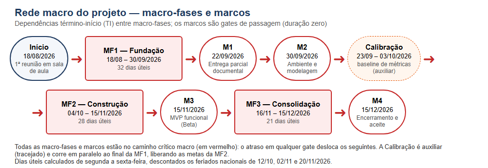
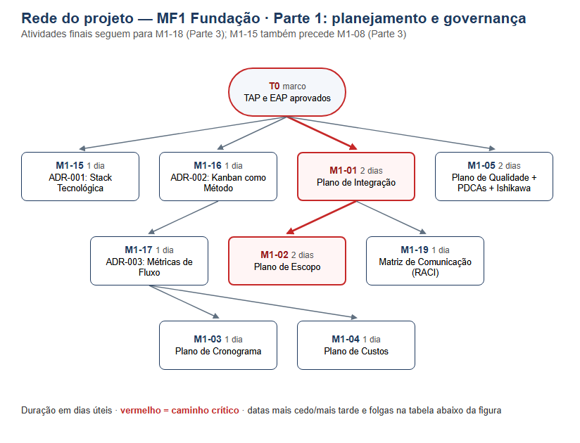
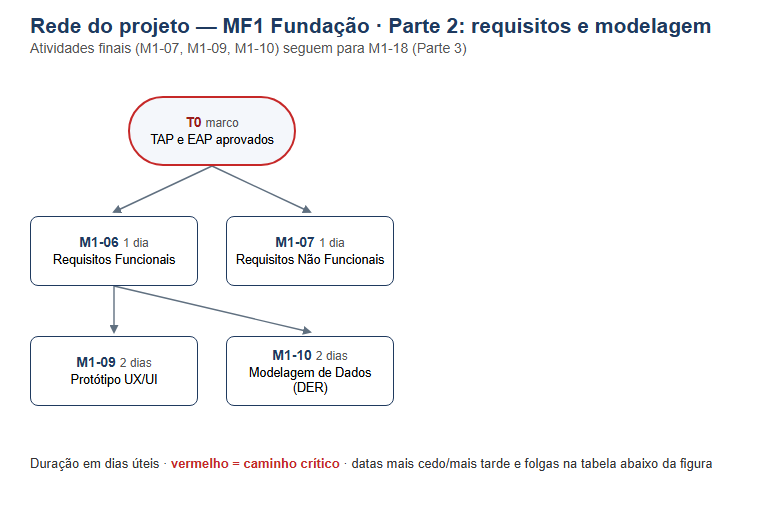
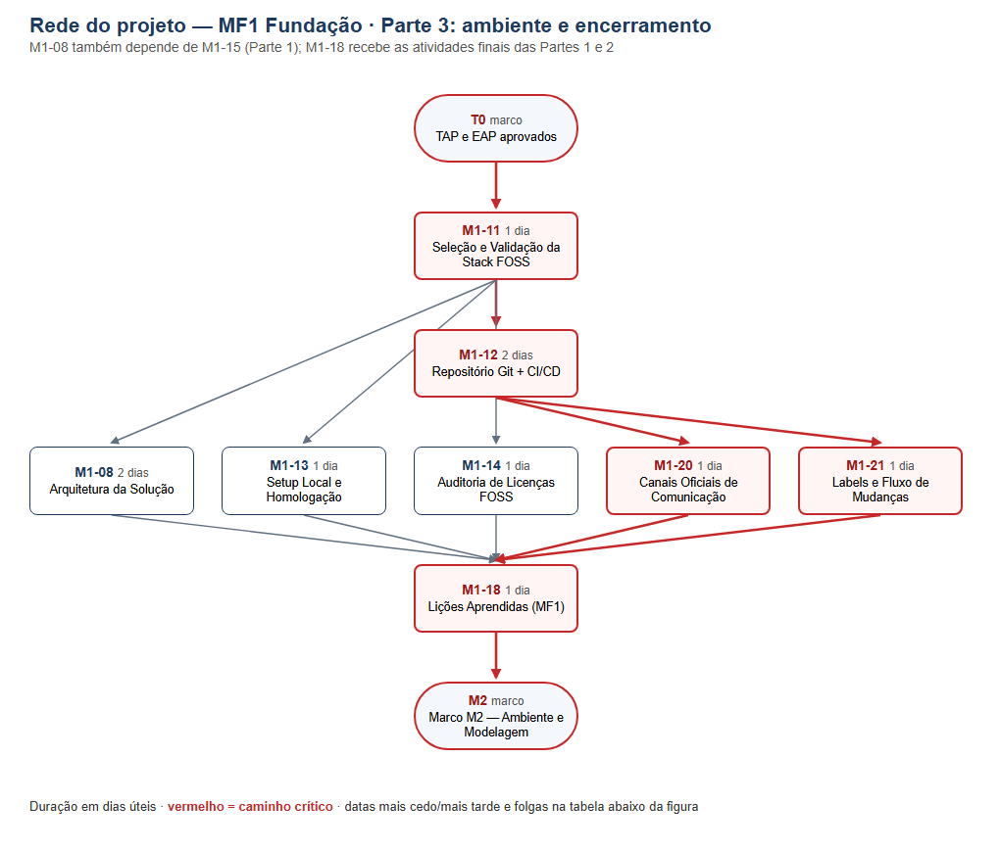
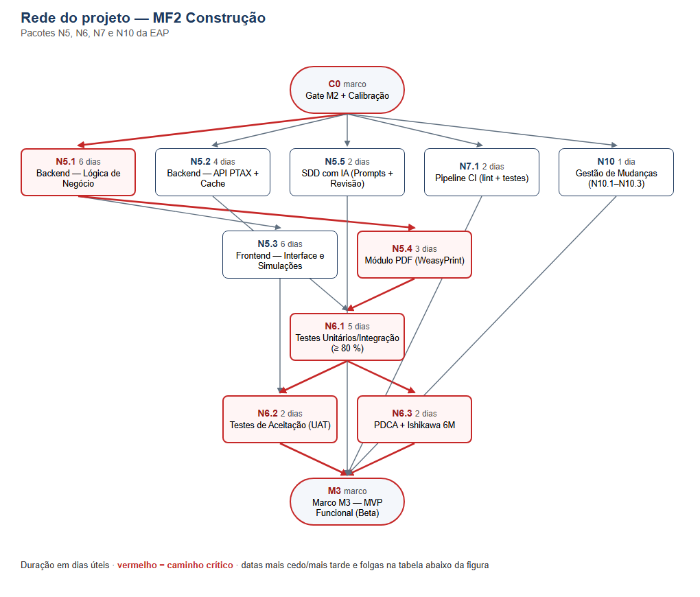
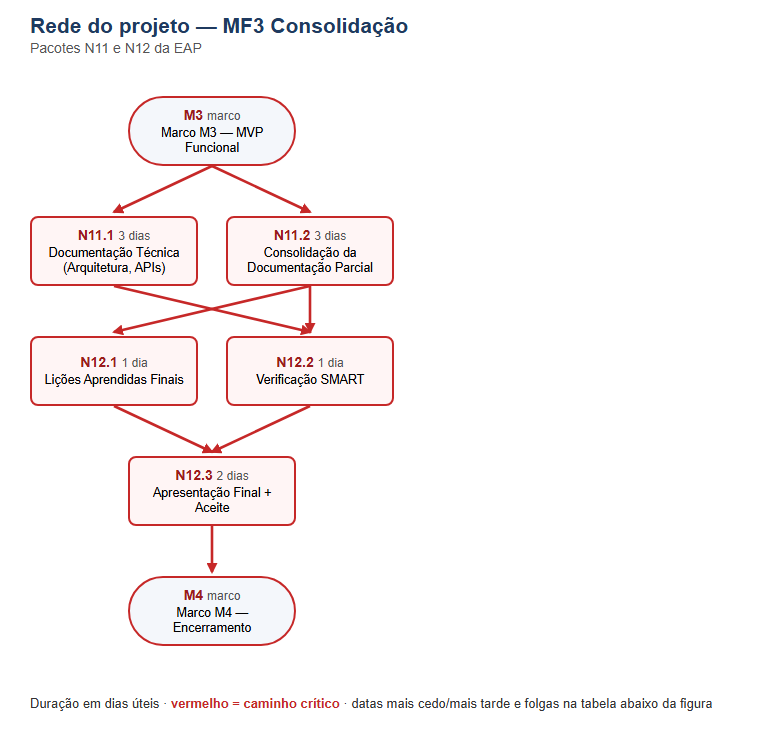

### Rede do Projeto (Diagrama de Precedências)

A rede do projeto representa a sequência lógica das atividades e permite calcular, pelo Método do Caminho Crítico (CPM), as datas mais cedo e mais tarde de cada atividade, as folgas e o caminho crítico. Pelo PMBOK® 6ª (dicionário), ela resulta do processo 6.3 (Sequenciar as Atividades) e alimenta o 6.5 (Desenvolver o Cronograma). No PMBOK® 7ª, apoia o Domínio de Planejamento e o Domínio de Medição. A rede é construída no nível dos **cards de marco** (MF1) e dos **pacotes de trabalho da EAP** (MF2 e MF3). Ela complementa, e não substitui, o sequenciamento operacional por fluxo descrito acima (ADR-003): serve para validar a viabilidade dos marcos e mostrar ao avaliador a lógica de precedências do projeto.

Para manter a legibilidade, a rede foi dividida em seis partes: (1) rede macro, com as macro-fases e os marcos; (2) MF1 — Parte 1, planejamento e governança; (3) MF1 — Parte 2, requisitos e modelagem; (4) MF1 — Parte 3, ambiente e encerramento da fase; (5) MF2 — Construção; e (6) MF3 — Consolidação. As ligações entre partes aparecem como conectores tracejados.

**Convenções adotadas:**

- Diagrama de precedências com atividade no nó (AON) e relações término-início (TI).
- Duração (D) em dias úteis = esforço estimado ÷ 4 h por dia (Premissa P5: até 20 h por semana por membro), arredondada para cima; marcos têm duração zero.
- MF1: atividades, esforço e predecessoras extraídos dos campos "Atribuição" e "Dependências" dos cards M1-01 a M1-21 no GitHub Projects. A dependência "TAP aprovado" é representada pelo marco inicial T0.
- MF2 e MF3: esforço estimado por julgamento de especialista, com base na classificação T-shirt do Plano de Cronograma. Os valores foram validados pela equipe em 25/10/2026 e servem de base para os cards de M3 e M4.
- ES/EF: início e término mais cedo; LS/LF: início e término mais tarde; Folga = LS − ES. Atividades com folga zero formam o caminho crítico e aparecem em vermelho e em negrito.

Figura R.0 — Rede macro do projeto: macro-fases e marcos.
Fonte: Elaborado pelos autores (2026).

#### MF1 — Fundação

Figura R.1 — Rede do projeto da MF1, Parte 1: planejamento e governança.
Fonte: Elaborado pelos autores (2026), com base nos cards do GitHub Projects.

| Atividade | Descrição | Responsável | Esforço (h) | D (dias úteis) | Predecessoras | ES | EF | LS | LF | Folga  Janela no GitHub Projects |
|---|---|---|---|---|---|---|---|---|---|---|
| **T0** | **TAP e EAP aprovados** | Equipe | — | 0 | — | 0 | 0 | 0 | 0 | 0 | 20/08–26/08 |
| M1-15 | ADR-001: Stack Tecnológica | Leonardo | 2 | 1 | T0 | 0 | 1 | 1 | 2 | 1 | 31/08–19/09 |
| M1-16 | ADR-002: Kanban como Método | Leonardo | 2 | 1 | T0 | 0 | 1 | 1 | 2 | 1 | 28/08–19/09 |
| M1-17 | ADR-003: Métricas de Fluxo | Leonardo | 2 | 1 | M1-16 | 1 | 2 | 2 | 3 | 1 | 01/09–21/09 |
| **M1-01** | **Plano de Integração** | Leonardo | 6 | 2 | T0 | 0 | 2 | 0 | 2 | 0 | 07/09–19/09 |
| **M1-02** | **Plano de Escopo** | Fabricio | 6 | 2 | T0, M1-01 | 2 | 4 | 2 | 4 | 0 | 16/09–19/09 |
| M1-03 | Plano de Cronograma | Fabricio | 4 | 1 | T0, M1-17 | 2 | 3 | 3 | 4 | 1 | 19/09–19/09 |
| M1-04 | Plano de Custos | Fabricio | 3 | 1 | T0, M1-17 | 2 | 3 | 3 | 4 | 1 | 19/09–19/09 |
| M1-05 | Plano de Qualidade + PDCAs + Ishikawa | Edson | 8 | 2 | T0 | 0 | 2 | 2 | 4 | 2 | 19/09–20/09 |
| M1-19 | Matriz de Comunicação (RACI) | Edson | 3 | 1 | M1-01 | 2 | 3 | 3 | 4 | 1 | 19/09–20/09 |

Fonte: Elaborado pelos autores (2026), com base nos cards do GitHub Projects.

Figura R.2 — Rede do projeto da MF1, Parte 2: requisitos e modelagem.
Fonte: Elaborado pelos autores (2026), com base nos cards do GitHub Projects.

| Atividade | Descrição | Responsável | Esforço (h) | D (dias úteis) | Predecessoras | ES | EF | LS | LF | Folga  Janela no GitHub Projects |
|---|---|---|---|---|---|---|---|---|---|---|
| M1-06 | Requisitos Funcionais | Fabricio | 4 | 1 | T0 | 0 | 1 | 1 | 2 | 1 | 31/08–19/09 |
| M1-07 | Requisitos Não Funcionais | Edson | 4 | 1 | T0 | 0 | 1 | 3 | 4 | 3 | 01/09–19/09 |
| M1-09 | Protótipo UX/UI | Edson | 8 | 2 | M1-06 | 1 | 3 | 2 | 4 | 1 | 18/09–30/09 |
| M1-10 | Modelagem de Dados (DER) | Edson | 8 | 2 | M1-06 | 1 | 3 | 2 | 4 | 1 | 18/09–30/09 |

Fonte: Elaborado pelos autores (2026), com base nos cards do GitHub Projects.

Figura R.3 — Rede do projeto da MF1, Parte 3: ambiente e encerramento da fase.
Fonte: Elaborado pelos autores (2026), com base nos cards do GitHub Projects.

| Atividade | Descrição | Responsável | Esforço (h) | D (dias úteis) | Predecessoras | ES | EF | LS | LF | Folga  Janela no GitHub Projects |
|---|---|---|---|---|---|---|---|---|---|---|
| **M1-11** | **Seleção e Validação da Stack FOSS** | Leonardo | 4 | 1 | T0 | 0 | 1 | 0 | 1 | 0 | 28/08–30/09 |
| M1-08 | Arquitetura da Solução | Leonardo | 6 | 2 | M1-15, M1-11 | 1 | 3 | 2 | 4 | 1 | 08/09–30/09 |
| **M1-12** | **Repositório Git + CI/CD** | Leonardo | 6 | 2 | M1-11 | 1 | 3 | 1 | 3 | 0 | 14/09–19/09 |
| M1-13 | Setup Local e Homologação | Fabricio | 4 | 1 | M1-11 | 1 | 2 | 3 | 4 | 2 | 19/09–21/09 |
| M1-14 | Auditoria de Licenças FOSS | Edson | 3 | 1 | M1-11 | 1 | 2 | 3 | 4 | 2 | 18/09–30/09 |
| **M1-20** | **Canais Oficiais de Comunicação** | Leonardo | 2 | 1 | M1-12 | 3 | 4 | 3 | 4 | 0 | 18/08–19/09 |
| **M1-21** | **Labels e Fluxo de Mudanças** | Leonardo | 2 | 1 | M1-12 | 3 | 4 | 3 | 4 | 0 | 19/09–19/09 |
| **M1-18** | **Lições Aprendidas (MF1)** | Leonardo | 2 | 1 | M1-02, M1-03, M1-04, M1-05, M1-19, M1-07, M1-09, M1-10, M1-08, M1-13, M1-14, M1-20, M1-21 | 4 | 5 | 4 | 5 | 0 | 18/09–30/09 |
| **M2** | **Marco M2 — Ambiente e Modelagem** | — | — | 0 | M1-18 | 5 | 5 | 5 | 5 | 0 | 30/09 |

Fonte: Elaborado pelos autores (2026), com base nos cards do GitHub Projects.

A rede da MF1 tem duração lógica mínima de **5 dias úteis**, com 3 caminhos críticos de mesma duração: T0 → M1-01 → M1-02 → M1-18 → M2; T0 → M1-11 → M1-12 → M1-20 → M1-18 → M2; T0 → M1-11 → M1-12 → M1-21 → M1-18 → M2. A janela real da MF1, porém, foi de 32 dias úteis (18/08 a 30/09/2026). A diferença mostra que a duração da fase foi determinada pela **disponibilidade da equipe** (curso noturno, outras disciplinas), e não pela lógica de precedências. Essa conclusão é coerente com o atraso registrado na questão Q-04 e com a opção do projeto pelo controle por fluxo (ADR-003).

#### MF2 — Construção

Figura R.4 — Rede do projeto da MF2 (Construção).
Fonte: Elaborado pelos autores (2026).

| Atividade | Descrição | Responsável | Esforço (h) | D (dias úteis) | Predecessoras | ES | EF | LS | LF | Folga |
|---|---|---|---|---|---|---|---|---|---|---|
| **C0** | **Gate M2 + Calibração** | — | — | 0 | — | 0 | 0 | 0 | 0 | 0 |
| **N5.1** | **Backend — Lógica de Negócio** | Fabricio | 24 | 6 | C0 | 0 | 6 | 0 | 6 | 0 |
| N5.2 | Backend — API PTAX + Cache | Fabricio | 16 | 4 | C0 | 0 | 4 | 5 | 9 | 5 |
| N5.3 | Frontend — Interface e Simulações | Leonardo | 24 | 6 | N5.1 | 6 | 12 | 8 | 14 | 2 |
| **N5.4** | **Módulo PDF (WeasyPrint)** | Fabricio | 12 | 3 | N5.1 | 6 | 9 | 6 | 9 | 0 |
| N5.5 | SDD com IA (Prompts + Revisão) | Leonardo | 8 | 2 | C0 | 0 | 2 | 14 | 16 | 14 |
| N7.1 | Pipeline CI (lint + testes) | Leonardo | 6 | 2 | C0 | 0 | 2 | 14 | 16 | 14 |
| N10 | Gestão de Mudanças (N10.1–N10.3) | Leonardo | 4 | 1 | C0 | 0 | 1 | 15 | 16 | 15 |
| **N6.1** | **Testes Unitários/Integração (≥ 80 %)** | Edson | 20 | 5 | N5.1, N5.2, N5.4 | 9 | 14 | 9 | 14 | 0 |
| **N6.2** | **Testes de Aceitação (UAT)** | Edson | 8 | 2 | N5.3, N6.1 | 14 | 16 | 14 | 16 | 0 |
| **N6.3** | **PDCA + Ishikawa 6M** | Edson | 6 | 2 | N6.1 | 14 | 16 | 14 | 16 | 0 |
| **M3** | **Marco M3 — MVP Funcional (Beta)** | — | — | 0 | N6.2, N6.3, N7.1, N5.5, N10 | 16 | 16 | 16 | 16 | 0 |

Fonte: Elaborado pelos autores (2026).

A MF2 tem duração lógica de **16 dias úteis**, com os caminhos críticos C0 → N5.1 → N5.4 → N6.1 → N6.2 → M3; C0 → N5.1 → N5.4 → N6.1 → N6.3 → M3. O CPM não considera a limitação de recursos: N5.1, N5.2 e N5.4 têm o mesmo responsável (Fabricio de Lima Cabral) e, executados em sequência, somam 13 dias úteis. Com esse **nivelamento de recursos**, a duração da MF2 passa a 20 dias úteis. De 26/10 a 13/11/2026 restam 14 dias úteis até o marco M3. Se os pacotes de backend ainda não estiverem concluídos, a folga do marco é negativa. Esse resultado reforça as questões Q-02 e Q-05 do Plano de Riscos e recomenda priorizar N5.1 e N5.4, além de redistribuir o N5.2 ou antecipar os testes (N6.1) de forma incremental.

#### MF3 — Consolidação

Figura R.5 — Rede do projeto da MF3 (Consolidação).
Fonte: Elaborado pelos autores (2026).

| Atividade | Descrição | Responsável | Esforço (h) | D (dias úteis) | Predecessoras | ES | EF | LS | LF | Folga |
|---|---|---|---|---|---|---|---|---|---|---|
| **M3** | **Marco M3 — MVP Funcional** | — | — | 0 | — | 0 | 0 | 0 | 0 | 0 |
| **N11.1** | **Documentação Técnica (Arquitetura, APIs)** | Fabricio e Edson | 12 | 3 | M3 | 0 | 3 | 0 | 3 | 0 |
| **N11.2** | **Consolidação da Documentação Parcial** | Fabricio e Edson | 12 | 3 | M3 | 0 | 3 | 0 | 3 | 0 |
| **N12.1** | **Lições Aprendidas Finais** | Equipe | 4 | 1 | N11.2 | 3 | 4 | 3 | 4 | 0 |
| **N12.2** | **Verificação SMART** | Equipe | 4 | 1 | N11.1, N11.2 | 3 | 4 | 3 | 4 | 0 |
| **N12.3** | **Apresentação Final + Aceite** | Equipe | 8 | 2 | N12.1, N12.2 | 4 | 6 | 4 | 6 | 0 |
| **M4** | **Marco M4 — Encerramento** | — | — | 0 | N12.3 | 6 | 6 | 6 | 6 | 0 |

Fonte: Elaborado pelos autores (2026).

A MF3 tem duração lógica de **6 dias úteis**, com os caminhos críticos M3 → N11.1 → N12.2 → N12.3 → M4; M3 → N11.2 → N12.1 → N12.3 → M4; M3 → N11.2 → N12.2 → N12.3 → M4, bem abaixo dos 21 dias úteis da janela de 16/11 a 15/12/2026. A folga disponível absorve eventuais atrasos herdados da MF2.

| Parte da rede | Caminho(s) crítico(s) | Duração lógica (dias úteis) | Janela disponível (dias úteis) |
|---|---|---|---|
| MF1 — Fundação | T0 → M1-01 → M1-02 → M1-18 → M2; T0 → M1-11 → M1-12 → M1-20 → M1-18 → M2; T0 → M1-11 → M1-12 → M1-21 → M1-18 → M2 | 5 | 32 (18/08–30/09) |
| MF2 — Construção | C0 → N5.1 → N5.4 → N6.1 → N6.2 → M3; C0 → N5.1 → N5.4 → N6.1 → N6.3 → M3 | 16 (com nivelamento: 20) | 28 (04/10–13/11); restantes em 26/10: 14 |
| MF3 — Consolidação | M3 → N11.1 → N12.2 → N12.3 → M4; M3 → N11.2 → N12.1 → N12.3 → M4; M3 → N11.2 → N12.2 → N12.3 → M4 | 6 | 21 (16/11–15/12) |

Fonte: Elaborado pelos autores (2026).
